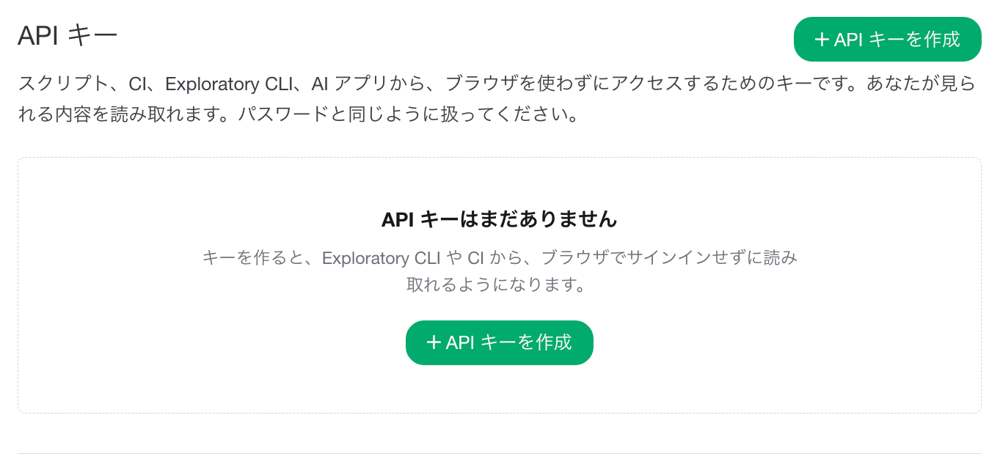
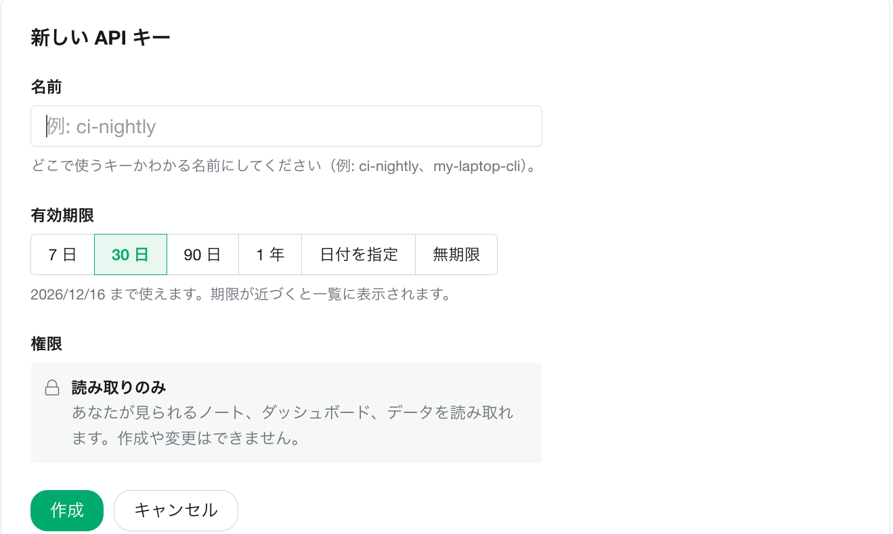

API キーを作り、expl に渡し、安全に扱います。CI、スクリプトなど、ブラウザのない場所で使います。

<a id="what"></a>

## API キーとは

API キーは、プログラムが、あなたとして Exploratory を読むための文字列です。パスワードの代わりに使います。CI（変更のたびに自動で処理を流す仕組み）では、人がブラウザでサインインできないので、API キーを渡します。キーは exp_pat_ で始まります。

キーで読めるのは、ブラウザでのサインインと同じ、あなたが見られる内容です（読み取りのみ）。作成や変更はできません。キーを作れるのは Author だけです。

このページのコマンドは token（expl server token）という名前ですが、扱うものは API キーです。

<a id="create"></a>

## API キーを作る

### 1. API キーを開く

exploratory.io の右上のアイコンから「アカウント設定」を開き（https://exploratory.io/account/settings ）、「API キー」の節に進みます。



### 2. 作成する

「API キーを作成」を選びます。どこで使うキーか分かる名前（例: ci-nightly）を入力します。名前は 100 文字以内で、ほかのキーと重ならないようにします。

### 3. 有効期限を選ぶ

7 日、30 日、90 日、1 年、日付の指定、無期限から選びます。既定は 30 日です。管理者が、これより短い上限を決めていることがあります。選んだら、「作成」を選びます。



### 4. キーをコピーする

キーが表示されるのは、このときだけです。コピーして、パスワード管理ツールや CI のシークレットに保管します。

> キーは、名前、有効期限、最終使用とともに一覧に並びます。値は二度と表示されません。

| 項目 | 内容 |
| --- | --- |
| 1 人あたりの有効なキー | 20 個まで |
| 作れる人 | Author |
| 権限 | 読み取りのみ |

キーをなくしたときは、「再生成」で新しい値を発行します。古い値はすぐに使えなくなります。キーを変更する前に、サインアウトして、もう一度サインインするよう表示されたときは、そのとおりにしてから、やり直します。

<a id="pass"></a>

## キーを expl に渡す

`expl server login --with-token` でキーを保存するか、環境変数 EXPL_SERVER_TOKEN に設定します。環境変数が先に使われます。選ばれる順と切り替え方は、[サインイン](/ja/cli/server/login#apikey)にあります。`--token` は削除されました。指定すると、終了コード 2 で終わります。

GitHub Actions での使い方は、[自動処理](/ja/cli/server/guides/automation)を参照してください。

<a id="cli"></a>

## ターミナルで作る・一覧する・取り消す

これらのコマンドは、ブラウザでサインイン（expl server login）したときだけ使えます。API キーでは、expl server token create は「Log in with "expl server login" to create tokens.」というエラーで失敗します。

```sh
expl server token create --name ci
```

`--name` は必須です。ターミナルから作るときの名前には、英数字と「.」「_」「-」を使え、1〜64 文字です。`--expires <days>` で、キーが使える日数を 1〜365 の範囲で指定できます。この方法で作ったものも API キーで、アカウント設定 \> API キーに並びます。キーが表示されるのは 1 回だけなので、すぐに保管します。

**実行結果**

```text
exp_pat_...
Token name: ci
Expires: 2026-12-13T09:00:00.000Z
Save this token; it will not be shown again.
Set EXPL_SERVER_TOKEN for CI.
```

```sh
expl server token list
```

キーの一覧を表示します。キーの値は表示されません。キーがないときは「No tokens.」と表示されます。

**実行結果**

```text
NAME  CREATED_AT                LAST_USED_AT              EXPIRES_AT
ci    2026-11-13T09:00:00.000Z  2026-11-13T09:05:00.000Z  2026-12-13T09:00:00.000Z
```

```sh
expl server token revoke ci
```

ci は、作るときに付けた名前です。

**実行結果**

```text
Revoked ci.
```

<a id="safe"></a>

## キーを安全に扱う

- キーをコマンドラインやスクリプトに書かないでください。シェルの履歴に残り、プロセスの一覧からも見えます。`expl server login --with-token`（キーを表示せずに聞きます）か、環境変数を使います。
- CI では、キーをシークレットとして渡し、ログに出さないようにします。[自動処理](/ja/cli/server/guides/automation#token)を参照してください。
- キーには有効期限があります。期限の 7 日前と 1 日前に、メールが届きます。ジョブが止まらないよう、それまでに新しいキーを作ってください。
- キーが作成・再生成・取り消しされたときも、メールが届きます。心当たりがないときは、キーを取り消して、パスワードを変更してください。

<a id="revoke"></a>

## キーを取り消す

キーが漏れたときや、使わなくなったときは、取り消します。アカウント設定 \> API キーで「取り消し」を選ぶか、ブラウザでサインインしたあとに expl server token revoke \<name\> を実行します。このコマンドは、確認なしで、`--yes` がなくても取り消しを送ります。キーはすぐに使えなくなります。

取り消した、期限切れの、または間違ったキーでの呼び出しは、終了コード 4 で終了し、「The API key is invalid or expired. Create a new one in Account Settings \> API Keys. (UNAUTHORIZED)」と表示します。

<a id="admin"></a>

## 管理者が決められること

オンプレミス環境と Hosted 環境では、管理者が管理画面で次のことを決められます。

- API キーをオフにする。すべてのキーがすぐに使えなくなり、設定をオンに戻すと、また使えます。メッセージは「API keys are disabled by your administrator.」です。
- キーの最長有効期間を決める。それより長い有効期間のキーは使えなくなります。
- キーを使える IP アドレスを限定する。メッセージは「This IP address is not allowed for API keys.」です。
- 全ユーザーのキーを確認・取り消す。持ち主にメールが届きます。

<a id="records"></a>

## 記録されるもの

API キーは、ハッシュで保存され、作成日時、有効期限、最終使用日時が記録されます。そのほかの記録は、MCP Server の[データと権限](/ja/mcp/server/data)のページにまとめています。
