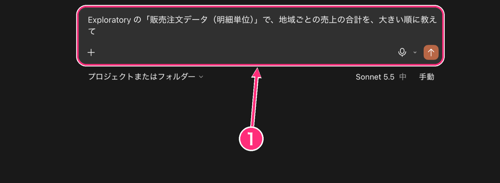
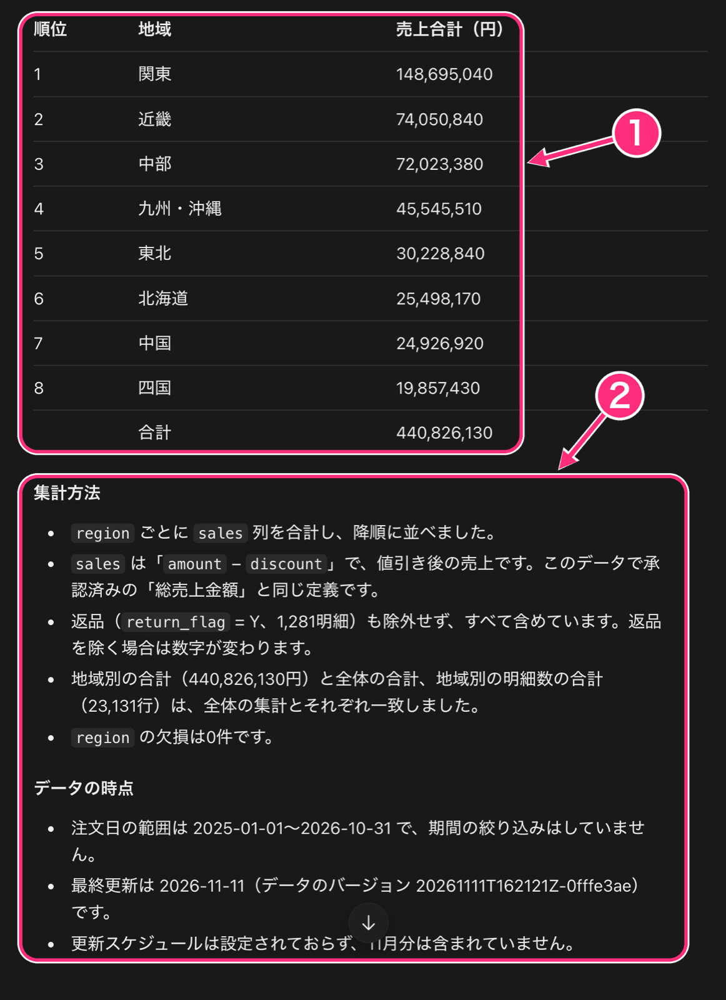
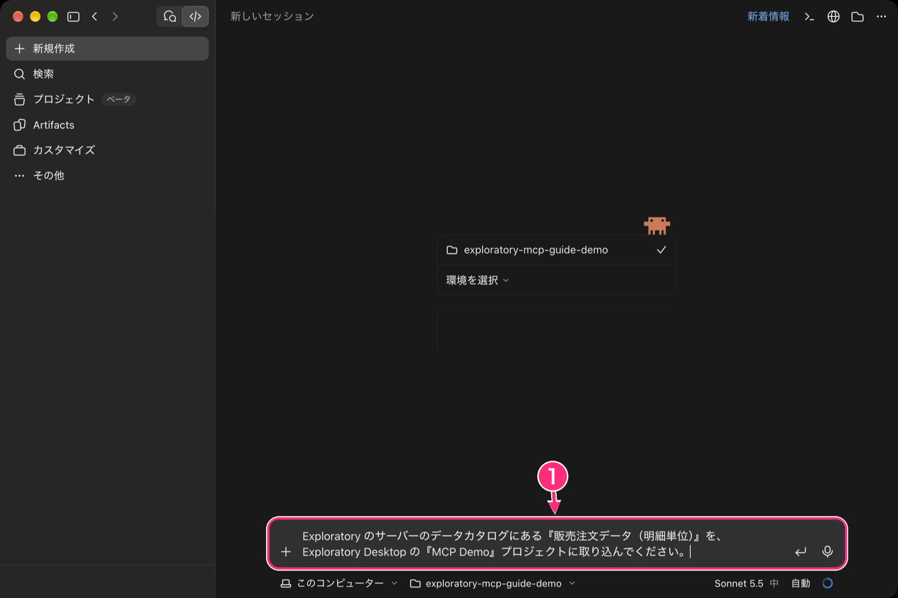
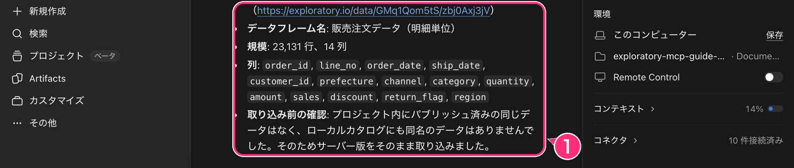
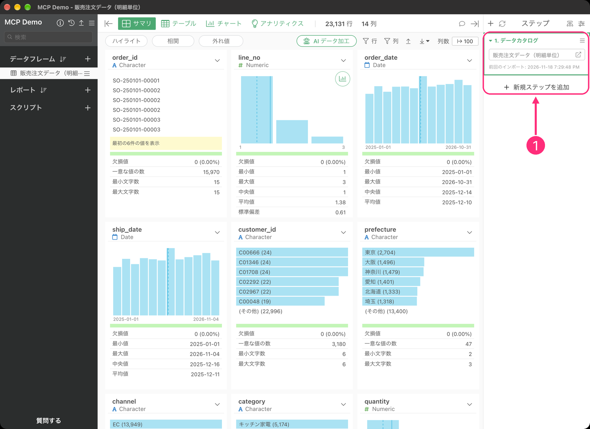
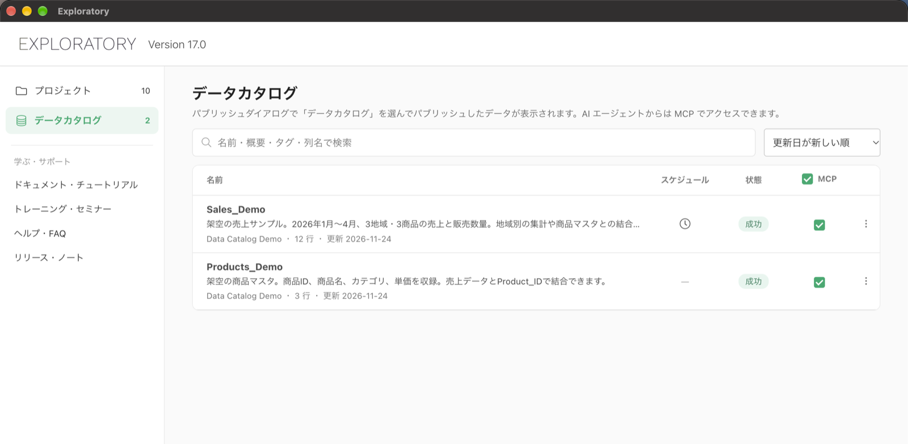

MCP は、Claude などの AI が Exploratory のデータを読み取るための接続方式です。パブリッシュしたデータは、AI エージェントから質問したり、Desktop に取り込ませたりできます。

## サーバー MCP から質問する

1. 一覧の「MCP アクセス」の列が「有効」になっていることを確かめます。止まっているときは、[サーバーの画面で活用する](/ja/data-catalog/server-ui)の「アクセスを設定する」で有効にします
2. 使う AI ツールに、サーバーの MCP をつなぎます。つなぎ方は、[クライアント別の手順](/ja/mcp/server/clients/apps)をご覧ください
3. パブリッシュしたときのタイトルを指定して、質問します。次の例の「販売注文データ（明細単位）」は、自分のデータのタイトルに置き換えてください

```text
Exploratory の「販売注文データ（明細単位）」で、地域ごとの売上の合計を、大きい順に教えて。集計方法も添えて
```



4. 回答の表で、地域ごとの売上の合計を確かめます。画像の ❶ が回答の表、❷ が集計方法とデータの時点の説明です。AI は、承認した定義を読んでから集計します



サーバー MCP の道具は、次のように使われます。

- `dataframe_get_schema` は、詳細（`full`）で取得すると、承認された定義を返します。データの変更などで「要再確認」になった定義には、警告が付きます。AI はこの定義を、集計の前に読みます
- `query_dataset` は、データをサーバーで絞り込み、集計します。オンプレミスのサーバーでは、管理者が有効にしたときだけ使えます

## 必要な集計結果だけを AI に渡す

`query_dataset` で集計を頼むと、サーバーが DuckDB（サーバーの中でデータを集計する仕組み）で、絞り込み、グループ化、集計、結合を計算します。AI エージェントは、データの行を何ページも読まなくても、集計した結果を受け取れます。元の行を取得する指定や、ほかの読み取りの道具では、返った行も会話の一部になります。くわしくは、[Server MCP のデータと権限](/ja/mcp/server/data)をご覧ください。

速さについては、開発時のテストで、数百万から数千万行のデータでも、1 秒以内に取得できました。実際の速さは、AI エージェントからサーバーまでのネットワークの速さに左右されます。

## Desktop MCP で、サーバーのデータを Desktop に取り込む

Desktop MCP をつないだ AI（Claude Code など）に頼んで、サーバーのデータカタログのデータを、Desktop のプロジェクトに取り込めます。この方法は、Exploratory Desktop 17.0 以降で使えます。

1. 取り込み先の Desktop に、サインインしておきます
2. 使う AI ツールに、Desktop MCP をつなぎます。つなぎ方は、[Desktop MCP の始め方](/ja/mcp/desktop/get-started)をご覧ください
3. データのタイトルと、取り込み先のプロジェクトの名前を書いて、頼みます。次の例の「販売注文データ（明細単位）」と「MCP Demo」は、自分のものに置き換えてください。データのページの URL を渡して頼むこともできます

```text
Exploratory のサーバーのデータカタログにある「販売注文データ（明細単位）」を、Exploratory Desktop の「MCP Demo」プロジェクトに取り込んでください。
```



4. AI が、取り込み先のプロジェクトを聞いてくることがあります。そのときは「MCP Demo に取り込んで」のように答えます。AI が、取り込んだ結果を説明します



5. Desktop に戻って、指定したプロジェクトを開き、データフレームができていることを確かめます。右のステップの欄に、「データカタログ」のステップとして加わります



画面から、フィルターや結合をしながら取り込む方法は、[データカタログからインポートする（Desktop）](/ja/data-catalog/import)をご覧ください。

## ローカルのデータカタログを AI から使う

Desktop MCP をつないだ AI（Claude など）から、ローカルのデータカタログを検索して、データを読んだり、絞り込み、集計、結合をしたりできます。ローカルのデータカタログは、サーバーにデータを上げなくても使えます。

- 一覧の「MCP」の列にチェックを入れたデータだけが、AI エージェントから見えます。チェックを外すと見えなくなります
- ローカルのデータにも、セマンティック情報を付けられます。AI は、承認した定義を使って集計します。くわしくは、[セマンティック情報](/ja/data-catalog/semantics)をご覧ください
- データへのアクセスは、詳細画面の「アクセスログ」タブで確認できます



使える道具と、確認が入る場面は、次のページにあります。

- [Desktop MCP の道具の一覧](/ja/mcp/desktop/tools)
- [データと権限](/ja/mcp/desktop/data)
- [許可の範囲と設定](/ja/mcp/desktop/permissions)
- [Server MCP の道具](/ja/mcp/server/tools)
- [Server MCP のデータと権限](/ja/mcp/server/data)
