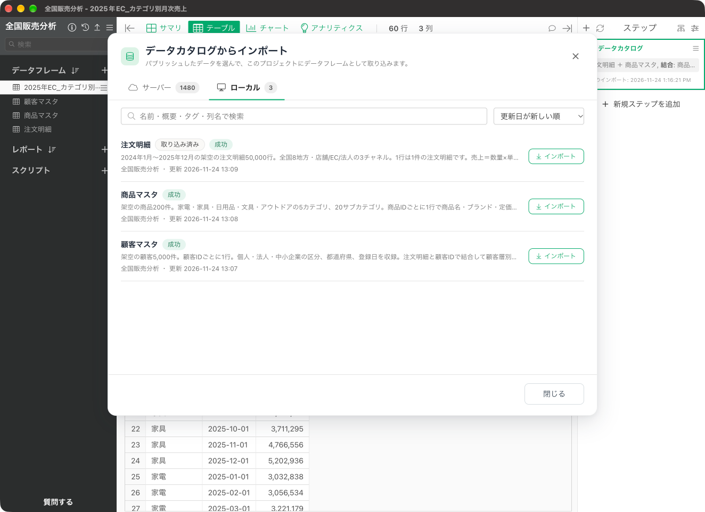
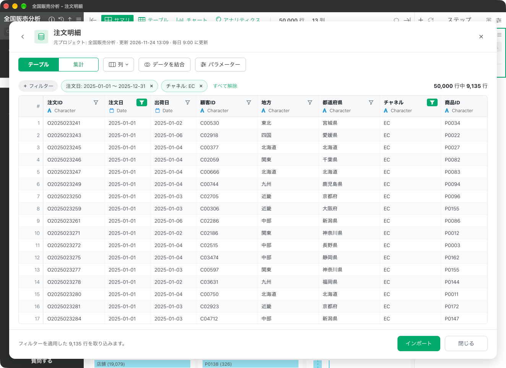
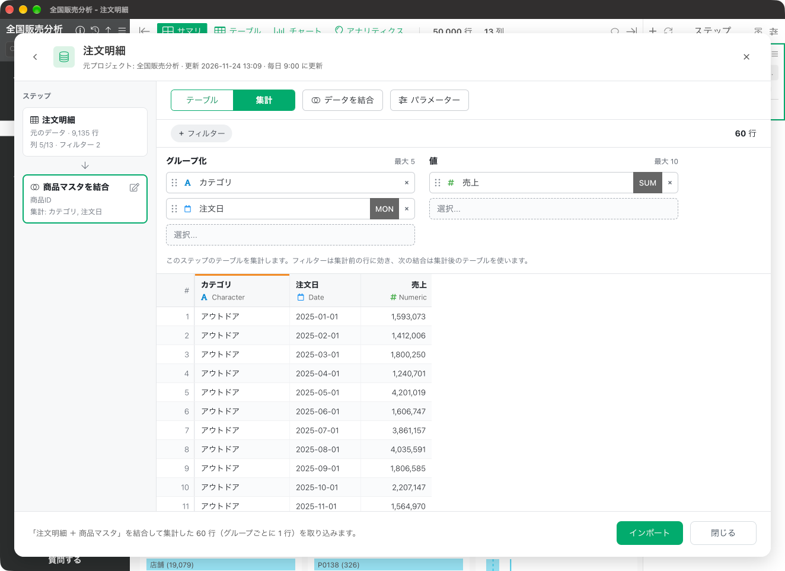
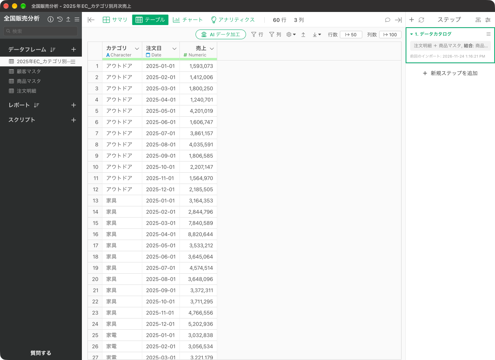

「データカタログからインポート」ダイアログでは、パブリッシュしたデータを、そのまま取り込むだけでなく、取り込む前に絞り込んだり、ほかのデータと結合したり、集計したりできます。サーバーのデータも、ローカルのデータも、同じ画面で扱えます。

## ダイアログを開く

1. 取り込み先のプロジェクトを開きます
2. データのインポートのメニューで、「データ・カタログ」を選びます
3. 「データカタログからインポート」ダイアログの上にある「サーバー」と「ローカル」のタブで、取り込むデータのある場所を選びます

「サーバー」は Exploratory サーバーのデータカタログ、「ローカル」はこの PC のデータカタログです。「ローカル」のタブには、データの件数が表示されます。最後に開いたタブは、次にダイアログを開いたときも使われます。画像は、「ローカル」のタブに「注文明細」「商品マスタ」「顧客マスタ」の 3 件が並んだところです。すでに取り込んだ「注文明細」には、「取り込み済み」と出ています。

すでにあるデータフレームの元のデータを、カタログのデータに入れ替えるときは、そのデータフレームのデータソースを差し替えます。このときのダイアログの名前は「データソースをデータカタログに差し替え」で、インポートのボタンが「差し替え」になります。

## 検索して、データを選ぶ

- **サーバー**: 検索欄で、名前、説明、タグ、作成者を検索できます。並べ替えは、既定で「関連度が高い順」です。「自分のデータ」「チームのデータ」「共有されたデータ」に分けて探せます
- **ローカル**: 検索欄で、名前、概要、タグ、列名を検索できます。一致したタグや列名が、データ名の下に表示されます。更新日や名前で並べ替えられます。すでに取り込んだデータには、「取り込み済み」と表示されます

データ名をクリックすると、そのデータの中身を見るダイアログに替わります。左上の「‹」を押すと、一覧に戻れます。

ローカルの次のデータは、インポートできません。理由は、ダイアログの表示で分かります。

- 全データが保存されていないデータ: 元のプロジェクトで、もう一度パブリッシュします
- 最後の更新に失敗しているデータ: 原因を直して、もう一度更新します

## 中身を確かめる

データを選ぶと、中身を確かめる画面に替わり、「テーブル」にデータの中身が表示されます。上の「テーブル」「集計」で、表示を切り替えられます。下に、取り込む行数の説明が出ます。たとえば、「{N} 行のデータをインポートします。」です。フィルターや列の選択、結合、集計を設定すると、この説明も変わります。

## フィルターで行を絞る

1. テーブルの上の「フィルター」を押します
2. 「フィルターを追加」で、「列を選択...」から列を選び、条件を決めます
3. 追加したフィルターは、テーブルの上に並びます。「すべて解除」で、フィルターをまとめて外せます

絞り込んだ行だけが、取り込まれます。下の説明は、「フィルターを適用した {N} 行を取り込みます。」になります。

次の画像は、「注文日: 2025-01-01 〜 2025-12-31」と「チャネル: EC」の 2 つのフィルターで、50,000 行を 9,135 行に絞った例です。

次のフィルターは、取り込みに使えません。そのときは、フィルターを外すか、取り込んだあとのステップで絞り込みます。

- 列「{列名}」へのフィルターのうち、時間の長さの列へのフィルターや、文字の大小の比較
- プロジェクトにないパラメーターを使っているフィルター（パラメーターを作るか、フィルターを変えます）

## 列を選ぶ

1. テーブルの上の「列」を押します。選ぶと、「列 {表示している数}/{全体の数}」の表示に変わります
2. 取り込む列にチェックを入れます。検索欄で列名を絞れます。「すべて選択」「すべて解除」も使えます

画像は、13 列のうち 5 列を選んだ状態です。検索欄に「売上」と入力して、「売上」の列を選んでいます。

選んだ列だけが、取り込まれます。下の説明は、「全データの {N} 行・{全体の数} 列中 {選んだ数} 列を取り込みます。」になります。フィルターも設定しているときは、「フィルターを適用した {N} 行・{全体の数} 列中 {選んだ数} 列を取り込みます。」になります。少なくとも 1 列は、選んだままにします。結合のキーに使っている列は、外せません。

## ほかのカタログのデータを結合する

結合は、取り込むデータに、データカタログにあるほかのデータの列を、キーでつなげる機能です。

1. テーブルの上の「データを結合」を押します
2. 「『{データ名}』にデータを結合」のダイアログで、「結合するデータ」を選びます。「データカタログを検索」で探せます。「共通の列があるデータ」が上に出ます
3. 「紐づけるキー」で、両方のデータの列を選びます。「キーを追加」で、キーを増やせます。キーの型が違うときは、文字列として比べるという説明が出ます
4. 「一致しない行」で、残し方を選びます。「{データ名}の行はすべて残す」（Left Join）は、相手が見つからない行も残し、結合した列は空になります。「両方にある行だけ残す」（Inner Join）は、両方のデータにキーが見つかった行だけを残します
5. 「結合する『{データ名}』データ」では、結合する前に、結合するデータの列、フィルター、集計を決められます
6. 画面の下に、一致率と結合後の行数が出ます。たとえば、「{データ名}の {N}%（{件数} 行）に {相手のデータ名} が見つかりました · 結合後 {行数} 行」です

次の画像は、「注文明細」に「商品マスタ」を、商品ID をキーに結合する画面です。画面の ①②③ は、手順 3・4・5 に当たります。一致率は 100%（9,135 行）で、結合後も 9,135 行です。

内容を確かめて、「結合」を押します。

結合したあとは、画面の左に「ステップ」が出て、元のデータ（注文明細）と「商品マスタを結合」が並びます。「商品マスタを結合」の鉛筆のアイコンで、結合の設定を直せます。

一致する行が少ないときや、キーに重複があって行が増えるときは、画面に注意が出ます。行が増えるときは、先に結合するデータを、キーごとに集計してから結合すると、行数は増えません。

結合して取り込むと、下の説明は、「『{データ名}』を結合した {N} 行を取り込みます。」になります。結合するデータも、全データが保存されている必要があります。

## 集計して取り込む

集計は、グループごとに 1 行にまとめてから、取り込む機能です。

1. テーブルの上の「テーブル」「集計」の切り替えで、「集計」を選びます
2. 「グループ化」に、まとめる単位の列を入れます。日付や日時の列は、時間の単位（日、週、月、四半期、年）を選べます
3. 「値」に、集計する列を入れ、集計関数を選びます。カウント、合計値（SUM）、平均値（MEAN）、中央値（MEDIAN）、最小値（MIN）、最大値（MAX）、一意な値の数（UNIQUE）、標準偏差（SD）があります

集計は、フィルターで絞った行が対象です。下の説明は、「集計した {N} 行（グループごとに 1 行）をインポートします。合計・小計の行は含まれません。」になります。結合したデータを集計するときは、「『{元のデータ名} + {結合したデータ名}』を結合して集計した {N} 行（グループごとに 1 行）を取り込みます。」になります。

次の画像は、結合したデータを、「カテゴリ」と「注文日（月単位）」でグループ化し、「売上」の合計（SUM）を求めた例です。60 行になります。

「列」に列を入れた集計（ピボットテーブル）は、インポートできません。そのときは、「列」から列を外します。

## インポートする

1. 設定を確かめて、「インポート」を押します
2. データフレームの名前を決めて、「OK」を押します

取り込んだデータは、プロジェクトにデータフレームとして加わります。右のステップの欄に、「データカタログ」のステップとして表示されます。画像は、60 行・3 列（カテゴリ、注文日、売上）のデータフレームができた例です。

## インポートしたあとに更新する

取り込んだデータフレームで、データカタログのステップを開き、「更新」を押すと、同じフィルター、列、結合、集計のまま、最新のデータを読み直します。ダイアログの下の説明には、「データフレーム『{名前}』のソースのフィルターです。『更新』で、このフィルターのまま最新のデータを読み直します。」のように、読み直す内容が出ます。

Desktop MCP をつないだ AI に頼んで取り込む方法は、[AI で活用する](/ja/data-catalog/ai)をご覧ください。
