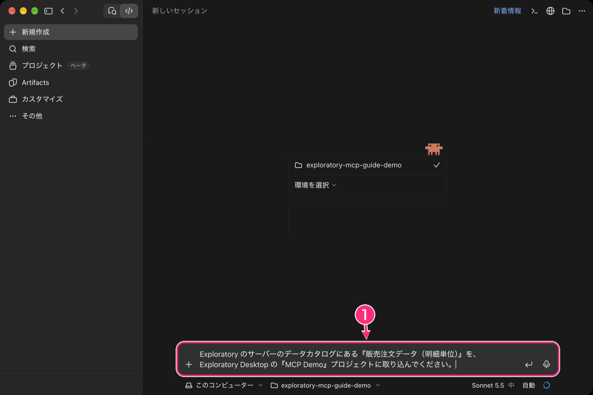
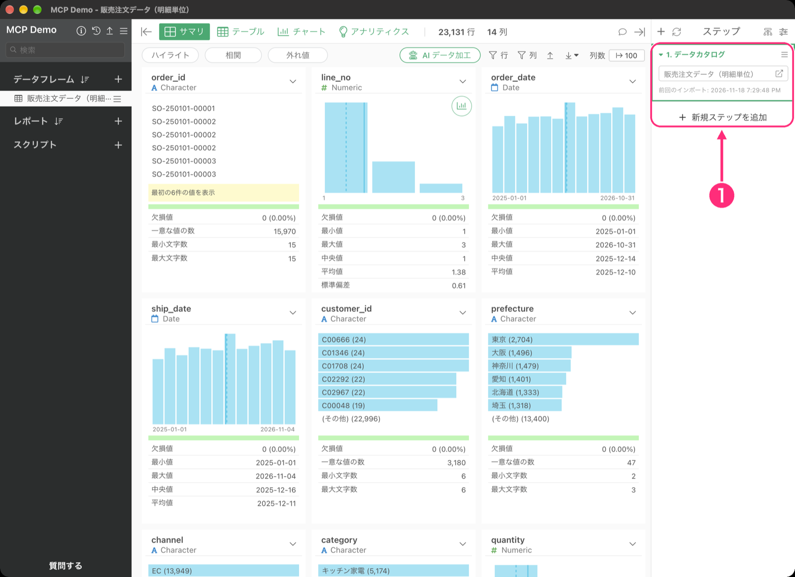

1. データのインポートのメニューで、「データ・カタログ」を選びます
2. 「データカタログからインポート」ダイアログの上のほうで、「サーバー」か「ローカル」を選びます
3. 検索して、インポートしたいデータを選びます
4. 必要に応じて、フィルター、列の選択、ほかのカタログのデータとの結合、集計を設定します
5. 「インポート」を押します

ローカルのタブでは、すでに取り込んだデータに「取り込み済み」と表示されます。全データが保存されていないデータは、インポートできません。元のプロジェクトで、もう一度パブリッシュしてください。

選んだデータは、このプロジェクトにデータフレームとして取り込まれます。取り込んだあとに「更新」を押すと、同じ条件で最新のデータを読み直します。すでにあるデータフレームのデータソースを、カタログのデータに差し替えることもできます。

Desktop MCP をつないだ AI（Claude Code など）に頼んで、サーバーのデータカタログのデータを、Desktop のプロジェクトに取り込むこともできます。この方法は、Exploratory Desktop 17.0 以降で使えます。取り込み先の Desktop には、サインインしておきます。

