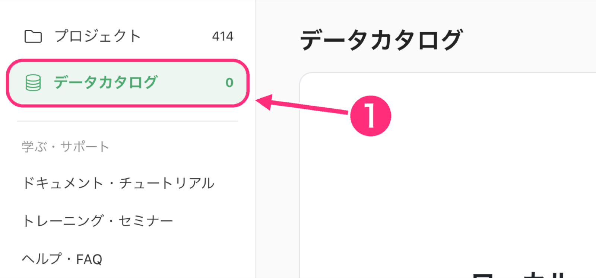
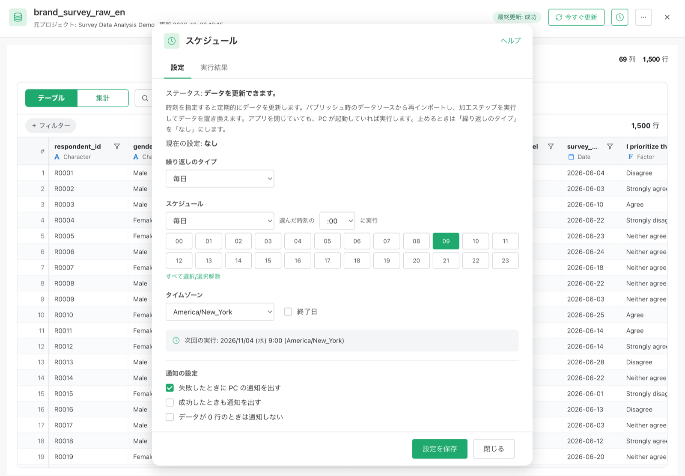
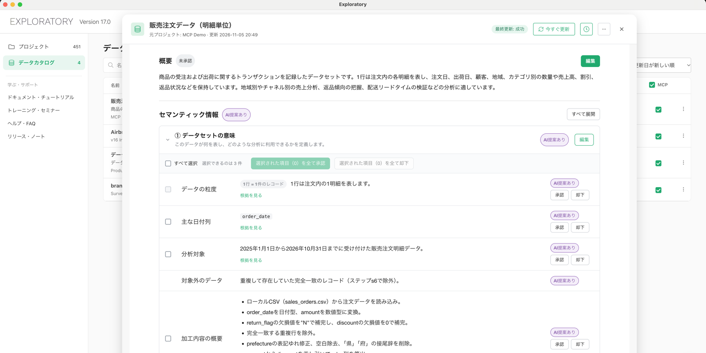

## 一覧から探す

プロジェクトの一覧が表示されるウィンドウの「データカタログ」タブに、この PC のローカルデータカタログが一覧で並びます。画像の ❶ が、そのタブです。数字は、載っているデータの件数で、この画像では 0 件です。データがあると、一覧に並びます。

- 検索欄では、「名前」「説明」「タグ」「列名」のどれを対象にするかを選んで検索できます。一致したタグや列名は、データ名の下に「一致」として表示されます
- 並べ替えは、更新日が新しい順、古い順、名前順（昇順・降順）から選べます
- 一覧には、データ名、元のプロジェクト、行数、更新日、スケジュール、更新の状態（成功、失敗、実行中）、MCP のチェックが並びます
- 一覧の「名前」の列のデータ名をクリックすると、詳細の画面が開きます。「MCP」の列のチェックは、AI エージェントに見せるかどうかの設定です

詳細の画面には、次のタブがあります。

| タブ | 内容 |
| --- | --- |
| サマリ | データの概要 |
| テーブル | データの中身。絞り込みや並べ替えもできます |
| メタデータ | 説明、タグ、列ごとの説明。「AIで生成・改善」では、データの概要、列の説明、セマンティクスを AI が作成、改善します |
| 加工ステップ | データを作るまでの加工ステップ |
| ソース | データの取得元 |
| アクセスログ | AI エージェント（MCP）からのアクセスの記録 |

右上の「⋯」のメニューからは、次の操作ができます。

- **保存フォルダを開く**: データが保存されているフォルダを開く
- **再パブリッシュ**: 元のデータフレームのパブリッシュダイアログを開く。元のプロジェクトやデータフレームが見つからないときは使えません
- **EDF としてエクスポート**: データを EDF ファイルとして書き出す
- **削除**: カタログから削除する。この PC に保存されたファイルも削除されます

## スケジュールで更新する

ローカルのデータは、時刻を決めて定期的に更新できます。詳細の画面の時計のボタンから、スケジュールのダイアログを開きます。

- 繰り返しのタイプは、「毎月」「毎週」「毎日」「毎時間」「N分おき」から選べます
- タイムゾーンと終了日も指定できます。「次回の実行」で、次に動く日時を確認できます
- 更新では、パブリッシュしたときのデータソースからデータを読み直し、加工ステップをもう一度実行して、データを置き換えます
- OS にバックグラウンド更新を登録できたときは、アプリを閉じていても実行します。登録できなかったときは、アプリを開いている間に更新し、未実行分は次にアプリを起動したときに 1 回更新します（Windows では、サインインしたときにも更新します）
- 失敗したときや成功したときに、PC に通知を出す設定もあります
- 時刻や通知を選んだら、「設定を保存」を押します
- 「実行結果」タブで、直近の実行の開始時刻、結果、行数、所要時間を確認できます。止めるときは、「繰り返しのタイプ」を「なし」にします

更新できないデータもあります。たとえば、データソースがスナップショットとしてパブリッシュされているデータや、更新に対応していないデータソースを使っているデータです。データソースのファイルが見つからないときも、更新に失敗します。ファイルをこの PC の同じ場所に置くか、元のプロジェクトでデータソースを更新して、もう一度パブリッシュしてください。理由は、一覧の更新の状態にポインタを合わせると確認できます。

サーバーにパブリッシュしたデータの更新は、サーバーのスケジュールで行います。くわしくは、[スケジュール](/ja/schedule/manage)をご覧ください。

## AI エージェント（MCP）から使う

AI エージェント（Claude など）から、ローカルのデータカタログを検索して、データを読んだり、絞り込み、集計、結合をしたりできます。一覧の「MCP」の列にチェックを入れたデータだけが、AI エージェントから見えます。チェックを外すと見えなくなります。

ローカルのデータにも、詳細画面の「メタデータ」タブで、セマンティクスを加えられます。画像は、メタデータのタブで、AI が提案した定義を確認している画面です。

使える道具と、確認が入る場面は、次のページにあります。

- [Desktop MCP の道具の一覧](/ja/mcp/desktop/tools)
- [データと権限](/ja/mcp/desktop/data)
- [許可の範囲と設定](/ja/mcp/desktop/permissions)
