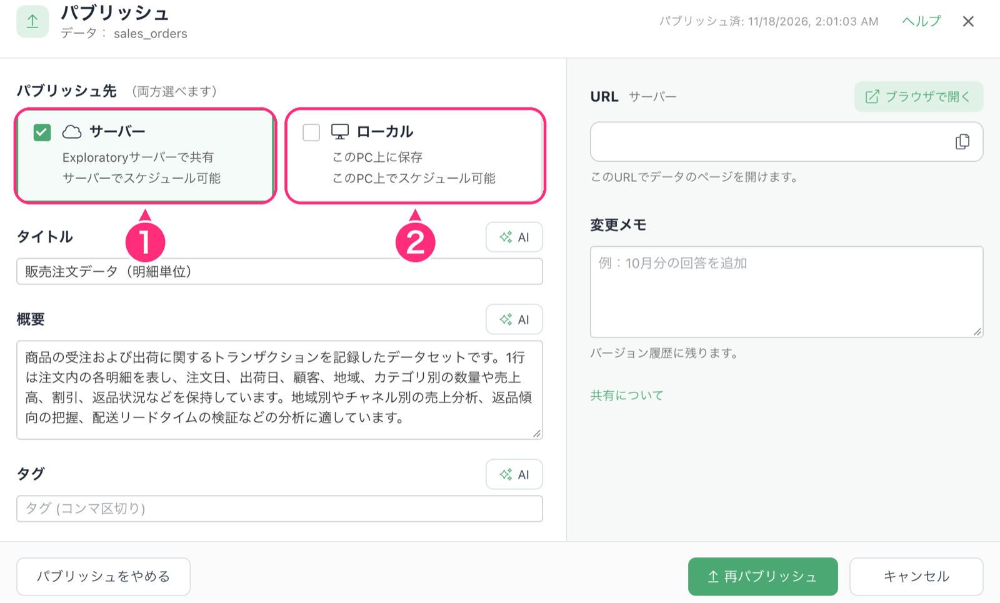
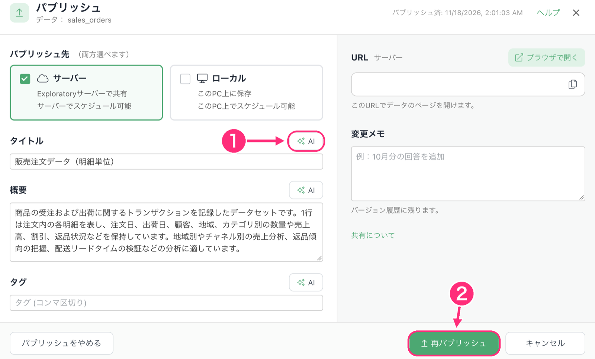
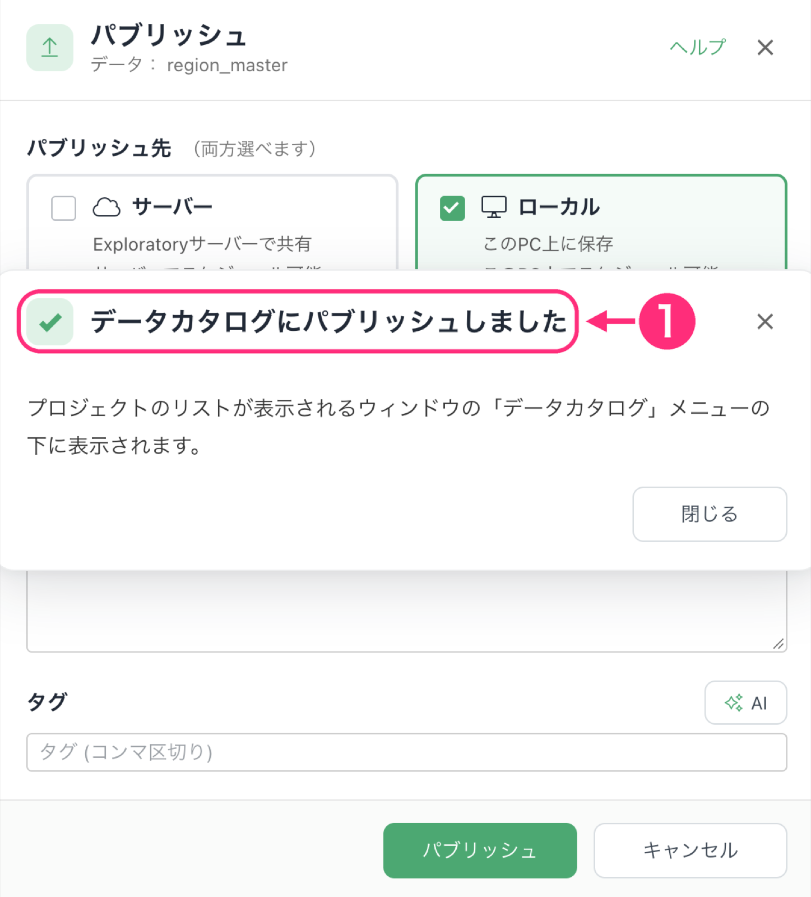

1. プロジェクトで、カタログに載せたいデータフレームを選び、「テーブル」タブの右上にある「パブリッシュ」ボタンを押します。ウィンドウが狭いと、ボタンはアイコンだけになります。データフレームのメニュー（≡）にはありません
2. パブリッシュダイアログの「パブリッシュ先」で、「サーバー」と「ローカル」のどちらか、または両方にチェックを入れます
   - **サーバー**: 「Exploratoryサーバーで共有」「サーバーでスケジュール可能」
   - **ローカル**: 「このPC上に保存」「このPC上でスケジュール可能」

画像の ❶ が「サーバー」、❷ が「ローカル」のカードです。

3. タイトル、概要、タグを入力します。それぞれの見出しの右にある「AI」ボタン（ポインタを合わせると「AI で生成」）を押すと、AI が下書きを作ります。ボタンは、AI サービスが使えるときだけ表示されます。内容は確かめて、必要なら直します
4. ダイアログの下にある「パブリッシュ ▾」ボタンを押し、開いたメニューで公開する人を選びます。自分として公開するときは「個人として」（自分の名前の行）を、チームとして公開するときは「チームとして」の下のチームを選びます。「パブリッシュしますか？」という確認が出るので、「OK」を押します

画像の ❶ が「AI」ボタン、❷ が公開のボタンです。この画像は、すでにパブリッシュしたデータの画面なので、ボタンが「再パブリッシュ」になっています。再パブリッシュのときの確認は、「再パブリッシュしますか？」です。ローカルだけにパブリッシュするときは、「パブリッシュ」を押します。

サーバーへのパブリッシュが終わると、進行を表すパネルが出ます。❶ の「開く」を選ぶと、サーバーのデータのページが開きます。続けて、データのページの「メタデータ」タブで、セマンティクスを AI で作って承認できます。手順は、[サーバーのデータカタログと AI](/ja/data-catalog/server)をご覧ください。

ローカルだけにパブリッシュすると、「データカタログにパブリッシュしました」と表示されます。データは、プロジェクトの一覧が表示されるウィンドウの「データカタログ」タブに並びます。

オフラインモードのときは、「サーバー」を選べません。オフラインモードを解除していても、サインインが切れていると、サーバーにはパブリッシュされません。両方にチェックを入れていた場合は、ローカルにだけ保存されます。サインインして、もう一度パブリッシュしてください。

すでにパブリッシュしたデータを更新するときは、同じ手順でもう一度パブリッシュします。サーバーへのパブリッシュでは、「変更メモ」を書くと、バージョン履歴に残ります。
