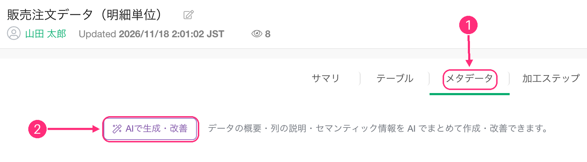
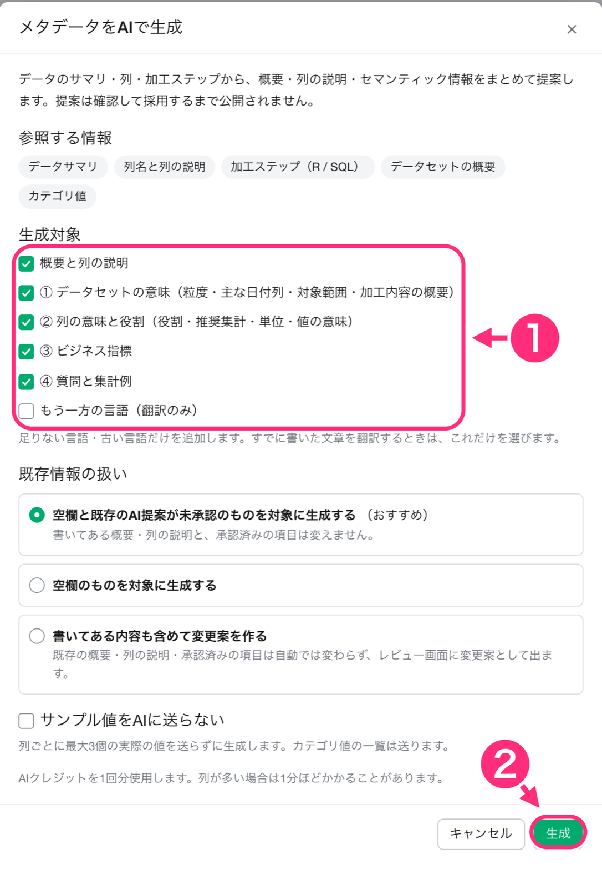
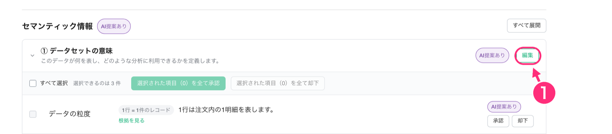
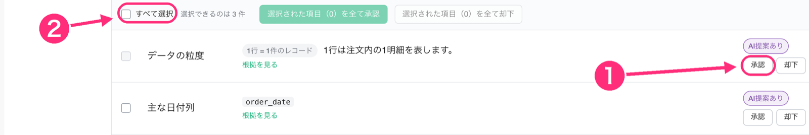
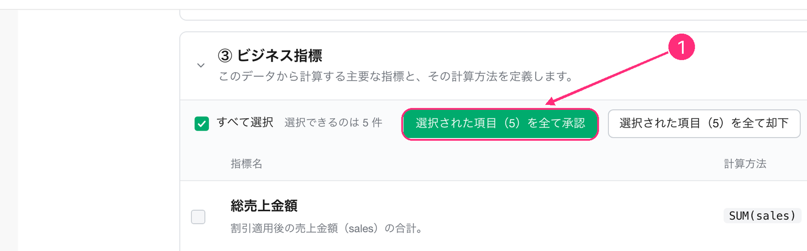
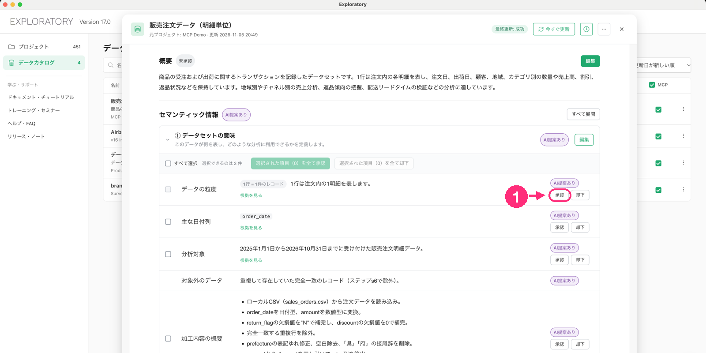

セマンティック情報は、そのデータの意味とビジネスルールを AI に伝えるための定義です。AI エージェントは、列の名前だけでは分からないことを、この定義から読み取ります。たとえば、1 行が何を表すのか、どの列を合計してよいのか、キャンセルを含めるのか、といったことです。

サーバーのデータカタログでは、パブリッシュしたデータに付けます。ローカルのデータカタログにも、同じように付けられます。

## 定義の内容

定義は、次の 5 つに分かれています。集計ルールは、お使いのサーバーの設定で有効なときだけ生成されます。

| 区分 | 定義する内容 |
| --- | --- |
| データセットの意味 | データの粒度（1 行が何か）、主な日付列、分析対象と対象外、加工内容の概要、更新状況 |
| 列の意味と役割 | 列ごとの用途と集計方法 |
| ビジネス指標 | このデータから計算する主要な指標と、その計算方法。別名も登録できます |
| 集計ルール・注意点 | 正しく集計し、解釈するためのルール |
| 質問と集計例 | よく使う質問と、その正しい集計方法 |

## サーバーのデータカタログで作る

### 1. AI に下書きを作らせる

1. データのページの「メタデータ」タブを開きます
2. 「AIで生成・改善」を押します

画像の ❶ が「メタデータ」タブ、❷ が「AIで生成・改善」です。

3. 「メタデータをAIで生成」のダイアログで、「生成対象」を確かめて、「生成」を押します。AI が、データの概要、列の情報、統計、加工の手順などをもとに、下書きを作ります

画像の ❶ が「生成対象」、❷ が「生成」ボタンです。

### 2. 提案を読んで、直す

「AI提案あり」と表示された項目を読み、直すところは「編集」で直します。画像の ❶ が「編集」です。

### 3. 正しい項目を承認する

正しい項目は、項目ごとに「承認」を押します。却下するときは「却下」を押します。画像の ❶ が「承認」、❷ が各セクションの「すべて選択」です。

### 4. まとめて承認する

各セクションの「すべて選択」にチェックを入れて、「選択された項目（N）を全て承認」を押します。N は、選んだ項目の数です。画像の ❶ が、そのボタンです。ただし、「データの粒度」は、個別に「承認」を押します。ほかにも一括で承認できない項目があるときは、内容を確かめてから、個別に承認します。

### 承認の基準

セマンティック情報を編集できるのは、データの所有者だけです。承認するときの基準は、「このデータの意味として正しいか」です。たとえば販売注文データなら、「データの粒度」は「1行 = 1件のレコード（注文の明細）」、「主な日付列」は order_date、sales 列は「数値指標」で集計方法は「合計」であることを確かめます。「純売上」の集計に、総売上の列と純売上の列のどちらを使うかのように、列名だけでは決められないことを、定義で決めておきます。

承認した項目が、公式の定義として AI エージェントに渡ります。承認していない定義は使われません。ただし、その列のデータは、そのまま集計できます。承認済みの項目を書き換えて保存すると、承認が外れるので、もう一度承認してください。

データの一覧の「AI 対応」の列で、準備の状況を確認できます。状態は、「準備完了」「要確認」「下書き」「未設定」です。

## ローカルのデータカタログで作る

ローカルのデータの詳細画面を開き、「メタデータ」タブで「AIで生成・改善」を押します。データの概要、列の説明、セマンティック情報を、AI が作成、改善します。提案を確認して、採用する流れは、サーバーと同じです。

画像は、メタデータのタブで、AI が提案した定義を確認している画面です。

<!-- IMAGE: local-metadata -->
