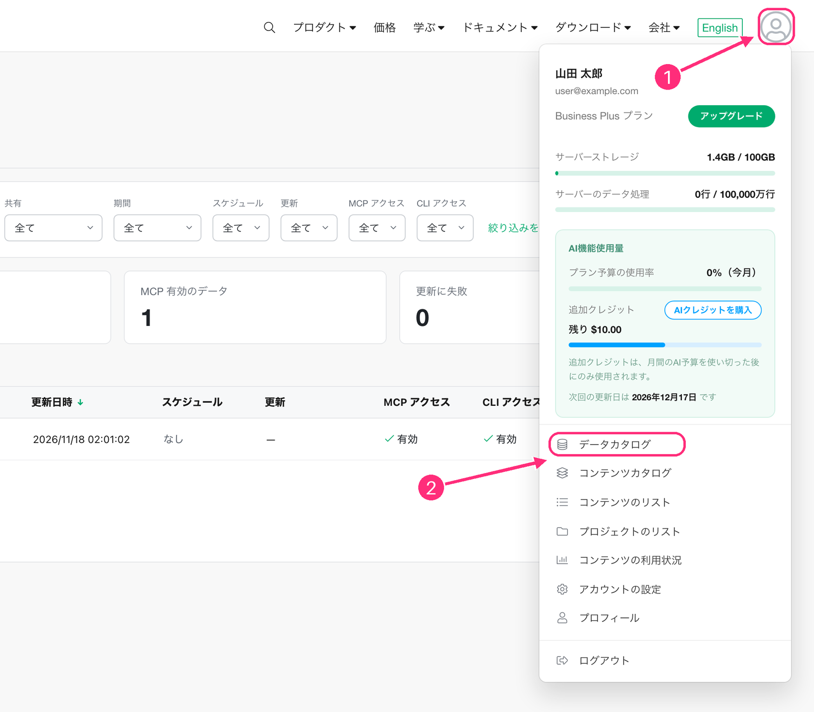
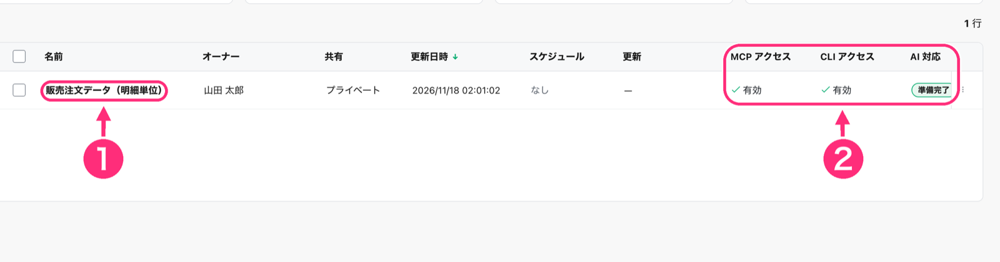
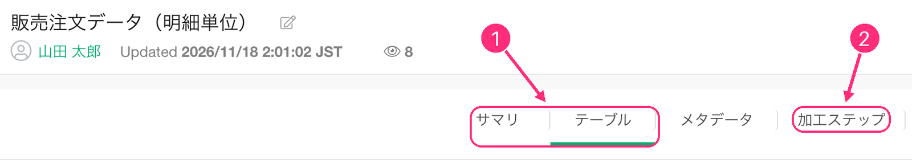
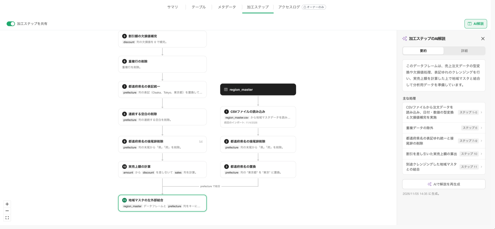
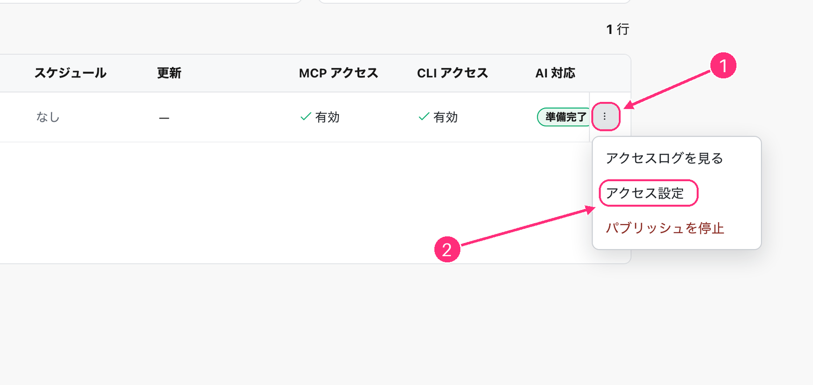
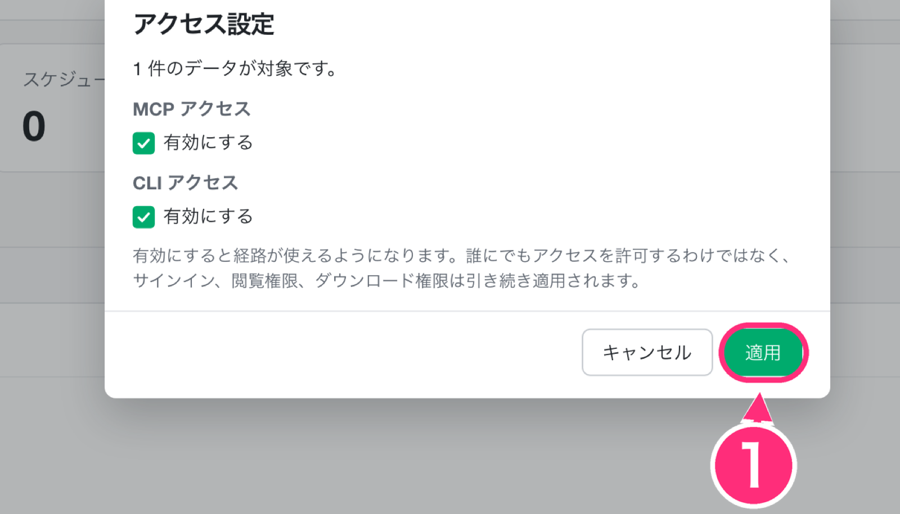

サーバーのデータカタログは、exploratory.io のブラウザの画面で使えます。パブリッシュしたデータを一覧で探し、データのページで中身や加工の過程を確かめ、AI エージェントなどからのアクセスを管理できます。

## データカタログのページを開く

1. exploratory.io の右上にあるアカウントのアイコンを選びます
2. メニューの「データカタログ」を選びます

パブリッシュしたデータの一覧が、「データ」タブに出ます。アカウントによっては、「アクセスログ」タブも出ます。一覧の列は、次のとおりです。

- 名前、オーナー、共有、更新日時、スケジュール、更新（更新の状態）
- MCP アクセス、CLI アクセス（環境によっては、REST API アクセスの列も出ます）
- AI 対応

一覧の上の検索欄と、「オーナー」「共有」「期間」「スケジュール」「更新」「MCP アクセス」「CLI アクセス」の絞り込みで、データを探せます。データの件数やスケジュール中のデータの数などの集計も、一覧の上に出ます。

## データのページで中身を確かめる

データの名前を選ぶと、データのページが開きます。画像の ❶ が「サマリ」「テーブル」などのタブです。

- **サマリ**: データの概要を確かめます
- **テーブル**: データの行を見ます。「すべての列を検索」で検索し、「フィルター」で絞り込み、「列」で表示する列を選べます。「表示」を「集計」に切り替えると、グループ化して集計した結果も見られます。「CSV でダウンロード」で CSV にでき、「リンクをコピー」で、テーブルの設定を含むリンクをコピーできます
- **メタデータ**: 説明、タグ、列の説明、セマンティック情報を確かめます。所有者は、ここで編集し、承認します。くわしくは、[セマンティック情報](/ja/data-catalog/semantics)をご覧ください
- **加工ステップ**: 元のデータからどのように加工されたかを、ダイアグラムで見ます。「加工ステップを共有」のスイッチで、ほかの人に見せるかを決めます。「AI解説」で、加工の要約を読めます
- **アクセスログ**: データへのアクセスを確認します。オーナーだけが見られます

「アクセスログ」では、アクセスの方法（MCP、API、UI）、アクセス元（国、IP アドレス、クライアント）、クエリの内容、処理時間、ステータスが分かります。

<!-- IMAGE: server-access-log -->

## アクセスを設定する

データの所有者は、データごとに、MCP などからのアクセスを設定できます。

1. サーバーの「データカタログ」で、対象の行の右端にある「⋮」を押します。メニューには、「アクセスログを見る」「アクセス設定」「パブリッシュを停止」が並びます
2. 「アクセス設定」を選びます。複数のデータを選んで、まとめて設定することもできます

画像の ❶ が「⋮」、❷ が「アクセス設定」です。

3. 「MCP アクセス」「CLI アクセス」「REST API アクセス」のそれぞれで、「有効にする」のチェックを決めます。「CLI アクセス」は、ターミナルや AI エージェントから `expl server` で読む設定です。「REST API アクセス」は、環境によっては表示されません
4. 設定を変えたら、「適用」を押します。設定を変えるまで、「適用」は押せません

たとえば、AI エージェントに使わせたくないデータは、「MCP アクセス」の「有効にする」のチェックを外して、「適用」を押します。有効にしても、誰にでも開放されるわけではありません。サインイン、閲覧の権限、ダウンロードの権限は、これまでどおり適用されます。

AI エージェントから質問する方法は、[AI で活用する](/ja/data-catalog/ai)をご覧ください。
