## サーバーのデータカタログのページを開く

1. exploratory.io の右上にあるアカウントのアイコンを選びます
2. メニューの「データカタログ」を選びます

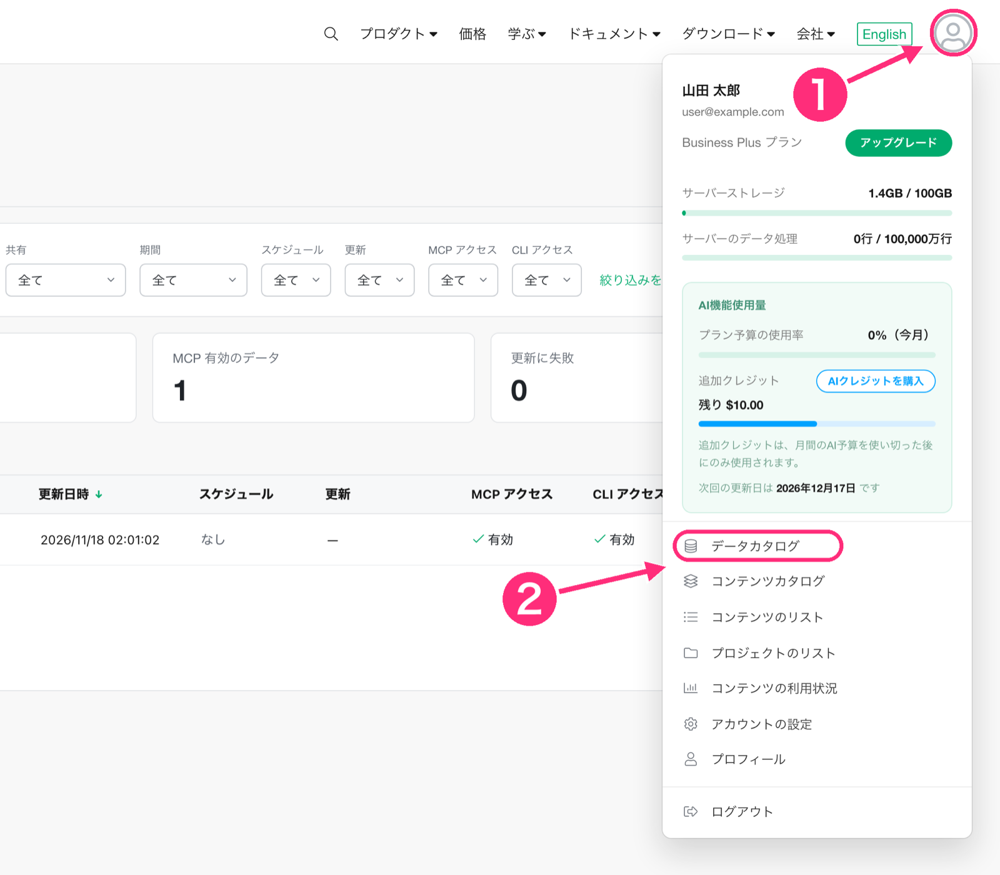

パブリッシュしたデータの一覧が、「データ」タブに出ます。アカウントによっては、「アクセスログ」タブも出ます。一覧の列は、次のとおりです。

- 名前、オーナー、共有、更新日時、スケジュール、更新（更新の状態）
- MCP アクセス、CLI アクセス、REST API アクセス
- AI 対応

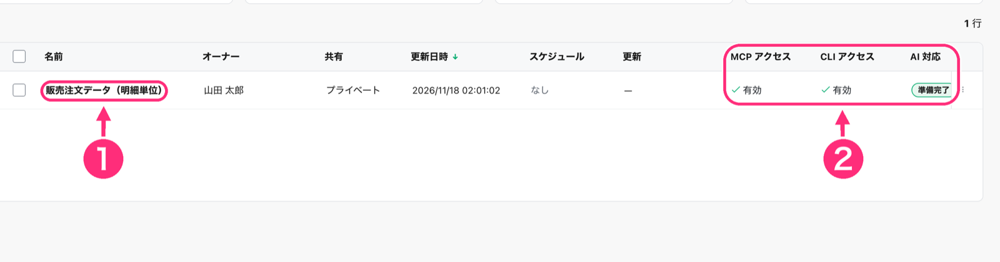

データの名前を選ぶと、データのページが開きます。「サマリ」「テーブル」などのタブで中身を確かめられます。「加工ステップ」のタブでは、元のデータからどのように加工されたかを、ダイアグラムで見られます。

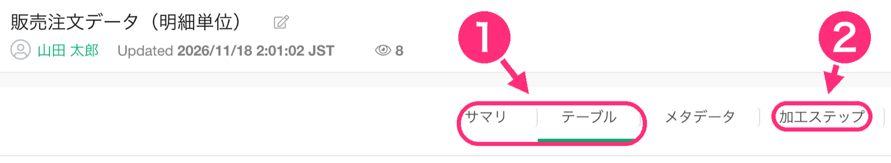

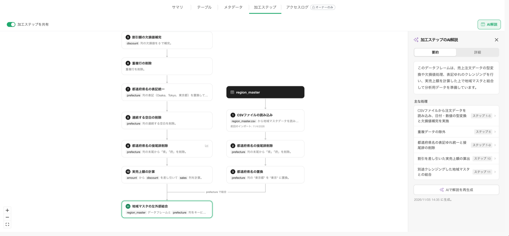

「アクセスログ」では、データへのアクセスを確認できます。アクセスの方法（MCP、API、UI）、アクセス元（国、IP アドレス、クライアント）、クエリの内容、処理時間、ステータスが分かります。

## サーバーのデータカタログで AI に答えさせる

サーバーのデータカタログでは、パブリッシュしたデータに「セマンティクス」を付けられます。セマンティクスは、そのデータの意味を AI に伝えるための定義です。AI エージェントは、列の名前だけでは分からないことを、この定義から読み取ります。たとえば、1 行が何を表すのか、どの列を合計してよいのか、キャンセルを含めるのか、といったことです。

### AI で生成して、人が承認する

1. データのページの「メタデータ」タブを開きます
2. 「AIで生成・改善」を押します
3. 「メタデータをAIで生成」のダイアログで、「生成対象」を確かめて、「生成」を押します。AI が、データの概要、列の情報、統計、加工の手順などをもとに、下書きを作ります

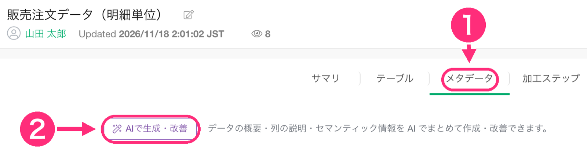

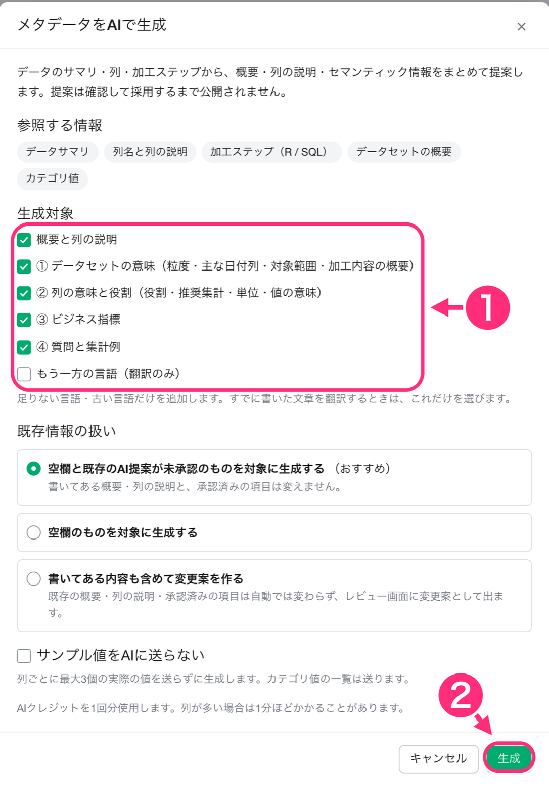

定義は、次の 5 つに分かれています。集計ルールは、お使いのサーバーの設定で有効なときだけ生成されます。

| 区分 | 定義する内容 |
| --- | --- |
| データセットの意味 | データの粒度（1 行が何か）、主な日付列、分析対象と対象外、加工内容の概要、更新状況 |
| 列の意味と役割 | 列ごとの用途と集計方法 |
| ビジネス指標 | このデータから計算する主要な指標と、その計算方法。別名も登録できます |
| 集計ルール・注意点 | 正しく集計し、解釈するためのルール |
| 質問と集計例 | よく使う質問と、その正しい集計方法 |

下書きの内容は、そのままでは公式の定義になりません。データの所有者が、次の手順で確認します。セマンティクスを編集できるのは、データの所有者だけです。

1. 「AI提案あり」と表示された項目を読み、直すところは「編集」で直します
2. 正しい項目は、項目ごとに「承認」を押します。却下するときは「却下」を押します
3. まとめて承認するときは、各セクションの「すべて選択」にチェックを入れて、「選択された項目（N）を全て承認」を押します。N は、選んだ項目の数です。ただし、「データの粒度」は、個別に「承認」を押します。ほかにも一括で承認できない項目があるときは、内容を確かめてから、個別に承認します

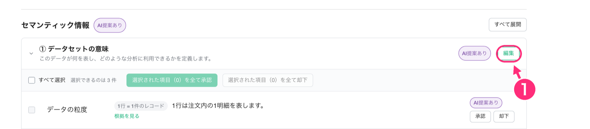

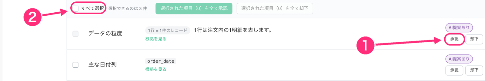

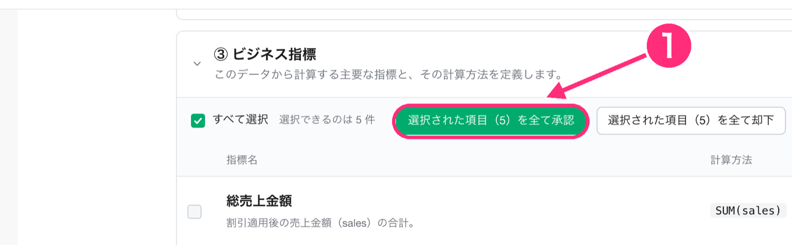

承認した項目が、公式の定義として AI エージェントに渡ります。承認していない定義は使われません。ただし、その列のデータは、そのまま集計できます。承認済みの項目を書き換えて保存すると、承認が外れるので、もう一度承認してください。

データの一覧の「AI 対応」の列で、準備の状況を確認できます。状態は、「準備完了」「要確認」「下書き」「未設定」です。

### 必要な集計結果だけを AI に渡す

`query_dataset` で集計を頼むと、サーバーが DuckDB で絞り込み、グループ化、集計、結合を計算します。AI エージェントは、データの行を何ページも読まなくても、集計した結果を受け取れます。開発時のテストでは、数百万から数千万行のデータでも、1 秒以内に取得できました。実際の速さは、AI エージェントからサーバーまでのネットワークの速さに左右されます。元の行を取得する指定や、ほかの読み取りの道具では、返った行も会話の一部になります。くわしくは、[Server MCP のデータと権限](/ja/mcp/server/data)をご覧ください。

### サーバー MCP から使う

サーバーの MCP からは、承認済みのセマンティクスを使って、データを探し、集計できます。

- `dataframe_get_schema` は、詳細（`full`）で取得すると、承認された定義を返します。データの変更などで「要再確認」になった定義には、警告が付きます。AI はこの定義を、集計の前に読みます
- `query_dataset` は、データをサーバーで絞り込み、集計します。オンプレミスのサーバーでは、管理者が有効にしたときだけ使えます

データの所有者は、データごとに、MCP などからのアクセスを設定できます。

1. サーバーの「データカタログ」で、対象の行の右端にある「⋮」を押します。メニューには、「アクセスログを見る」「アクセス設定」「パブリッシュを停止」が並びます
2. 「アクセス設定」を選びます。複数のデータを選んで、まとめて設定することもできます
3. 「MCP アクセス」「CLI アクセス」「REST API アクセス」のそれぞれで、「有効にする」のチェックを決めます。「CLI アクセス」は、ターミナルや AI エージェントから `expl server` で読む設定です。「REST API アクセス」は、環境によっては表示されません
4. 設定を変えたら、「適用」を押します。設定を変えるまで、「適用」は押せません

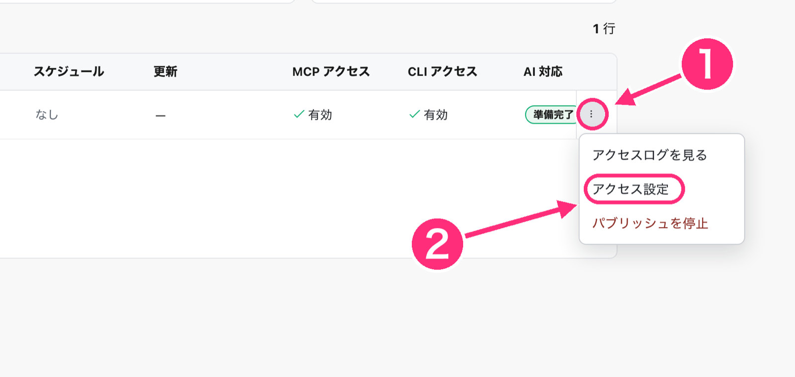

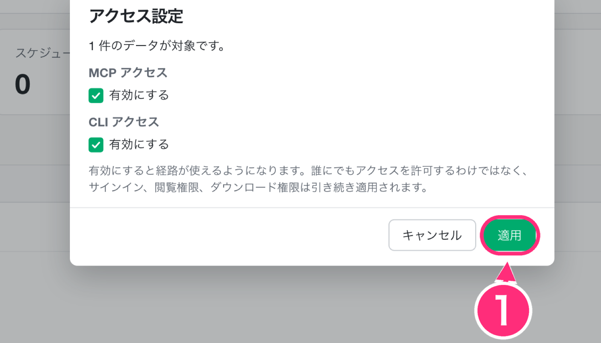

たとえば、MCP を止めるときは、「MCP アクセス」の「有効にする」のチェックを外して、「適用」を押します。有効にしても、誰にでも開放されるわけではありません。サインイン、閲覧の権限、ダウンロードの権限は、これまでどおり適用されます。

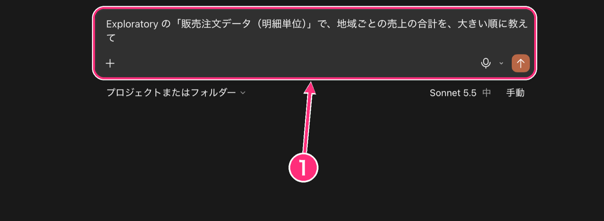

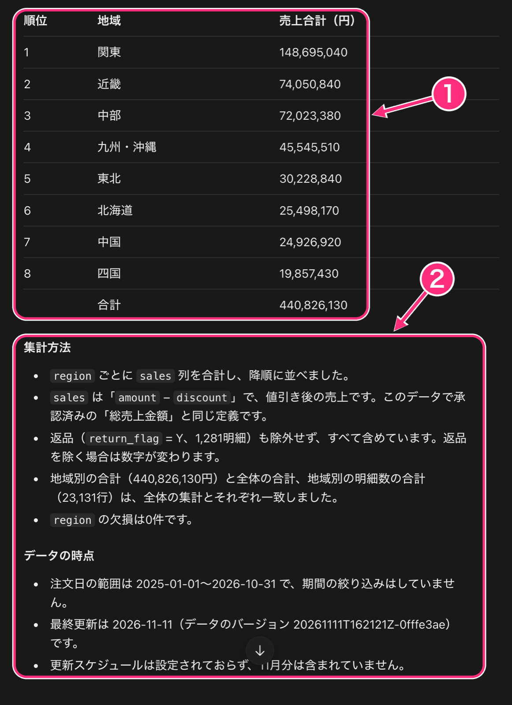

道具の使い方と、記録される内容は、次のページをご覧ください。

- [Server MCP の道具](/ja/mcp/server/tools)
- [Server MCP のデータと権限](/ja/mcp/server/data)
