チャートやステップを誤って削除したり、ノートの内容を消して保存してしまったりしたときは、「変更履歴」から、プロジェクトを特定の時点のバージョンに戻せます。プロジェクトで行った操作は変更履歴として記録されており、一覧から戻したい時点を選んで復元します。

復元の対象は、チャートだけではありません。アナリティクス、ステップ、レポートの中のノート、ダッシュボードも同じように扱われます。

変更履歴の機能は、バージョン14以前は「その他」のメニュー内にありました。バージョン15からは、プロジェクトメニューにアイコンとして表示されます。

## 変更履歴に表示される情報

変更履歴の一覧には、次の情報が列として表示されます。戻したい時点を見つけやすくなっています。

- 日付: いつ操作をしたか
- 操作タイプ: どういった操作をしたか
- 詳細
- 使ったデータフレーム

## 使い方

ここでは、チャートを削除してしまった場合を例に説明します。

1. チャートのプルダウンメニューから「削除」を選んで、チャートを削除したとします。削除したチャートは元に戻せない状態になります。

   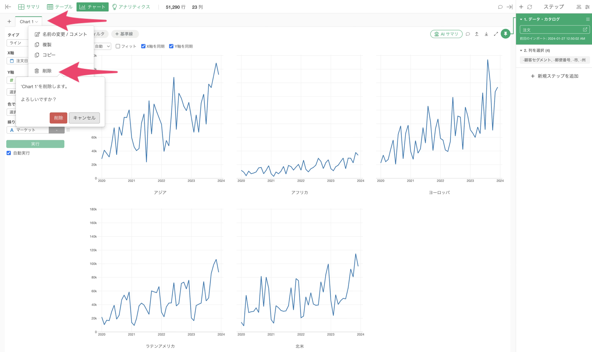

   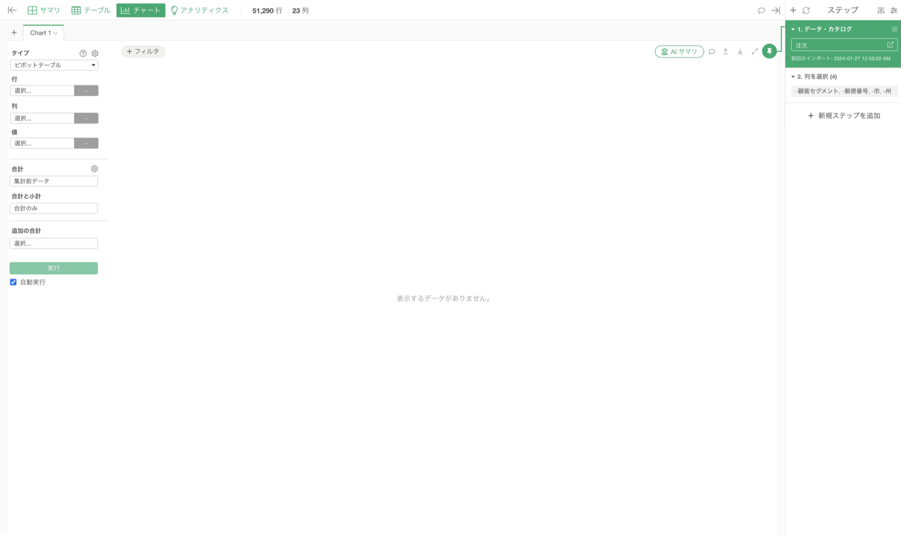

2. プロジェクトメニューの「変更履歴」のアイコンをクリックします。

   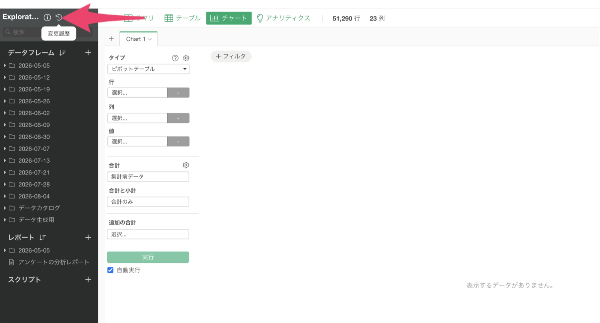

3. 変更履歴の一覧が表示されます。日付、操作タイプ、詳細、使ったデータフレームを確認しながら、戻したい時点を探します。

   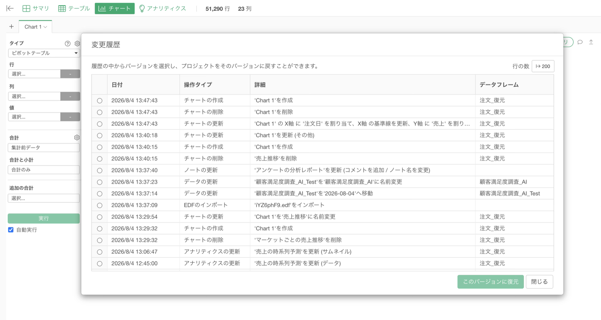

4. 戻したい時点にチェックを付けて、「このバージョンに復元」をクリックします。この例では、チャートを作成してから削除しました。削除の操作が上から2番目の履歴なので、その1つ前の、上から3番目の履歴を選びます。

   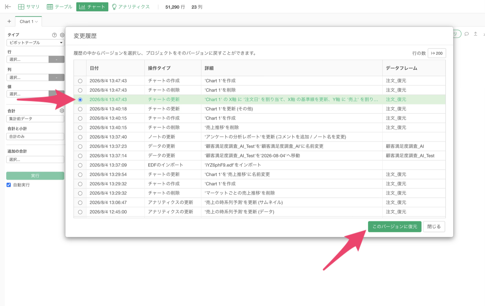

5. プロジェクトが、選んだバージョンに復元されます。変更履歴にも、指定したバージョンに復元したことが記録されます。

   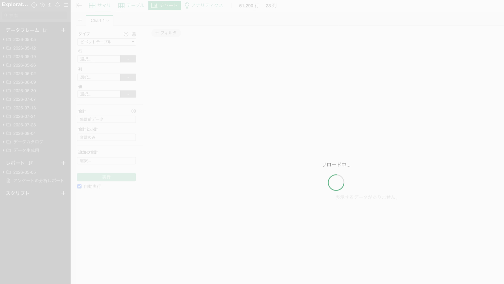

6. データフレームを開くと、削除したチャートが元に戻っています。

   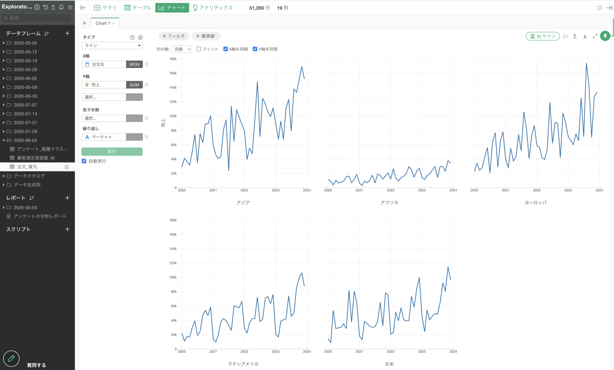

## ステップやノートも同じように復元する

ステップやノートも、同じ手順で復元できます。たとえば、列を選択するステップを削除し、分析レポートのノートから要約の情報を消して保存したとします。

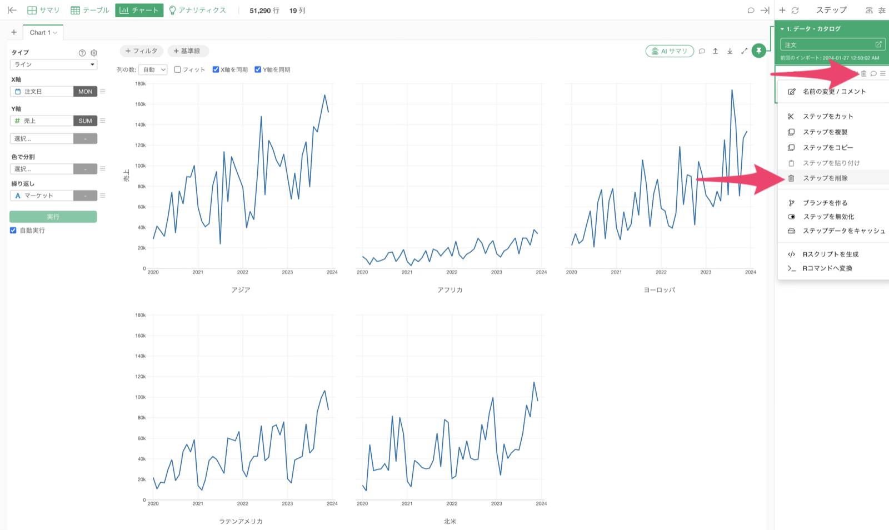

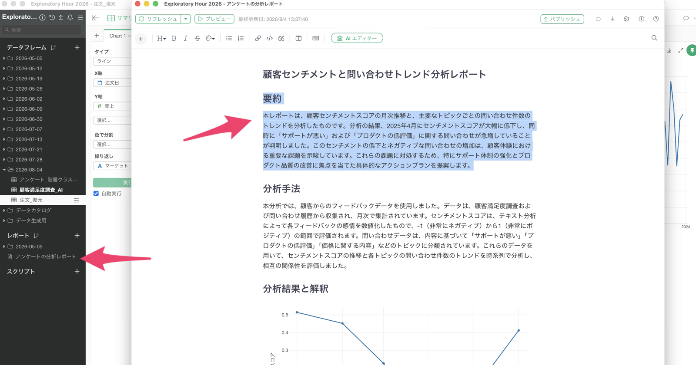

プロジェクトメニューの「変更履歴」のアイコンをクリックします。ノートの要約を削除する操作とステップを削除する操作を行う前の時点にチェックを付けて、「このバージョンに復元」を選びます。

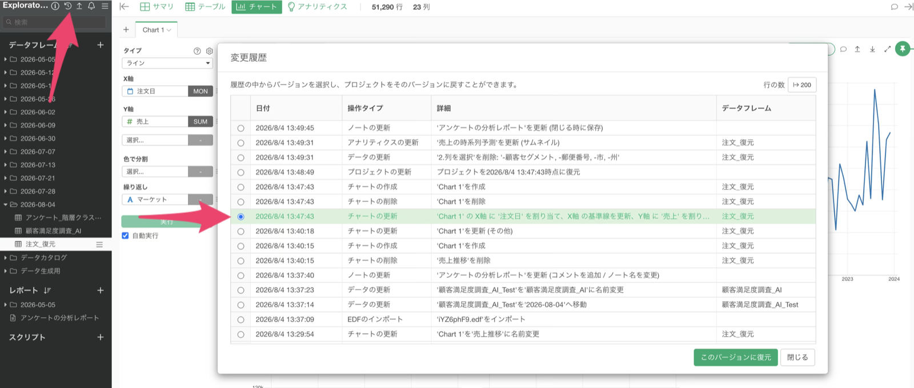

復元されたデータフレームを開くと、削除した列を選択するステップと、ノート内の要約の情報が元に戻っています。

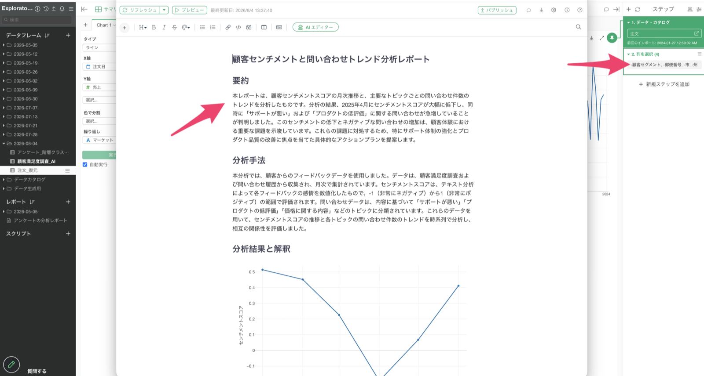
