AI データを使うと、欲しいデータを日本語で伝えるだけで、AI が API からデータを取得する R スクリプトを作成して実行します。API を使うには通常、呼び出し方を調べてコードを書く準備が必要ですが、API キーをコネクションに登録しておけば、会話を通じてデータを取得できます。

ここでは、YouTube Data API v3 を例に、API キーを作ってコネクションに登録し、動画の一覧を取得する手順を説明します。

## 全体の流れ

1. Google Cloud で YouTube Data API v3 を有効にし、API キーを作ります。
2. Exploratory の AI データで、API キーを登録したコネクションを作ります。
3. 欲しいデータを依頼し、取得結果を確認して保存します。

コネクションは、データの取得に必要な接続情報を保存する設定です。この例では、Google Cloud で発行した API キーを登録します。Google Cloud コンソールへのログインには Google アカウントを使います。

## 1. Google Cloud で API キーを作る

### プロジェクトを作る

[Google Cloud コンソール](https://console.cloud.google.com/)にログインし、プロジェクトの選択画面から「新しいプロジェクト」を開きます。「プロジェクト名」を入力し、「組織」と「親リソース」を利用する環境に合わせて設定して、「作成」を押します。

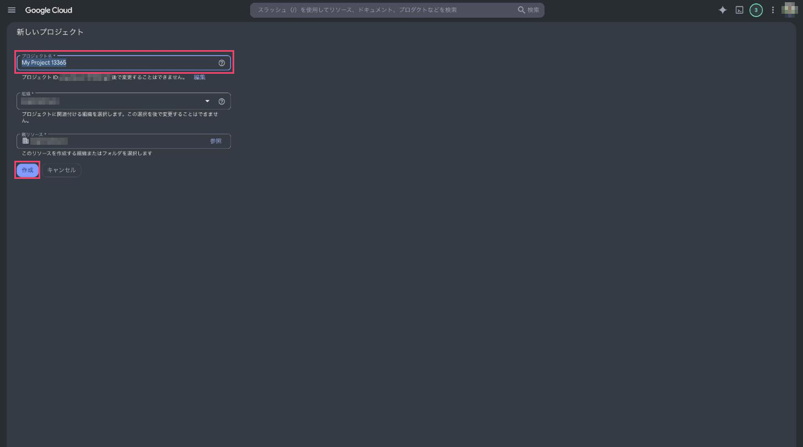

続く操作では、作成したプロジェクトを選択します。既存のプロジェクトを使う場合も、API の有効化と API キーの作成を同じプロジェクトで行います。画面で請求先の設定を求められた場合は、その案内に従います。

### YouTube Data API v3 を有効にする

API ライブラリで「YouTube Data API v3」を検索して開き、「有効にする」を押します。有効化が終わったら、詳細画面でステータスが「有効」になっていることを確認します。

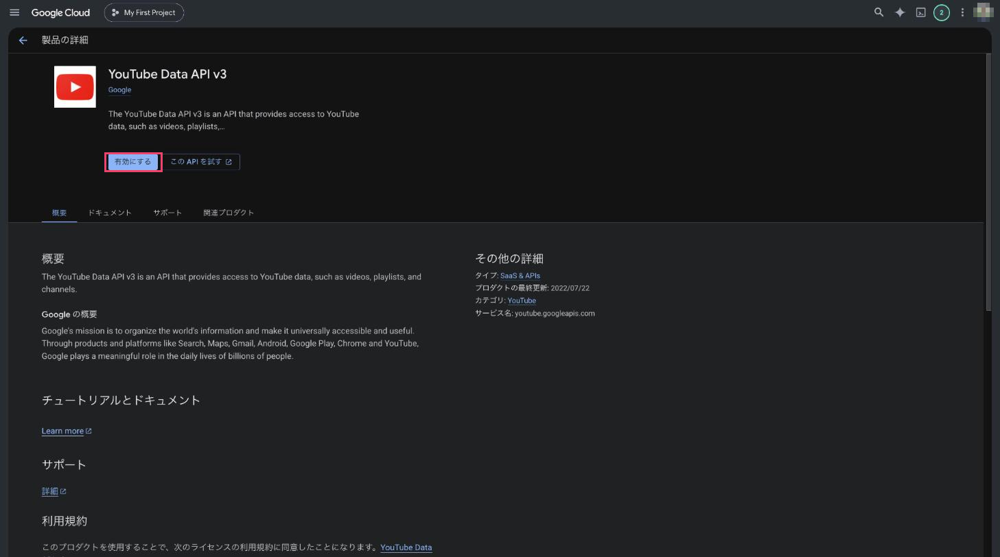

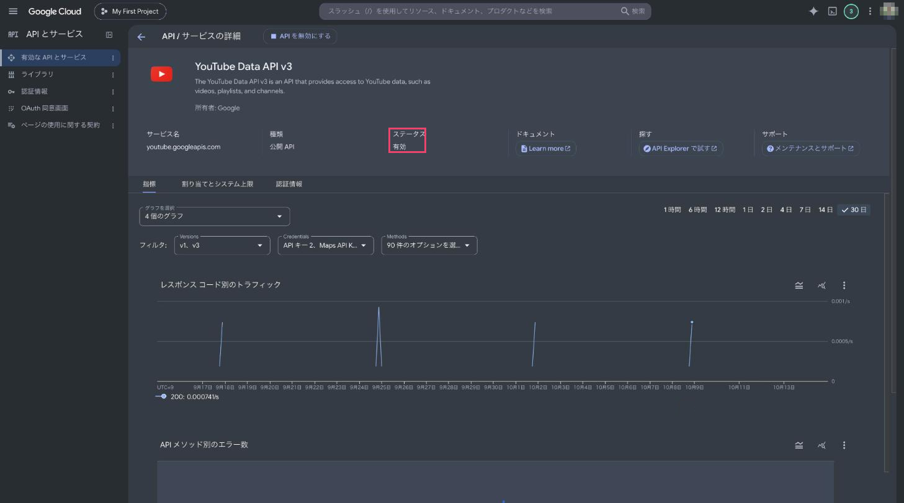

### API キーを作り、使える API を制限する

1. 左メニューの「認証情報」を開き、「認証情報を作成」から「API キー」を選びます。

   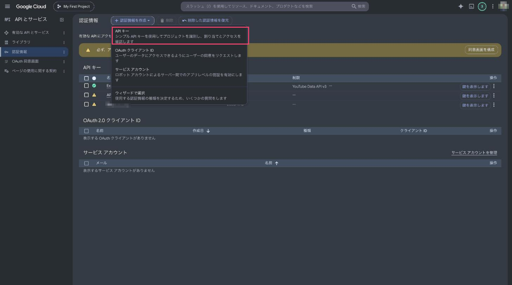

2. 「API キーの作成」フォームが開きます。「名前」に用途がわかる名前を入力します。このフォームで、キーを使える API と、キーを使うアプリケーションの制限を設定します。

   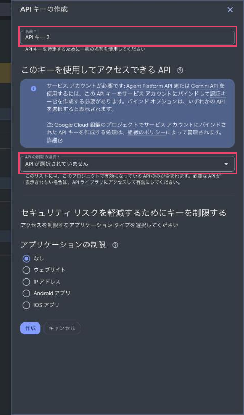

3. 「API の制限の選択」を開き、「YouTube Data API v3」にチェックを付けて「OK」を押します。

   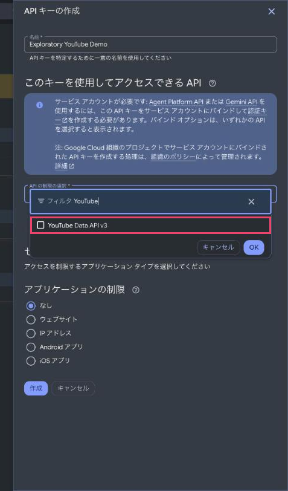

4. 「選択中の API」が YouTube Data API v3 だけになっていることを確認し、「作成」を押します。この例では、「アプリケーションの制限」は「なし」にしています。Google は、「API の制限」と「アプリケーションの制限」の両方を設定することを推奨しています。使い方に合わせて設定を検討してください。

   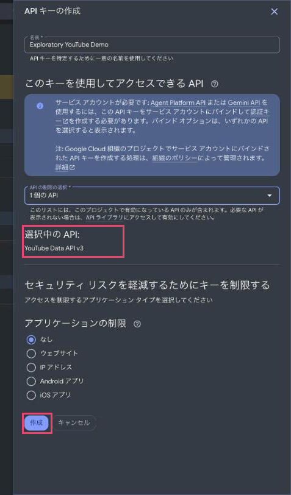

5. 「作成された API キー」が表示されます。キー欄の右端のコピーアイコンでコピーします。

   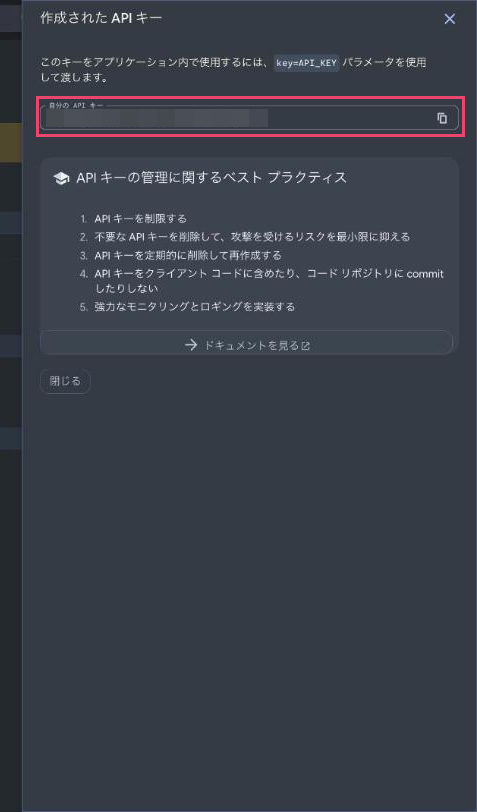

API キーは他人に見せず、コードや、コードを保管・共有するリポジトリにも含めません。「API の制限」は使える API を絞る設定であり、キー自体の公開を防ぐものではありません。制限の詳しい説明は、[Google Cloud の API キー管理ガイド](https://docs.cloud.google.com/docs/authentication/api-keys?hl=ja)にあります。

### API の利用枠を確認する

API には、1日に使える量の上限である「クォータ」があります。消費量を数える単位が「ユニット」です。YouTube Data API の既定の利用枠は、キーワード検索などの独立枠を除き、1日10,000ユニットです。

動画一覧を取得するときの中心になるのは、次の3種類の呼び出しです。

| 呼び出し | 取得するもの | 1回の消費量 |
|:---|:---|:---|
| `channels.list` | チャンネルの情報 | 1ユニット |
| `playlistItems.list` | チャンネルの動画一覧 | 1ユニット |
| `videos.list` | 動画の情報と再生数・高評価数 | 1ユニット |

動画数が多く、一覧を複数回に分けて取得する場合は、その分だけ呼び出し回数が増えます。キーワード検索の `search.list` には、1日100回の独立した枠があります。繰り返し実行するときは、Google Cloud コンソールで使用量を確認してください。利用枠と消費量は、[Google 公式のクォータ資料（英語版）](https://developers.google.com/youtube/v3/determine_quota_cost)で確認できます。

## 2. AI データでコネクションを作る

1. Exploratory のプロジェクトで、「データフレーム」の右側にある「＋」を押し、「AI データ」を選びます。

   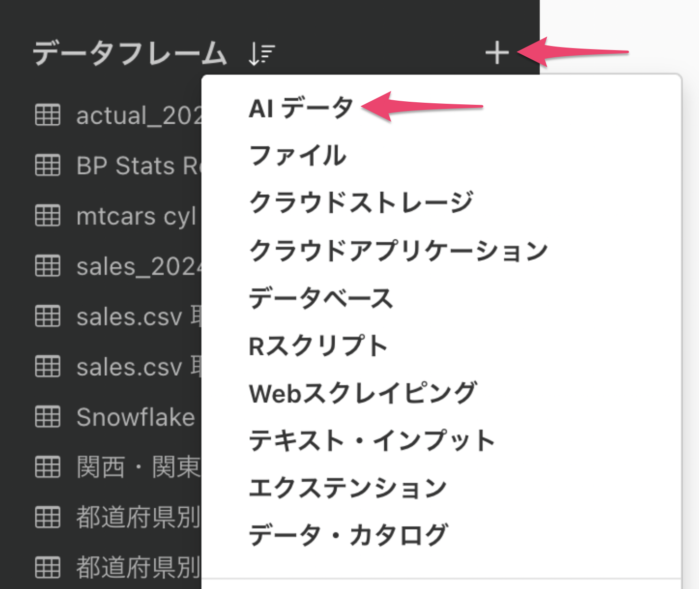

2. AI データの画面が開きます。左側の入力欄から、YouTube Data API v3 のコネクションを作りたいと伝えます。たとえば、次のように入力します。

   ```text
   既存のコネクションは使わず、YouTube Data API v3 の新しいコネクションを新規に作成したい。API キーの入力から始めたい。
   ```

   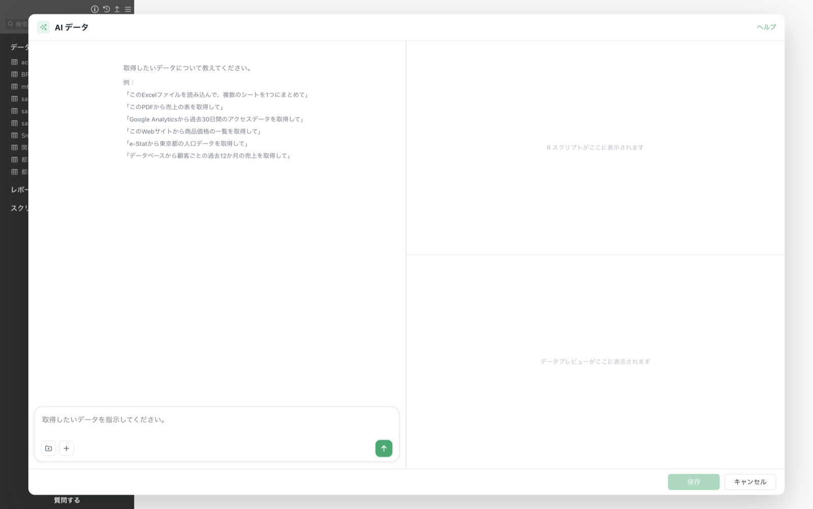

3. AI が Google Cloud コンソールでの API キーの発行手順を案内し、「接続設定ダイアログを開く」ボタンを表示します。

   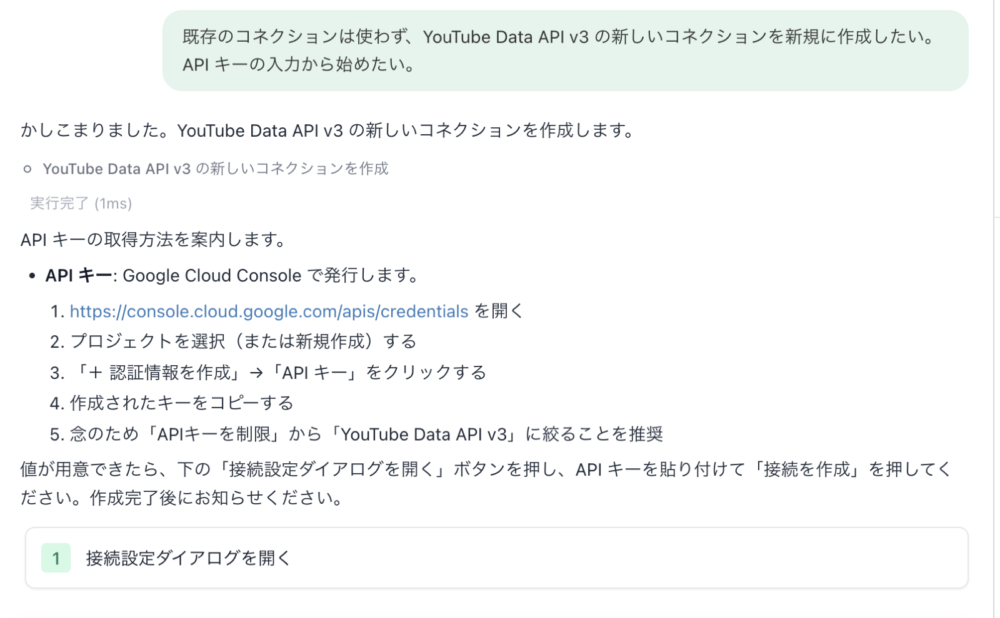

4. 「接続設定ダイアログを開く」を押すと、「コネクションを追加 - Web API」が開きます。「コネクション名」は好きな名前に変えられます。すでに同じ名前のコネクションがある場合は、区別できる名前にします。「API キー」欄に先ほどコピーしたキーを貼り付けて、「追加」を押します。**API キーはチャットの文章に貼り付けず、このダイアログの入力欄に登録します。**

   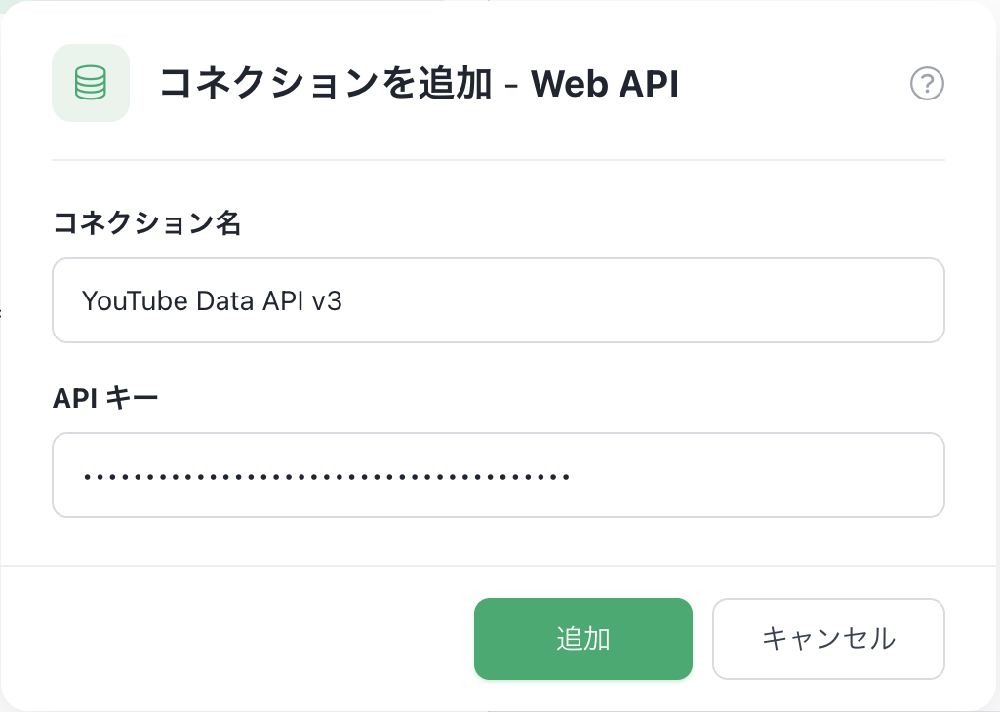

追加すると、チャットにコネクションの作成が完了したことを知らせるメッセージが表示されます。

登録済みのコネクションがある場合は、入力欄の追加メニューで「データコネクション」を選び、接続の候補から使うコネクションを選ぶ方法もあります。

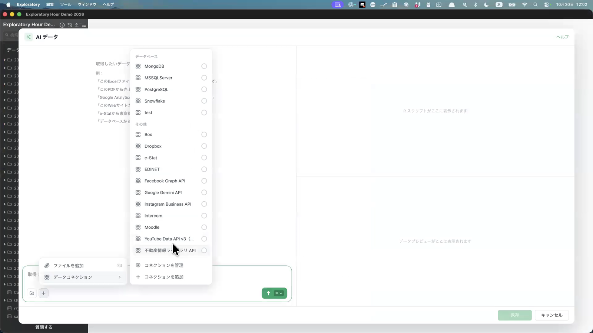

## 3. データを取得して保存する

1. 取得したいチャンネルと項目をチャットに入力します。たとえば、次のように入力します。

   ```text
   Exploratory 公式チャンネル（@ExploratoryData）の動画を、タイトル・公開日・再生数・高評価数つきで一覧にして。作成したコネクションを使ってください。
   ```

   期間を指定することもできます。たとえば、チャンネルと一緒に「直近3ヶ月で公開したデータを取得して」と伝えます。次の画像は、別のチャンネル（Exploratory Japan）で、直近3ヶ月を指定した入力例です。

   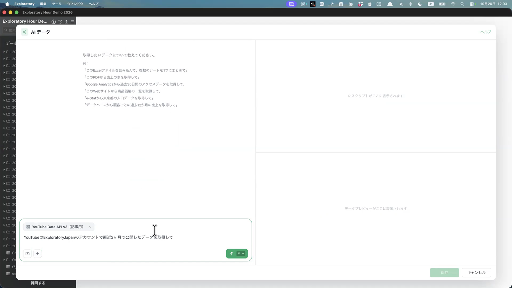

2. AI がチャンネルを調べ、動画一覧と統計情報を取得する R スクリプトを作成して実行します。完了すると、右上にスクリプト、右下にデータのプレビューが表示されます。以下の14行・5列は、期間を指定せずに @ExploratoryData を取得した例の結果で、公開日の新しい順に並んでいます。

   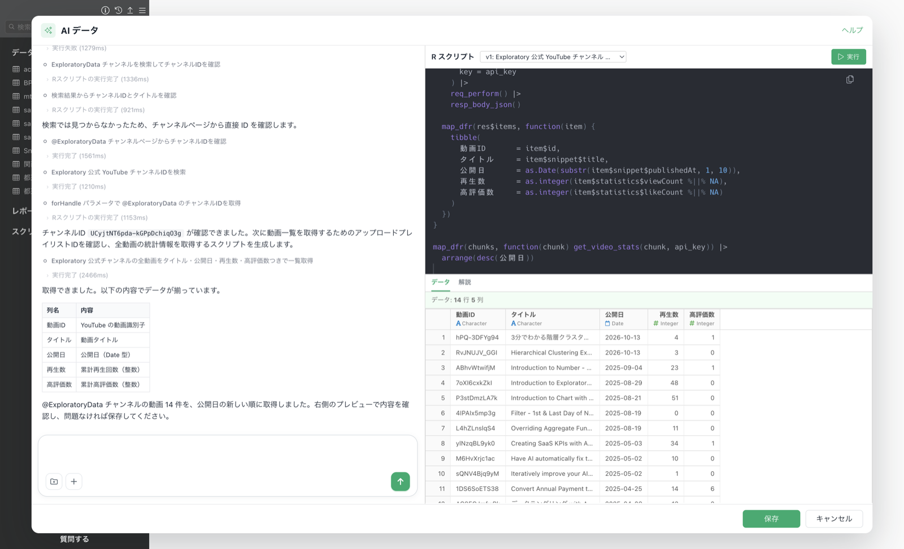

   途中のチャンネル確認で「実行失敗」と表示されたカードがあっても、AI がその後の確認を続けて取得を完了することがあります。毎回同じ流れになるとは限らないため、途中の表示だけで判断せず、最後の応答とプレビューを確認します。

3. 保存する前に、対象のチャンネルの動画か、必要な項目が揃っているかをプレビューで確認します。この例の列とデータの型は次のとおりです。

   | 列名 | 型 | 内容 |
   |:---|:---|:---|
   | 動画ID | Character（文字） | 動画を識別する文字列 |
   | タイトル | Character（文字） | 動画のタイトル |
   | 公開日 | Date（日付） | 動画の公開日 |
   | 再生数 | Integer（整数） | 取得時点の累積再生数 |
   | 高評価数 | Integer（整数） | 取得時点の累積高評価数 |

4. 画面右下の「保存」を押します。「データフレームを作成」で「名前」を確認し、「作成」を押すと、データフレームとして取り込まれます。

   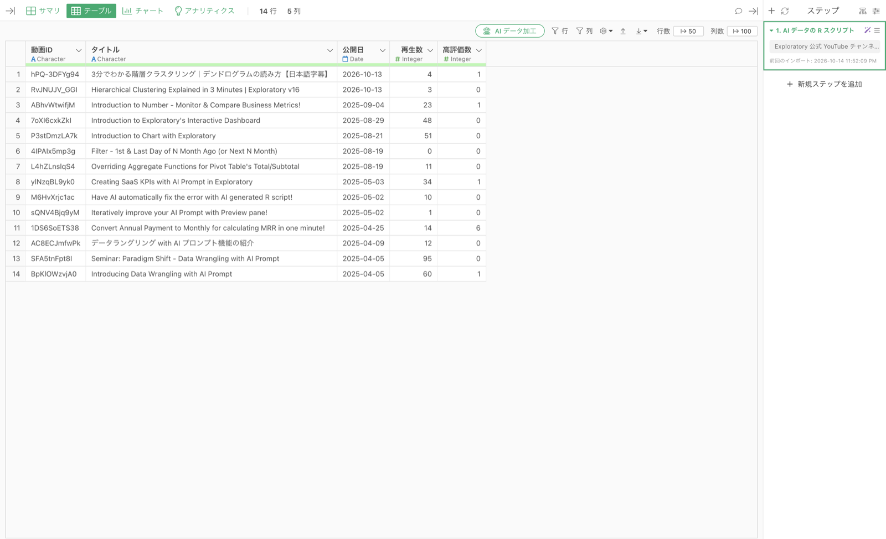

再生数と高評価数は、取得時点までの累積値です。公開からの経過日数が違うため、再生数の大小だけで動画の良し悪しを決めず、公開日も合わせて見ます。この一覧には日ごとの推移は含まれていません。

## 気をつけること

| 項目 | 注意点 |
|:---|:---|
| API キーの管理 | 他人に見せず、コードやリポジトリに含めません。画面共有や記事掲載のときはキーを隠し、不要になったキーは削除します。 |
| 利用上限 | API の呼び出しにはクォータを消費します。大量の動画の取得や繰り返し実行では、Google Cloud コンソールで使用量を確認します。 |
| 数値の時点 | 再生数・高評価数は取得時点の値です。取得日が変わると値も変わるため、比較するときは取得時点を揃えます。 |
