政府統計の総合窓口（e-Stat）で提供している統計データは、2つの方法で取得できます。1つは AI データを使い、調べたい地域や内容を文章で伝える方法です。もう1つは、R スクリプトと estatapi パッケージを使う方法です。

## AI データで取得する

e-Stat のデータを使うには、まず目的に合う統計表を探し、その中から対象の地域や分類を選ぶ必要があります。市区町村より細かい町丁・字などの地域を調べたいときは、どの統計表や地域コードを使うのかを見つける作業も必要です。AI データでは、調べたい地域と内容を伝えることで、統計表の検索からデータの取得までを進められます。

ここでは、自由が丘の男女別の人口データを取得します。

1. 「データフレーム」の「＋」ボタンから「AI データ」を開き、次のように入力します。

   ```text
   自由が丘の男女別の人口のデータを取得したい
   ```

   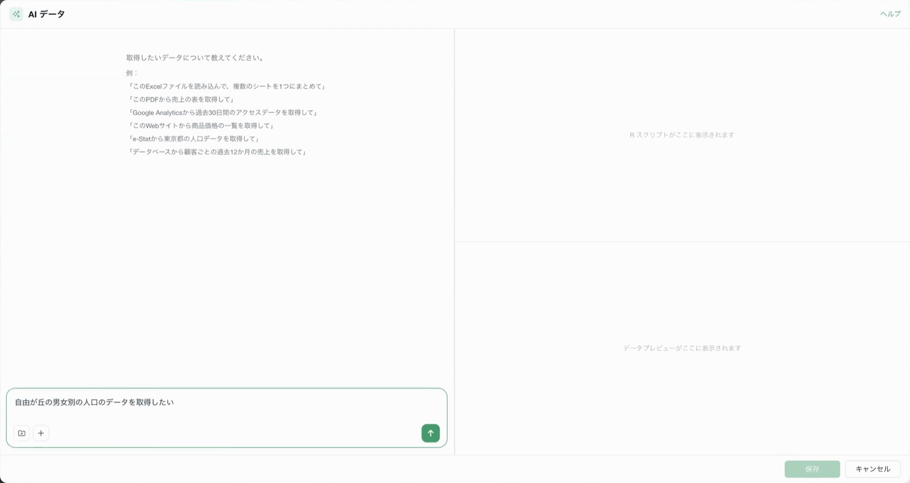

   AI データが e-Stat の統計表を探し、東京都の小地域の表から、自由が丘に対応する地域コードや分類コードを確認します。

2. 処理が終わると、右側のデータプレビューに人口データが表示されます。対象の地域と、性別ごとの人口が取得されていることを確認します。

   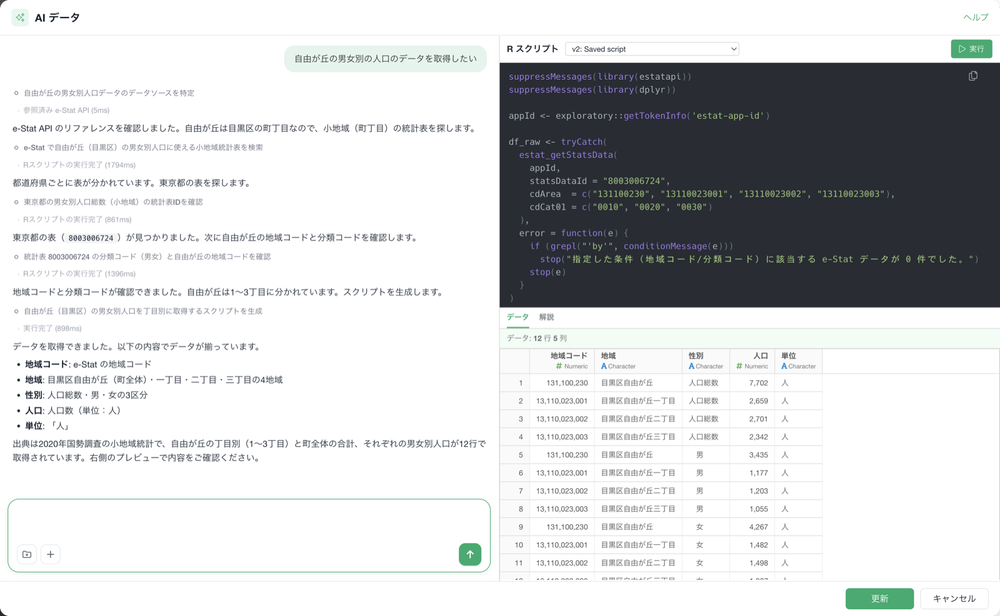

3. 地域列で自由が丘と一〜三丁目を確認し、性別列の「人口総数」「男」「女」に対応する人口と単位を確認します。取得結果を変えたいときは、AI データのチャットから追加で指示できます。

   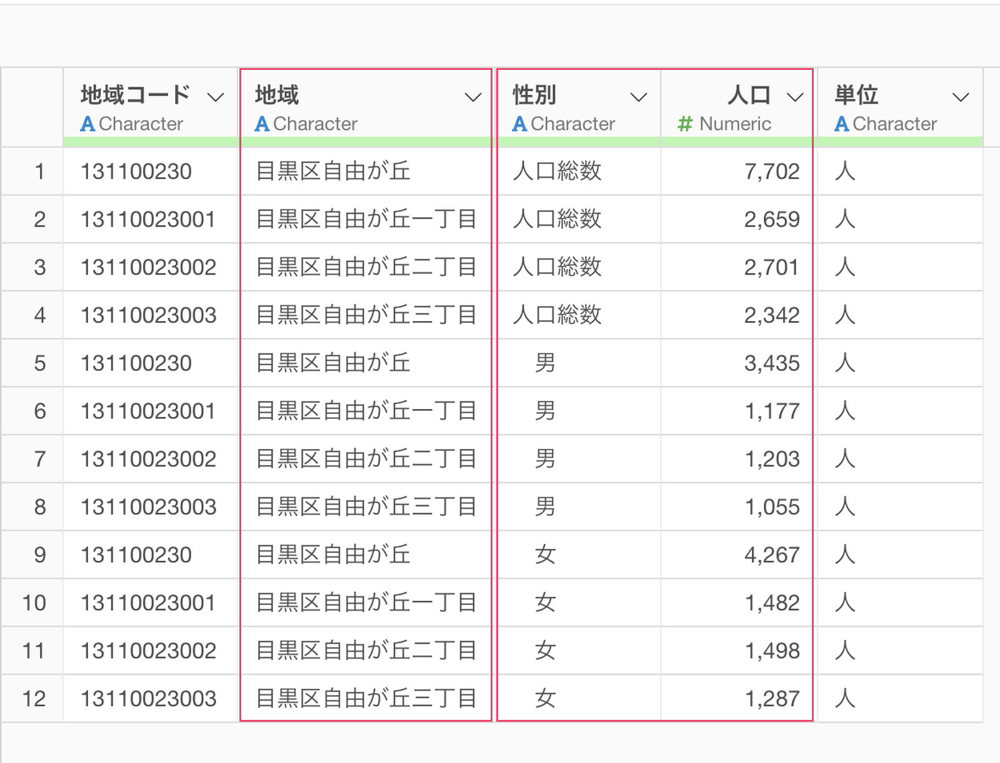

4. 「保存」をクリックすると、人口データがデータフレームとして保存されます。

取得に使った処理は R スクリプトとして表示されます。また、成功した取得方法は AI データのスキルとして保存され、同じようなデータを次に取得するときに参照されます。

## estatapi パッケージで取得する

[Hiroaki Yutani](https://twitter.com/yutannihilation) 氏が開発した estatapi パッケージを使うと、e-Stat から次のデータを取得できます。ここでは、統計表情報と統計データを取得する方法を説明します。

- 統計表情報: 提供されている統計表を検索します。
- メタ情報: 統計データのメタ情報を取得します。
- 統計データ: 統計データを取得します。
- データカタログ情報: 統計表ファイル（Excel、CSV、PDF）および統計データベースの情報を取得します。

estatapi の詳しい情報は、[パッケージのドキュメント](https://cloud.r-project.org/web/packages/estatapi/index.html)をご覧ください。

### 事前の準備

e-Stat の API を使うには、アプリケーション ID を取得する必要があります。[e-Stat API の手順](http://www.e-stat.go.jp/api/api-guide/)に従って取得してください。API にアクセスするときは、`appId` というパラメータに取得したアプリケーション ID を指定します。

次に、estatapi パッケージをインストールします。

1. プロジェクトのメニューから「R パッケージの管理」を選びます。

   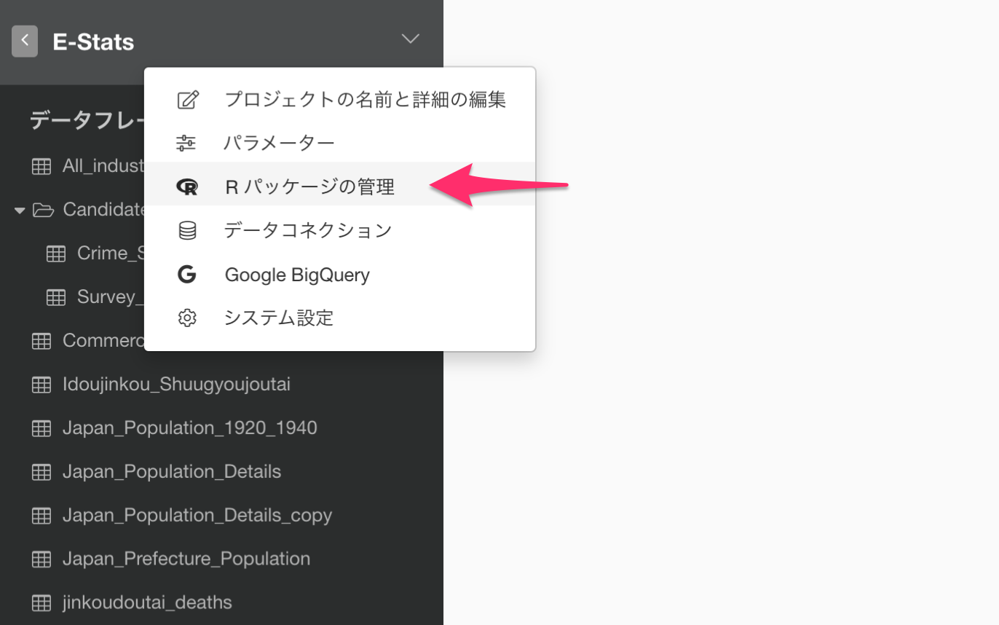

2. 「パッケージをインストール」のタブを選び、「estatapi」と入力して「インストール」ボタンを押します。

   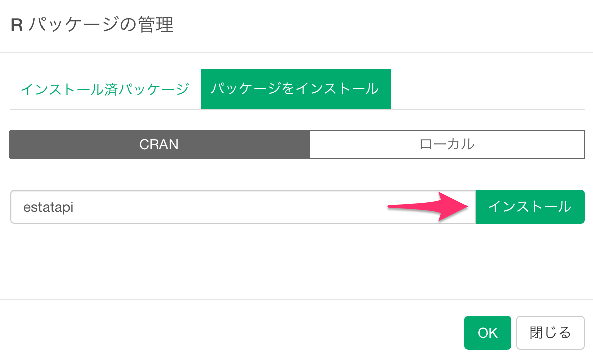

3. インストールが終わると、「estatapi」が「インストール済みのパッケージ」のリストに入り、チェックが付いています。チェックが付いていると、そのパッケージの関数をそのまま使えます。

   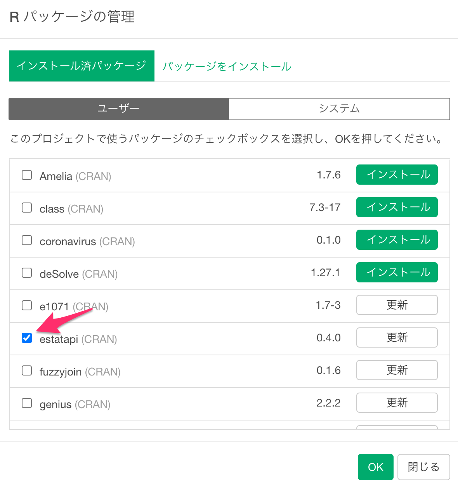

### 統計表情報を取得する

興味のあるキーワードから、どんな統計表があるかを取得します。

1. データフレームの「＋」ボタンから「R スクリプト」を選びます。

   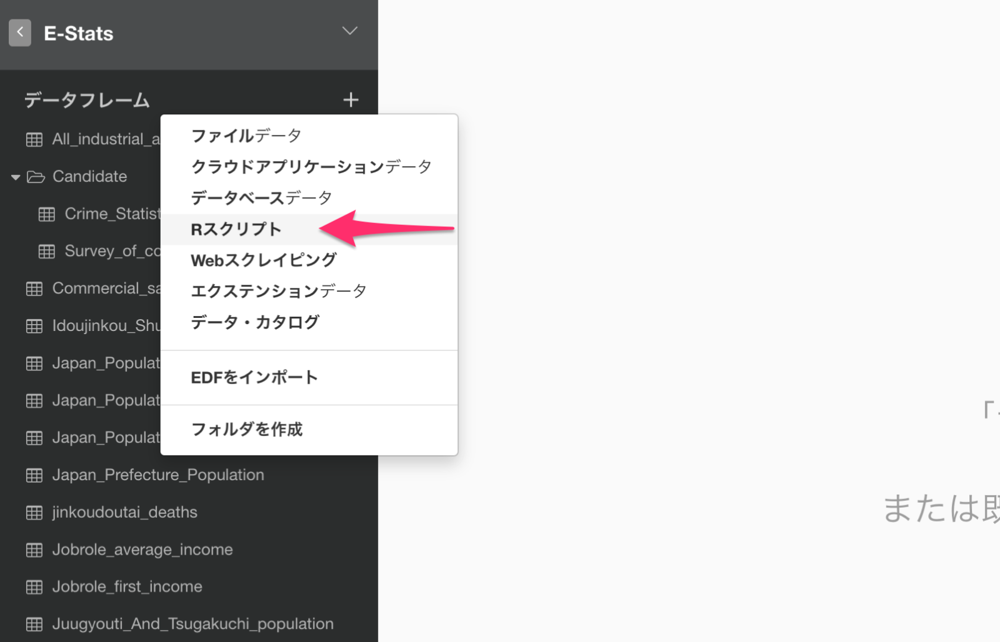

2. R スクリプト・データフレームのダイアログに次のスクリプトを入力して実行します。`appId` には取得したアプリケーション ID を、`searchWord` には興味のあるキーワードを、それぞれ引用符の中に入れて指定します。

   ```text
   estat_getStatsList(appId = "取得したID", searchWord = "インフルエンザ")
   ```

   関連した統計表が表示されます。この例では「インフルエンザ」というキーワードで統計表を取得しています。

   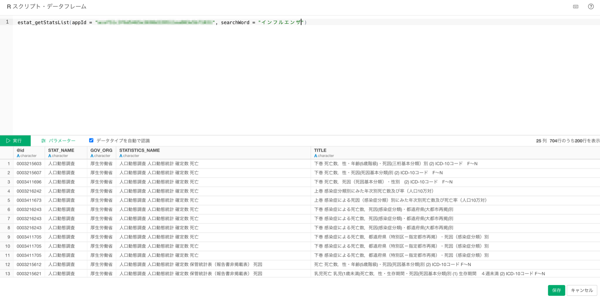

3. キーワードによっては取得される統計表が多くなります。テーブルビューのフィルタ機能で絞り込めます。

   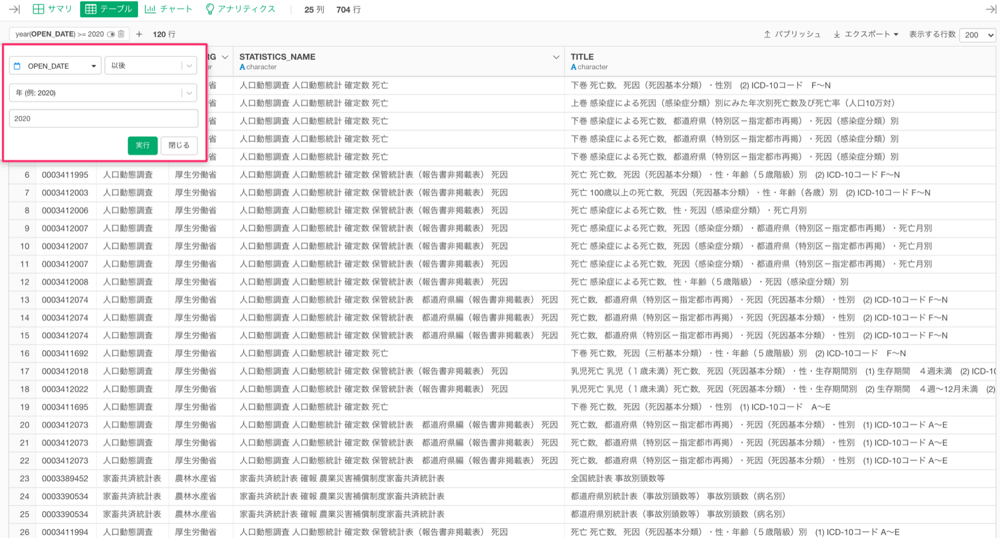

4. 統計表の `@id` 列が、統計データを取得するときに必要な一意の ID です。この例では、厚生労働省が公開している「人口動態調査の感染症による死因」のデータを使うため、`@id` 列の「0003411673」をコピーしておきます。

   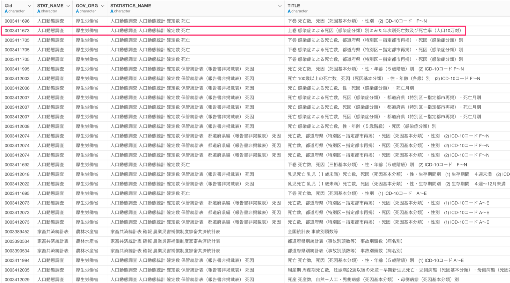

### 統計データを取得する

1. データフレームの「＋」ボタンから「R スクリプト」を選びます。

   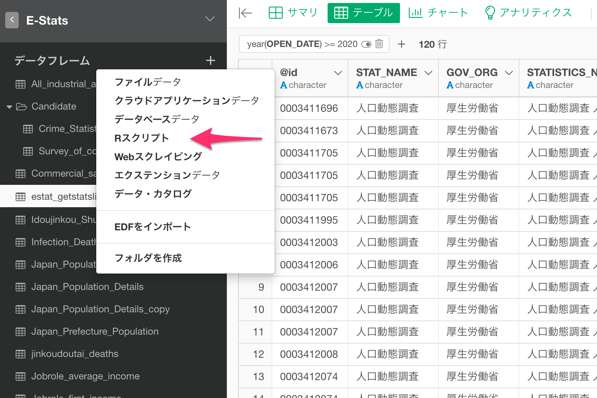

2. R スクリプト・データフレームのダイアログで次のスクリプトを実行します。`statsDataId` には、統計表の `@id` 列の値を引用符の中に入れて指定します。アプリケーション ID も引用符の中で置き換えます。

   ```text
   estat_getStatsData(
     appId = "取得したID",
     statsDataId = "0003411673"
   )
   ```

   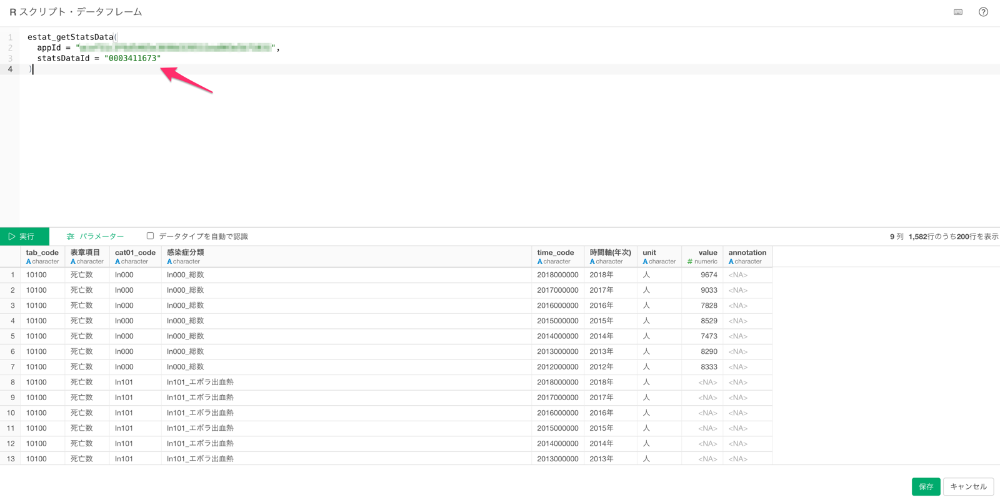

取得される行数が多いときは、`limit` で取得する行数を制限できます。

```text
estat_getStatsData(
  appId = "取得したID",
  statsDataId = "0003411673",
  limit = 100
)
```

特定のカテゴリのデータだけを取得したいときは、データの中の `cat01_code` の値を `cdCat01` に指定します。複数指定するときは、コンマで区切ります。

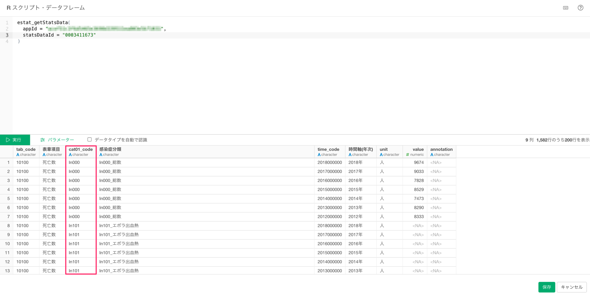

```text
estat_getStatsData(
  appId = "取得したID",
  statsDataId = "0003411673",
  cdCat01 = c("In000", "In101")
)
```

この例では、`limit` もカテゴリコードも使わずにインポートします。サマリビューで、基本統計値やデータの分布、欠損値の数などを把握できます。

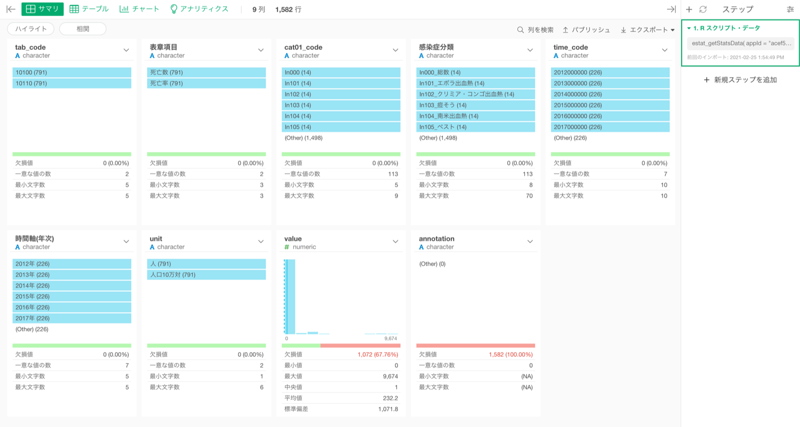

## 参考資料

- [estatapi パッケージ](https://cloud.r-project.org/web/packages/estatapi/estatapi.pdf)
- [estatapi - 政府統計の総合窓口（e-Stat）の API を使うための R パッケージ](https://yutannihilation.github.io/estatapi/)
