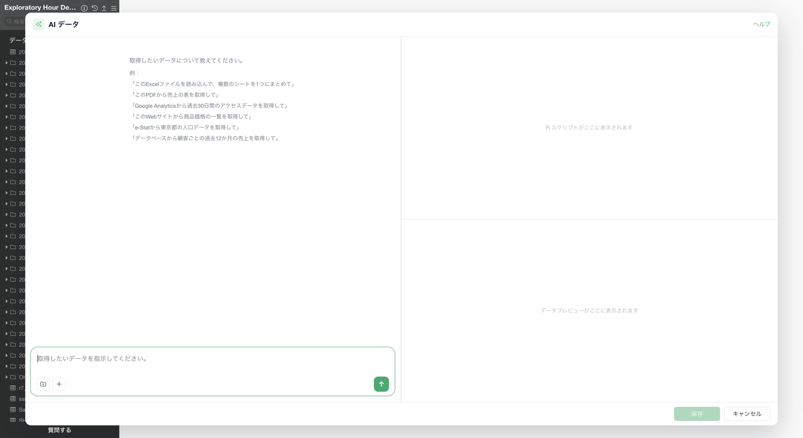
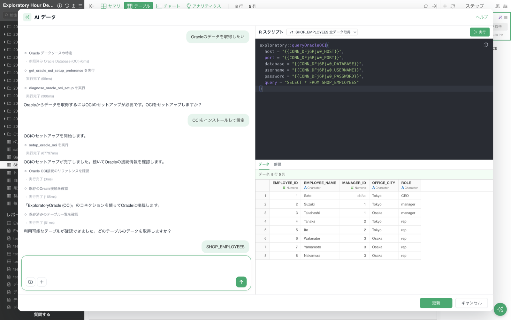
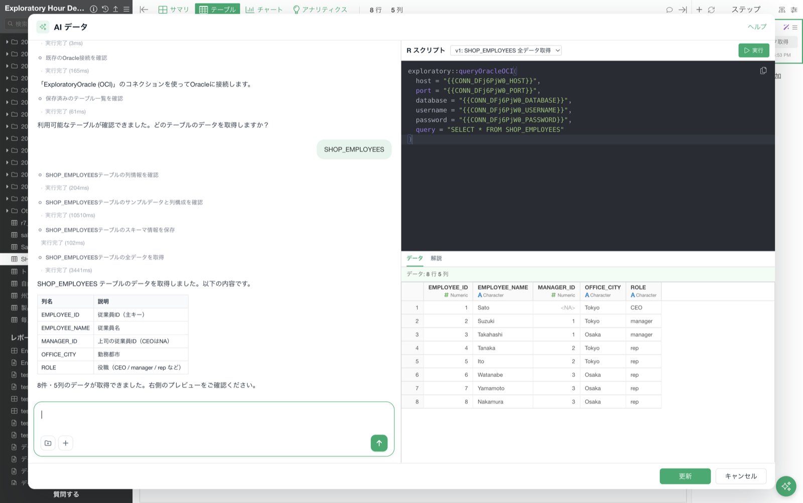
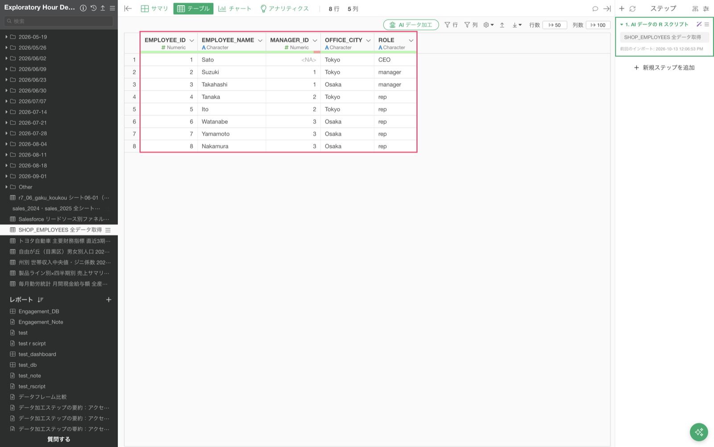

Oracle には、ODBC を使う接続に加えて、OCI を使う接続方法があります。OCI で接続するには、事前に OCI のインストールと設定が必要です。AI データを使うと、そのインストールと設定を会話の中で進め、続けて Oracle のデータを取得できます。

## 使い方

1. データフレームの追加メニューから「AI データ」を開きます。

   

2. 「Oracleのデータを取得したい」と入力して送信します。AI データが OCI の設定状況を確認し、セットアップが必要な場合は、インストールするかどうかを尋ねます。

3. 表示された選択肢から「OCIをインストールして設定」を選びます。AI データがダウンロードと設定を進めるので、完了するまで待ちます。

   セットアップが完了すると、チャットに完了のメッセージが表示されます。続けて Oracle の接続情報が確認され、登録済みの接続を使ってデータ取得へ進みます。保存後にインポートステップを開くと、OCI のセットアップが完了し、登録済みの接続が確認された履歴を見られます。

   

4. 取得するテーブルの候補が表示されたら、使いたいテーブルを選びます。この例では「SHOP_EMPLOYEES」を選び、全データを取得します。

   AI データがテーブルの列構成を確認し、取得用のスクリプトを作成します。結果が右側のプレビューに表示されたら、取り込みたい列と値を確認します。保存後にインポートステップを開くと、テーブルを選んで取得した履歴と、その取得結果を確認できます。

   

5. プレビューを確認して「保存」を押します。この例の保存した表では、従業員ID、従業員名、上司の従業員ID、勤務都市、役職を確認できます。

   
