ODBC を使って、Oracle Database のデータを Exploratory にインポートします。ODBC ドライバーをインストールして接続を設定し、コネクションを作ってから、データをインポートします。

## Windows で Oracle Instant Client の ODBC を設定する

### 1. Microsoft Visual C++ Redistributable をインストールする

Oracle Instant Client を利用するには、Microsoft Visual C++ Redistributable が必要です。インストールしていない場合は、[こちら](https://aka.ms/vs/17/release/vc_redist.x64.exe)からインストーラーをダウンロードして実行します。詳細は[最新の Microsoft Visual C++ Redistributable バージョン](https://learn.microsoft.com/en-us/cpp/windows/latest-supported-vc-redist?view=msvc-170#latest-microsoft-visual-c-redistributable-version)をご覧ください。

### 2. Oracle Instant Client をインストールする

[Oracle Instant Client Downloads for Microsoft Windows (x64) 64-bit](http://www.oracle.com/technetwork/topics/winx64soft-089540.html) のページにアクセスします（登録が必要です）。複数のドライバーバージョンがあるので、Oracle Database に対応した認証済みのバージョンを選び、次の2つのパッケージをダウンロードします。

- 基本パッケージ
- ODBC パッケージ

ダウンロード後、両方のパッケージを同じディレクトリ（例: `C:/Oracle/oracle_odbc`）に解凍します。このディレクトリに両方の zip ファイルの内容が表示されます。

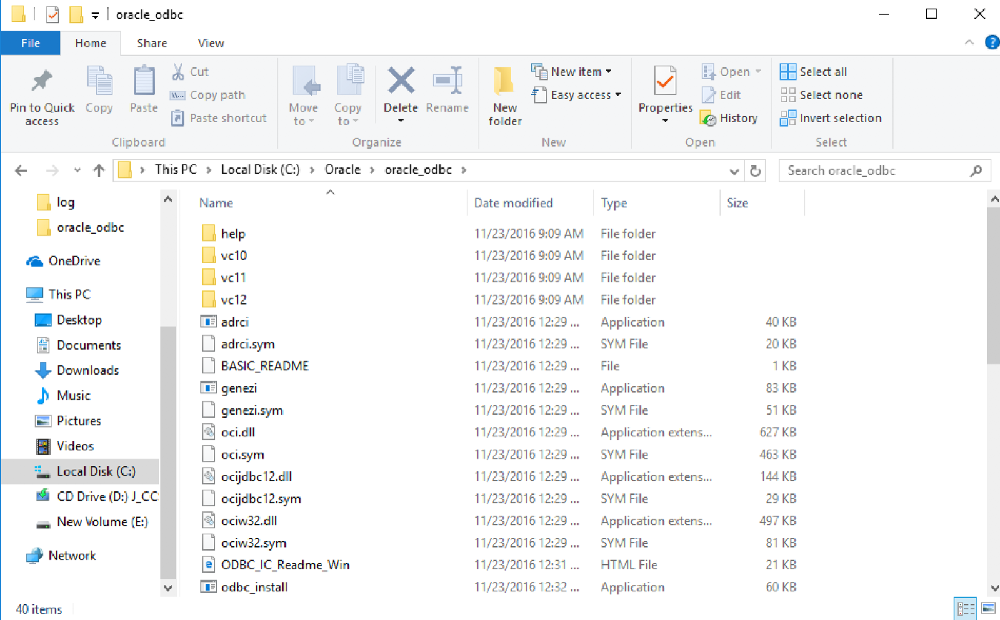

次に、`odbc_install.exe` を右クリックして「管理者として実行」を選び、管理者権限で実行します。

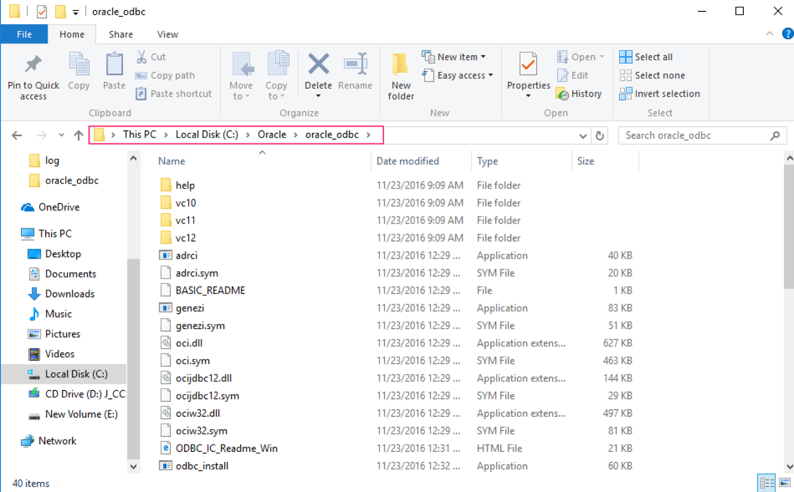

### 3. 環境変数を設定する

Oracle Instant Client のインストールディレクトリ（例: `C:/Oracle/oracle_odbc`）を指す2つの環境変数を設定します。

1. Windows の検索ボックスに「environment」と入力し、表示された結果から「Edit the system environment（システム環境変数の編集）」をクリックします。

   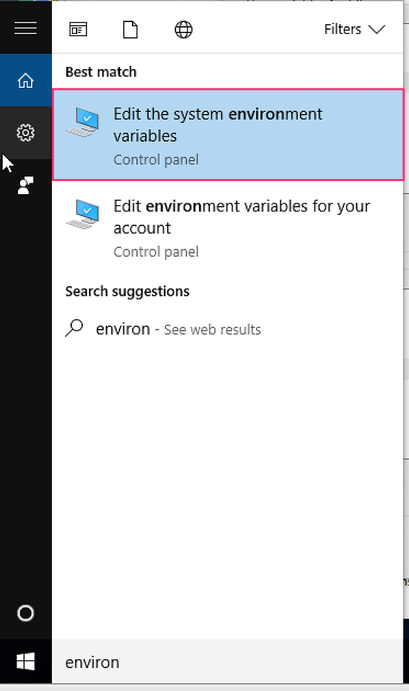

2. ダイアログが表示されたら、「Environment Variables…（環境変数）」ボタンをクリックします。

   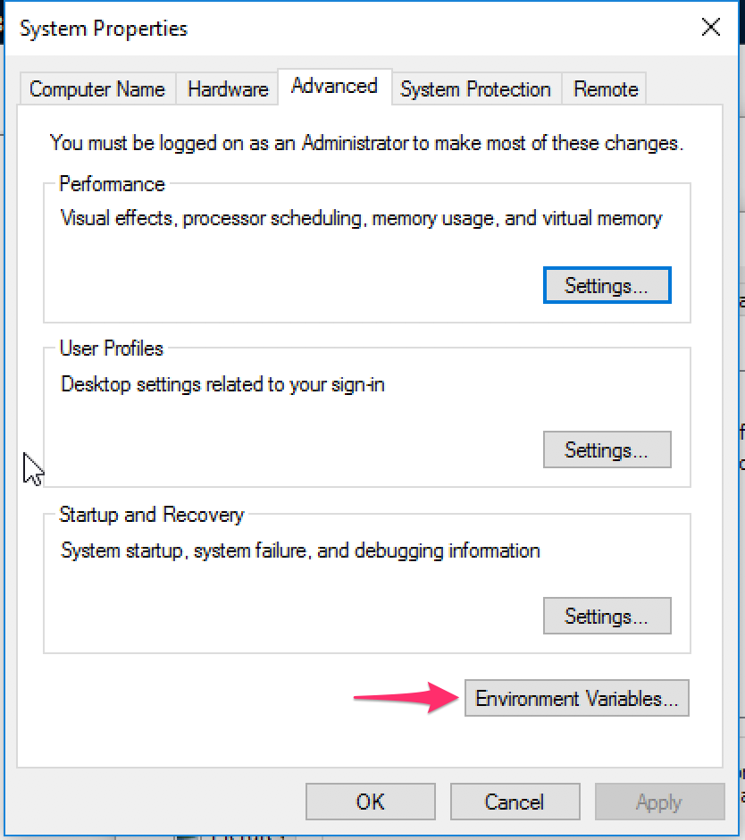

3. ダイアログ上部のペインで環境変数 PATH を選び、「Edit（編集）」ボタンをクリックします。

   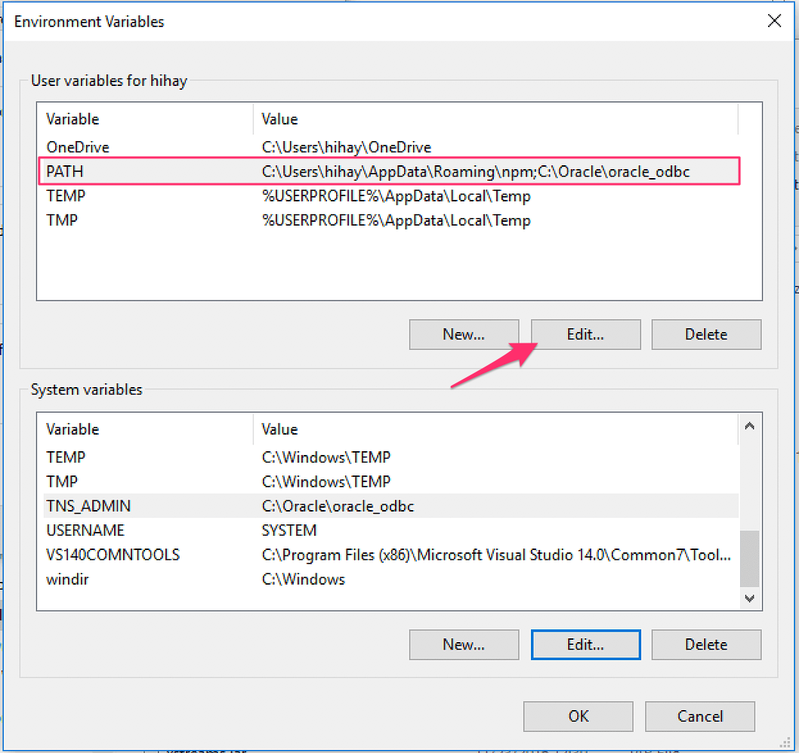

4. 表示されたダイアログで、先ほどのディレクトリのパスを追加し、OK ボタンをクリックします。

   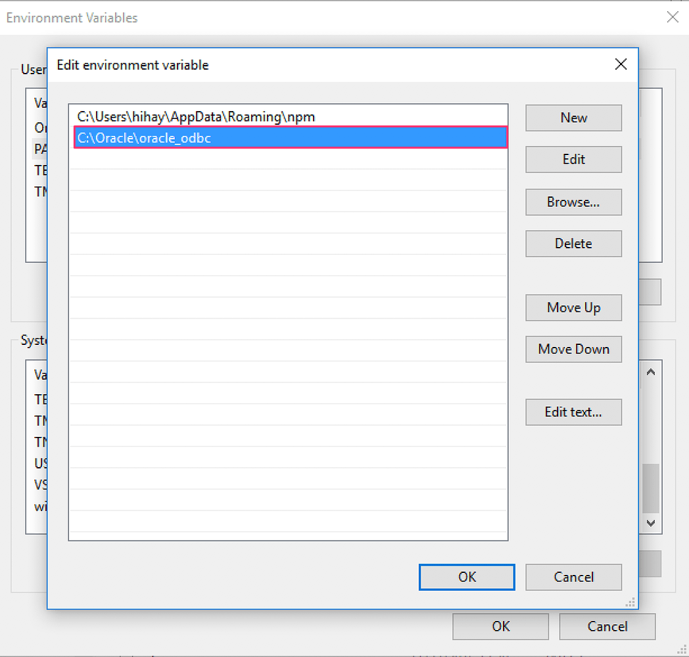

5. 続いて TNS_ADMIN を設定します。ダイアログ下部のペインの「New（新規）」ボタンをクリックします。

   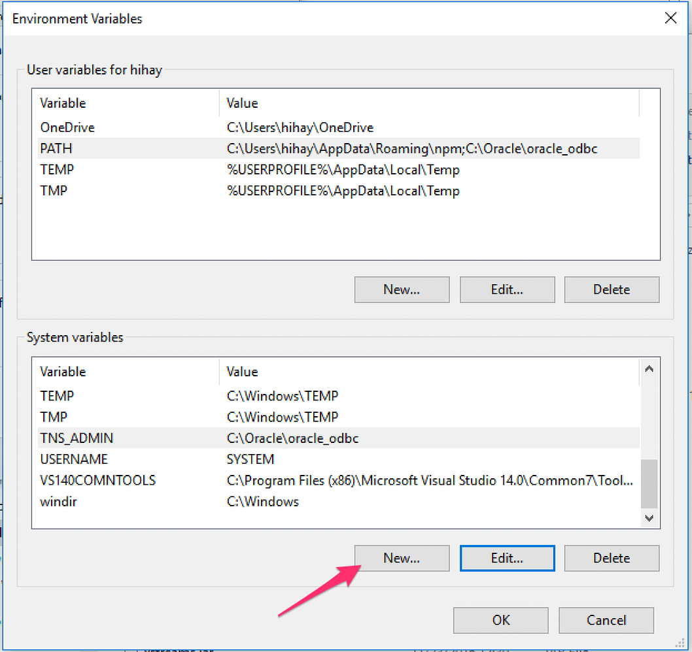

6. 「Variable name（変数名）」に「TNS_ADMIN」、「Variable Value（変数値）」にディレクトリのパスを入力し、「OK」をクリックします。

   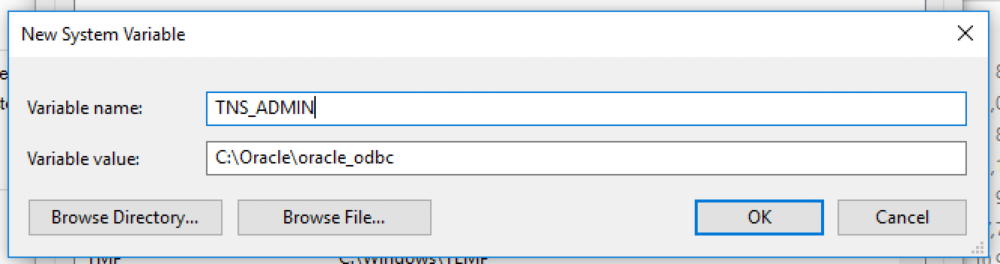

### 4. Exploratory で接続を作成する

1. Exploratory を起動してプロジェクトを開き、プロジェクトメニューから「データコネクション」を選びます。

   

2. 「追加」ボタンをクリックします。

   

3. Oracle データベースを選びます。

   

4. Oracle 用の ODBC ドライバーのドロップダウンにインストールしたドライバーが表示されていることを確認し、Oracle データベースの詳細を入力して設定を完了します。

   

Oracle の接続を作成したら、データベースのインポートで「Oracle」とその接続を選びます。

## Mac で Oracle Instant Client の ODBC を設定する

Mac では、次の手順で設定します。コネクションの作成は、Windows の「4. Exploratory で接続を作成する」と同じ「データコネクション」から行い、インポートでは「Oracle」とその接続を選びます。

1. [unixODBC をインストールします](https://exploratory.io/note/exploratory/How-to-set-up-ODBC-in-Mac-unixodbc-lQz2Fnp7)。
2. Oracle の公式サイトから、お使いの macOS のアーキテクチャ（ARM64 または Intel x86）に対応した Instant Client の Basic と ODBC のパッケージをダウンロードし、ディレクトリ（例: `~/instantclient_23_3`）に解凍します。
   - [Oracle Instant Client Downloads for macOS (ARM64)](https://www.oracle.com/database/technologies/instant-client/macos-arm64-downloads.html)
   - [Oracle Instant Client Downloads for macOS (Intel x86)](https://www.oracle.com/database/technologies/instant-client/macos-intel-x86-downloads.html)
3. 付属のスクリプトで `odbcinst.ini` を更新します。以下のコマンドは、Homebrew のインストール先が `/opt/homebrew` の例です。先に `brew --prefix` で確認し、登録コマンドとシンボリックリンクの両方で、自分のパスを使ってください。更新後、`odbcinst.ini` に Oracle ODBC ドライバーの情報が入っていることを確認します。

   ```text
   cd ~/instantclient_23_3
   ./odbc_update_ini.sh /opt/homebrew
   ```

4. Oracle ODBC ドライバーが unixODBC で動くように、シンボリックリンクを作成します。次のコマンドは、`libodbcinst.2.dylib` が `/opt/homebrew/lib` にあることを前提にしています（`brew --prefix` の結果に合わせて読み替えます）。

   ```text
   cd ~/instantclient_23_3
   ln -s /opt/homebrew/lib/libodbcinst.2.dylib . 
   ```

5. シェルの設定ファイル（`~/.zshrc` や `~/.bash_profile` など）に次の行を追加し、設定を読み込み直します。

   ```text
   export PATH=~/instantclient_23_3:$PATH
   export ORACLE_HOME=~/instantclient_23_3
   export DYLD_LIBRARY_PATH=~/instantclient_23_3
   export TNS_ADMIN=~/instantclient_23_3/network/admin  # TNS 名を使う場合のみ
   ```

   ```text
   source ~/.zshrc  # または source ~/.bash_profile
   ```

## OS 側で DSN を登録し、汎用 ODBC 接続でインポートする

ここまでの「Oracle」の接続とは別の方法です。OS 側でデータソース名（DSN）を登録し、汎用の「ODBC（Oracle, Hive, etc.）」接続でインポートします。Oracle の接続を作成しても、この手順に必要な OS 側の DSN は作成されません。

まず、ODBC ドライバーをインストールし、Exploratory に接続するデータベースの DSN を設定します。Oracle Database での DSN の作成方法は、次のノートにあります。

- Oracle（Windows 用）: [Oracle Instant Client を使って Windows から ODBC で Oracle Database に接続する方法](https://exploratory.io/note/BWz1Bar4JF/Oracle-Instant-Client-Windows-ODBC-Oracle-Database-AGi5wIz7QG)
- Oracle（Mac 用）: [Connecting to Oracle Database through ODBC from Mac](https://exploratory.io/note/exploratory/Connecting-to-Oracle-Database-through-ODBC-from-Mac-lRg4zWa8)

### コネクションを作成する

1. プロジェクト名の横のメニューから「データコネクション」を選びます。

   

2. 「追加」のボタンをクリックします。

   

3. 「ODBC（Oracle, Hive, etc.）」を選びます。

   

4. 作成した DSN を選び、「コネクションをテスト」をクリックして動作することを確認します。

   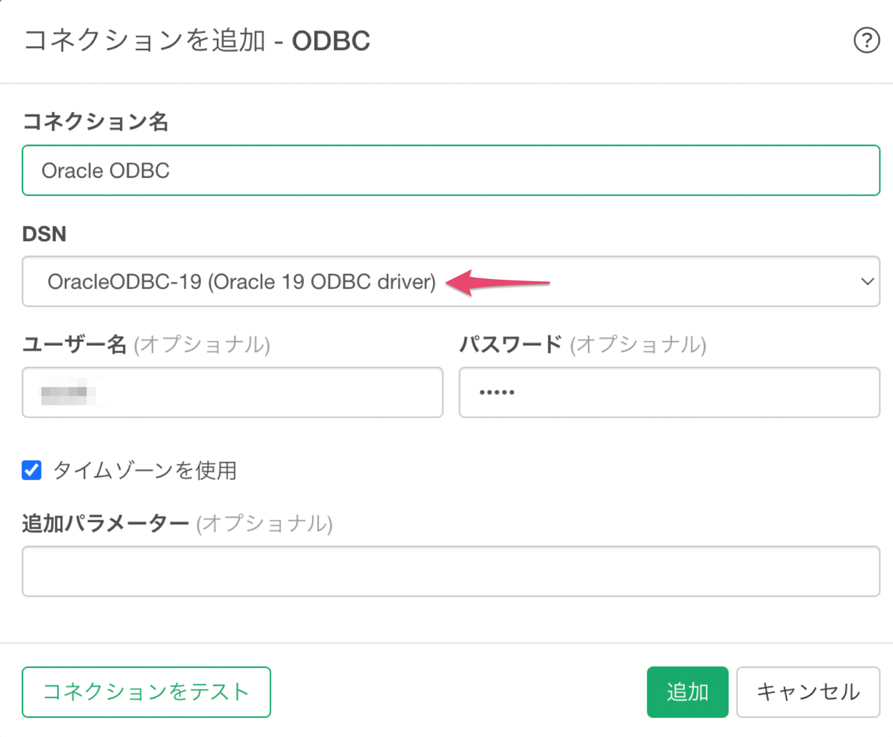

5. 「追加」ボタンをクリックして、接続を保存します。

### インポートする

1. データフレームの横にある「＋」ボタンをクリックし、「データベースデータ」を選びます。

   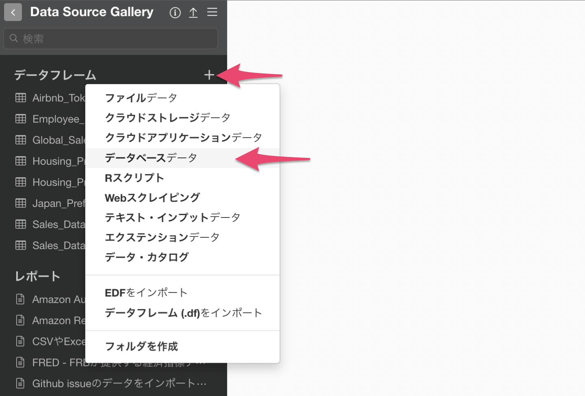

2. 「ODBC（Oracle, Hive, etc.）」を選びます。

   

3. 「実行」ボタンをクリックして、ODBC データベース接続からのデータを確認します。

   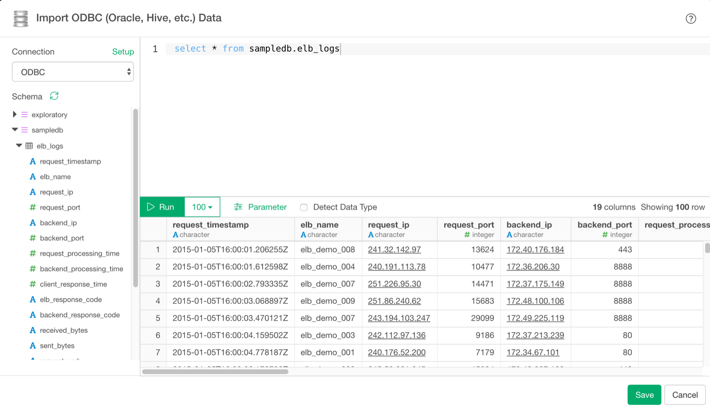

4. 問題がなければ、「保存」ボタンをクリックして、データを Exploratory にインポートします。

### SQL でパラメータを使う

1. インポートダイアログの「パラメータ」を選びます。

   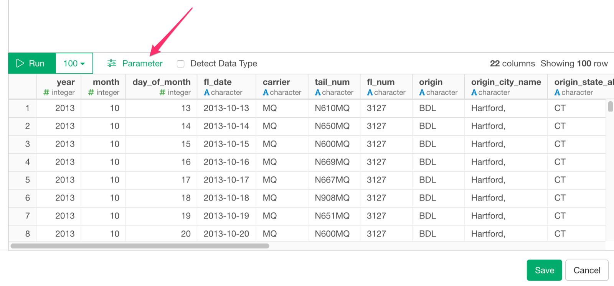

2. パラメータを作成し、「保存」ボタンをクリックします。

   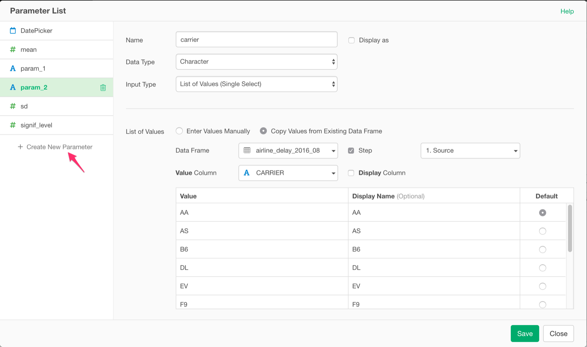

3. SQL のクエリの中で、`@` を使ってパラメータを指定します。

   ```text
   select *
   from airline_2016_01
   where carrier = @{carrier}
   ```

   「@」と入力すると、パラメータの候補が表示されます。

   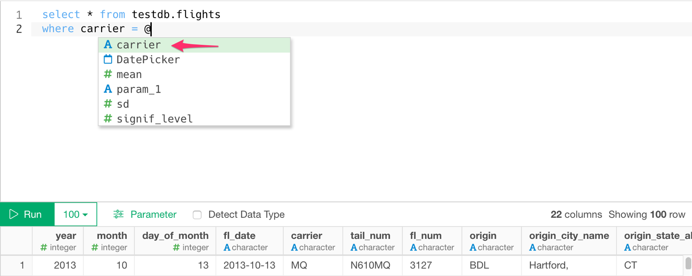

## Windows 版で日本語データが文字化けするとき

Windows 版の Exploratory で Oracle から日本語データを読み込むと、日本語が文字化けして「?」になることがあります。


次の手順で、Oracle データベース用のエンコーディングを設定します。

1. プロジェクト名の横のメニューから「システム設定」を選びます。

   

2. 「データベース」タブを選び、「Oracle データベース用のエンコーディング (NLS_LANG)」で JAPANESE_JAPAN.AL32UTF8 を選びます。

   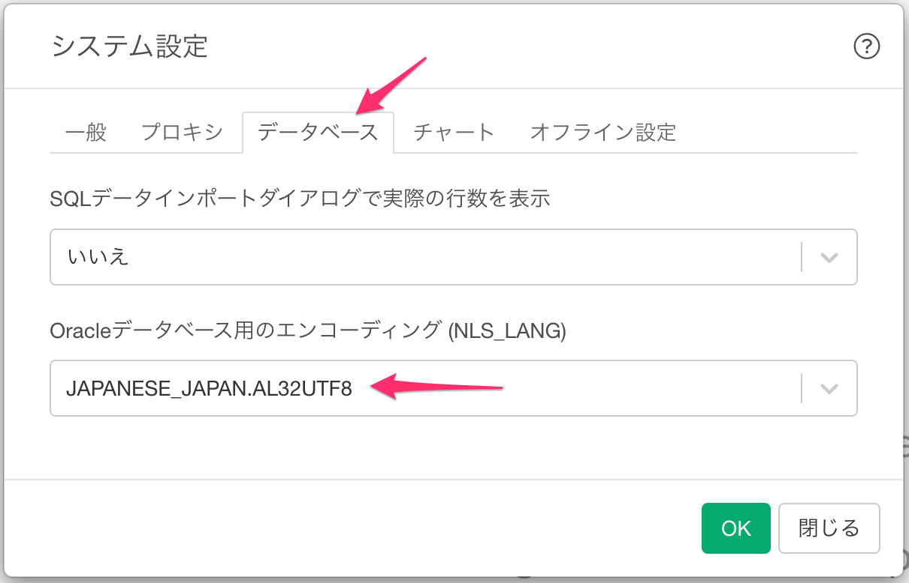

3. 「レガシーのWindows文字エンコードを使用」が「いいえ (UTF-8)」になっていることも確認します。

   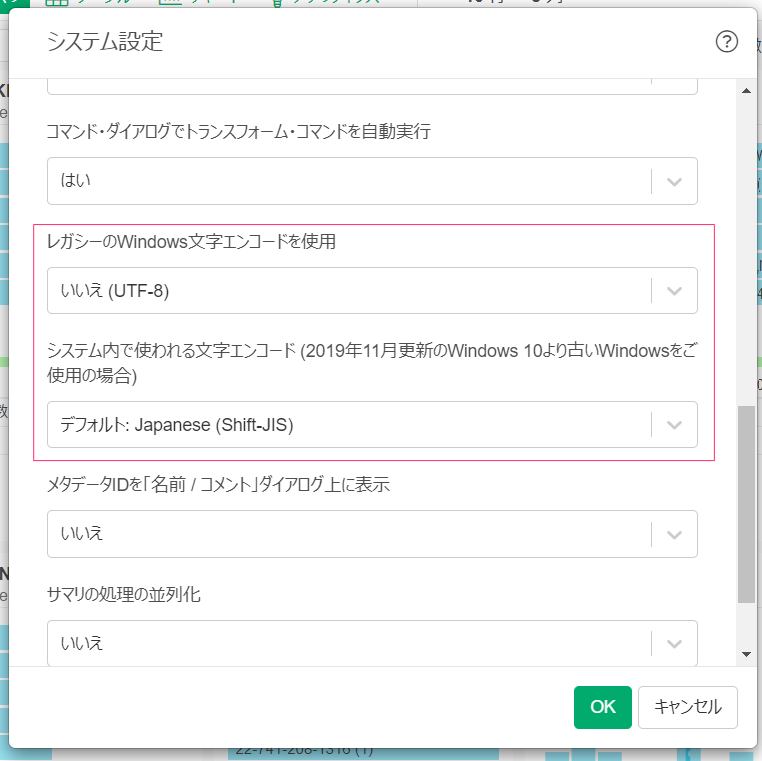

この状態でデータを読み直すと、文字化けが解消します。保存または更新ボタンをクリックすると、データをインポートできます。


