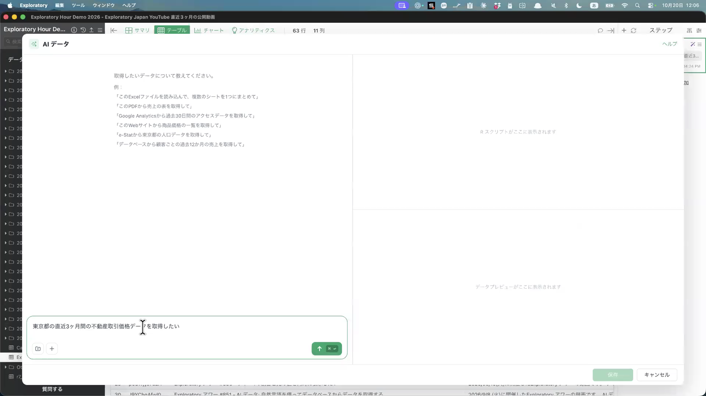
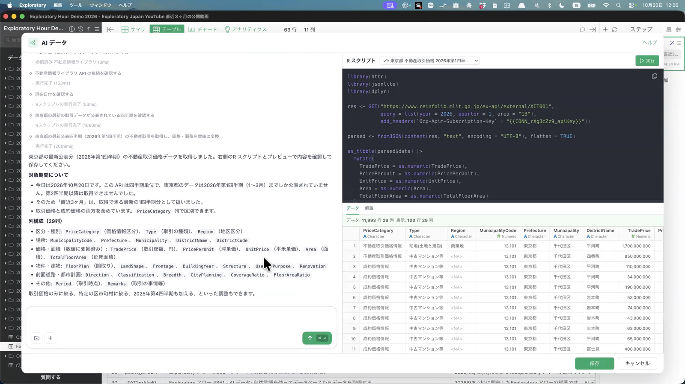
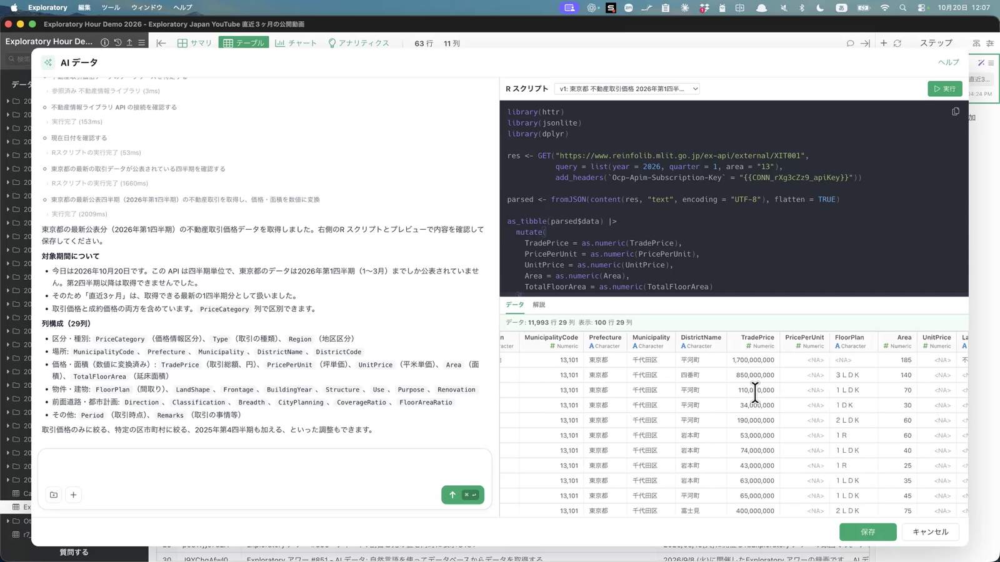
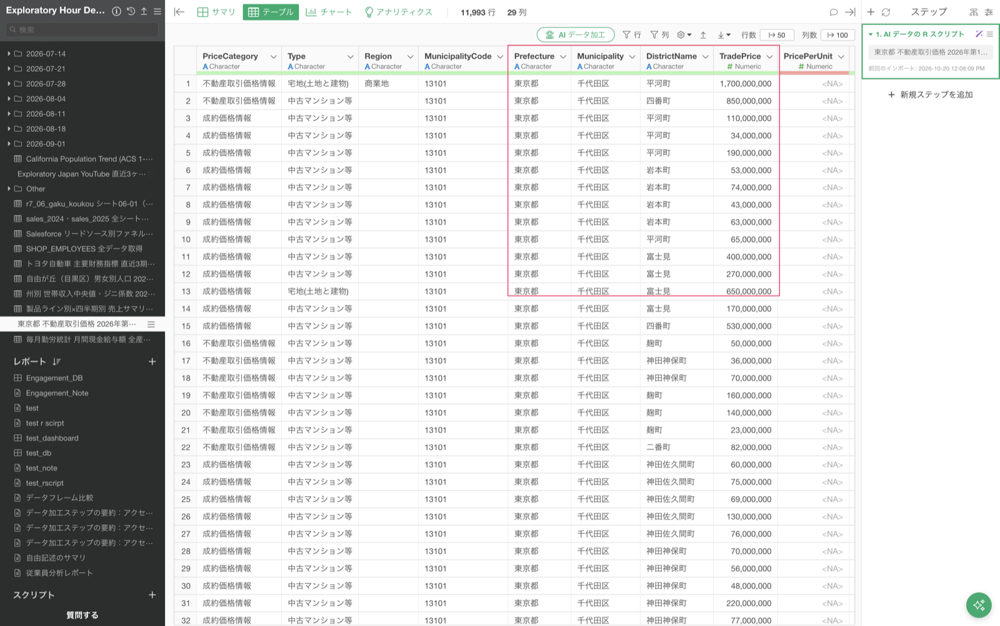

AI データを使うと、不動産情報ライブラリの API から、地域と期間を文章で指定して不動産取引価格データを取得できます。取得した価格や間取りなどは、表で確認できます。

## 事前の準備

不動産情報ライブラリの API を使うには、事前に API キーを申請して取得する必要があります。以下の例では、登録済みの接続を使います。

AI データでは、先に接続を選ぶ方法に加えて、接続を選ばずに取得したいデータを伝える方法もあります。接続がない場合は、接続を作成するダイアログが表示されます。

## 使い方

ここでは、東京都の不動産取引価格データを取得します。

1. データフレームの追加メニューから「AI データ」を開きます。この例では接続を選ばず、「東京都の直近3ヶ月間の不動産取引価格データを取得したい」と入力して送信します。

   

2. AI データが、登録済みの接続と、公表されているデータの期間を確認します。この例では、最新公表分として2026年第1四半期のデータを取得します。依頼した期間と、実際に取得された期間はチャットで確認できます。

   プレビューには、中古マンションや宅地などの種類、都道府県、市区町村、地区名、取引価格などが表示されます。

   

3. 表を横にスクロールすると、取引価格を表す「TradePrice」や、間取りを表す「FloorPlan」などを確認できます。一部の値は欠損しています。

   

4. 取得結果に問題がなければ「保存」を押し、データフレームを作成します。保存後は、東京都の不動産取引価格データを Exploratory の表で確認できます。

   

取得する期間を半年に広げたい場合や、神奈川県、千葉県も追加したい場合は、保存する前に AI データへ追加の指示を伝えます。
