インストールすると、AI ツールから Exploratory Desktop を使えるようになります。Exploratory Desktop のシステム設定から、Desktop MCP のプラグインを、このコンピューターの AI ツールにインストールします。
所要時間は 5 分ほどです。同じコンピューターに、Exploratory Desktop と、プラグインを入れる AI ツール（Claude Code、Codex、Antigravity、Cursor のいずれか）を用意してください。

Claude Code、Codex、Antigravity、Cursor は、どれも Exploratory Desktop のシステム設定から入れられます。システム設定から入れられない場合は、[手作業でインストールする](#manual)をご覧ください。

<a id="steps"></a>

## インストールする

### システム設定でインストールする

Exploratory Desktop で、画面の左下にある自分の名前を選び、開いたメニューで「システム設定」を選びます（画面の画像の ① と ②）。

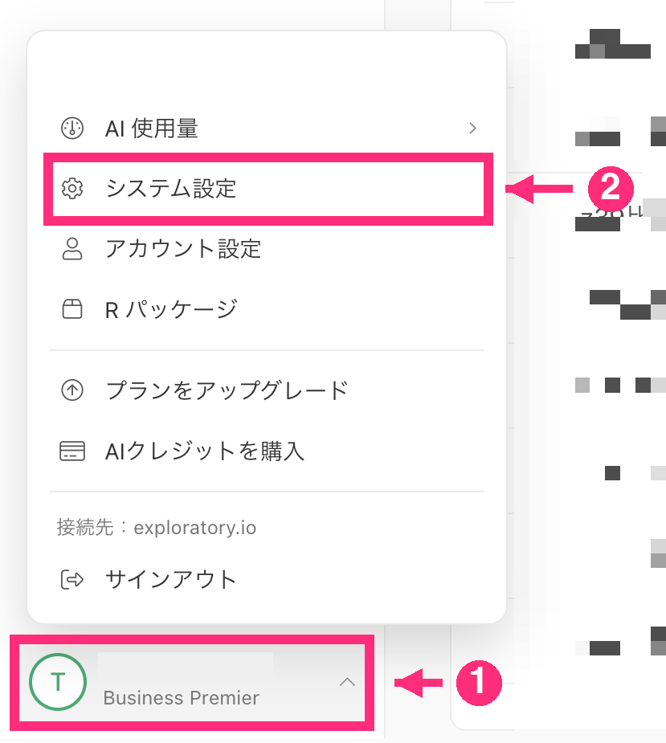

1. 左のメニューで、「MCP / CLI」を選びます。
2. 「Exploratory Desktop プラグインのインストール」の欄を探します。
3. 使う AI ツールの行の「インストール」を選びます。

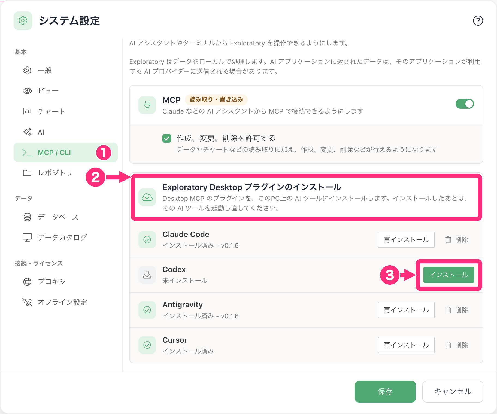

この欄の説明は次のとおりです。

> Desktop MCP のプラグインを、このPC上の AI ツールにインストールします。インストールしたあとは、その AI ツールを起動し直してください。

この欄には、Claude Code、Codex、Antigravity、Cursor が並びます。このコンピューターにない AI ツールには、「このパソコンに見つかりません」と表示されます。コマンドは、アプリの起動時に自動で入ります。コマンドを登録する操作は要りません。

続けて、同じ画面で、次の操作をします。

4. 「MCP」のスイッチをオンにします。初期状態ではオフです。
5. チャートやノートなどを AI に作成・変更させるときだけ、「作成、変更、削除を許可する」にチェックを入れます。チェックがないと、AI は読み取りだけができます。
6. 画面の下にある「保存」を選びます。

保存しないと、「MCP」のスイッチと「作成、変更、削除を許可する」の設定が反映されません。

<a id="check"></a>

### AI ツールで確かめる

1. インストールが終わったら、その AI ツールを起動し直します。
2. AI ツールが初めて接続すると、Desktop に「AI ツールが許可を求めています」という画面が出ます。自分で起動したアプリだけ「許可する」を選んでください。「許可しない」を選んだときは、[うまくいかないとき](/ja/mcp/desktop/get-started#trouble)を参照してください。
3. Exploratory Desktop で、使うプロジェクトを開きます。
4. AI ツールで、次のように頼みます。

   ```text
   開いている Exploratory のプロジェクトのデータフレームを一覧して
   ```

   これは、「作成、変更、削除を許可する」がオフでも動きます。作成も試すときは、「作成、変更、削除を許可する」をオンにして保存してから、自分のデータの列を使った棒グラフなど、チャートを作るように頼みます。

5. 接続を確かめます。
   - Claude Code では、`/mcp` を開いて、exploratory-desktop が接続されていることを確認します。
   - Codex では、`codex mcp list` を実行して、exploratory-desktop が並んでいることを確認します。
   - Antigravity では、アプリの Customizations > Installed に、プラグインが表示されていることを確認します。
   - システム設定から Cursor に入れた場合は、システム設定の Cursor の行に「インストール済み - v」とプラグインのバージョンが表示されていることを確認します。アプリから入れた場合は、Cursor に「開いている Exploratory のプロジェクトのデータフレームを一覧して」と頼み、一覧が返ってくることを確認します。

MCP がオフだと表示されたときは、システム設定に戻り、「MCP」のスイッチをオンにして「保存」を選んだかを確かめます。

<a id="differences"></a>

## AI ツールごとの違い

システム設定での操作はどの AI ツールも同じですが、入るものが少し違います。

| AI ツール | システム設定から入るもの | システム設定の表示 |
| --- | --- | --- |
| Claude Code | Exploratory Desktop のプラグイン（スキルを含む） | 「インストール済み - v」とプラグインのバージョン。「インストール」の代わりに「再インストール」と「削除」 |
| Codex | 同上 | 同上 |
| Antigravity | 同上 | 同上 |
| Cursor | 同上。入る場所だけが違い、\~/.cursor/mcp.json ではなく、Cursor のプラグインのフォルダ（\~/.cursor/plugins/local/exploratory）へコピーします。\~/.cursor/mcp.json に古い exploratory-desktop の項目が残っていると、その項目を削除します。ほかの項目は残ります | 同上 |

どの AI ツールも、インストールのあとに起動し直します。

各行のボタンは、状態によって変わります。

| 状態 | 表示とボタン |
| --- | --- |
| インストールしていない | 「未インストール」と、緑の「インストール」 |
| インストール済み | 「インストール済み」と、「再インストール」「削除」 |

「削除」を選ぶと、確認の画面が出ます。

<a id="failure"></a>

## インストールに失敗したとき

失敗すると、その AI ツールの行の 2 行目に、赤い文字で「インストールできませんでした。」と表示されます。すぐ右に「詳細」、その後ろに理由の文（例:「インターネットに接続できているか確認してください。」）、行の右に「もう一度試す」のボタンが出ます。インストール済みのプラグインの更新に失敗したときは、その右に「削除」のボタンも出ます。

「詳細」にマウスを載せると、実行したコマンドの出力が、吹き出しで表示されます。出力は、末尾の 2000 文字までです。長いときは、吹き出しの中を縦にスクロールできます。吹き出しの中にマウスを移しても消えません。「詳細」をクリックすると、開いたままになります。右上の「コピー」で、出力をコピーできます。

画像は、インストール済みのプラグインの更新に失敗したときの、エラーの詳細の表示例です。吹き出しに出ているコマンドの出力は、サンプルで、実際の出力とは異なります。

1. 「詳細」にマウスを載せます。
2. 右上の「コピー」を選びます。

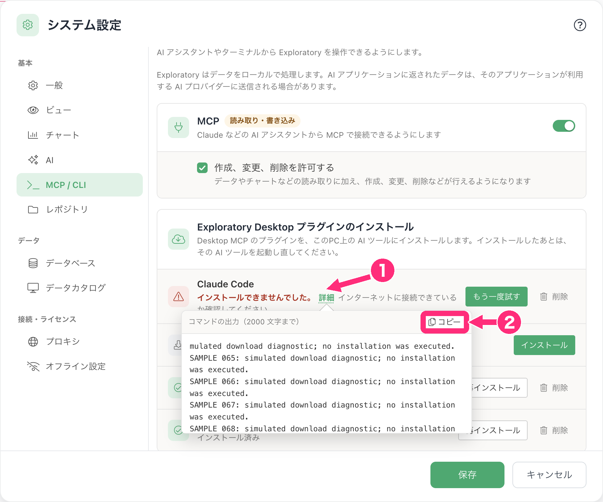

理由の文を読んでも直せないときは、コピーした出力を添えて、サポートに問い合わせてください。直ったら、「もう一度試す」を選びます。

<a id="manual"></a>

## 手作業でインストールする

Exploratory Desktop がネットワークに接続できないなど、システム設定からプラグインを入れられないときは、お使いの AI アプリの手順を選んでください。ターミナルを使う場合は、「コマンドでインストールする」に進んでください。

### アプリからインストールする

- [Claude アプリ](#install-claude-app)
- [ChatGPT アプリ（Codex）](#install-chatgpt)
- [Cursor](#install-cursor)

<a id="install-claude-app"></a>

#### Claude アプリ

Exploratory Desktop と同じコンピューターで Claude アプリを使います。マーケットプレイスを追加するには、Claude アプリから GitHub のリポジトリにアクセスできる必要があります。

1. Claude アプリの「カスタマイズ」で「プラグイン」を選び（❶）、右上の「＋ 追加」を開きます（❷）。

   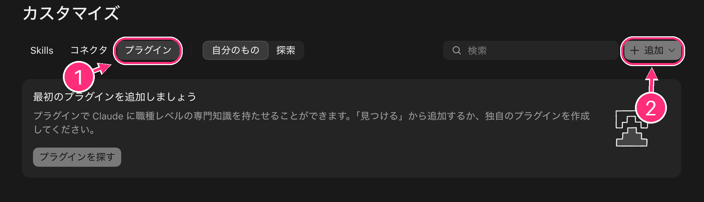

2. メニューの「マーケットプレイスを追加」を選びます（❶）。

   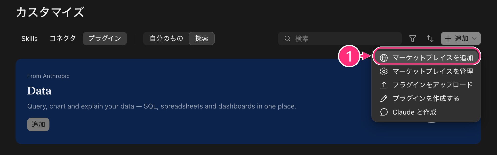

3. 「リポジトリから追加」を選びます（❶）。

   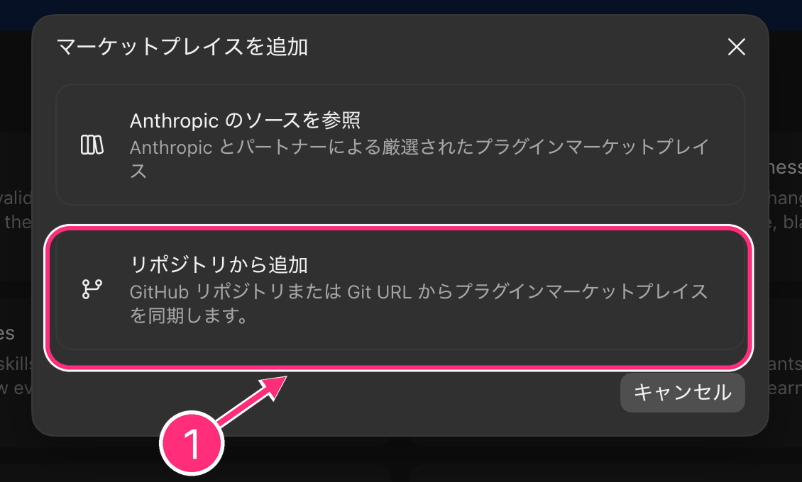

4. URL 欄の「リポジトリを選択」を開きます（❶）。

   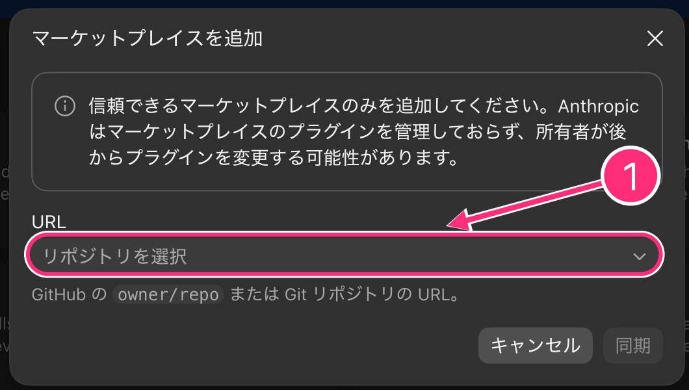

5. `exploratory-io/exploratory` を入力します。入力しても候補は絞り込まれないので、一覧をスクロールして `exploratory-io` の `exploratory` を選びます。URL 欄（❶）に `exploratory-io/exploratory` が表示されていることを確認し、「同期」を選びます（❷）。

   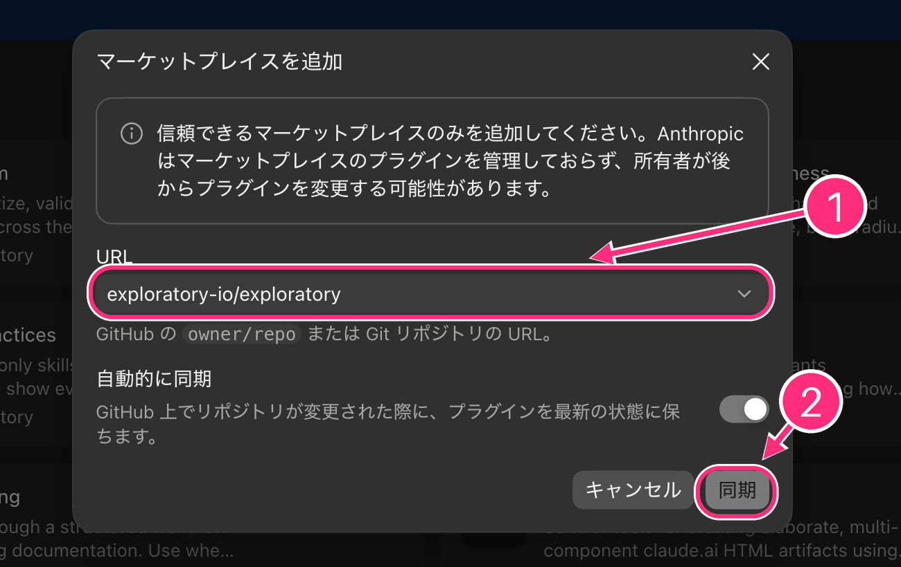

6. 同期が終わると、自動で「探索」タブに切り替わります。「Exploratory Desktop」の行の「追加」を選びます（❶）。

   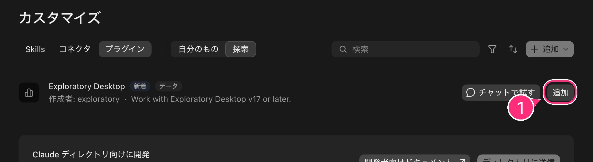

7. ローカル MCP サーバーの確認画面で exploratory-desktop が含まれていることを確認し、「続ける」を選びます（❶）。

   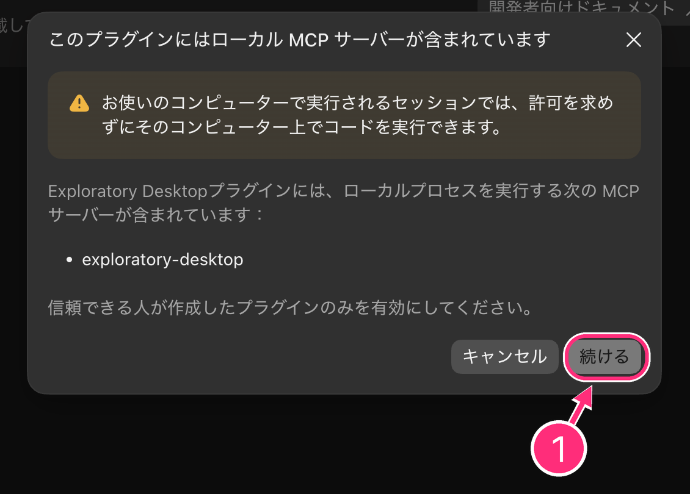

8. インストールが終わると、プラグインの詳細画面が開きます。左上の「← プラグイン」を選んで（❶）、「探索」に戻ります。

   

9. 「自分のもの」タブを選びます（❶）。

   

「追加したマーケットプレイスから」に「Exploratory Desktop」が表示されていることを確認します。


続けて、Exploratory Desktop のシステム設定の「MCP / CLI」で「MCP」をオンにし、画面下の「保存」を選びます。接続を確かめるには、Exploratory Desktop でプロジェクトを開きます。依頼は、Claude アプリの Code タブか、このコンピューターで起動した Cowork から送ります。「開いている Exploratory のプロジェクトのデータフレームを一覧して」と頼みます。開いているプロジェクトのデータフレーム名が返ってくれば、接続できています。ローカルの MCP は、通常のチャットでは使えません。詳しくは[接続を確かめる手順](#check)を参照してください。

<a id="install-chatgpt"></a>

#### ChatGPT アプリ（Codex）

Exploratory Desktop と同じコンピューターで ChatGPT アプリ（Codex）を使います。マーケットプレイスを追加するには、ChatGPT アプリから GitHub のリポジトリにアクセスできる必要があります。

1. 左の「カスタマイズ」で「プラグイン」を選び（❶）、右上の「追加」を開きます（❷）。

   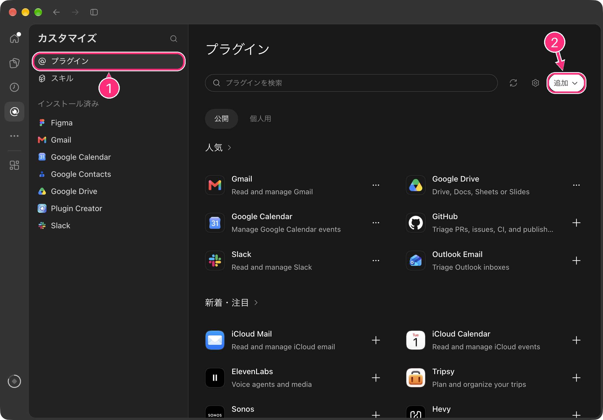

2. メニューの「マーケットプレイスを追加」を選びます（❶）。

   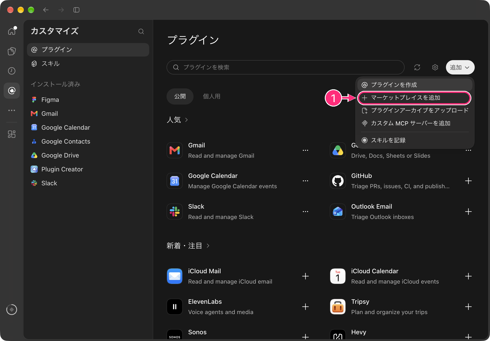

3. 「プラグインマーケットプレイスを追加」の「ソース」欄（❶）に `exploratory-io/exploratory` を入力します。「Git ref」と「スパースパス」は空のままにします。

   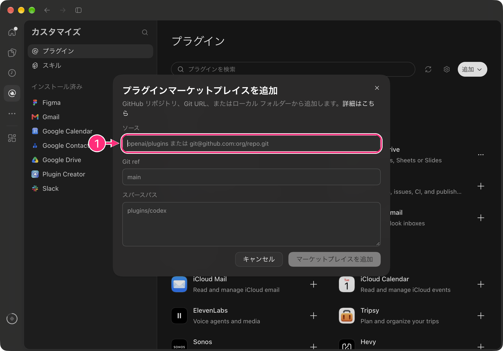

4. 右下の「マーケットプレイスを追加」を選びます（❶）。

   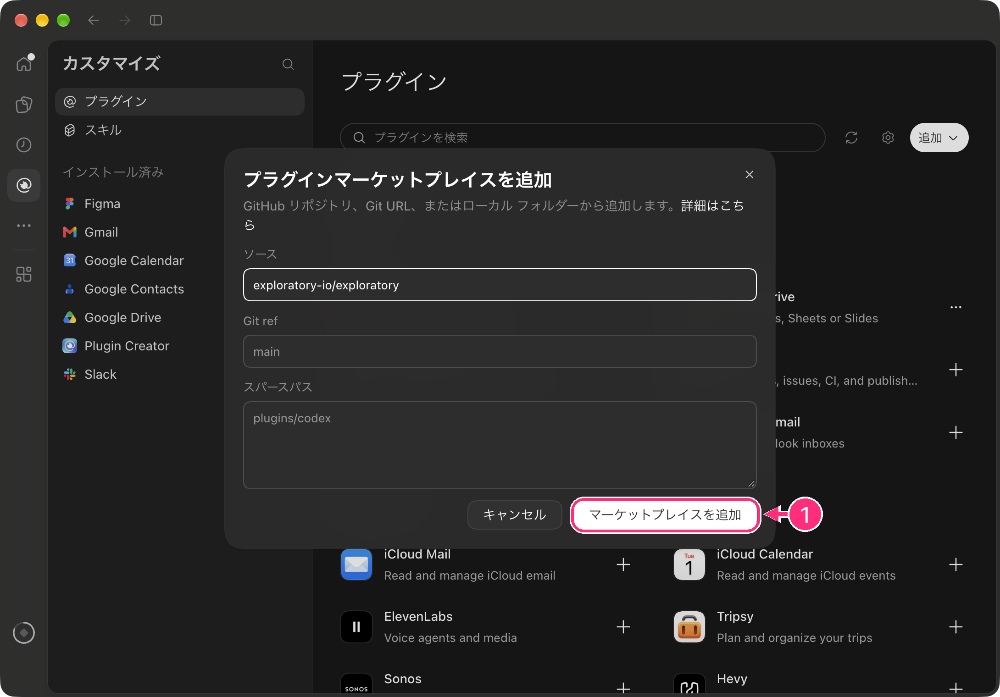

5. 追加したプラグインは「公開」タブの一覧に出ないので、「プラグインを検索」欄（❶）に `exploratory` と入力します。

   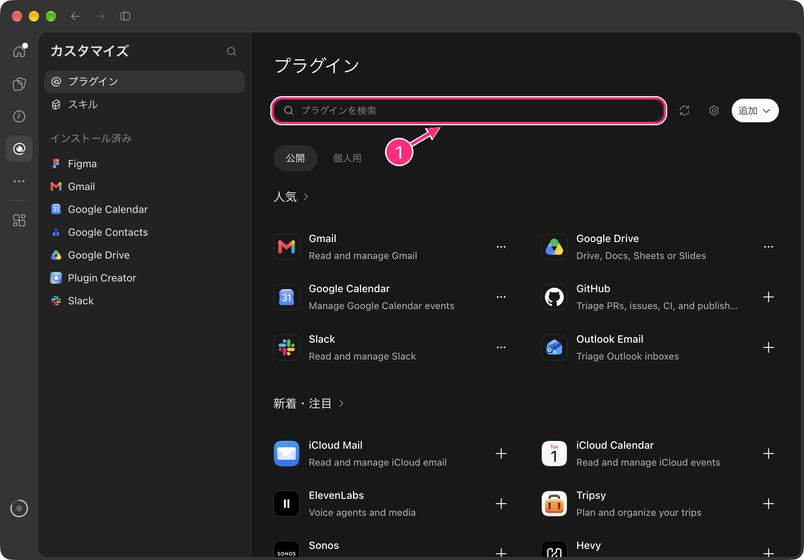

6. 検索結果の「Exploratory Desktop」（提供元 Exploratory, Inc.）の右端にある「＋」を選びます（❶）。似た名前のプラグインが出た場合は、提供元が「Exploratory, Inc.」のものを選んでください。

   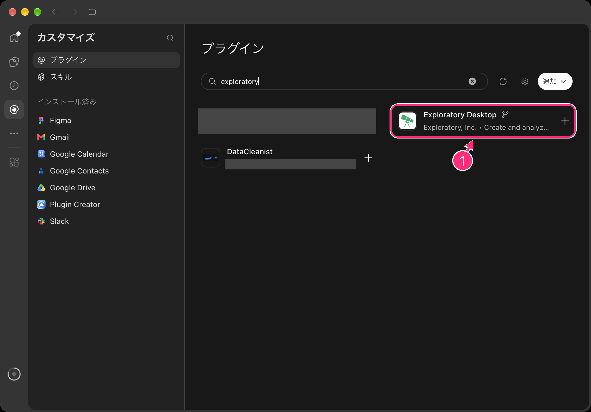

7. 左の「インストール済み」に「Exploratory Desktop」が表示されたことを確かめます（❶）。

   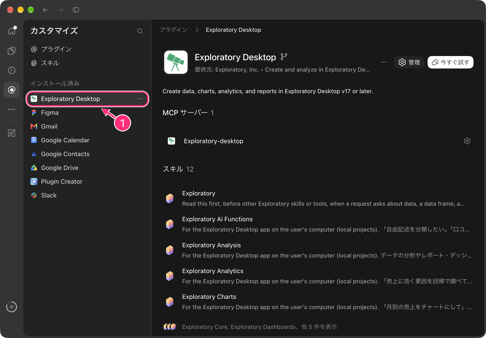

続けて、Exploratory Desktop のシステム設定の「MCP / CLI」で「MCP」をオンにし、画面下の「保存」を選びます。接続を確かめるには、Exploratory Desktop でプロジェクトを開きます。ChatGPT アプリの Codex で「開いている Exploratory のプロジェクトのデータフレームを一覧して」と頼みます。開いているプロジェクトのデータフレーム名が返ってくれば、接続できています。詳しくは[接続を確かめる手順](#check)を参照してください。

<a id="install-cursor"></a>

#### Cursor

Cursor は Exploratory Desktop と同じコンピューターで使います。Cursor から GitHub のリポジトリにアクセスできる必要があります。

1. Cursor の Agents ウィンドウで「Customize」を選びます（❶）。

   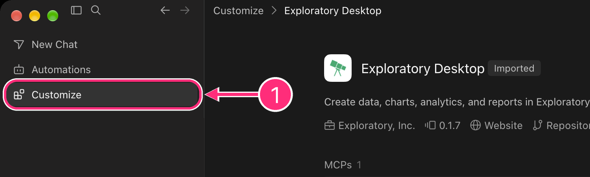

2. 次の画面で「Plugins」（❶）、「+ Add」（❷）の順に選びます。

   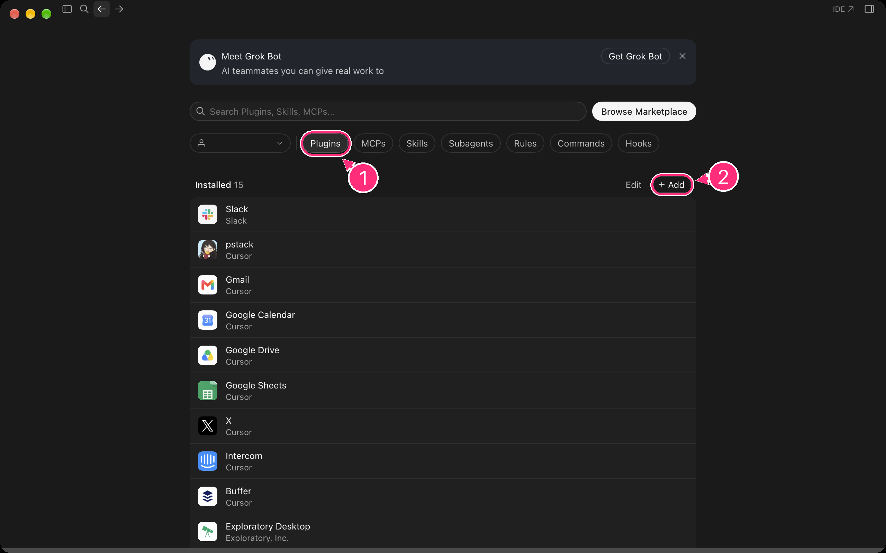

3. メニューの「From GitHub Repository」を選びます（❶）。

   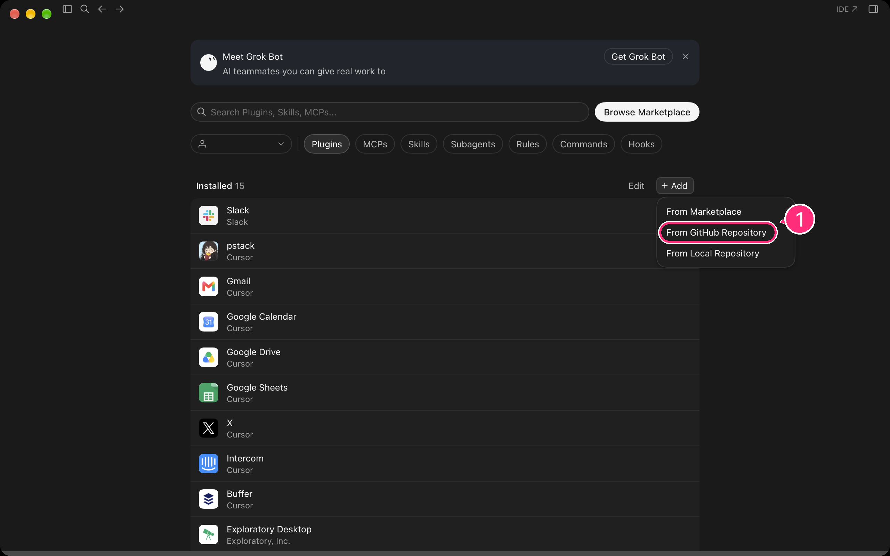

4. 「Import Marketplace」の「Repository」に `https://github.com/exploratory-io/exploratory` を入力します（❶）。「Scope」は「User」のまま、「Import」を選びます（❷）。

   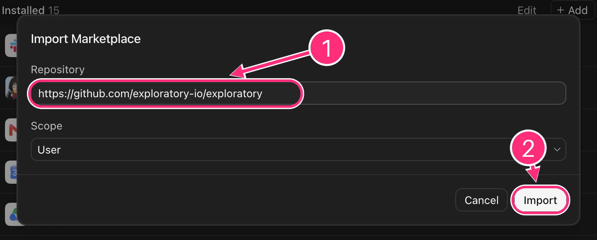

   インポートが終わると、マーケットプレイスが開きます。

   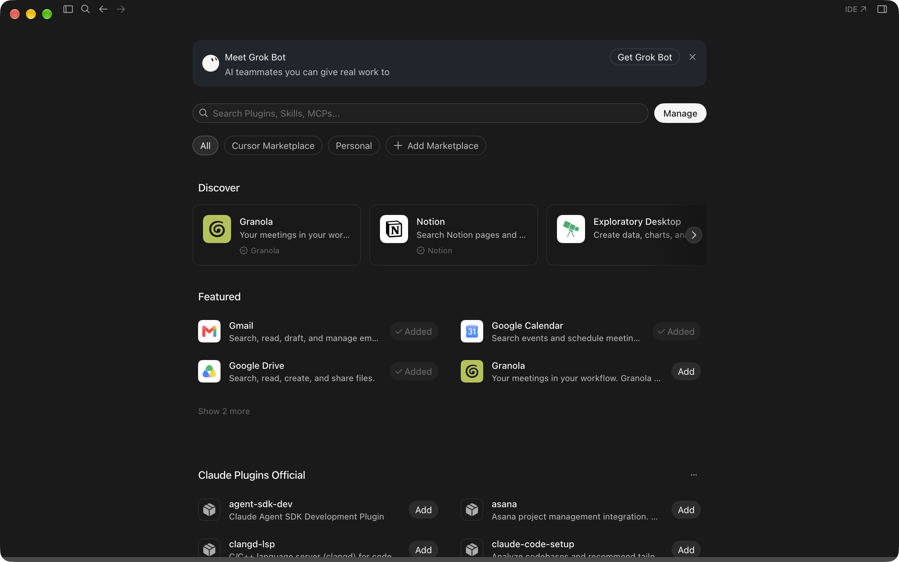

5. 下へスクロールし、「Exploratory Desktop」の行にある「Add」を選びます（❶）。

   セクション名は環境によって変わることがあるので、プラグイン名と説明文で見分けます。提供元は「Exploratory, Inc.」です。説明文は `Create data, charts, analytics, and reports in Exploratory Desktop v17 or later.` です。「exploratory」（説明文が `Work with Exploratory Desktop, search and read published content …`）は選ばないでください。

   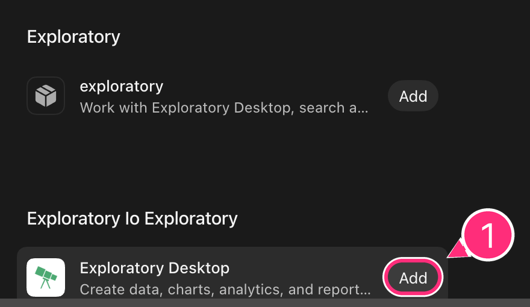

6. 追加が終わると、選んだ行のボタンが「✓ Added」に変わります。

   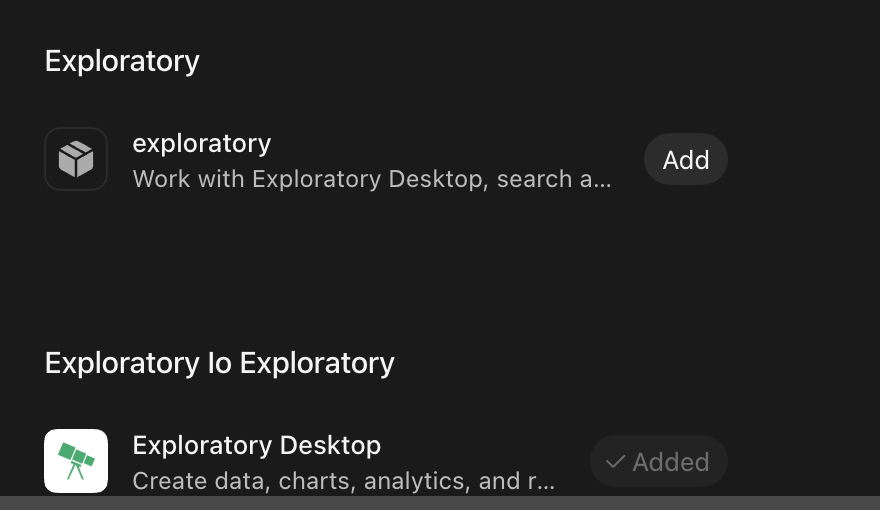

7. 「Customize」の「Plugins」に戻り、「Installed」に「Exploratory Desktop」が表示されていることを確かめます（❶）。

   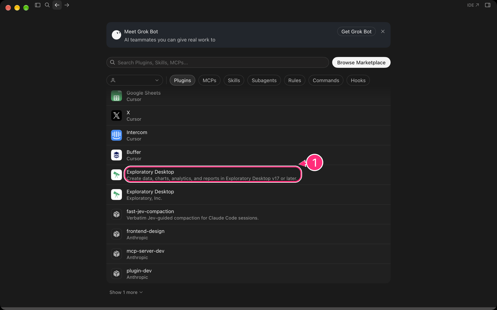

「Settings > Agents」で「Third-Party Imports」がオンだと、追加前から「Exploratory Desktop」が一覧に出ていることがあります。

説明文と提供元は、プラグインの詳細画面で確認できます。

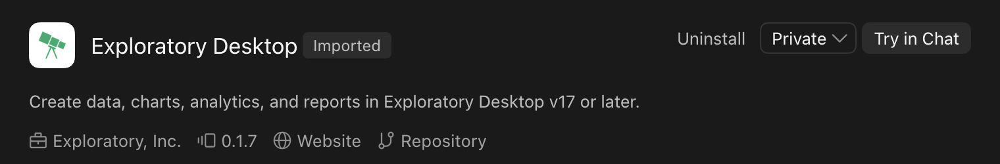

続けて、Exploratory Desktop のシステム設定の「MCP / CLI」で「MCP」をオンにし、画面下の「保存」を選びます。接続を確かめるには、Exploratory Desktop でプロジェクトを開きます。次に、Cursor で「開いている Exploratory のプロジェクトのデータフレームを一覧して」と頼みます。開いているプロジェクトのデータフレーム名が返ってくれば、接続できています。詳しくは[接続を確かめる手順](#check)を参照してください。

### コマンドでインストールする

このプラグインは、公式のプラグイン一覧にはありません。リポジトリ exploratory-io/exploratory をマーケットプレイスとして追加してから、プラグイン exploratory を入れます。コマンドは、ご自身でターミナルに打つか、AI ツールに頼んで実行してもらってください。

**Claude Code**

```sh
claude plugin marketplace add exploratory-io/exploratory
claude plugin install exploratory@exploratory
```

Claude Code で /plugin を開いてインストールすることもできます。リポジトリ exploratory-io/exploratory をマーケットプレイスに追加し、exploratory を選びます。ターミナルで入れた場合、Claude アプリのプラグイン一覧では「ローカルにインストール済み」と表示されます。

**Codex**

```sh
codex plugin marketplace add exploratory-io/exploratory
codex plugin add exploratory@exploratory
```

**Antigravity**

```sh
git clone https://github.com/exploratory-io/exploratory
agy plugin install ./exploratory/plugins/exploratory-desktop
```

Git が必要です。プラグインは、Antigravity のアプリの Customizations \> Installed に表示されます。

**Cursor**

```sh
git clone --depth 1 https://github.com/exploratory-io/exploratory
mkdir -p ~/.cursor/plugins/local
cp -R exploratory/plugins/exploratory-desktop ~/.cursor/plugins/local/exploratory
```

Git が必要です。システム設定から入れたときと同じフォルダ（~/.cursor/plugins/local/exploratory）に入れます。Cursor を終了して起動し直すと、Customize \> Plugins の Installed に「Exploratory」が「Local」の表示付きで出ます。Cursor のアプリから入れた Exploratory Desktop とは重複するため、どちらか一方で入れてください。

<a id="update"></a>

## 更新と削除

入れ方によって、操作が違います。

- システム設定から入れたもの（Claude Code、Codex、Antigravity、Cursor）: システム設定のその AI ツールの行で「再インストール」を選び、最新のプラグインに入れ直します（更新も、この操作で行います）。外すときは、同じ行の「削除」を選びます。
- コマンドで入れたもの（Claude Code、Codex、Antigravity、Cursor）は、次の表の手順で更新・削除します。

| AI ツール | 更新 | 削除 |
| --- | --- | --- |
| Claude Code | claude plugin marketplace update exploratory を実行し、続けて claude plugin update exploratory@exploratory を実行して、Claude Code を起動し直します | claude plugin uninstall exploratory@exploratory |
| Codex | codex plugin marketplace upgrade exploratory を実行し、続けて codex plugin remove exploratory@exploratory と codex plugin add exploratory@exploratory を実行します | codex plugin remove exploratory@exploratory |
| Antigravity | クローンしたフォルダで git pull を実行し、もう一度 agy plugin install を実行します | Antigravity のプラグインの設定で、プラグインを削除します |
| Cursor | クローンしたフォルダ exploratory で git pull を実行し、rm -rf ~/.cursor/plugins/local/exploratory && cp -R plugins/exploratory-desktop ~/.cursor/plugins/local/exploratory を実行して、Cursor を起動し直します | rm -rf ~/.cursor/plugins/local/exploratory を実行して、Cursor を起動し直します |

Desktop の MCP は、Exploratory Desktop を終了すると止まります。プラグインを削除しても、Server の MCP の接続には影響しません。

<a id="trouble"></a>

## うまくいかないとき

[トラブルシューティング](/ja/mcp/desktop/troubleshooting) を参照してください。
