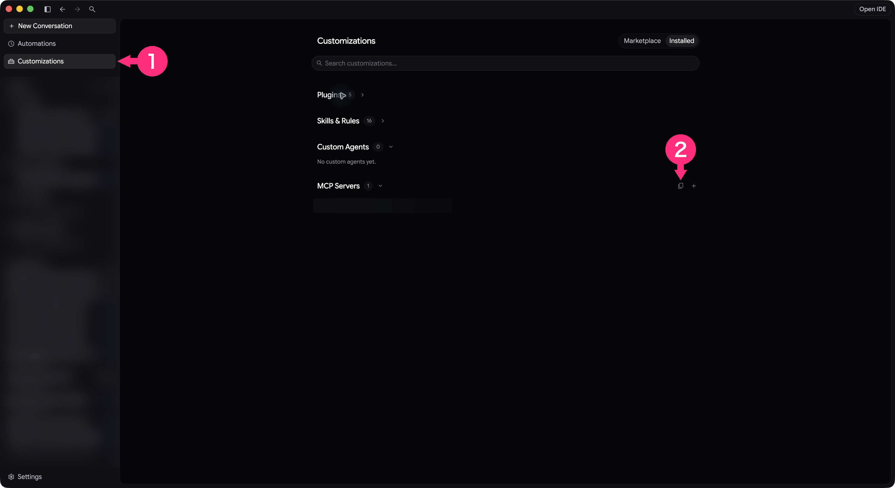
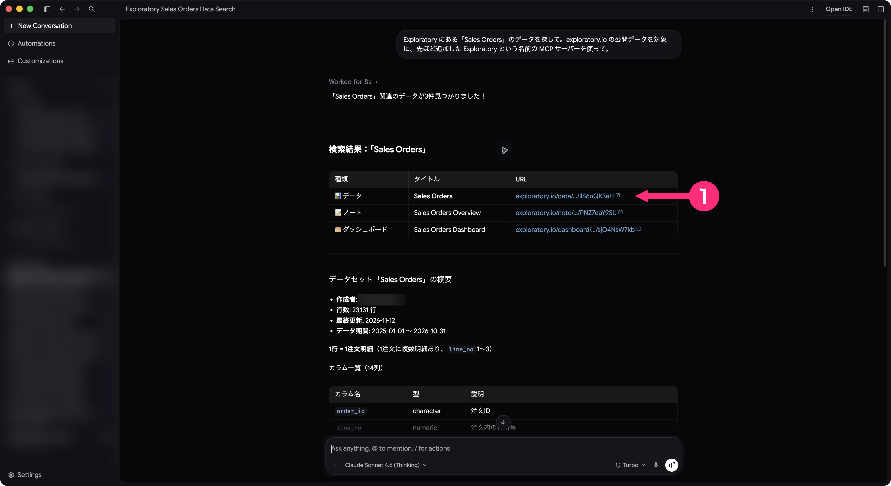
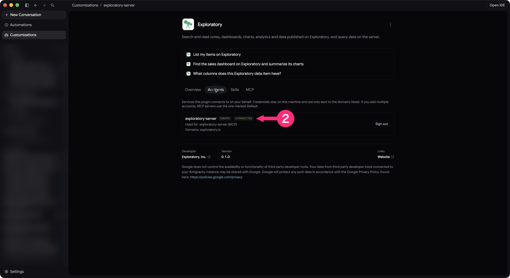
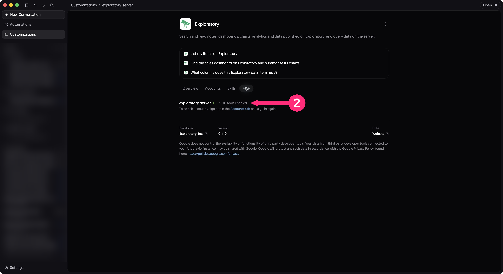

接続すると、AI から Exploratory に公開されたノートやデータを読めるようになります。ページ（HTML ページ）も作れます。Antigravity に Exploratory のサーバーを登録し、ブラウザでサインインします。
かかる時間は 10 分ほどです。Exploratory のアカウントと、Antigravity を用意してください。

<a id="need"></a>

## 必要なもの

- Exploratory のアカウント
- Antigravity
- API キーとクライアント ID は必要ありません。

<a id="steps"></a>

## 手順

### 設定ファイルの場所をコピーする

次の操作をします。

1. Antigravity のアプリで、サイドバーの「Customizations」を選びます。 画面の上の「Installed」が選ばれていることを確かめます。
2. 「MCP Servers」の行の右端にあるコピーのアイコン（「Copy Config File Path」）を選びます。設定ファイル（mcp_config.json）の場所がコピーされます。



### サーバーを登録する

リモートのサーバーは、「serverUrl」に URL を書きます。

1. mcp_config.json を開きます。
2. 次の `exploratory-server` の項目を追加します。ファイルにすでに `mcpServers` がある場合は、その中に `exploratory-server` の項目だけを追加し、ほかのサーバーの設定は残します。以下は、新しいファイルを作る場合の全体の例です。

   ```json
   {
     "mcpServers": {
       "exploratory-server": {
         "serverUrl": "https://exploratory.io/mcp"
       }
     }
   }
   ```

コマンドラインの agy で使うときは、\~/.gemini/config/mcp_config.json に、同じ内容を書きます。

### サインインを始める

アプリでは、次の操作をします。

1. 「MCP Servers」で、exploratory-server の横にある「Authenticate」を選びます。

agy では、次の順で行います。

1. agy を起動します。
2. `/plugin` を実行します。
3. exploratory-server の接続を開きます（Desktop プラグインの exploratory とは別です）。
4. 「Sign in」を選びます。

### exploratory.io で許可する

アプリでも agy でも、ブラウザが開きます。

1. ブラウザで、Exploratory にサインインします。
2. Exploratory の同意画面で、アクセスを許可します。
3. ブラウザに表示された認可コードをコピーします。

### 認可コードを貼り付ける

アプリでは、Antigravity に戻って、次の操作をします。

1. 「Enter authorization code」の欄に、認可コードを貼り付けます。
2. 「Submit」を選びます。

サーバーは、自動でつなぎ直されます。サインインできたサーバーには、「Sign out」のボタンが表示されます。

agy では、agy に戻って、次の操作をします。

1. 認可コードを貼り付けます。

### つながったことを確かめる

新しいチャットで、次のように送信します。

```text
Exploratory にある「Sales Orders」のデータを探して。exploratory.io の公開データを対象に、先ほど追加した Exploratory という名前の MCP サーバーを使って。
```

Sales Orders は例です。閲覧できるデータの名前に置き換えてください。結果が 0 件でも、認証や接続に失敗したとは限りません。見分け方は、[自分のコンテンツが出ない](/ja/mcp/server/troubleshooting#zero)を参照してください。

「exploratory.io の公開データを対象に」と接続名を添えると、Desktop ではなく Server が使われます。接続名は、登録した名前に置き換えます（この画像では「Exploratory」）。画面の画像は、日本語の依頼文の例です。

送信したあと、結果を確かめます。

1. 返答の表にある、「Sales Orders」の URL を確かめます。



Sales Orders のデータが URL 付きで表示されれば、接続できています。

<a id="plugin"></a>

## プラグインでインストールした場合の確かめ方

exploratory-server が一覧に出る Exploratory のプラグインを入れているとき（以下の画像のとき）は、「Customizations」の「Plugins」で「Exploratory」を開くと、接続の状態を確かめられます。`exploratory@exploratory` は Desktop 用のプラグインで、Server とは別のプラグインです。

次の 2 つの画面で確かめられます。

1. 「Accounts」のタブを選びます。
2. exploratory-server の「CONNECTED」の表示を確かめます。



exploratory-server が「OAUTH」「CONNECTED」と表示されていれば、接続できています。

続けて、「MCP」のタブを確かめます。

1. 「MCP」のタブを選びます。
2. exploratory-server の行を確かめます。



exploratory-server と、使える道具の数が表示されます。

<a id="trouble"></a>

## トラブルシューティング

| 表示される内容 | 対処 |
| --- | --- |
| サインインを求められる | 上のサインインの手順を、もう一度行います。 |
| Desktop のプラグインをインストールしたが、Server の道具が表示されない | Desktop のプラグイン exploratory は、Server とは別です。上の設定で、Server を登録します。 |

- [トラブルシューティング](/ja/mcp/server/troubleshooting) - Server の MCP 全体の、症状ごとの対処です。

<a id="remove"></a>

## 接続を解除する

以下は、mcp_config.json に直接登録した場合の手順です。アプリでは、exploratory-server の横の「More actions」（⋮）を選び、「Delete」を選びます。一時的に止めるだけなら、「Disable」を選びます。mcp_config.json に追加した exploratory-server の部分を削除しても、解除できます。

登録を解除しても、アクセスの許可は残ります。許可も取り消すには、exploratory.io のアカウント設定の「接続中のAIアプリ」から、クライアントを解除します。
