接続すると、ChatGPT から、Exploratory に公開されたノートやデータを読めるようになります。ページ（HTML ページ）も作れます。ChatGPT のデスクトップアプリに、Exploratory のサーバーを「MCP サーバー」として追加します。MCP サーバーとは、AI ツールが外部のサービスのデータや機能を使うための接続先です。
かかる時間は 5 分ほどです。Exploratory のアカウントと、ChatGPT のデスクトップアプリを用意してください。

Web（chatgpt.com）で使う場合は、追加の画面が違います。その手順は、このページの後ろにあります。

<a id="need"></a>

## 必要なもの

- Exploratory のアカウント
- ChatGPT のデスクトップアプリ

API キーやクライアント ID は要りません。

<a id="steps"></a>

## 手順（デスクトップアプリ）

### 「MCP」のタブを開く

ChatGPT のデスクトップアプリで、設定を開きます。

1. 設定の左のメニューで、「連携」の中の「プラグイン」を選びます。
2. 「MCP」のタブを選びます。
3. 右上の「追加」を選びます。

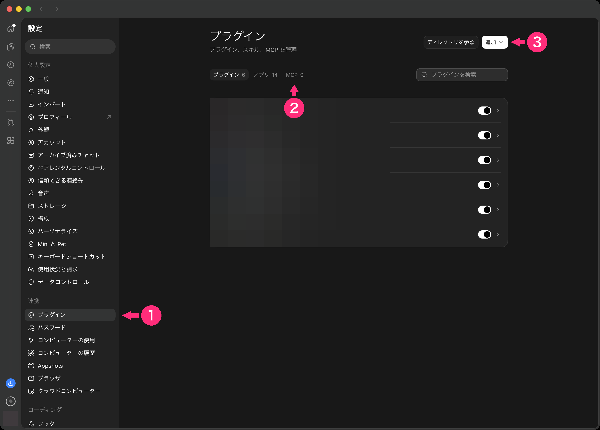

続けて、「追加」のメニューが開きます。

1. 「MCP サーバーを追加」を選びます。「カスタム MCP に接続する」の画面が開きます。

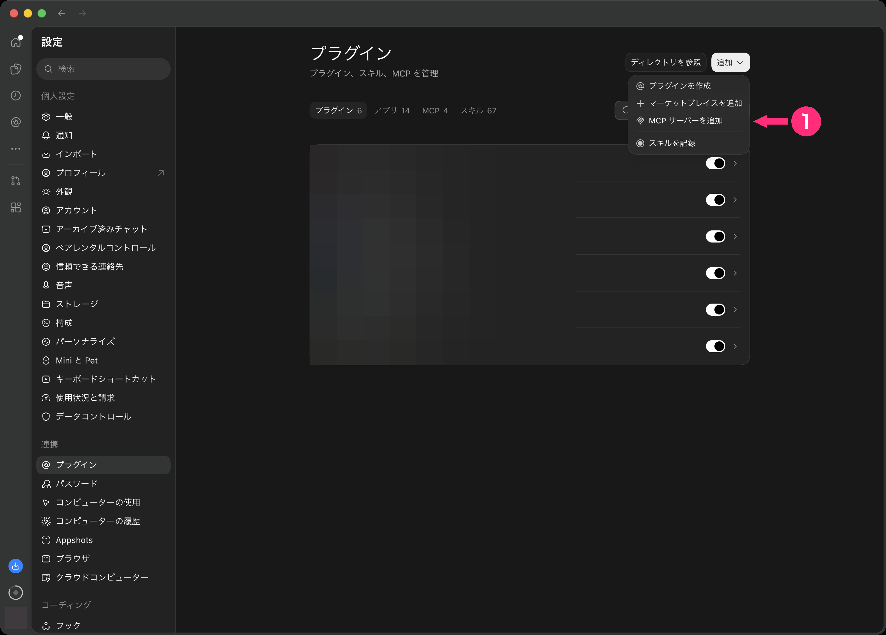

### 接続先を入力する

1. 「名前」に、`Exploratory` と入力します。
2. 「タイプ」で、「ストリーミング可能な HTTP」を選びます。
3. 「URL」に、`https://exploratory.io/mcp` と入力します。

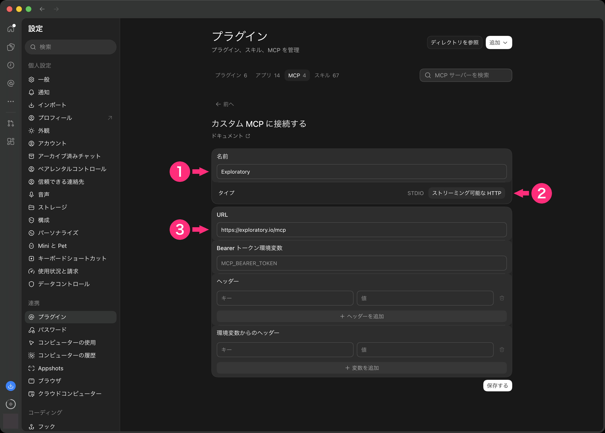

4. 右下の「保存する」を選びます。

「STDIO」は選びません。ほかの欄は空欄のままで構いません（ブラウザでのサインインで接続するため）。

### 再起動して認証する

[公式の資料](https://learn.chatgpt.com/docs/extend/mcp)では、「Save the server, then select Restart.」と「Select Authenticate when an OAuth server requires sign-in.」と案内しています。画面の表示が違うときは、同じ意味のボタンを選びます。

1. 保存したあと、「Restart」を選びます。
2. サーバーの一覧に、認証（OAuth）が必要と表示されたら、「Authenticate」を選びます。

### exploratory.io で許可する

ブラウザで exploratory.io が開きます。サインインしていないときは、先にサインインします。

1. ChatGPT がアクセスを求めている画面で、「許可する」を選びます。

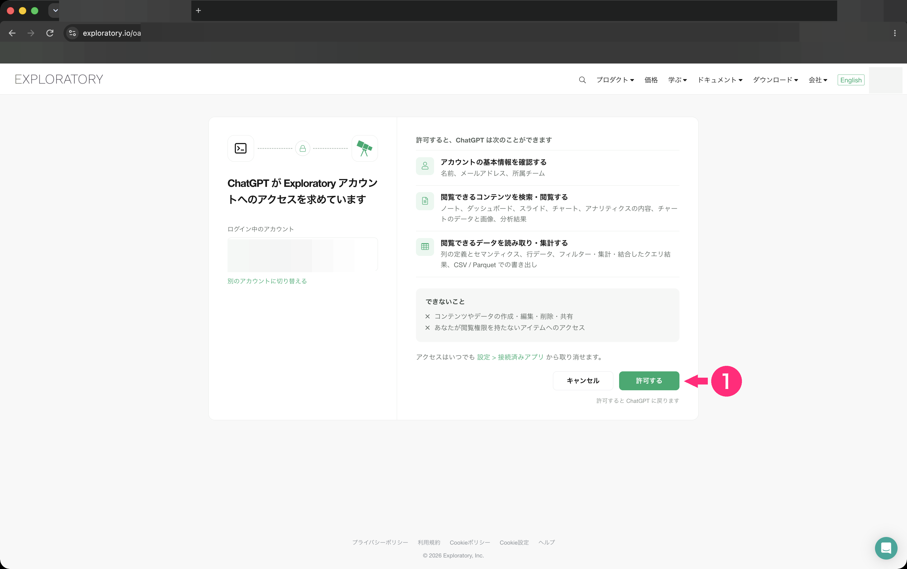

### つながったことを確かめる

1. 「MCP」のタブの「サーバー」の一覧で、追加したサーバーの行を確かめます。

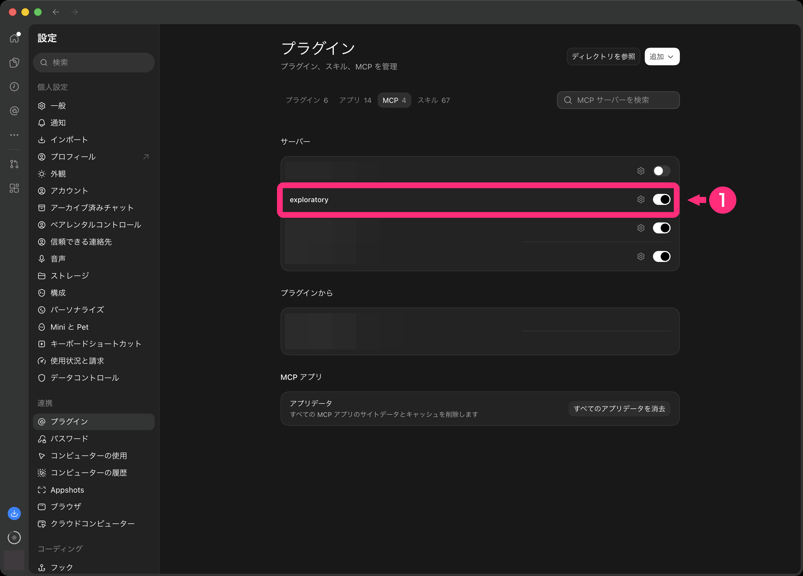

追加したサーバーが表示されていれば、追加できています。

2. チャットの入力欄に `/mcp` と入力します。接続しているサーバーを確認できます。
3. 新しいチャットを開きます。
4. 次のように送信します。

   ```text
   接続した Exploratory Server で、閲覧できるコンテンツを最大 3 件、URL 付きで一覧して。見つからなければ、その旨を教えて。
   ```

コンテンツが URL 付きで表示されれば、使えています。結果が 0 件でも、認証や接続に失敗したとは限りません。見分け方は、[自分のコンテンツが出ない](/ja/mcp/server/troubleshooting#zero)を参照してください。

<a id="web"></a>

## Web（chatgpt.com）で追加する

Web で使う場合は、追加の画面が、デスクトップアプリと違います。ここでは、Web での手順を説明します。

### 設定の「プラグイン」を開く

ChatGPT で、設定を開きます。

1. 設定の「プラグイン」を選びます。
2. 「エージェント一覧を見る」を選びます。カスタマイズの「プラグイン」の画面が開きます。

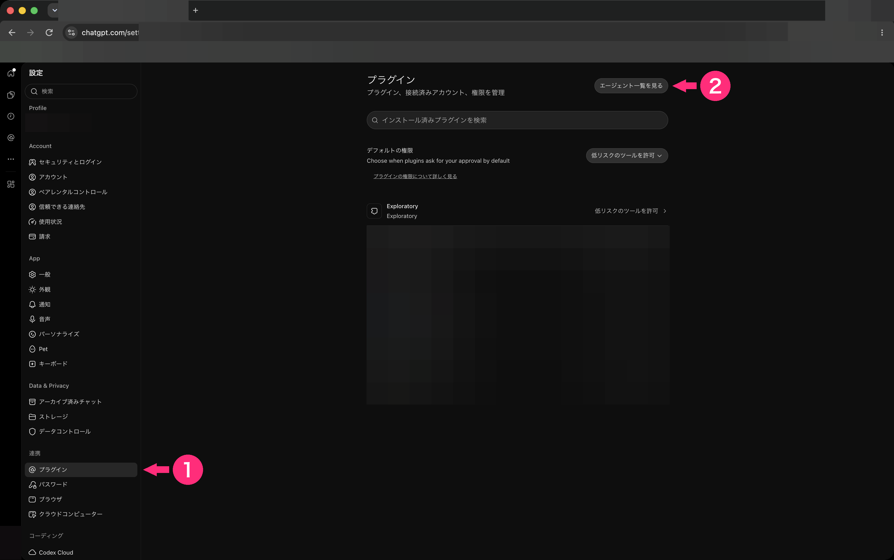

### 「追加」のメニューを開く

カスタマイズの「プラグイン」の画面で操作します。

1. 右上の「追加」を選びます。

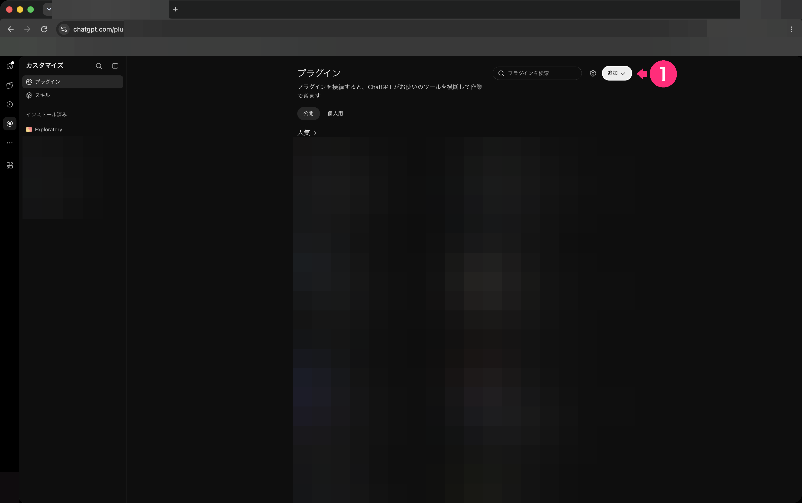

続けて、メニューが開きます。

1. 「カスタム MCP サーバーを追加」を選びます。

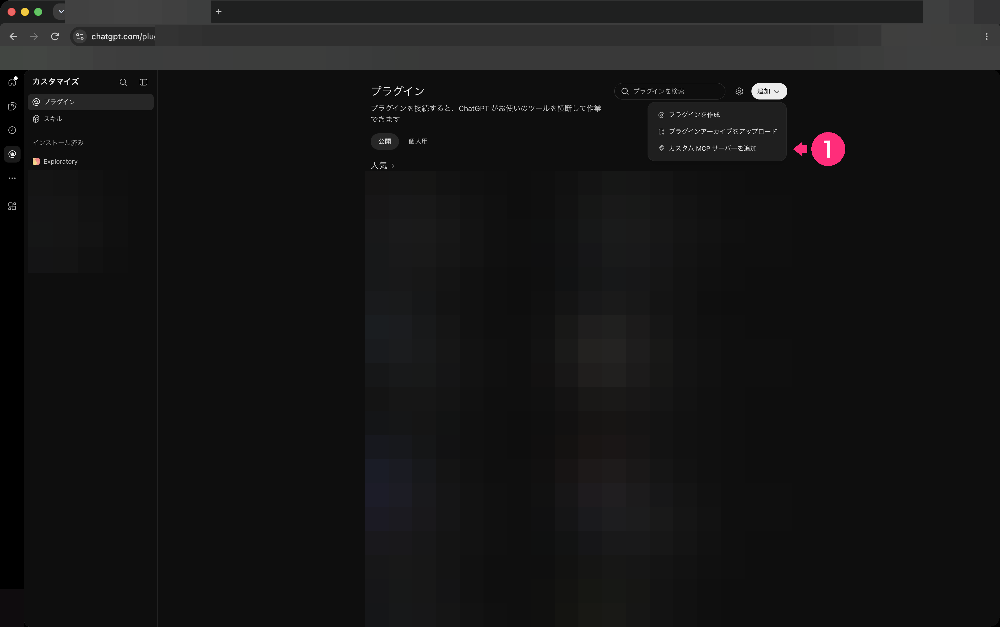

### 接続先を入力する

「カスタム MCP サーバーを追加」の画面で入力します。画面に「カスタム MCP サーバーの利用にはリスクが伴います。」と表示されます。接続先を信頼できることを確かめてから、入力します。

1. 「名前」に、`Exploratory` と入力します。
2. 「接続タイプ」は「サーバーURL」を選んだままにして、URL の欄に、`https://exploratory.io/mcp` と入力します。
3. 「理解したうえで続けます」にチェックを入れます。

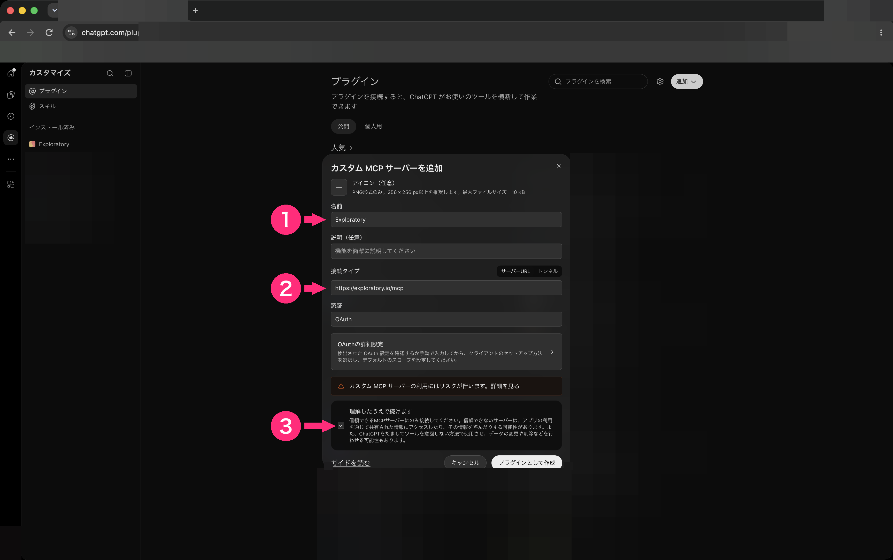

4. 「認証」が「OAuth」になっていることを確かめます。変えるところはありません。
5. 「プラグインとして作成」を選びます。

続けて、接続の画面が開きます。

1. 「Exploratoryに接続」のボタンを選びます。

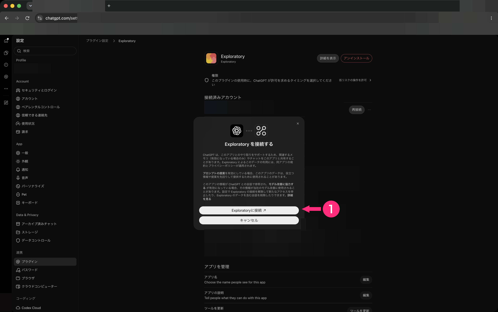

### exploratory.io で許可する

ブラウザで exploratory.io が開きます。サインインしていないときは、先にサインインします。

1. ChatGPT がアクセスを求めている画面で、「許可する」を選びます。


### つながったことを確かめる

ChatGPT に戻ります。

1. カスタマイズの左の「インストール済み」で、「Exploratory」を選びます。

詳細画面が表示されます。続けて、次の操作をします。

1. 「アプリ」の下の「Exploratory」の行を確かめます。

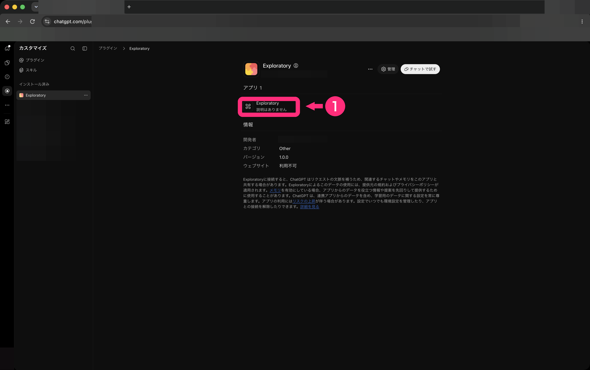

画像では、開発者の欄をぼかしています。「情報」には、開発者、カテゴリ、バージョン、ウェブサイトが並びます。

2. 詳細画面の「チャットで試す」を選んで、チャットを開きます。
3. 次のように送信します。

   ```text
   接続した Exploratory Server で、閲覧できるコンテンツを最大 3 件、URL 付きで一覧して。見つからなければ、その旨を教えて。
   ```

コンテンツが URL 付きで表示されれば、使えています。結果が 0 件でも、認証や接続に失敗したとは限りません。見分け方は、[自分のコンテンツが出ない](/ja/mcp/server/troubleshooting#zero)を参照してください。

<a id="trouble"></a>

## うまくいかないとき

症状ごとの対処は、[トラブルシューティング](/ja/mcp/server/troubleshooting) を参照してください。

<a id="remove"></a>

## 接続を解除する

デスクトップアプリでは、「MCP」のタブの「サーバー」の一覧で、追加したサーバーのスイッチをオフにすると、使われなくなります。Web で使う場合は、プラグインの一覧で、追加した「Exploratory」を削除します。そのあと、exploratory.io の「アカウント設定」を開き、「接続中のAIアプリ」から、接続したアプリを解除します。ChatGPT で削除しただけでは、Exploratory 側のアクセスの許可は残ります。
