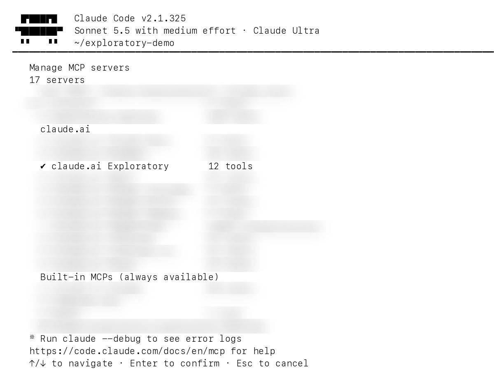
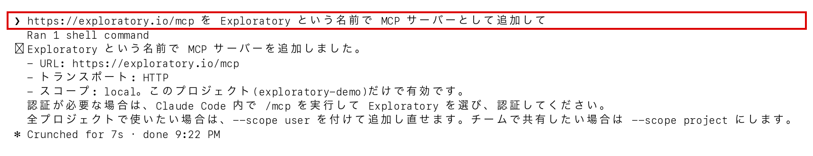
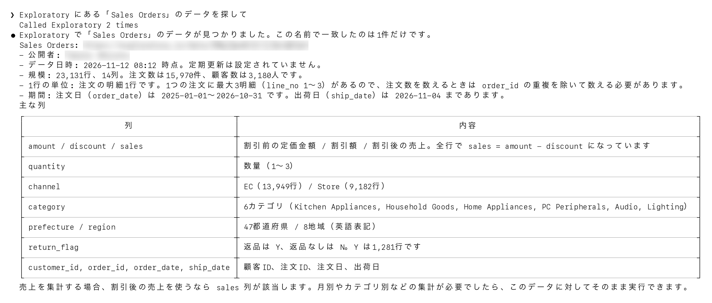

接続すると、AI から Exploratory に公開されたノートやデータを読めるようになります。ページ（HTML ページ）も作れます。Claude Code に Exploratory のサーバーを登録し、ブラウザでサインインします。
かかる時間は 3 分ほどです。Exploratory のアカウントと、Claude Code を用意してください。

Claude のアプリ（デスクトップ・Web）で、すでに Exploratory をコネクタとして追加しているときは、ここでもう一度追加する必要はありません。同じ claude.ai アカウントでサインインした Claude Code には、「claude.ai Exploratory」として自動で表示され、そのまま使えます。確かめるには、Claude Code で `/mcp` を開きます。詳しい追加の手順は、[Claude アプリ（デスクトップ・Web）](/ja/mcp/server/clients/claude)のページを参照してください。



<a id="need"></a>

## 必要なもの

- Exploratory のアカウント
- Claude Code
- API キーとクライアント ID は必要ありません。

<a id="steps"></a>

## 手順

### 登録してサインインする

プラグインやスキルを使わずに、サーバーだけを登録する方法です。

1. 次のコマンドを実行します。

   ```sh
   claude mcp add --transport http exploratory-server https://exploratory.io/mcp
   ```

2. 新しいセッションを開始します。
3. `/mcp` を開きます。
4. exploratory-server の接続を選びます。
5. ブラウザでサインインします。

### つながったことを確かめる

1. 新しいセッションで、次のように送信します。

   ```text
   接続した Exploratory Server で、閲覧できるコンテンツを最大 3 件、URL 付きで一覧して。見つからなければ、その旨を教えて。
   ```

コンテンツが URL 付きで表示されていれば、接続できています。結果が 0 件でも、認証や接続に失敗したとは限りません。見分け方は、[自分のコンテンツが出ない](/ja/mcp/server/troubleshooting#zero)を参照してください。

スキルは、AI に操作の進め方を教える説明です。MCP の接続設定とは別のものです。

<a id="chat"></a>

## チャットで頼んで追加する

コマンドを自分で実行する代わりに、Claude Code のチャットで頼んで、サーバーを追加してもらうこともできます。

### チャットで頼む

1. Claude Code で、次の文を送ります。

   ```text
   https://exploratory.io/mcp を Exploratory という名前で MCP サーバーとして追加して
   ```



Claude Code は `claude mcp add` を実行し、サーバーを追加したこと、認証が必要な場合は `/mcp` を実行して認証することを答えました。AI がどのコマンドを選ぶか、どの範囲（このフォルダだけか、全プロジェクトか）に保存するかは、実行のたびに変わることがあります。返答を読んで確かめてください。

### サインインして確かめる

1. 新しいセッションを始めます。
2. `/mcp` を開き、Exploratory が一覧にあることを確かめます。

3. Exploratory を選び、ブラウザでサインインします。
4. 新しいセッションで、次のような依頼を送ります。

   ```text
   Exploratory にある「Sales Orders」のデータを探して
   ```

Claude Code が Exploratory サーバー経由で検索し、データが見つかります。



Exploratory への接続が複数あるとき（たとえば exploratory-server や、Claude アプリで追加したコネクタ）は、「Exploratory の MCP サーバーを使って」のように、検索に使う接続名を指定します。

<a id="apikey"></a>

## API キーで接続する

ブラウザを開けない環境では、ブラウザでのサインインの代わりに、API キーでサーバーを登録します。キーは、アカウント設定 \> API キーで作ります。EXPLORATORY_API_KEY は、秘密情報を管理する仕組みで設定します。シェルの設定ファイルではなく、OS の資格情報の保管庫や CI のシークレットなどを使います。キーそのものをコマンドラインや設定ファイルに書かないでください。以下は、この環境変数が設定済みであることを前提にします。

プロジェクトの .mcp.json にヘッダーを書くと、Claude Code が環境変数からキーを読みます。

```json
{
  "mcpServers": {
    "exploratory-server": {
      "type": "http",
      "url": "https://exploratory.io/mcp",
      "headers": {
        "Authorization": "Bearer ${EXPLORATORY_API_KEY}"
      }
    }
  }
}
```

コマンドラインにキーをそのまま打ったり、設定ファイルにそのまま書いたりすると、シェルの履歴やファイルに残ります。上のように、環境変数から読みます。

上の OAuth でのサインインか、この方法か、どちらか一方だけを使います。

- [API キーで接続する](/ja/mcp/server/auth#apikey) - キーで読めるものと、返ってくるエラーです。

<a id="trouble"></a>

## トラブルシューティング

| 表示される内容 | 対処 |
| --- | --- |
| サインインを求められる | /mcp を開いて、もう一度サインインします。 |
| 同じ道具が 2 組表示される | インストール方法は 1 つだけにします（公式一覧にある Exploratory Server のプラグイン、URL の直接追加、claude.ai のコネクタのいずれか）。あとから公式の一覧でインストールする場合は、先に直接追加した分を claude mcp remove exploratory-server で削除します。 |

- [トラブルシューティング](/ja/mcp/server/troubleshooting) - Server の MCP 全体の、症状ごとの対処です。

<a id="remove"></a>

## 接続を解除する

コマンドで直接登録した接続は、以下の手順で削除します。Claude アプリから引き継がれたコネクタは、[Claude アプリのページ](/ja/mcp/server/clients/claude#remove)の「接続を解除する」を参照してください。

```sh
claude mcp remove exploratory-server
```

これは、上の手順で付けた名前です。チャットで追加した場合は、自分が付けた名前（例では Exploratory）に置き換えます。AI が既定とは別の範囲（scope）で追加したときは、その範囲を `--scope` で指定します。登録した名前は、`claude mcp list` で確かめられます。

登録を解除しても、アクセスの許可は残ります。許可も取り消すには、exploratory.io のアカウント設定の「接続中のAIアプリ」から、クライアントを解除します。
