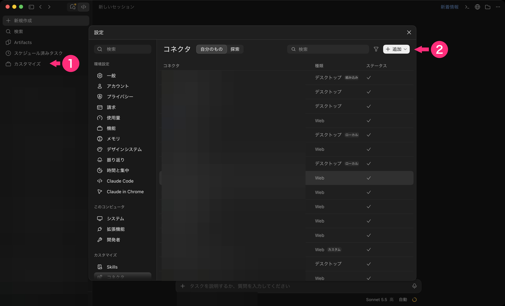
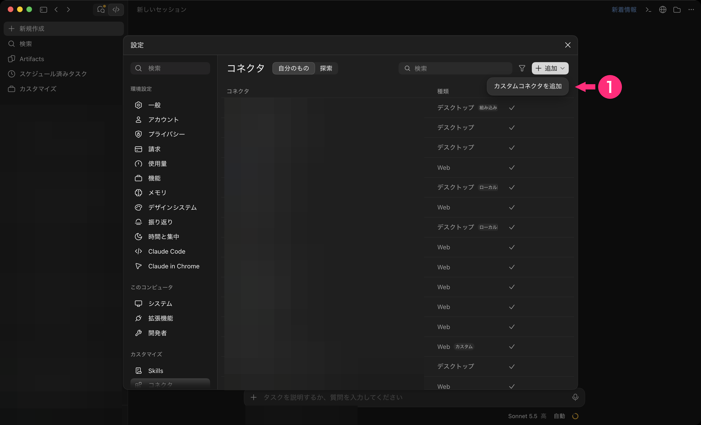
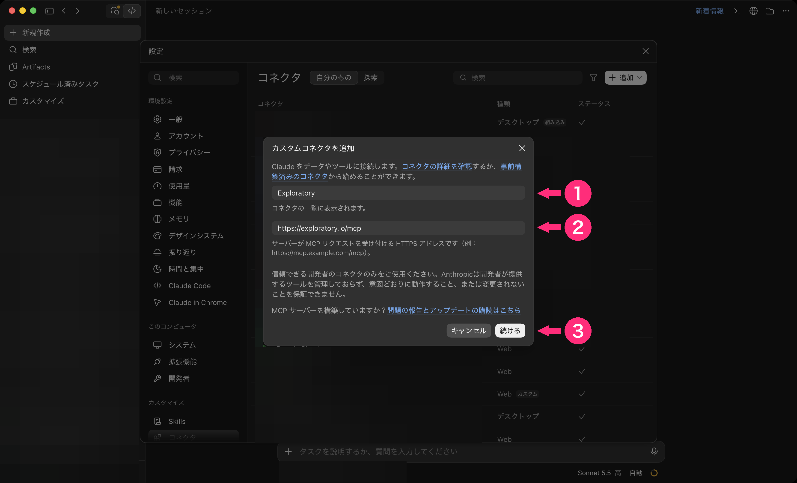
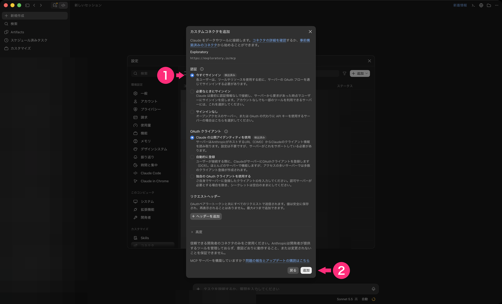
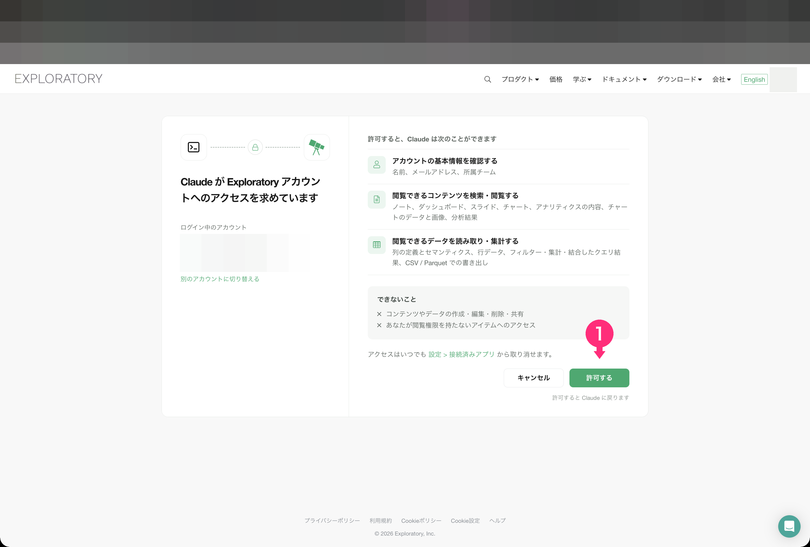
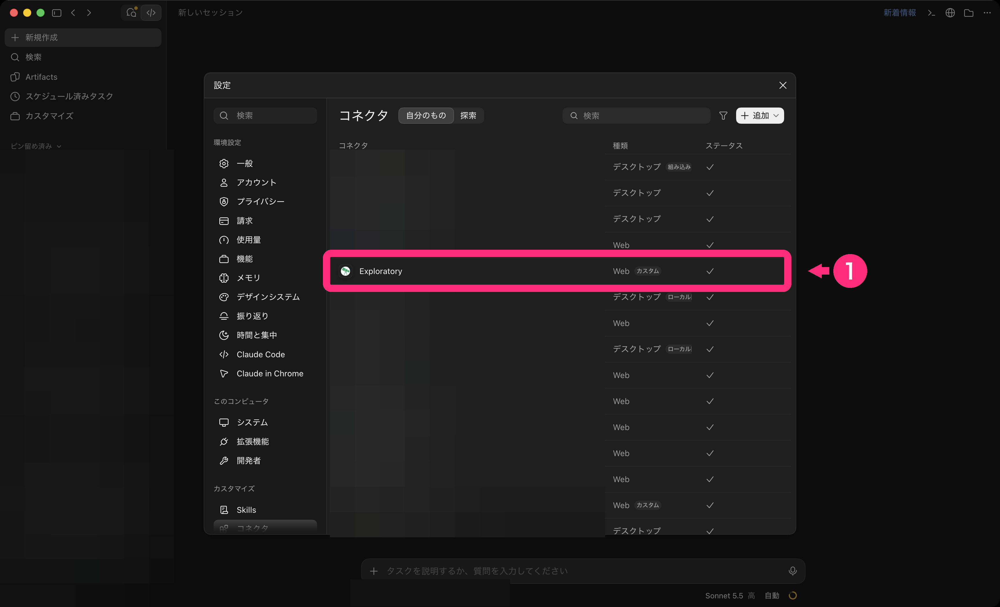
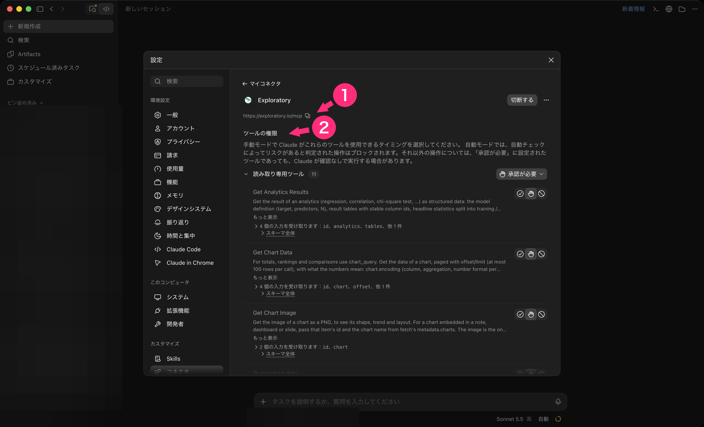

Claude に、Exploratory のサーバーを「カスタムコネクタ」として追加します。コネクタとは、Claude が外部のサービスのデータや機能を使うための接続です。接続すると、Claude のチャットから、Exploratory に公開されたノートやデータを読めるようになります。ページ（HTML ページ）も作れます。
かかる時間は 5 分ほどです。Exploratory のアカウントと、Claude のデスクトップアプリまたは Web（claude.ai）を用意してください。

コネクタの画面は、Claude のデスクトップアプリと、Web（claude.ai）で同じです。

<a id="need"></a>

## 必要なもの

- Exploratory のアカウント
- Claude のデスクトップアプリ、または Web（claude.ai）

API キーやクライアント ID は要りません。

<a id="steps"></a>

## 手順

### 追加の画面を開く

Claude のデスクトップアプリで、設定の「コネクタ」の画面を開きます。「自分のもの」が選ばれている画面で操作します。

1. 左のサイドバーの「カスタマイズ」を選びます。設定の画面が開き、「コネクタ」の画面が表示されます。
2. 一覧の右上の「＋ 追加」を選びます。



続けて、「＋ 追加」のメニューが開きます。

1. 「カスタムコネクタを追加」を選びます。



### 接続先を入力する

1. 「名前」に、`Exploratory` と入力します。
2. 「MCP サーバー URL」に、`https://exploratory.io/mcp` と入力します。
3. 「続ける」を選びます。



続けて、認証の画面になります。

1. 「認証」が「今すぐサインイン」になっていることを確かめます。
2. 「追加」を選びます。



「OAuth クライアント」は「Claude の公開アイデンティティを使用」になっています。どちらにも「検出済み」と表示されています。変えるところはありません。

### exploratory.io で許可する

ブラウザで exploratory.io が開き、「Claude が Exploratory アカウントへのアクセスを求めています」と表示されます。サインインしていないときは、先にサインインします。

1. 「許可する」を選びます。



この画面が出ないまま接続されたときは、次の確認に進みます。

### つながったことを確かめる

1. コネクタの「自分のもの」の一覧で、「Exploratory」の行を確かめます。



「Exploratory」が「カスタム」と表示され、接続済みを示すチェックが付いていれば、接続できています。

2. 新しいチャットを開きます。
3. 次のように送信します。

   ```text
   接続した Exploratory Server で、閲覧できるコンテンツを最大 3 件、URL 付きで一覧して。見つからなければ、その旨を教えて。
   ```

コンテンツが URL 付きで表示されれば、使えています。結果が 0 件でも、認証や接続に失敗したとは限りません。見分け方は、[自分のコンテンツが出ない](/ja/mcp/server/troubleshooting#zero)を参照してください。

### Claude Code でも使う

同じ claude.ai アカウントで [Claude Code](/ja/mcp/server/clients/claude-code) にサインインすると、ここで追加したコネクタは、Claude Code にも「claude.ai Exploratory」として表示され、そのまま使えます。Claude Code で追加し直す必要はありません。

<a id="permissions"></a>

## 道具の実行を確認する

一覧で「Exploratory」を開きます。

1. サーバーの URL（[https://exploratory.io/mcp](https://exploratory.io/mcp)）を確かめます。
2. 「ツールの権限」を確かめます。



Exploratory のコネクタの道具には、読み取りだけの道具と、ページを作成・更新・削除する道具があります。道具ごとに、実行のタイミングを選べます。この設定は、手動モードで Claude が道具を使えるタイミングを決めるものです。自動モードでは、自動チェックで危険と判断された操作はブロックされます。それ以外の操作は、「承認が必要」に設定した道具でも、Claude が確認なしで実行することがあります。

<a id="trouble"></a>

## うまくいかないとき

| 表示される内容 | 対処 |
| --- | --- |
| 「このURLのコネクタはすでに組織内に存在します」と表示される | 組織（チーム）で、すでにコネクタが追加されています。新しく追加せず、コネクタの一覧にある既存のコネクタを使います。 |
| サインインを求められる | コネクタの一覧で「Exploratory」を開き、もう一度サインインします。 |

ほかの症状は、[トラブルシューティング](/ja/mcp/server/troubleshooting) を参照してください。

<a id="remove"></a>

## 接続を解除する

コネクタの一覧で「Exploratory」を開き、右上の「切断する」を選びます。

「切断する」を選んでも、Exploratory 側のアクセスの許可は残ります。許可も取り消すには、exploratory.io の「アカウント設定」を開き、「接続中のAIアプリ」から Claude を解除します。
