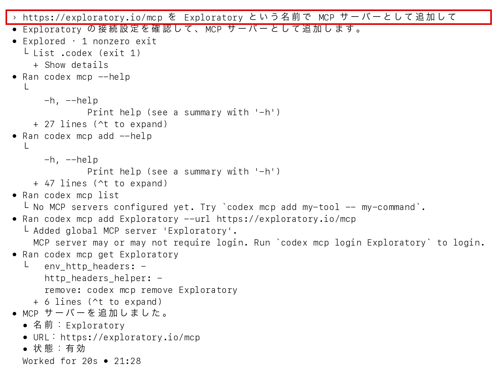
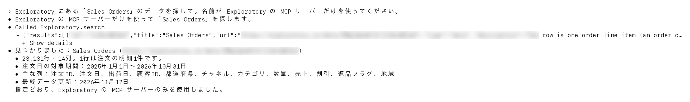

接続すると、AI から Exploratory に公開されたノートやデータを読めるようになります。ページ（HTML ページ）も作れます。Codex に Exploratory のサーバーを登録し、ブラウザでサインインします。
かかる時間は 3 分ほどです。Exploratory のアカウントと、Codex を用意してください。

<a id="need"></a>

## 必要なもの

- Exploratory のアカウント
- Codex
- API キーとクライアント ID は必要ありません。

<a id="steps"></a>

## 手順

### 登録する

サーバーのみを登録します。スキルは含まれません。次のいずれかの方法で登録します。

**設定ファイルに書く場合**

1. \~/.codex/config.toml に、次の内容を追加します。

   ```text
   [mcp_servers.exploratory-server]
   url = "https://exploratory.io/mcp"
   ```

**コマンドで追加する場合**

1. 次のコマンドを実行します。

   ```sh
   codex mcp add exploratory-server --url https://exploratory.io/mcp
   ```

Exploratory の GitHub マーケットプレイスの exploratory@exploratory は Desktop 用で、Server は含まれません。

### サインインする

1. 次のコマンドを実行します。

   ```sh
   codex mcp login exploratory-server
   ```

2. ブラウザが開いたら、Exploratory にサインインします。
3. アクセスを許可します。

### つながったことを確かめる

1. 新しいチャットで、次のように送信します。

   ```text
   接続した Exploratory Server で、閲覧できるコンテンツを最大 3 件、URL 付きで一覧して。見つからなければ、その旨を教えて。
   ```

コンテンツが URL 付きで表示されていれば、接続できています。結果が 0 件でも、認証や接続に失敗したとは限りません。見分け方は、[自分のコンテンツが出ない](/ja/mcp/server/troubleshooting#zero)を参照してください。

スキルは、AI に操作の進め方を教える説明です。MCP の接続設定とは別のものです。

<a id="chat"></a>

## チャットで頼んで追加する

コマンドを自分で実行する代わりに、Codex のチャットで頼んで、サーバーを追加してもらうこともできます。

### チャットで頼む

1. Codex で、次の文を送ります。

   ```text
   https://exploratory.io/mcp を Exploratory という名前で MCP サーバーとして追加して
   ```



Codex は、サーバーを追加し、有効になったことを答えます。まだサインインしていないときは、`codex mcp login Exploratory` を実行します。AI がどのコマンドを選ぶかは、実行のたびに変わることがあります。返答を読んで確かめてください。

### サインインして確かめる

1. まだサインインしていなければ、`codex mcp login Exploratory` を実行します。ブラウザが開くので、アクセスを許可します。
2. 新しいセッションを始めて、`/mcp` を開きます。Exploratory が connected になっていることを確かめます。

3. データを探すときは、検索に使う接続名を指定します。

   ```text
   Exploratory にある「Sales Orders」のデータを探して。名前が Exploratory の MCP サーバーだけを使ってください。
   ```

Codex が Exploratory サーバー経由で検索し、データが見つかります。



すでに Exploratory への別の接続（たとえば exploratory-server や Desktop）があると、Codex がそちらを選ぶことがあります。接続名を指定すると、それを避けられます。

<a id="apikey"></a>

## API キーで接続する

ブラウザを開けない環境では、サインインの代わりに API キーを使います。キーは、アカウント設定 \> API キーで作り、環境変数に入れます。EXPLORATORY_API_KEY は、秘密情報を管理する仕組みで設定します。シェルの設定ファイルではなく、OS の資格情報の保管庫や CI のシークレットなどを使います。キーそのものをコマンドラインや設定ファイルに書かないでください。以下は、この環境変数が設定済みであることを前提にします。

\~/.codex/config.toml には、キーではなく、環境変数の名前を書きます。

```text
[mcp_servers.exploratory-server]
url = "https://exploratory.io/mcp"
bearer_token_env_var = "EXPLORATORY_API_KEY"
```

キーをファイルにそのまま書くと、ファイルに残ります。上のサインインか、この方法か、どちらか一方だけを使います。キーで読めるものは、[API キーで接続する](/ja/mcp/server/auth#apikey)を参照してください。

<a id="trouble"></a>

## トラブルシューティング

| 表示される内容 | 対処 |
| --- | --- |
| サインインを求められる | codex mcp login exploratory-server を実行して、もう一度サインインします。チャットで追加した場合は、自分が登録した名前（例では Exploratory）を指定します。 |
| Server の道具が出ない | exploratory@exploratory は Desktop 用です。上の手順で、Server を登録します。 |

- [トラブルシューティング](/ja/mcp/server/troubleshooting) - Server の MCP 全体の、症状ごとの対処です。

<a id="remove"></a>

## 接続を解除する

\~/.codex/config.toml に追加した \[mcp_servers.exploratory-server\] の部分を削除します。チャットで追加した場合は、自分が付けた名前（例では Exploratory）で登録されているので、\[mcp_servers.Exploratory\] の部分を削除します。自分が登録した名前を使ってください。

登録を解除しても、アクセスの許可は残ります。許可も取り消すには、exploratory.io のアカウント設定の「接続中のAIアプリ」から、クライアントを解除します。
