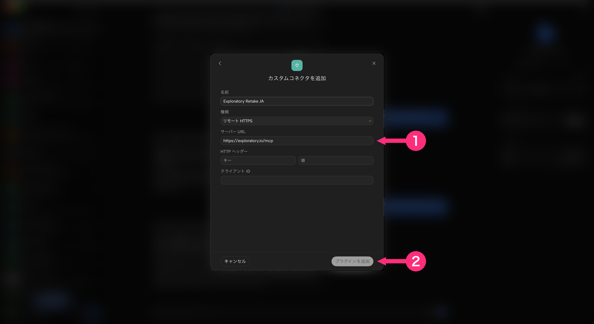
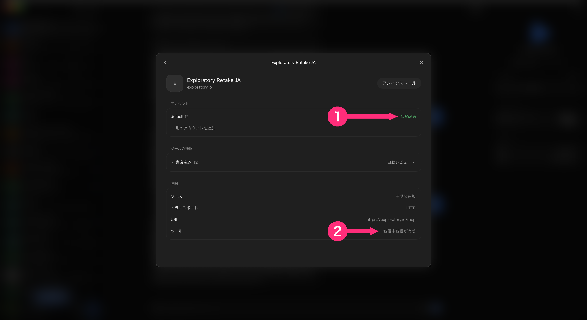
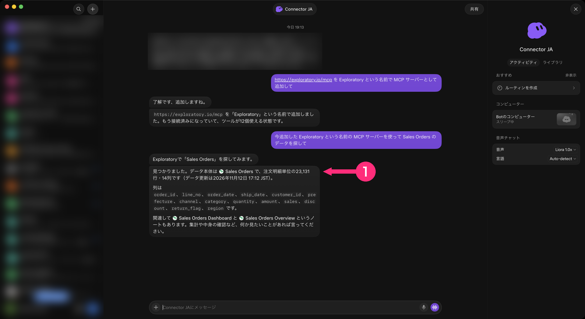

接続すると、AI から Exploratory に公開されたノートやデータを読めるようになります。ページ（HTML ページ）も作れます。Grok Bot に、カスタムコネクタとして Exploratory のサーバーを追加します。
かかる時間は 3 分ほどです。Exploratory のアカウントと、Grok Bot を用意してください。

<a id="need"></a>

## 必要なもの

- Exploratory のアカウント
- Grok Bot
- API キーとクライアント ID は必要ありません。

<a id="steps"></a>

## 手順

### カスタムコネクタのフォームを開く

この方法で追加されるのは MCP サーバーのみで、スキルは含まれません。

1. Grok Bot のサイドバーで、「アプリを接続」を開きます。
2. 下へスクロールして、「カスタムコネクタを追加」を選びます。

### フォームに入力する

「名前」には Exploratory と入力し、「種類」は「リモート HTTPS」のままにします。画像の名前は例です。

1. 「サーバー URL」に、`https://exploratory.io/mcp` を入力します。
2. 「プラグインを追加」を選びます。



ブラウザが開いたら、Exploratory にサインインして、アクセスを許可します。

### つながったことを確かめる

追加したコネクタを開いて、詳細を確かめます。

1. アカウントが「接続済み」になっていることを確かめます。
2. 「ツール」が、すべて有効になっていることを確かめます。数は、サーバーの設定によって変わります（[使える道具](/ja/mcp/server/tools#overview)を参照）。Grok Bot は、これらの道具を自身の「書き込み」の権限の欄に表示しますが、このサーバーの道具で書き込むのは、ページの作成・更新・削除だけです。dataframe_export は、ダウンロードリンクを作るだけです。



続けて、チャットで、次のように送信します。

```text
今追加した Exploratory という名前の MCP サーバーを使って Sales Orders のデータを探して
```

Sales Orders は例です。閲覧できるデータの名前に置き換えてください。結果が 0 件でも、認証や接続に失敗したとは限りません。見分け方は、[自分のコンテンツが出ない](/ja/mcp/server/troubleshooting#zero)を参照してください。

送信したあと、結果を確かめます。

1. 返答にある、Sales Orders のリンクを確かめます。

返答に Sales Orders のリンクが出れば、使えています。



スキルは、AI に操作の進め方を教える説明です。MCP の接続設定とは別のものです。

<a id="trouble"></a>

## トラブルシューティング

| 表示される内容 | 対処 |
| --- | --- |
| サインインを求められる | 接続を解除してから、もう一度追加し直します。 |

- [トラブルシューティング](/ja/mcp/server/troubleshooting) - Server の MCP 全体の、症状ごとの対処です。

<a id="remove"></a>

## 接続を解除する

Grok Bot でコネクタの詳細を開き、「アンインストール」を選びます。

登録を解除しても、アクセスの許可は残ります。許可も取り消すには、exploratory.io のアカウント設定の「接続中のAIアプリ」から、クライアントを解除します。
