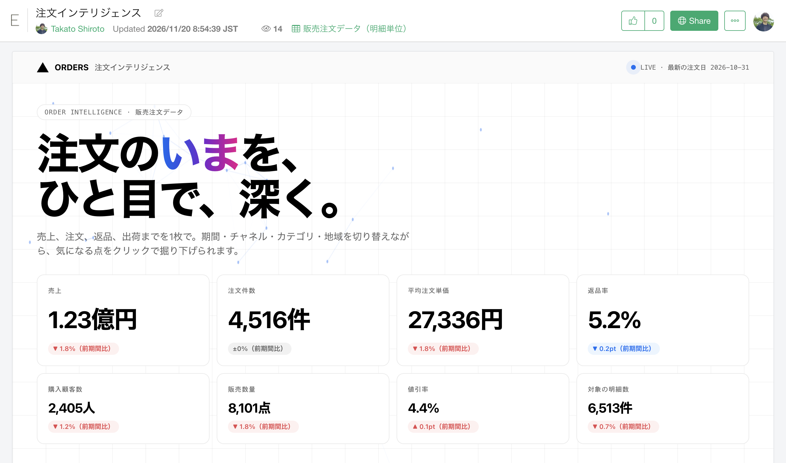

公開されたコンテンツでやりたいことに合わせた、AI への依頼文の例です。AI が使用する道具と、依頼するときのポイントもあわせて説明します。道具は AI が使うもので、自分で呼び出す必要はありません。

| やりたいこと | 節 | AI が使う主な道具 |
| --- | --- | --- |
| データを探す | [データを探す](#find) | search、fetch |
| ノートを読む | [ノートを読む](#notes) | search、fetch |
| データを集計する | [データを集計する](#data) | dataframe_get_schema、query_dataset |
| チャートの数値を取得する | [チャートの数値を取得する](#chart) | fetch、chart_get_data、chart_query |
| アナリティクスの結果を取得する | [アナリティクスの結果を取得する](#analytics) | fetch、analytics_get_result |
| 結果をファイルに保存する | [結果をファイルに保存する](#export) | query_dataset、dataframe_export |
| ダッシュボードやレポートを Page として公開する | [Page を作る](#page) | get_page_guide、page_publish、page_update |

ターミナルから同じことをするときは、CLI Server の[使い方](/ja/cli/server/use)を参照してください。

<a id="find"></a>

## データを探す

```text
Exploratory にある「Sales Orders」のデータを探して
```

AI は、search を scope: "all" で呼び出し、該当するデータを URL 付きで表示します。内容を読む場合は、id を指定して fetch を呼び出します。

<a id="notes"></a>

## ノートを読む

```text
Exploratory の「Sales Orders Report」のノートを読んで、要点を教えて
```

AI は、search で探した id を指定して fetch を呼び出し、ノートやダッシュボードの本文を Markdown で読みます。長いノートでは、fetch の section、query で必要な部分だけを読みます。ノートの名前に加えて、知りたい話題（「予測の節だけ」など）を伝えると、速く読めます。

ターミナルから同じことをするときは、[ノートを読む](/ja/cli/server/guides/read-notes)を参照してください。

<a id="data"></a>

## データを集計する

```text
Exploratory の「Sales Orders」データにはどんな列がある？ 売上の上位 5 地域も教えて
```

データの名前と知りたいことを伝えます。AI は、列と集計のルールを確かめてから計算します。結果とあわせて、計算の条件（集計方法、絞り込み）とデータの時点を確認してください。

ターミナルから同じことをするときは、[データを集計する](/ja/cli/server/guides/query-data)を参照してください。

<a id="chart"></a>

## チャートの数値を取得する

```text
「Sales Orders Dashboard」のダッシュボードにある「Monthly Sales Trend」のチャートの数値を教えて
```

AI は、ダッシュボードの中のチャートの名前を調べ、数値を取得します。ノート、ダッシュボード、スライド内のチャートは、chart_query で絞り込み、並べ替え、集計もできます。数値は、公開されたときの値です。


ターミナルから同じことをするときは、[チャートの数値を取得する](/ja/cli/server/guides/dashboard-charts)を参照してください。

<a id="analytics"></a>

## アナリティクスの結果を取得する

```text
「Sales Orders Dashboard」にある「Monthly Sales Forecast」のアナリティクスの結果を教えて
```

AI は、fetch でダッシュボードの中のアナリティクスの名前を確かめ、analytics_get_result で結果を取得します。係数や p 値などは、表示されたとおりの値で返ります。アナリティクスの名前（タイトル）と、知りたい数値（係数、p 値など）を伝えてください。

ターミナルから同じことをするときは、[アナリティクスの結果を取得する](/ja/cli/server/guides/analytics)を参照してください。

<a id="export"></a>

## 結果をファイルに保存する

```text
「Sales Orders」データの、地域ごとの売上の集計結果を CSV にして
```

AI は、query_dataset と同じ指定で絞り込みや集計をして、dataframe_export で結果を CSV か Parquet にし、ダウンロードリンクを返します。結果が大きく、画面に取得しきれないときに使います。ファイルの形式（CSV か Parquet）と、集計の条件を伝えてください。公開した人がダウンロードを許可していないデータは、保存できません。

ターミナルから同じことをするときは、[結果をファイルに保存する](/ja/cli/server/guides/export)を参照してください。

<a id="page"></a>

## Page を作る

```text
Exploratoryサーバーにある「 販売注文データ」を対象にして、注文状況をモニタリングできるインタラクティブなダッシュボードを作ってPageとして公開してください。
デザインについては、以下を参考にしてください。
https://v0.app/templates/optimus-the-ai-platform-to-build-and-ship-LHv4frpA7Us
```

AI は、get_page_guide で Page の書き方を確かめ、データの列を調べてから、page_publish で Page を公開し、URL を返します。Page は、ブラウザで開けるダッシュボードや分析レポート、スライドです。公開されたデータを、開くたびに読み込みます。公開した直後の Page は非公開で、共有できるのは作った本人だけです。使うデータの名前と、見たいことを伝えてください。デザインの参考にしたいページがあれば、その URL も添えます。

次の画像は、上の依頼文で作ったダッシュボードです。



手順の詳細と、ノートやスライドの例は、[Page を作る](/ja/page/getting-started)をご覧ください。
