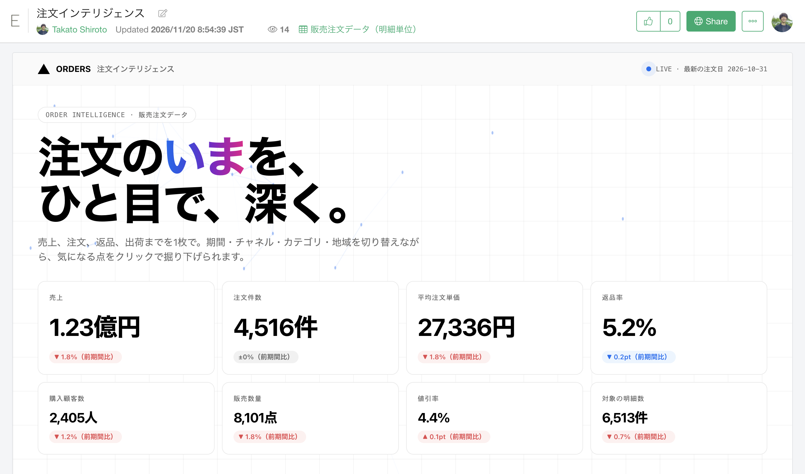
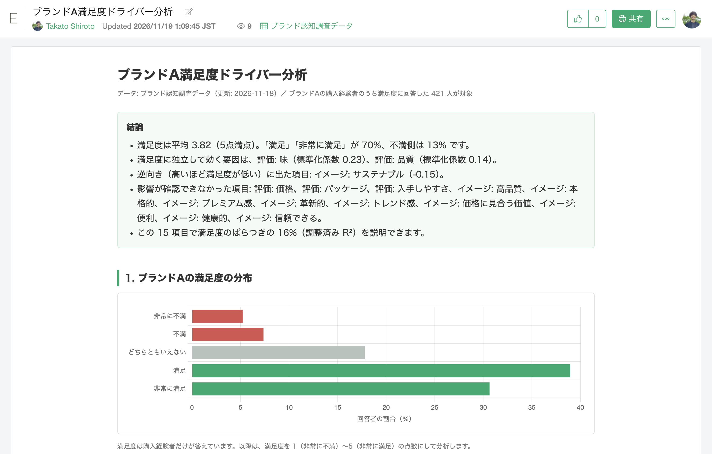
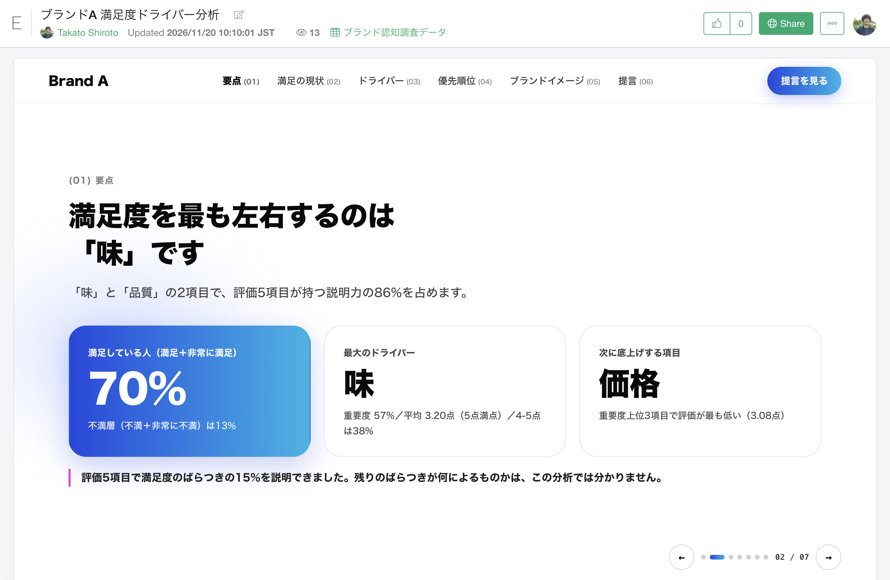

注文状況を追うダッシュボードのほかに、分析の結果を文章で読むノートや、会議で説明するスライドも作れます。

## ダッシュボードで注文状況を見る

[はじめる](/ja/page/get-started)の手順とは、デザインの参考にしたページが違う依頼文で作りました。

```text
Exploratoryサーバーにある「 販売注文データ」を対象にして、注文状況をモニタリングできるインタラクティブなダッシュボードを作ってPageとして公開してください。
デザインについては、以下を参考にしてください。
https://v0.app/templates/optimus-the-ai-platform-to-build-and-ship-LHv4frpA7Us
```



[ダッシュボードの作成例を開く](https://exploratory.io/page/GMq1Qom5tS/Zqr2rYj9uH)

## ノートでブランド A の満足度に関係する要因を読む

```text
以下のデータを対象にブランドAの満足度に対して関係する要因をドライバー分析をして、分析レポートをPageで作成してください https://exploratory.io/data/exploratory/SKz6cZH7
```



[分析ノートの作成例を開く](https://exploratory.io/page/GMq1Qom5tS/fAr6BQN2Xh)

## スライドで経営層に分析結果を伝える

```text
ブランドサーベイのデータがサーバーにパブリッシュされているので、それを元にブランドAの満足度に関するドライバー分析を行って、エグゼクティブ向けのスライドを作ってpageに公開してください。デザインは以下を模倣してください。page作成時の決まりの色は使用しなくてよく、以下のデザインを最大限参考にして作ってください。https://v0.app/templates/ai-product-portfolio-LFFFrvSq9Bb
```



[スライドの作成例を開く](https://exploratory.io/page/GMq1Qom5tS/zyH0jPM0AJ)

<Tip>
今回のダッシュボードとスライドでは、参考にしたいテンプレートの URL を添えるだけで、希望に沿った見栄えに仕上がりました。作りたい資料に近い例を探して、依頼文に加えてみてください。[v0 のテンプレート一覧](https://v0.app/templates)
</Tip>
