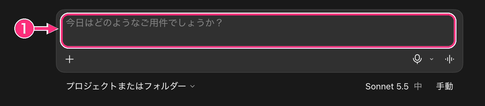
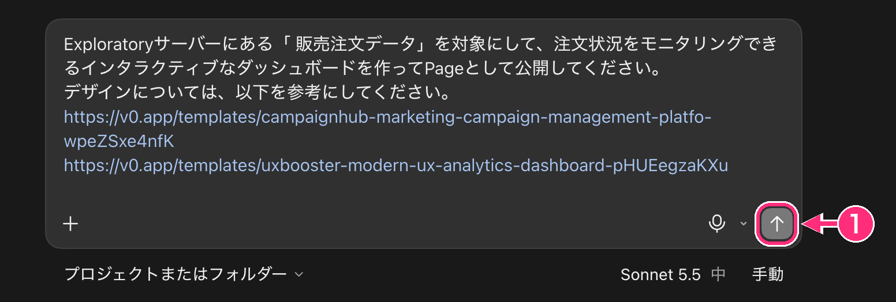
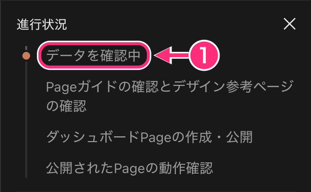
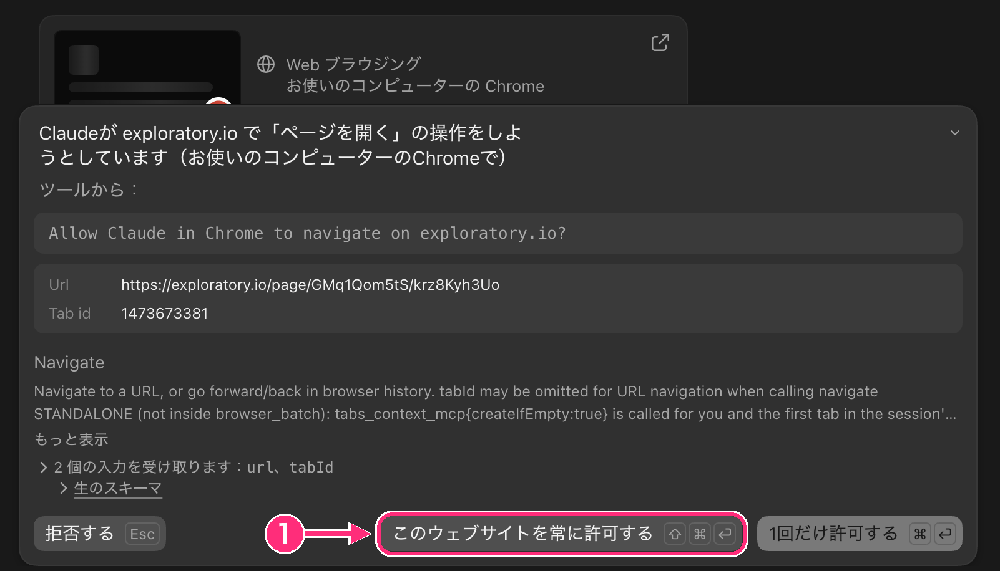
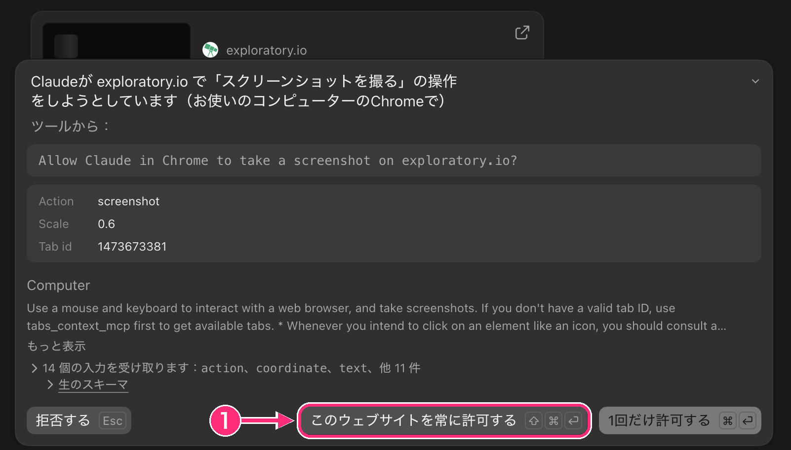
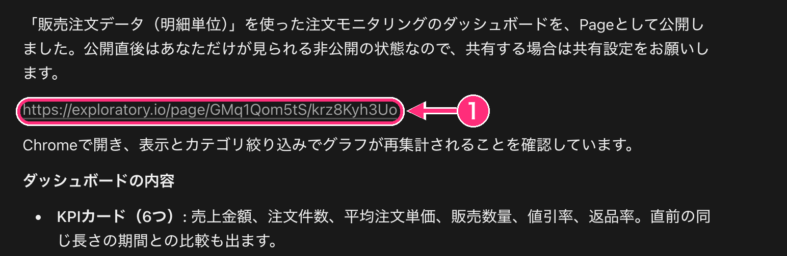
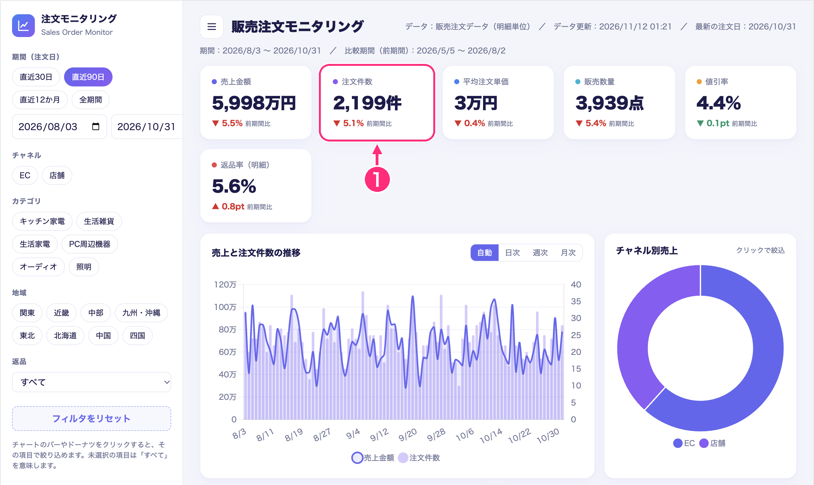
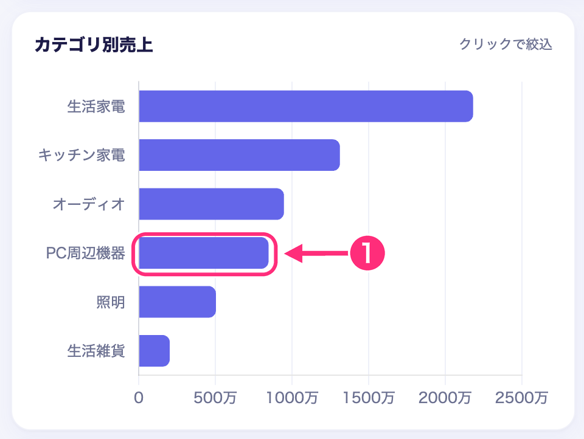

Exploratory Page を使うと、Claude などの AI ツールにデータと目的を伝えて、ブラウザで開けるダッシュボードや分析レポート、スライドを作れます。ここでは Claude のデスクトップアプリを例に、Exploratory に公開された「販売注文データ」から、注文状況を確認できるダッシュボードを作ります。

## AI ツールを Exploratory につなぐ

Exploratory Page は、Server MCP につないだ AI ツールから作れます。Claude のほか、ChatGPT や Cursor などでも使えます。つなぎ方は、[AI ツールから追加する](/ja/mcp/server/clients/apps)をご覧ください。この例では、Exploratory コネクタを接続済みの Claude のデスクトップアプリから始めます。

## 注文状況のダッシュボードを作る

依頼文には、使うデータの名前、ダッシュボードで見たいこと、デザインの参考にしたいページの URL を入れます。

```text
Exploratoryサーバーにある「 販売注文データ」を対象にして、注文状況をモニタリングできるインタラクティブなダッシュボードを作ってPageとして公開してください。
デザインについては、以下を参考にしてください。
https://v0.app/templates/campaignhub-marketing-campaign-management-platfo-wpeZSxe4nfK
https://v0.app/templates/uxbooster-modern-ux-analytics-dashboard-pHUEegzaKXu
```

❶ 新しいチャットを開き、上の依頼文を入力欄に貼り付けます。



❶ 右下の上向き矢印を押して送信します。



Exploratory のツール（Get Data Schema や Publish a Page など）を初めて使うときに許可を求められたら、ツール名と操作内容を確認して許可します。

❶ 「進行状況」の「データを確認中」を見ます。Claude は Get Data Schema でデータの列や型を調べています。



## Claude にブラウザでの確認を許可する

Chrome の拡張機能「Claude in Chrome」を入れていると、Claude ができた Page を Chrome で開いて確かめることがあります。

❶ Claude が Chrome で「ページを開く」許可を求めたら、開こうとしている URL を確認し、「このウェブサイトを常に許可する」を選びます。



❶ 続けて「スクリーンショットを撮る」許可を求められたら、操作を確認し、「このウェブサイトを常に許可する」を選びます。



試したときは、「このウェブサイトを常に許可する」を選んだあと、同じチャットで同じサイトのページをもう一度開いても、「ページを開く」許可は表示されませんでした。新しいタブを開く操作では、同じチャットでも確認が出ました（下記）。新しいチャットでは、同じサイトでも最初に「ページを開く」許可をもう一度求められることがあります。

「新しいタブを開く（Tabs Create）」の確認では、許可する場合に選べるのは「1回だけ許可する」です。確認が出るたびに、このボタンを選びます。

## 完成した Page を開く

❶ ご自身で作ったダッシュボードを開くには、Claude の返事にあるリンクをクリックします。



❶ ダッシュボードの「注文件数」で、選んだ期間の注文が何件だったか、前の期間からどれだけ変わったかを確認できます。



❶ 下へスクロールし、「カテゴリ別売上」で「PC周辺機器」の棒をクリックすると、そのカテゴリの注文に絞り込めます。



この手順で作ったダッシュボードは、次のリンクから開けます。

[この手順で作ったダッシュボードを開く](https://exploratory.io/page/GMq1Qom5tS/krz8Kyh3Uo)

ダッシュボードのほかに、分析ノートやスライドも作れます。依頼文と作成例は、[作成例](/ja/page/examples)をご覧ください。
