エリアチャートは、時系列データの数値の大きさを面積で可視化するチャートです。

## エリアチャートの作り方

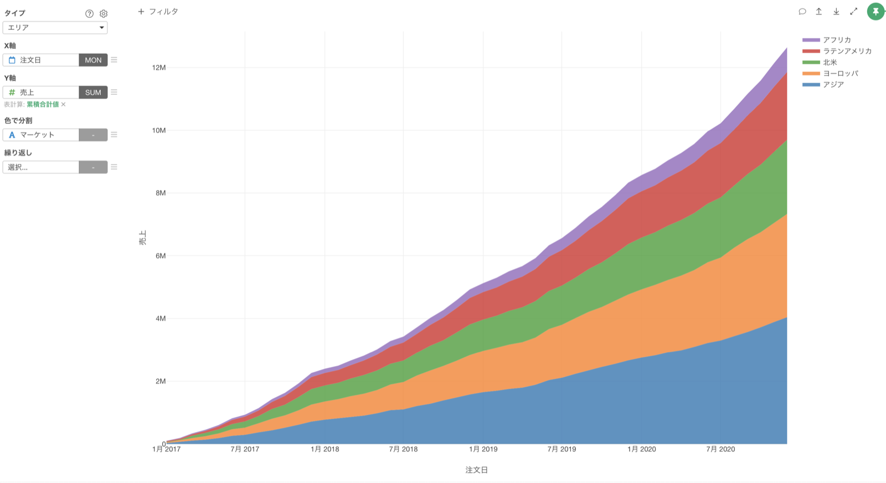

サンプルデータとして売上データを使用していきます。 このデータは1行が1注文で、列には注文日や売上、マーケットなどの列があります。

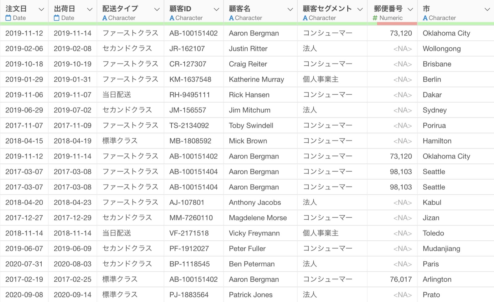

今回は、売上の累積合計の推移をエリアチャートを使って可視化していきます。

チャートビューからチャートを作成し、タイプにエリアを選択します。

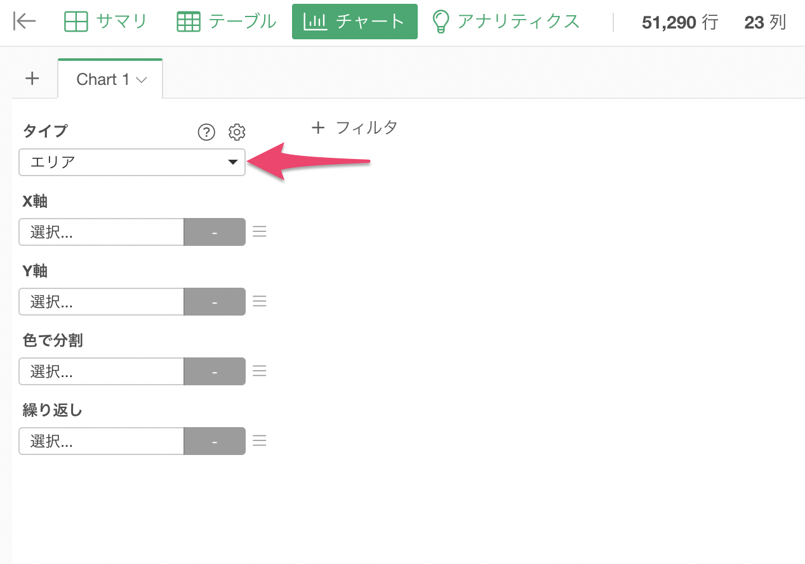

X軸に「注文日」を選び、日付の単位に「丸め処理」の「月」を選択します。

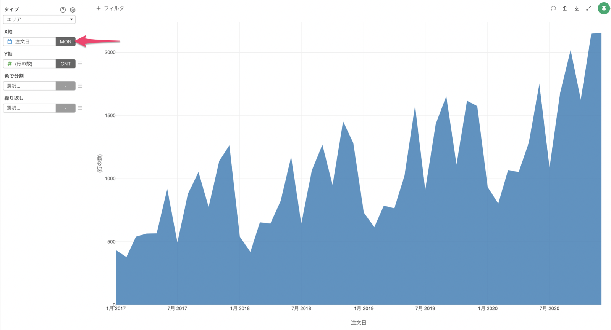

Y軸に「売上」を選び、集計関数に「合計値 (SUM)」を選択します。

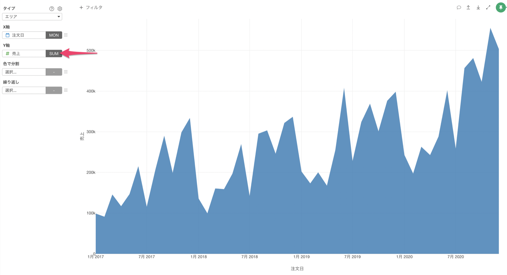

エリアチャートで月ごとの売上合計を可視化できました。

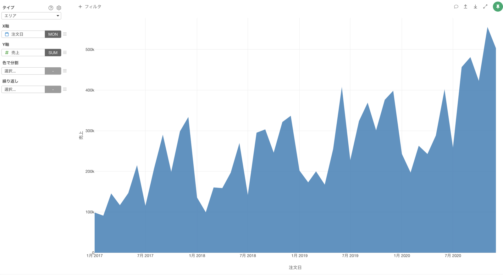

その月までの売上合計を可視化したいため、売上高の累積合計値を可視化します。

Y軸のメニューから「クイック表計算」を選び、「累積合計値」を選択します。

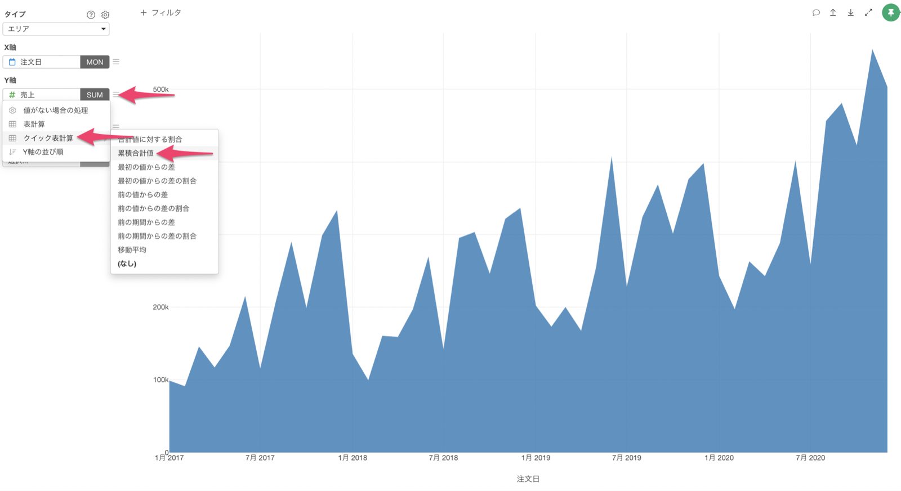

これにより、特定の時点での売上の累積合計値を確認していくことができます。

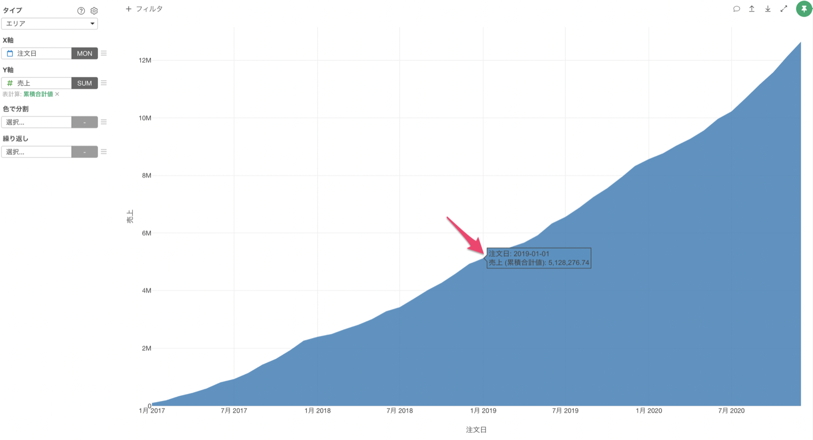

色で分割に「マーケット」を選択します。

マーケットごとに売上の累積合計値を可視化できました。

マーケットがアジアやヨーロッパは他のマーケットに比べて売上の累積合計値が多いことが確認できます。

## 積み重ねとオーバーレイを切り替える

### 使い方

エリアチャートを作成し、「色で分割」列を選択をすると、タイプの切り替えボタンを選択できるようになります。

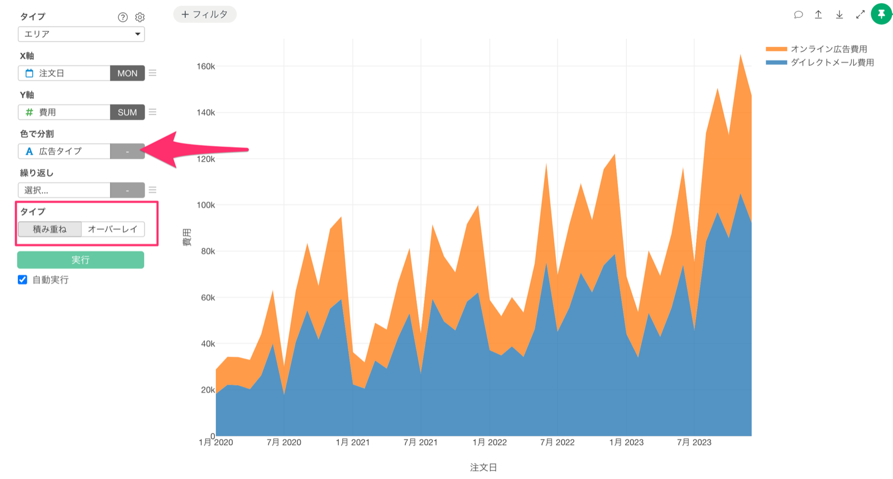

デフォルトでは「積み重ね」モードが有効です。このモードでは各色グループの値が累積されて積み上げ表示されるため、全体に対して各グループが占める量を確認できます。

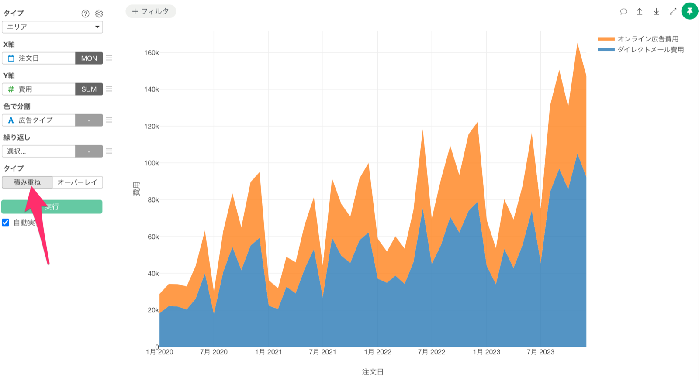

「オーバーレイ」に切り替えると、各色グループのエリアがY軸ゼロから独立して描画され、エリア同士が重なり合います。各グループの実際の値をそのまま比較するのに適した表示です。

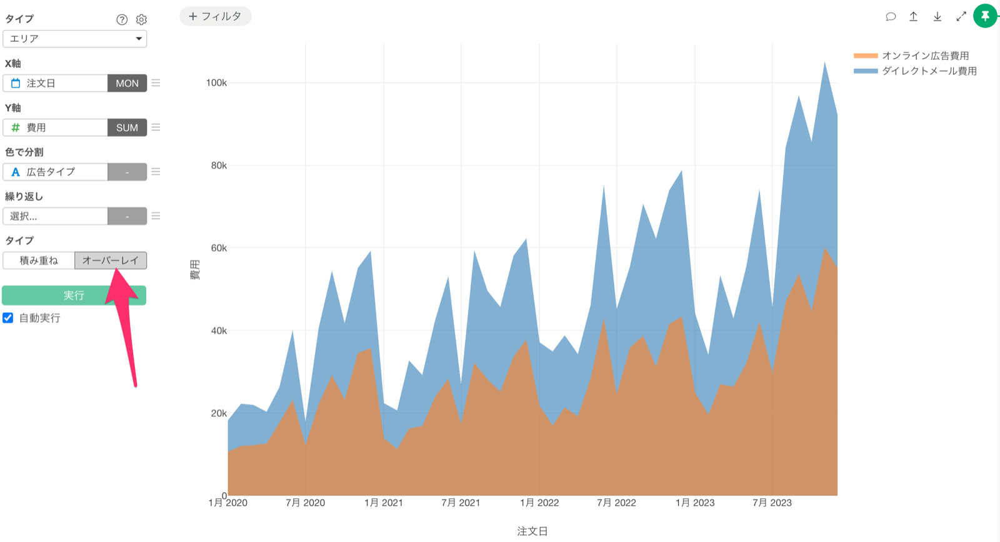
