散布図 (集計あり)は、グループごとに集計した2つの数値データ（カテゴリデータも可能）が交わる位置に、データを点でプロットするチャートです。

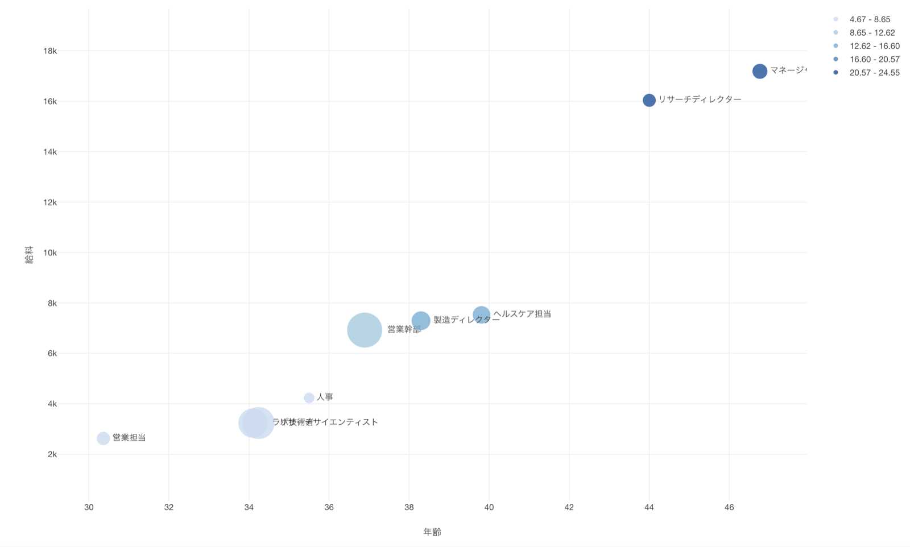

今回はサンプルデータとして[従業員データ](https://exploratory.io/data/kanaugust/HR-Employee-Attrition-Tog2pMA0AH)を使用していきます。

このデータは1行が1従業員となっていて、列には年齢や給料、職種といった列があります。

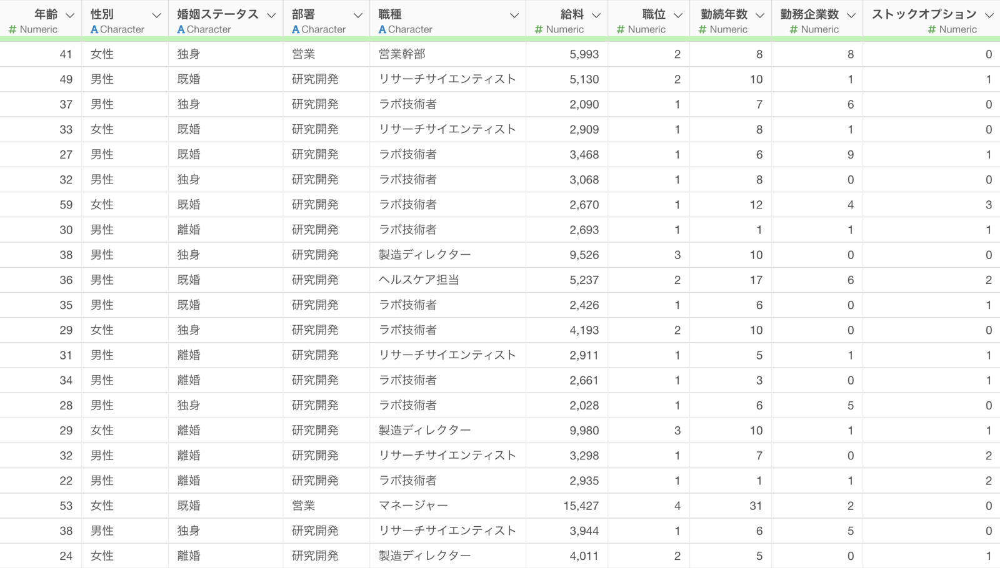

今回は年齢と給料の平均値を職種ごとに可視化したいとします。

そのため、数値同士の関係性をみる時によく使われる散布図 (集計なし) を使って可視化してみます。

チャートから散布図 (集計なし) を選び、X軸に「年齢」を、Y軸に「給料」を選択し、色で分割に「職種」を選択します。

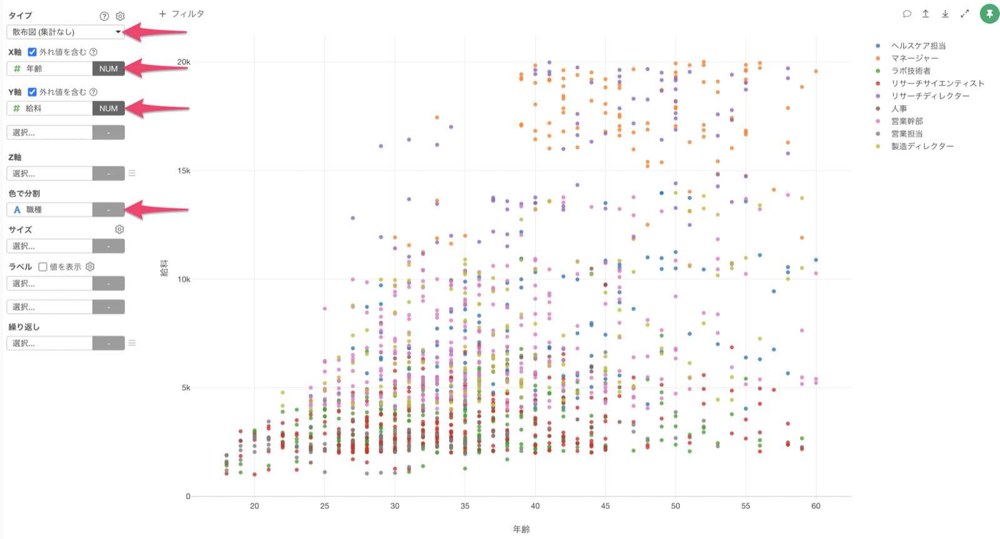

散布図 (集計なし)では、一行を一つの点としてチャートに描画します。そのため、職種ごとの年齢と給料の平均値を可視化することは難しいです。

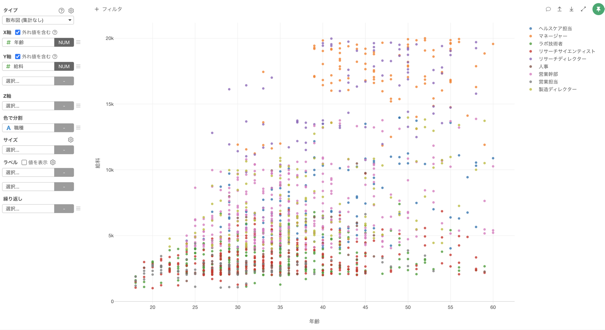

そんな時に便利なのが、散布図 (集計あり)というチャートです。

散布図 (集計あり)では、グループごとに集計されたデータを散布図として可視化できます。

早速作っていきましょう！

新規チャートを追加をクリックします。

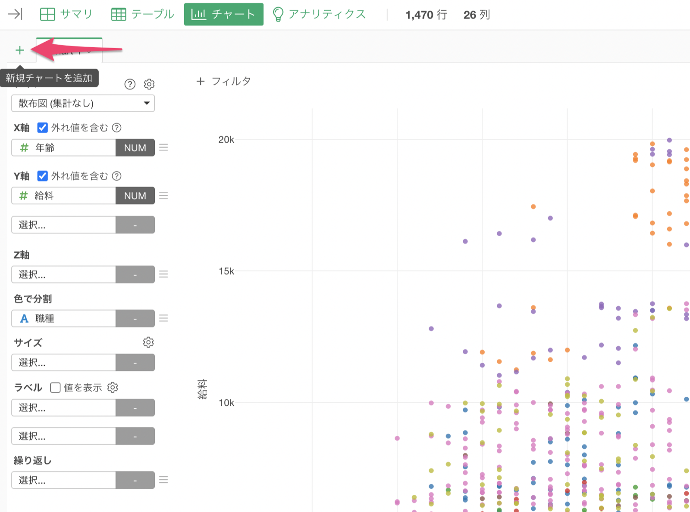

タイプに「散布図 (集計あり)」を選択します。

X軸には「年齢」を選び、集計関数には「平均値 (MEAN)」 を選択し、Y軸には「給料」 を選び、集計関数には「平均値 (MEAN)」 を選択します。

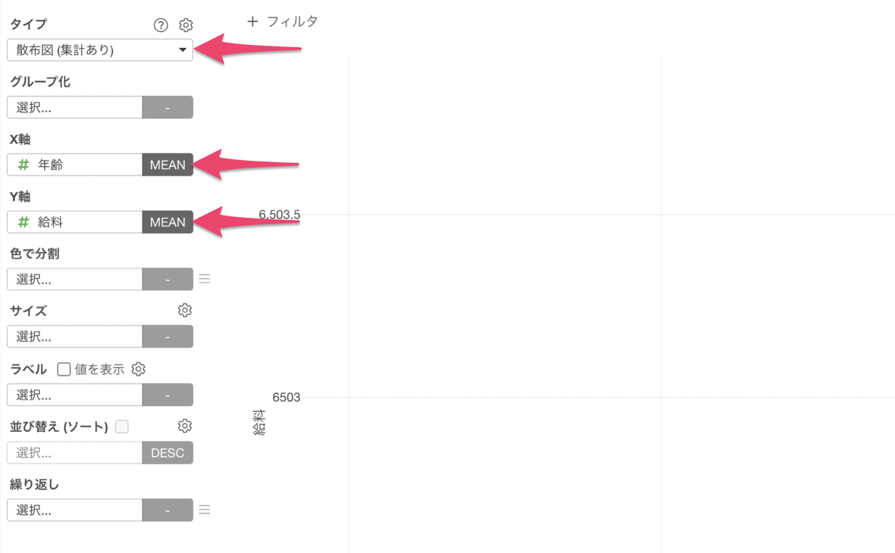

チャート上に一つの点が描画されました。この点は、全体の年齢と給料の平均値となります。

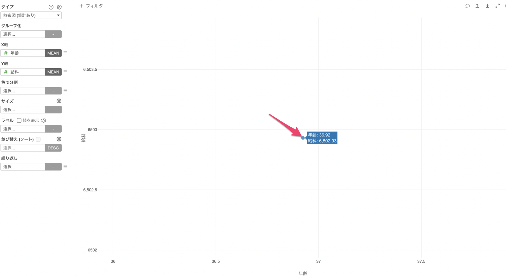

ここから散布図 (集計あり)の特徴でもある**グループ化**を使って、それぞれのグループごとに値を描画していきます。

今回は職種ごとにみたいため、グループ化に「職種」を選択します。

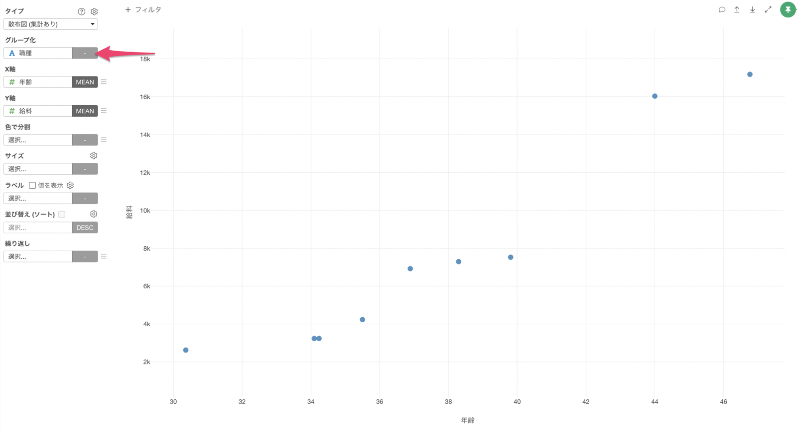

これにより、**職種ごと**に年齢や給料の平均値をチャートに可視化できました。

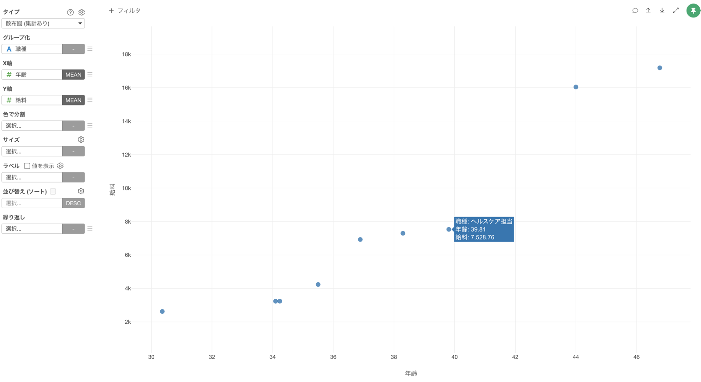

しかし、どの点がどの職種かはマウスオーバーしないとわからないため、チャート上に職種を表示します。

ラベルに「職種」を選択し、「値を表示」にチェックをします。

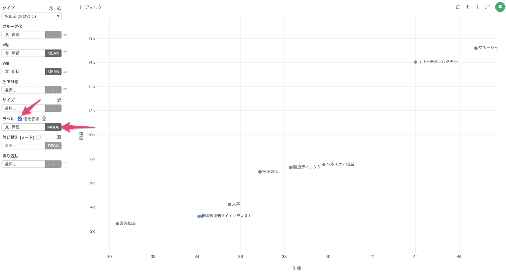

これにより、それぞれ点が何の職種なのかをすぐに理解できます。

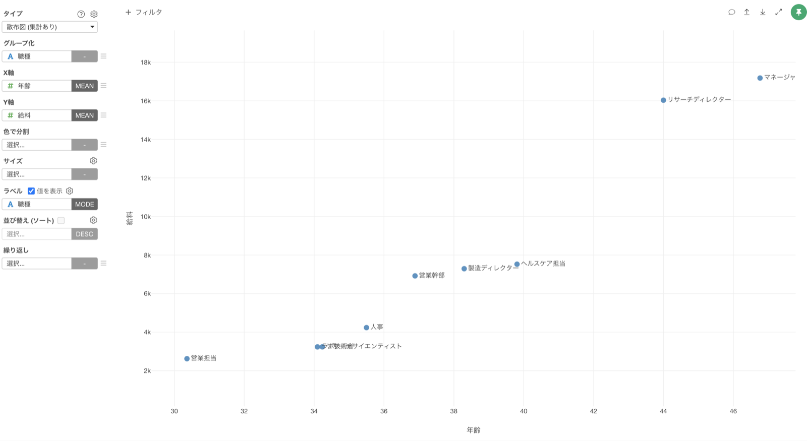

職種ごとに年齢と給料の平均値がわかりましたが、どれくらいの人数がこの職種にいるのでしょうか？

その質問に答えるためにサイズを使って、それぞれの職種の人数を可視化していきます。

サイズに**行の数**を選択します。

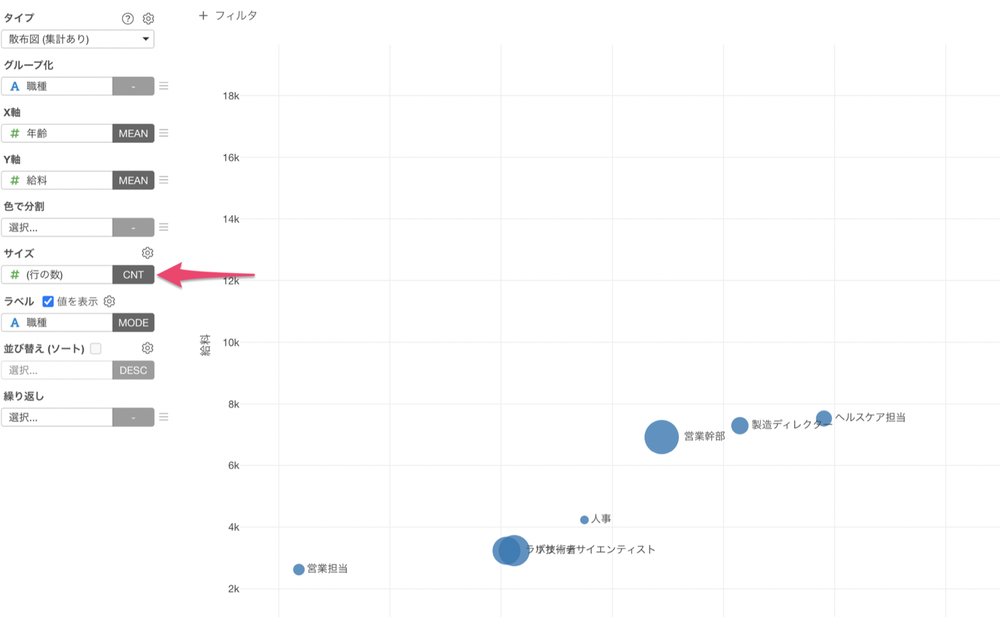

職種ごとに行の数（人数）が多いものは点が大きく、逆に行の数（人数）が少ないものは点が小さくなりました。

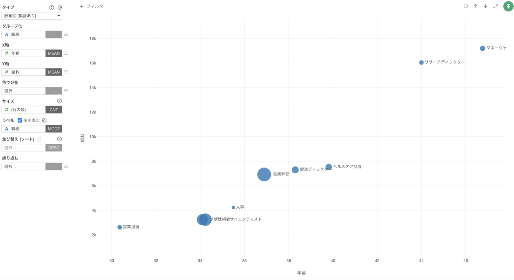

サイズの横にある**ギアアイコン**をクリックすると、最大サイズと最小サイズを設定できます。

今回は最大サイズに**50**を、最小サイズに**15**を入力して適用します。

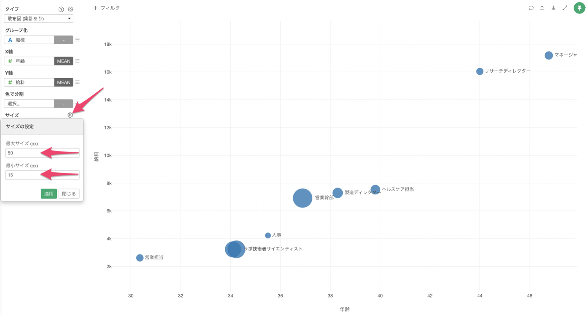

それぞれの職種で行の数（人数）が多いものを大きな点で可視化できました。

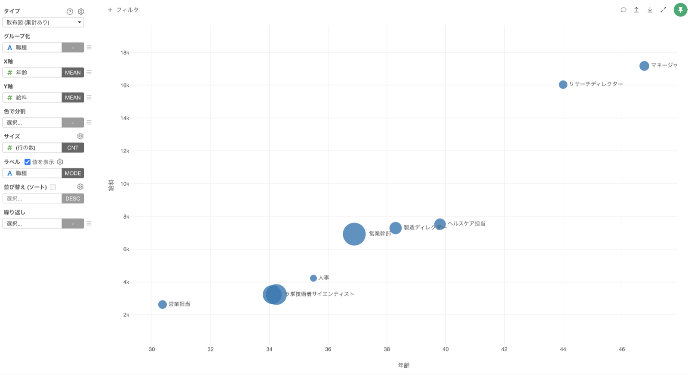

次に、これらの職種の人はどのくらいこの会社で働いて今の職種についているのでしょうか？

その質問に答えるために、この会社での勤続年数の平均値を色を使って可視化します。

色で分割に「勤続年数」を選び、集計関数に「平均値 (MEAN)」を選択します。　

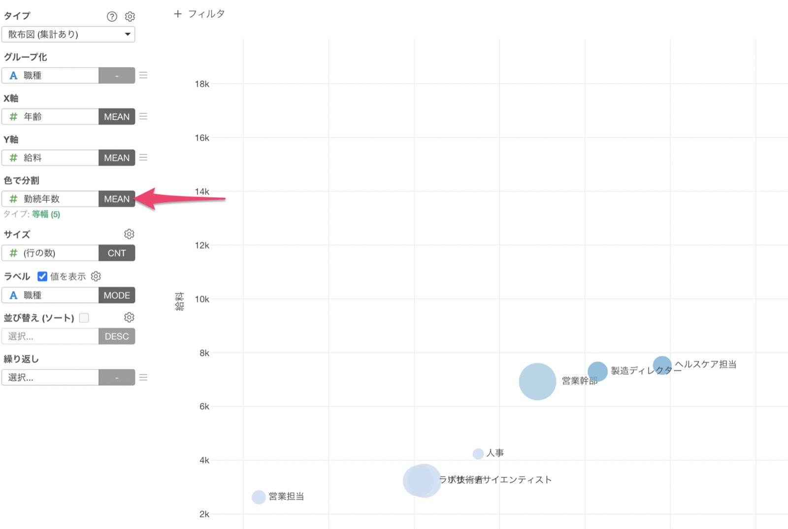

職種ごとにこの会社での勤続年数の平均値を**等幅（5）** で色分けできました。

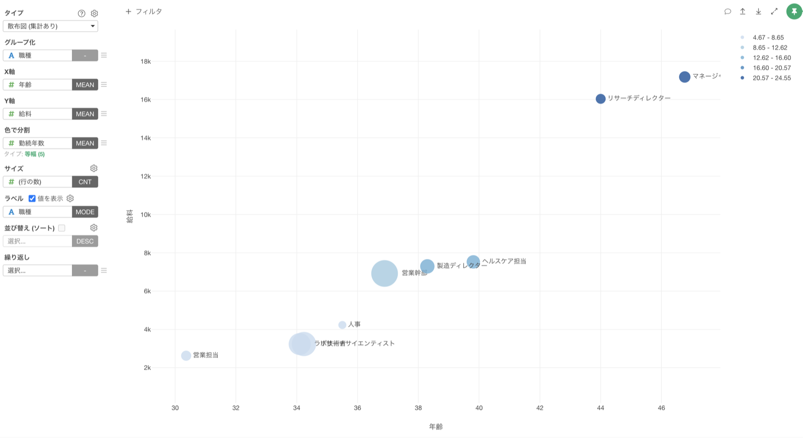

今回使用した散布図 (集計あり)を使うと、グループごとに集計されたデータを散布図として可視化できます。

さらには、「サイズ」や「色で分割」を使って別の列の情報を可視化することで、データを様々な角度から理解していくことができます。
