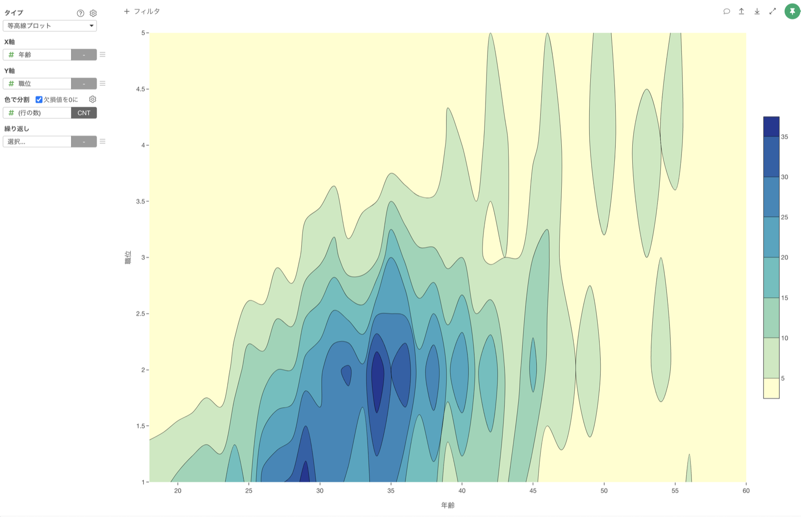
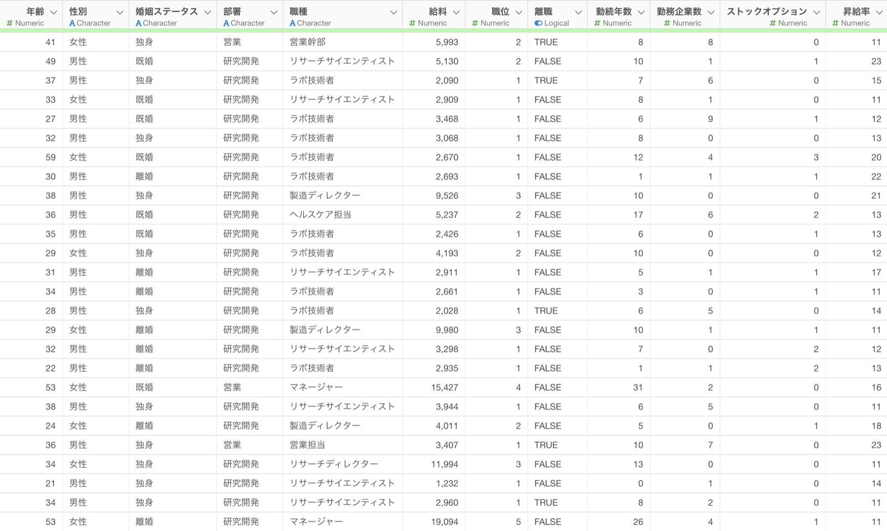
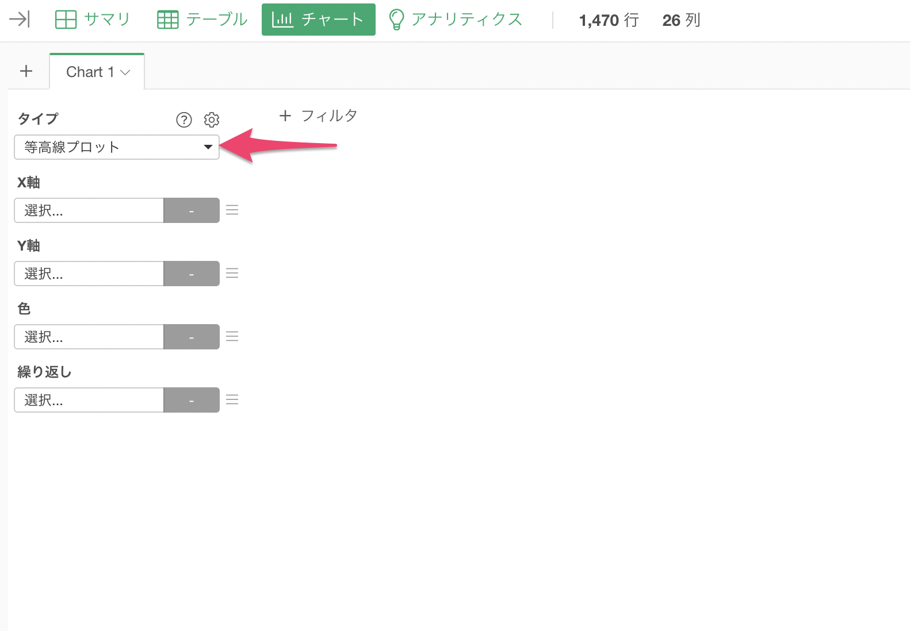
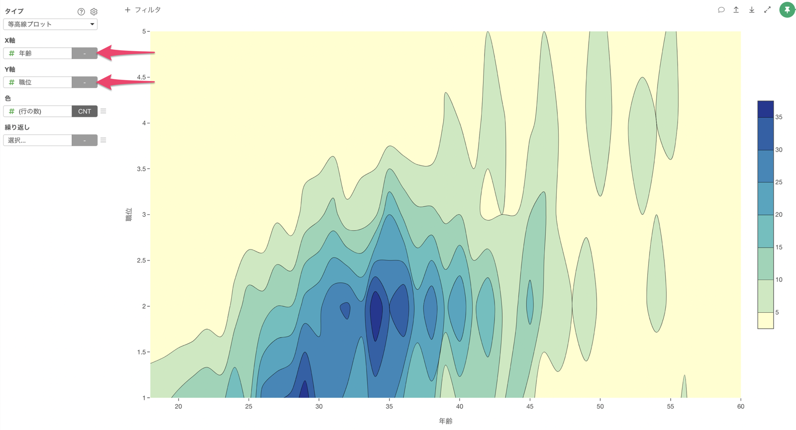
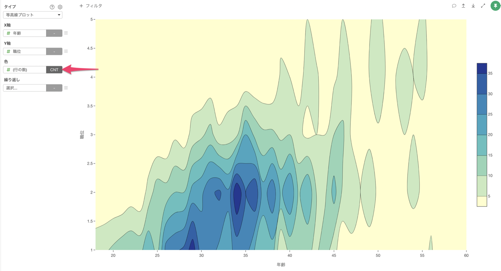
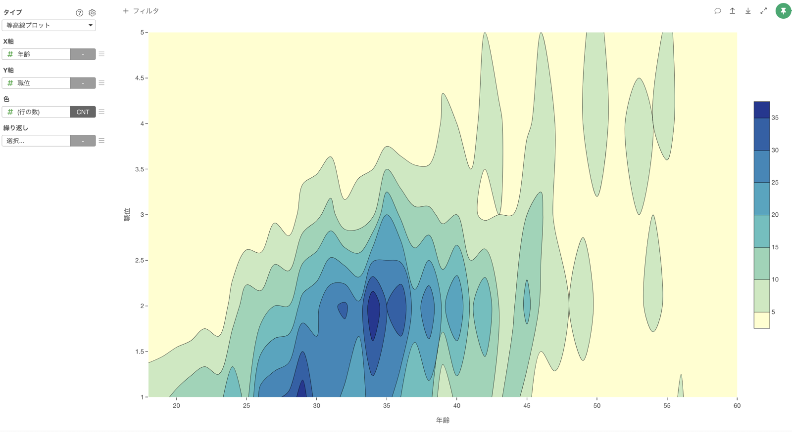
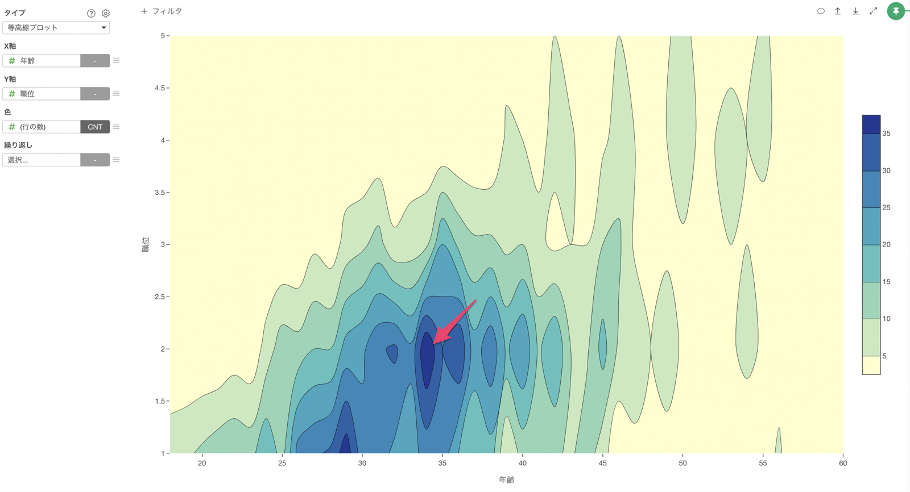

等高線プロットは、3つの数値列をもとに傾向や関係性を調べたいときに使うチャートです。

等高線プロットは、3つの次元のデータを2次元の平面上で表現したチャートです。高さが同じ場所を線で結んだ「等高線」として描き、色はその中での値の大小を表してくれます。

線が密集しているほど、傾斜が急（値が急激に変化）であることを示し、線が離れている場所は傾斜が緩やか（値の変化が緩やか）であることを意味しています。

今回はサンプルデータとして従業員データを使用していきます。

このデータは1行が1従業員となっており、列には給料や職位などの列があります。

今回は、年齢と職位を掛け合わせた時に、どのあたりに従業員集まっているのかを「等高線プロット」を使用して可視化していきます。

  
チャートビューに移り、タイプに「等高線プロット」を選択します。

次に、X軸に「年齢」を選び、Y軸には「職位」を選択します。

色には従業員数を調べたいため、「行の数」を選択します。

年齢と職位を掛け合わせた時に、どのあたりに従業員（行の数）が集まっているのかを可視化できました。

色が青色に濃くなるほど、色に割り当てた値が大きいことを表し、今回の場合は従業員数が多いことを意味します。

上記の結果では、年齢が35歳くらいで職位が2付近の従業員が多くいることがわかります。
