ユーザーカラーパレットは、自社の企業の色や、データの意味に合わせた色で、独自のカラーパレットを作れる機能です。

Exploratoryには、チャートを綺麗に表現するために豊富なカラーパレットがデフォルトで用意されています。自社の企業の色に適したカラーパレットを作りたい場合や、データの意味に合わせた色にしたい場合は、**ユーザーカラーパレット**という機能で、独自に設定した色のカラーパレットを作れます。

例えば、このようなチャートがあった時に、女性はピンク、男性は青で表示したいとします。

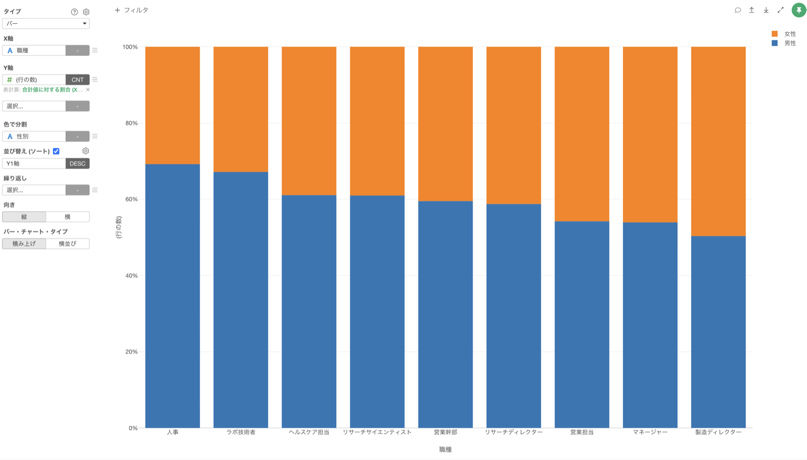

色のメニューから「色、グループ、並び順」を選択します。

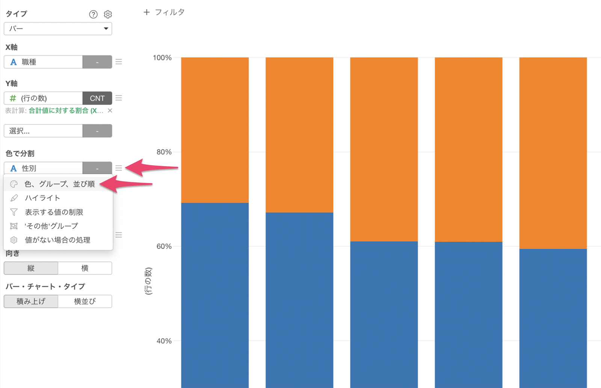

このチャートのみで色を変えたい場合は、それぞれの値に対応した色を個別に指定できます。

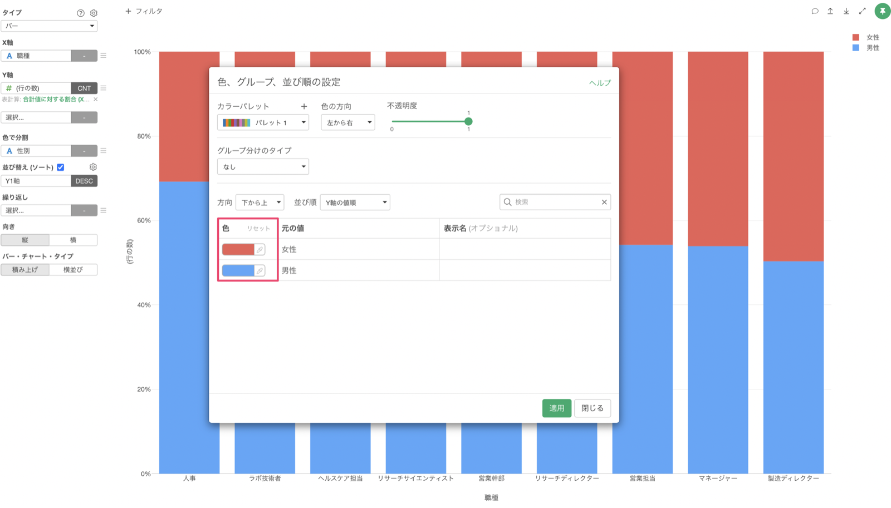

一方で、性別を使ったチャートでは常に同じ色にしたかったり、企業独自の色でチャートを作らなければいけない時に、毎回設定するのは大変です。

そこで、ユーザーカラーパレットを作っていきましょう。

カラーパレットのプラスボタンの「カラーパレットの追加 / 編集」をクリックします。

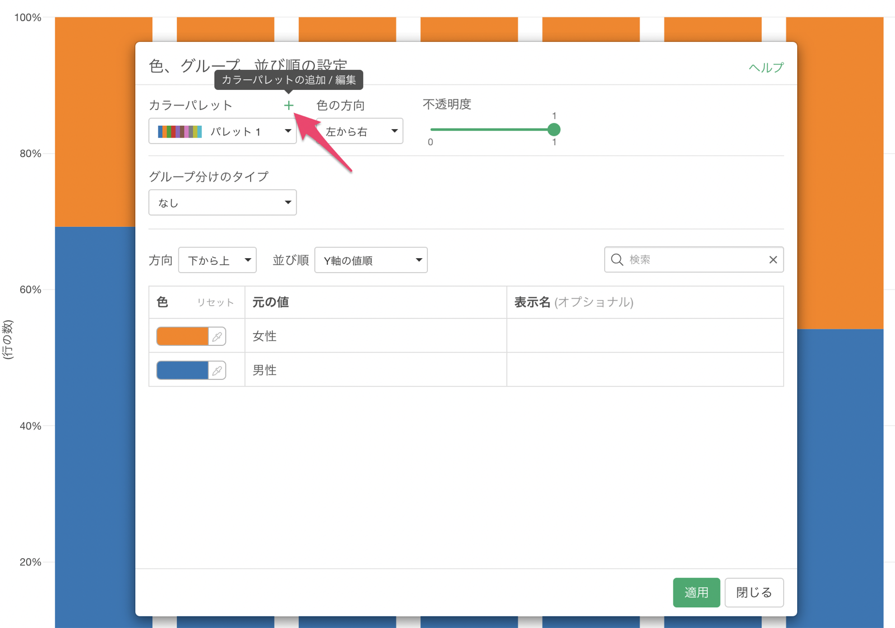

ユーザーカラーパレットのダイアログが表示されるため、「追加」ボタンをクリックします。

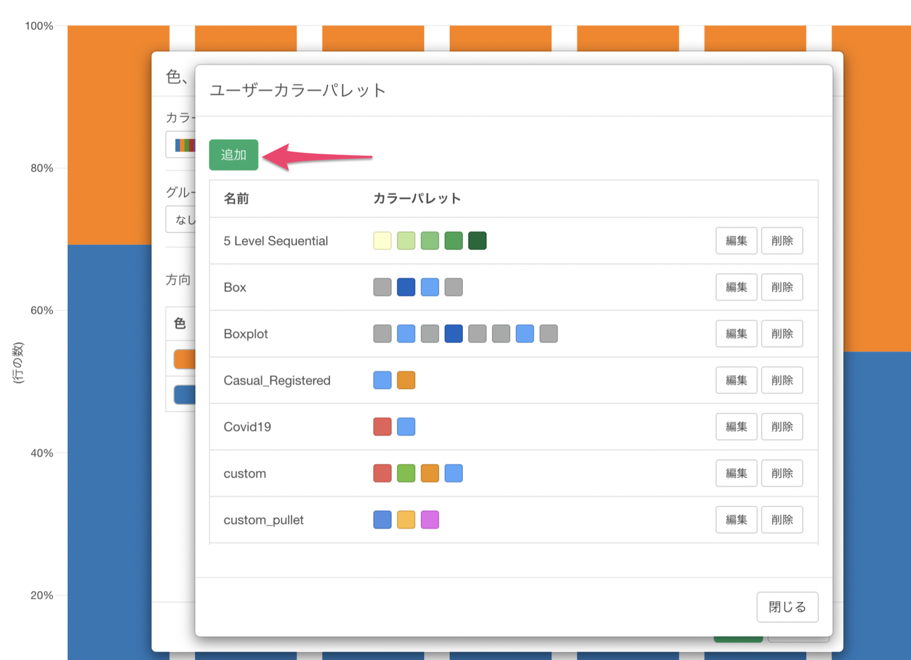

**「表示名の指定」** と「**カラーパレットの追加**」をしていきましょう。

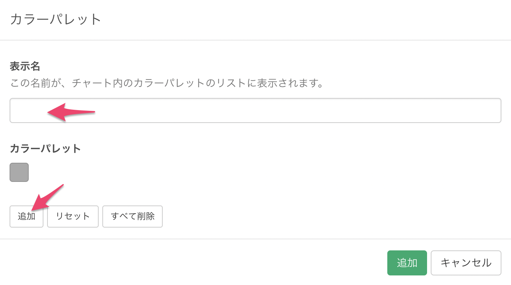

次に、色を割り当てたいパレットをクリックします。

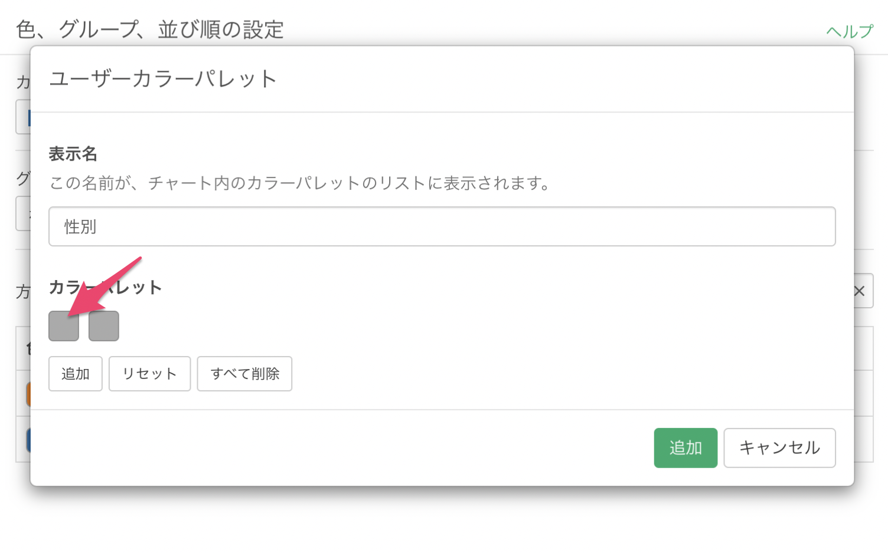

ここでは好きな色を自由に指定できます。 今回は、女性に「ピンク（Hex:FA766F）」、男性に「青（Hex:4A90E2）」を割り当てます。

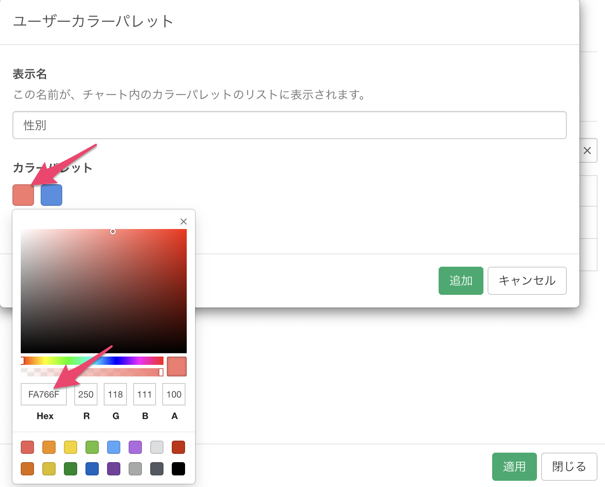

パレットの追加と色の割り当てが完成したら、「追加」ボタンをクリックします。

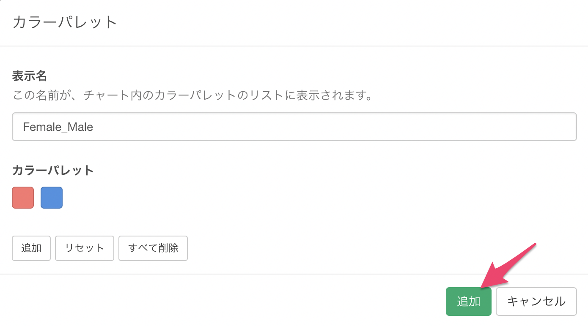

ユーザーカラーパレットを作成できました。

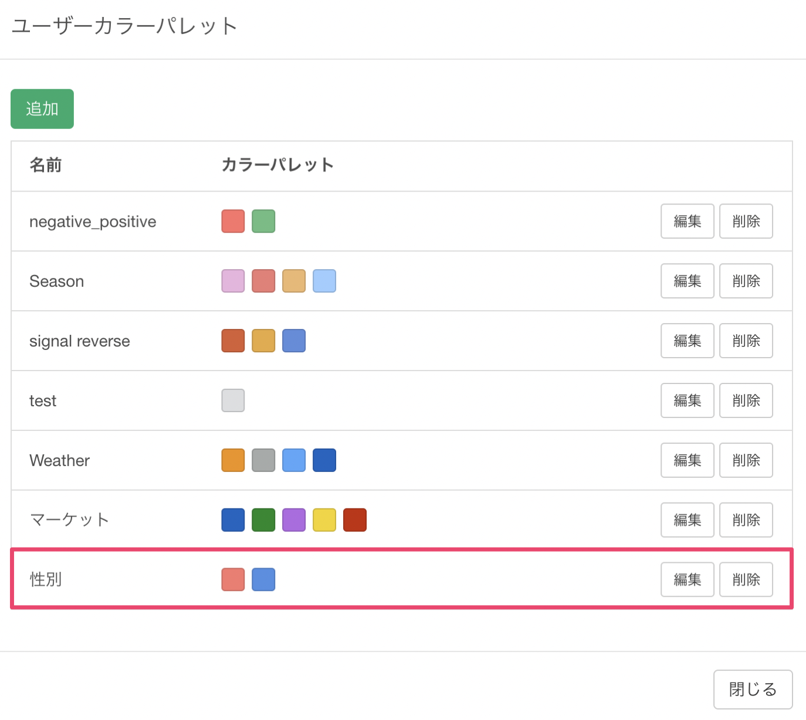

それでは、先ほどのチャートにユーザーカラーパレットを適用してみましょう。

色の設定ダイアログから、カラーパレットに先ほど作成した「性別」のカラーパレットを選択します。

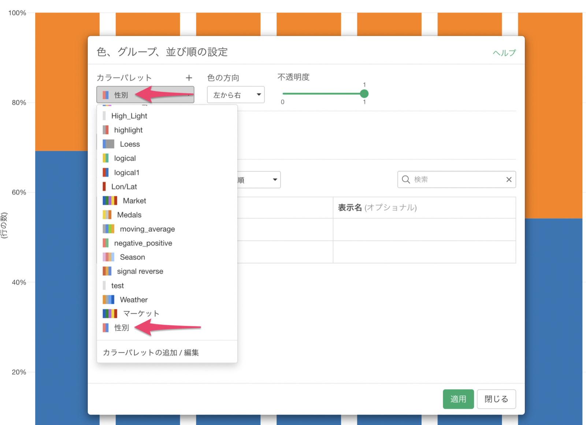

女性にピンクと男性に青を割り当てることができました。

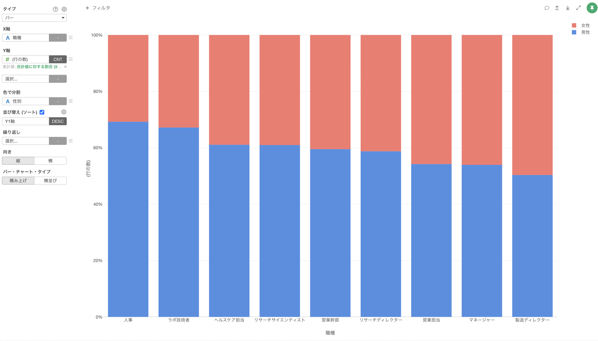
