密度曲線は、数値データの分布をカーネル密度推定で滑らかな曲線にして可視化するチャートです。

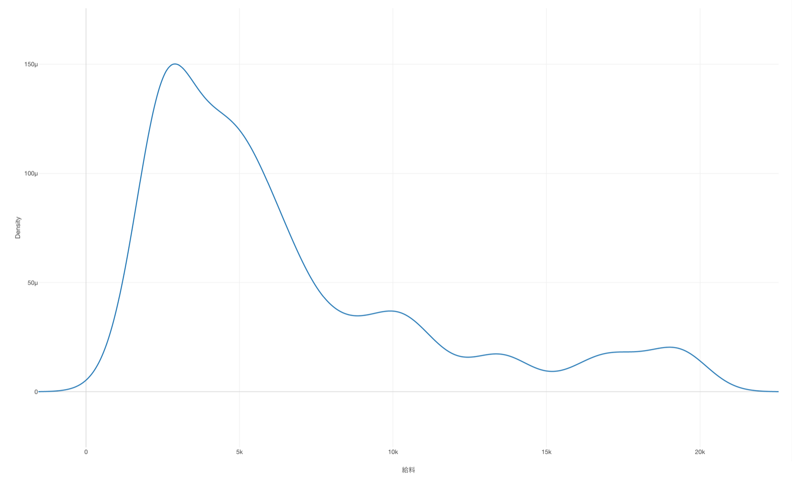

サンプルデータとして従業員データを使用していきます。 このデータは1行が1従業員で、列には給料や職種などの列があります。

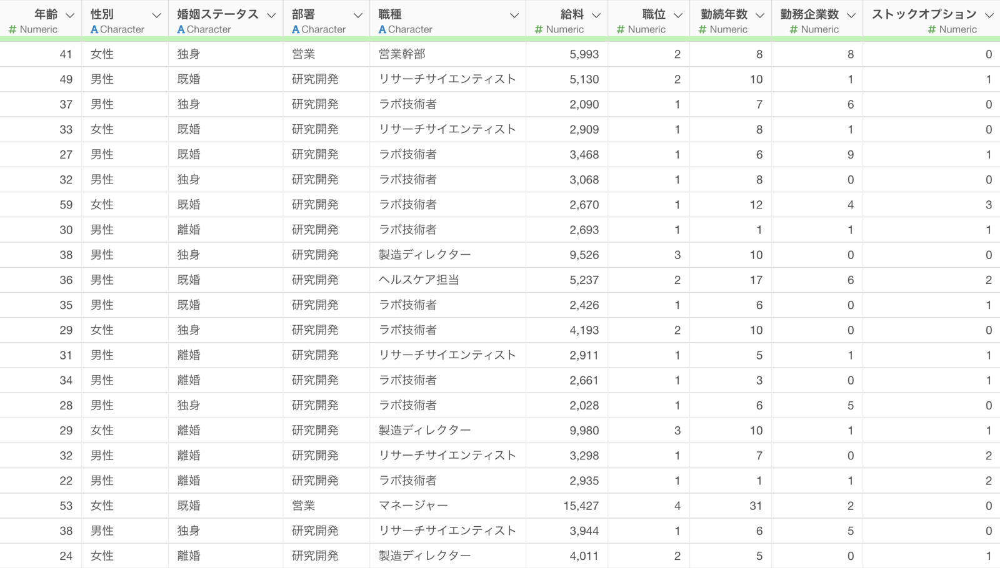

今回は、「給料」のデータの分布を密度曲線を使って可視化していきます。

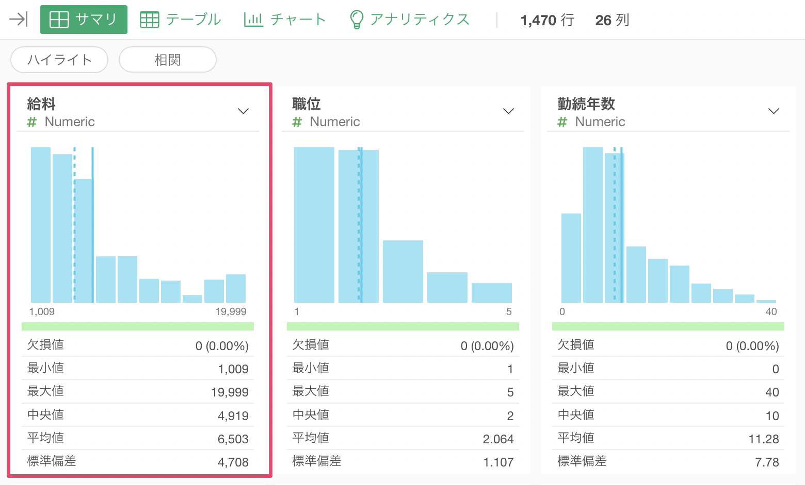

チャートビューからチャートを作成し、タイプに「密度曲線」を選び、X軸に「給料」を選択します。

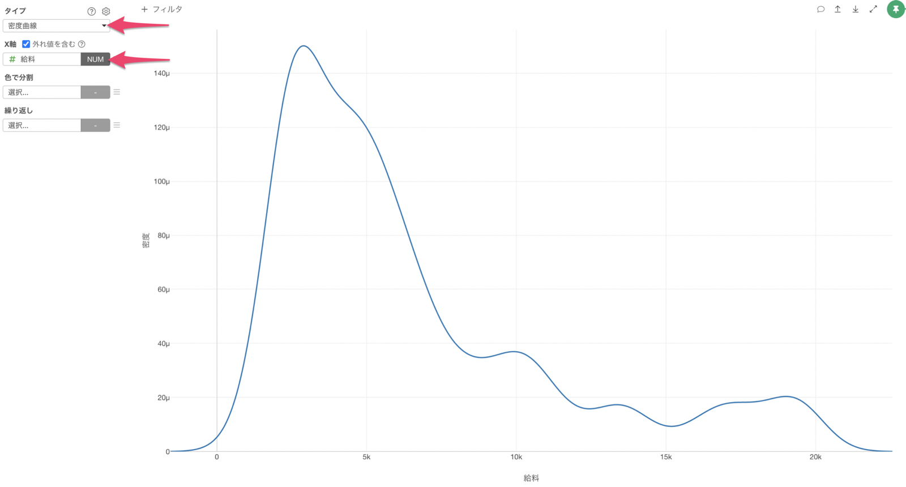

給料の密度曲線が作成できました。曲線の下の面積が1となるように高さが決まっているため、Y軸はその地点の密度になります。

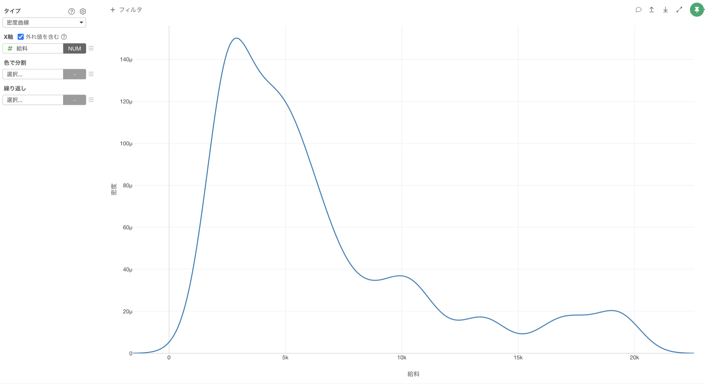

もしデータに外れ値がある場合は、外れ値を含むのチェックを外すことで外れ値を除くことができます。外れ値の閾値は1.5IQRを使用しています。

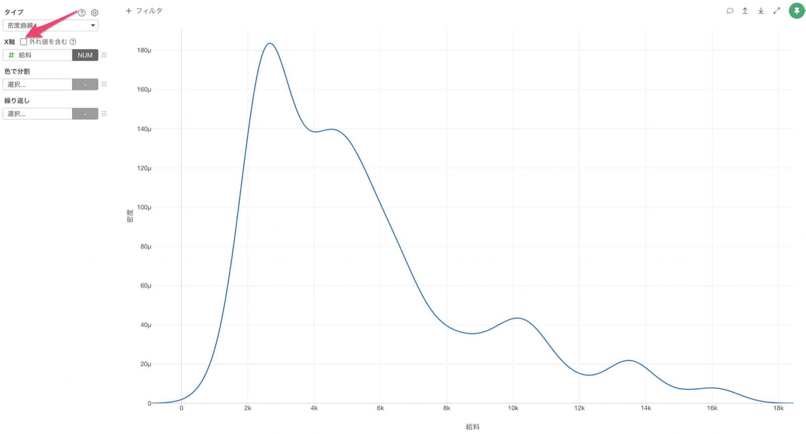

密度曲線を見ると、給料が2,000ドルから6,000ドルの間に多くの人が集まっているようです。また、給料が10,000ドル以上の人たちも一定数いるようで、16,000ドルから20,000ドルにも多少のデータが集まっています。

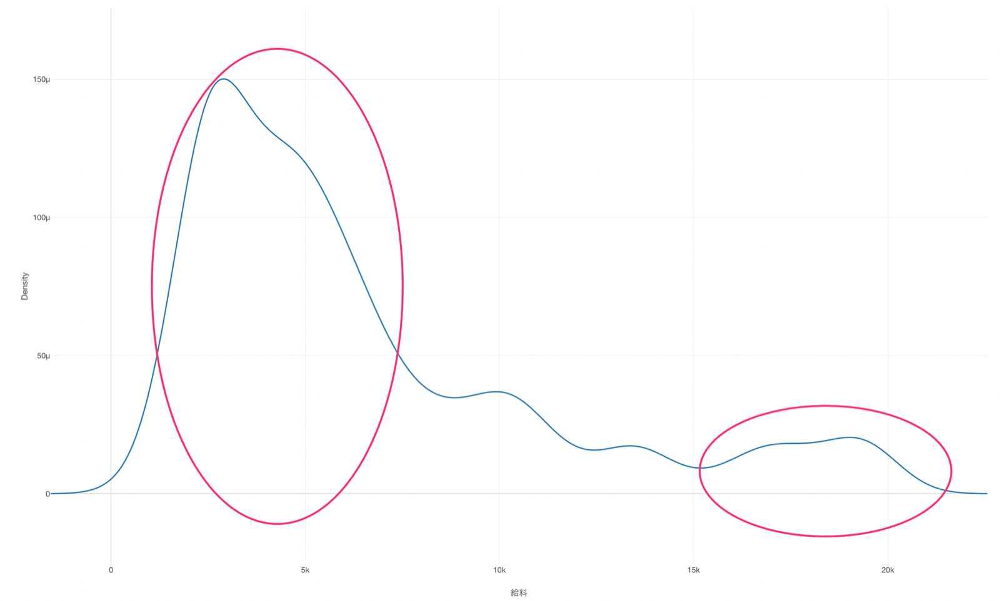

色で分割に「職種」を選択します。

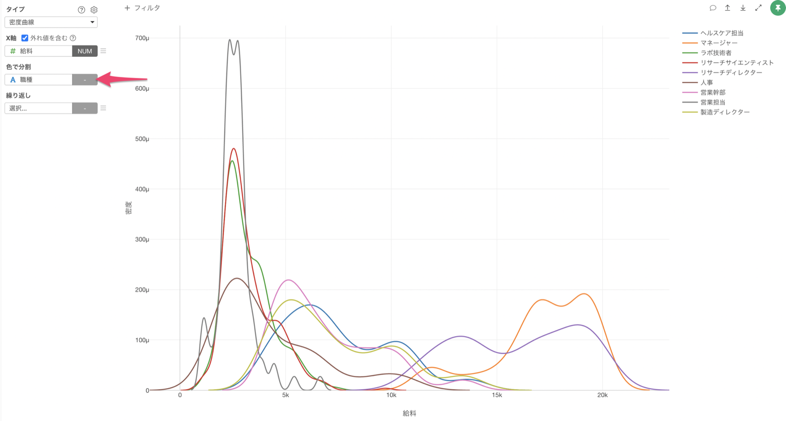

職種ごとに分けて密度曲線で可視化できました。

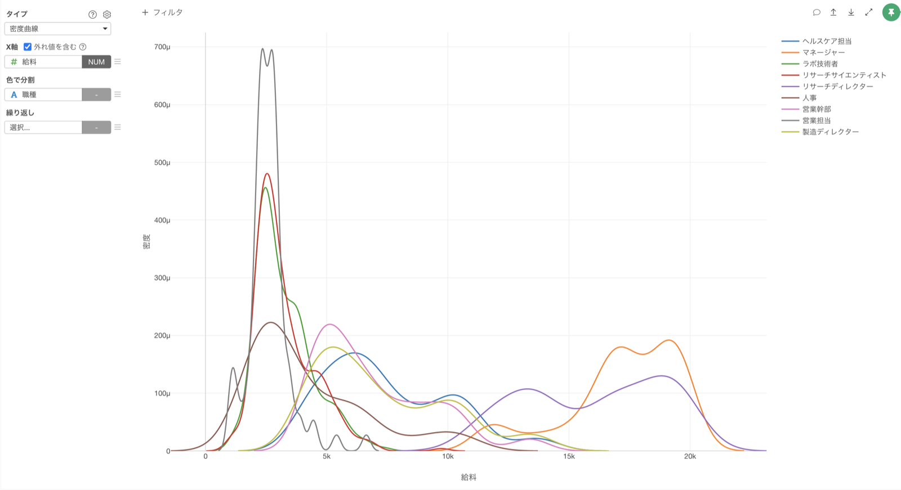

職種ごとに見ると、給料が高い人たちはマネージャーやリサーチディレクターということがわかりました。

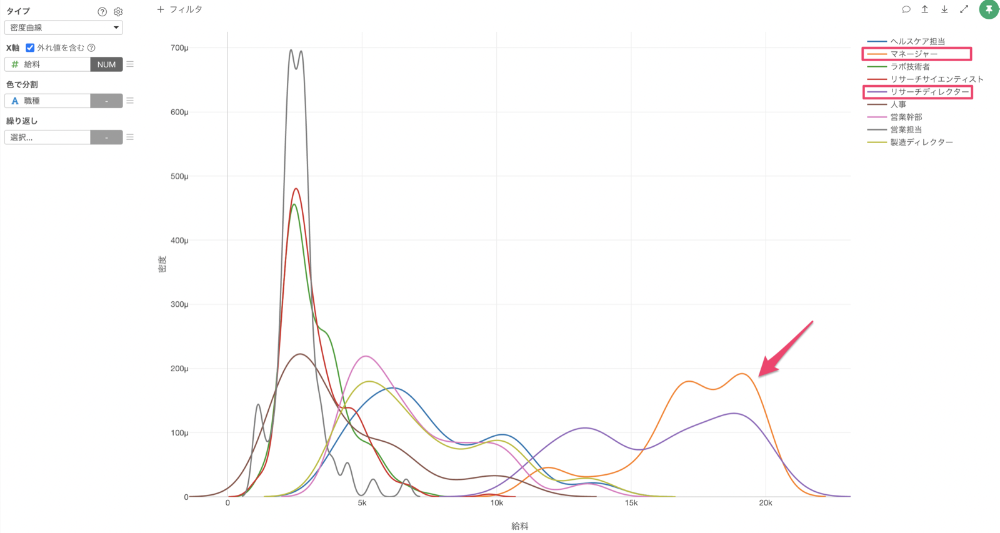

一方で、ラボ技術者やリサーチサイエンティスト、営業担当といった職種は他に比べて給料が低い人たちが多いようです。

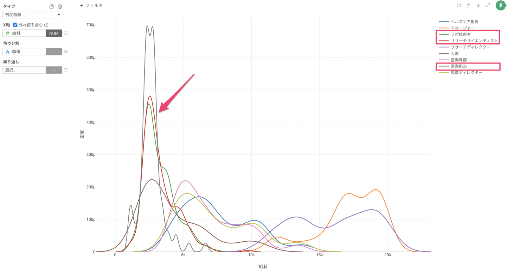

[ヒストグラム](https://exploratory.io/note/GMq1Qom5tS/UGZ4vyR3GG)は実際の値の分布を可視化します。これに対し密度曲線は、実際の値をもとに推定された分布を可視化するため、どのあたりにデータがどれくらいの比率で集まっているかを理解しやすいチャートです。

## 密度曲線に関するよくある質問

Q: 密度曲線はどのように描かれていますか？

密度曲線は、データの分布を「カーネル密度推定」を使って表現したものとなります。

カーネル密度推定については、[こちら](https://ja.wikipedia.org/wiki/%E3%82%AB%E3%83%BC%E3%83%8D%E3%83%AB%E5%AF%86%E5%BA%A6%E6%8E%A8%E5%AE%9A)をご覧ください。

密度曲線の作成方法のイメージとしては、下記のようになります。

例えば給料の分布を密度曲線として表す際には、給料をX軸に点としてプロットします。

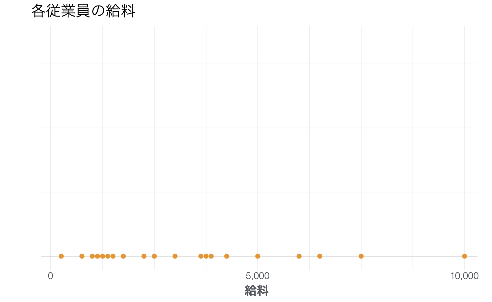

その後に、各点は正規分布に従うと仮定して、それぞれの点に対してのばらつきの分布を描きます。

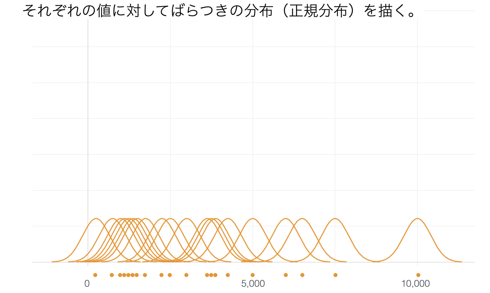

最後に、各点のばらつきの分布を足し上げていくことで、密度曲線で見えているものができあがります。

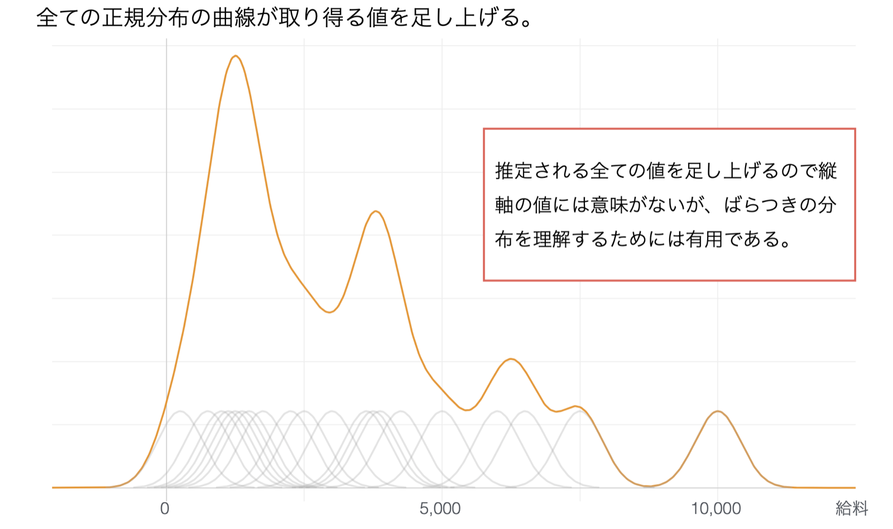
