GeoJSONは、地理的な境界線や座標などの空間データをJSON形式で表現したファイル形式です。Exploratoryにインポートすると、デフォルトでは対応していない地域区分の地図でデータを可視化できます。

## GeoJSONファイルをインポートして地図チャートで利用する

Exploratoryではデフォルトで、世界各国の地図やアメリカの州、日本の都道府県などの行政区分の地図をサポートしています。

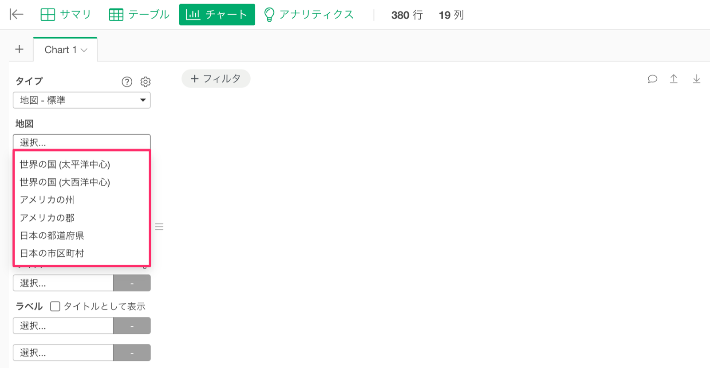

しかし、世界には多様な国や地域が存在するため、デフォルトでサポートされていない地域区分を使って情報を可視化したい場合もあります。

そのような時には、GeoJSON（地理的な境界線や座標などの空間データをJSON形式で表現したファイル形式）をExploratoryにインポートできます。デフォルトでサポートしていない国や地域の地図をインポートして、その地域の行政区分や地理的境界を可視化するための地図として利用できます。

そこで、ここでは、GeoJSONをExploratoryにインポートして利用する方法を説明します。

### GeoJSONファイルのインポート

GeoJSONを利用したい場合には、任意のデータフレームを開き、チャートビューに移動して、タイプに「地図 - 拡張」を選択します。

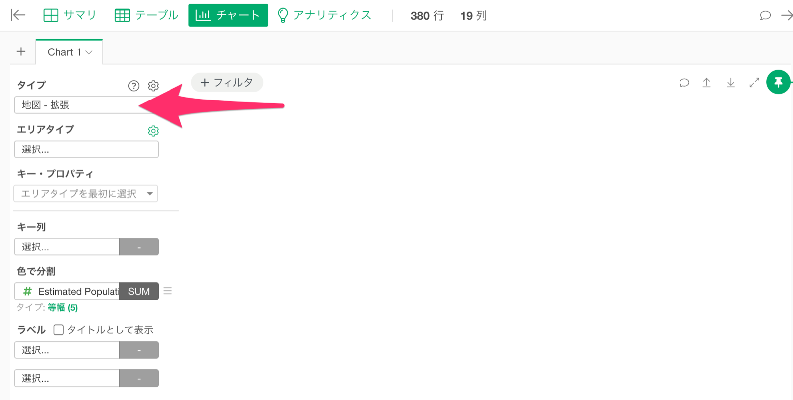

次に、エリアタイプの横にあるギアアイコンをクリックします。

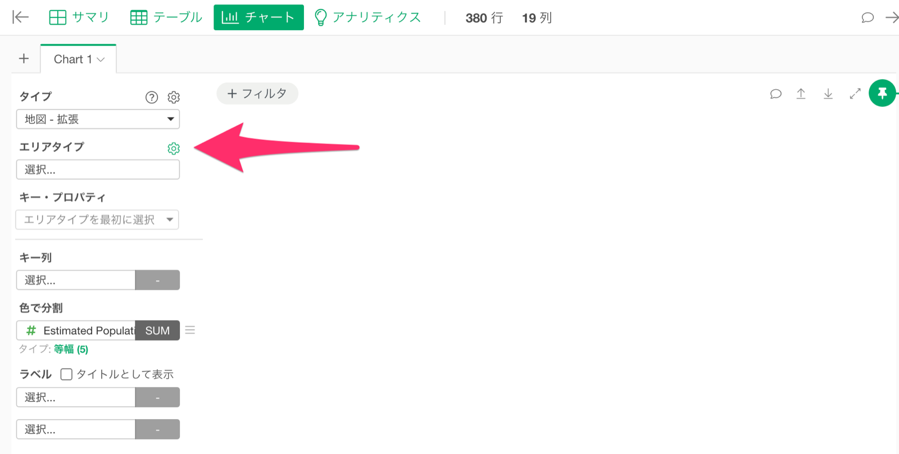

すると、エクステンションのダイアログが表示され、新しい地図を追加できます。

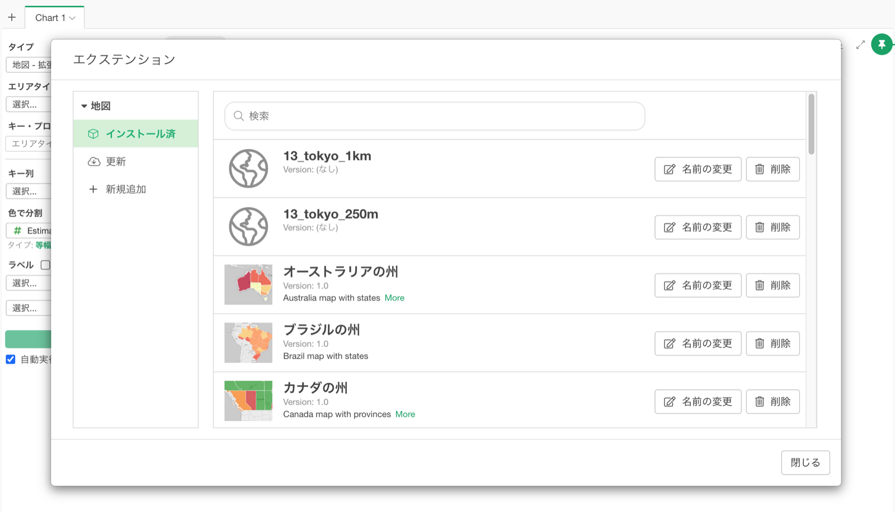

デフォルトでは「インストール済み」に地図の情報が表示され、何もインストールされていない場合は、何も表示されていません。

新たに地図を追加する場合には、「新規追加」ボタンをクリックします。


新規追加のボタンをクリックすると、画面が切り替わり、Exploratoryがホストしている地図の情報、またはローカルからGeoJSONのファイルを選択して追加できます。

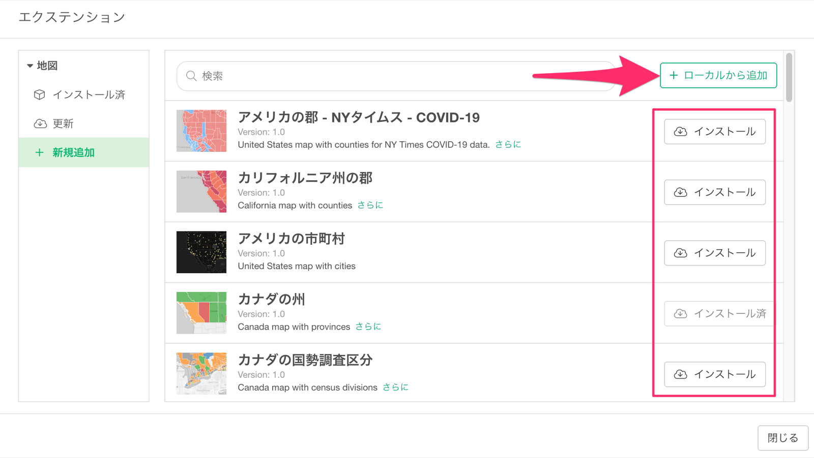

例えば、Exploratoryがホストしているイギリスの行政区分の地図をインポートしたい時には、イギリスの行政区分の「インストール」ボタンをクリックします。すると、イギリスの行政区分のデータがインポートされます。

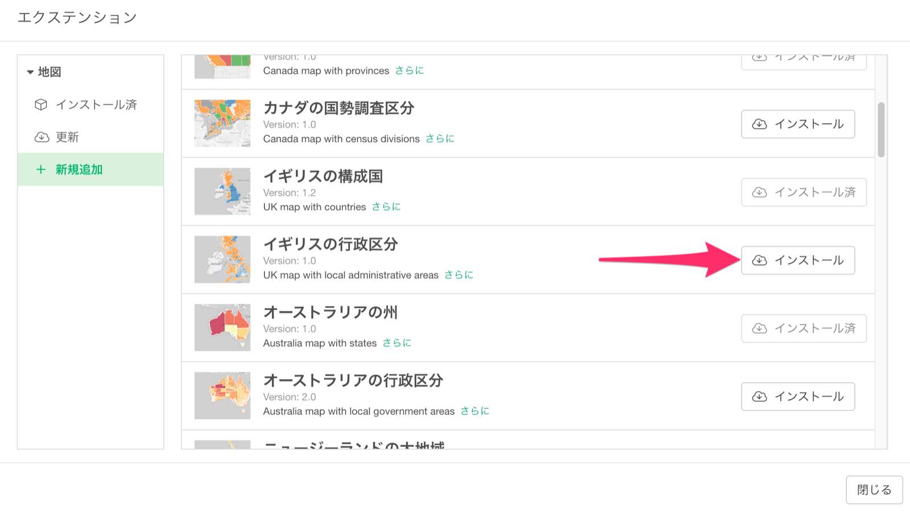

イギリスの行政区分のデータがインポートされたら、「インストール済み」にイギリスの行政区分の地図が表示されるようになります。

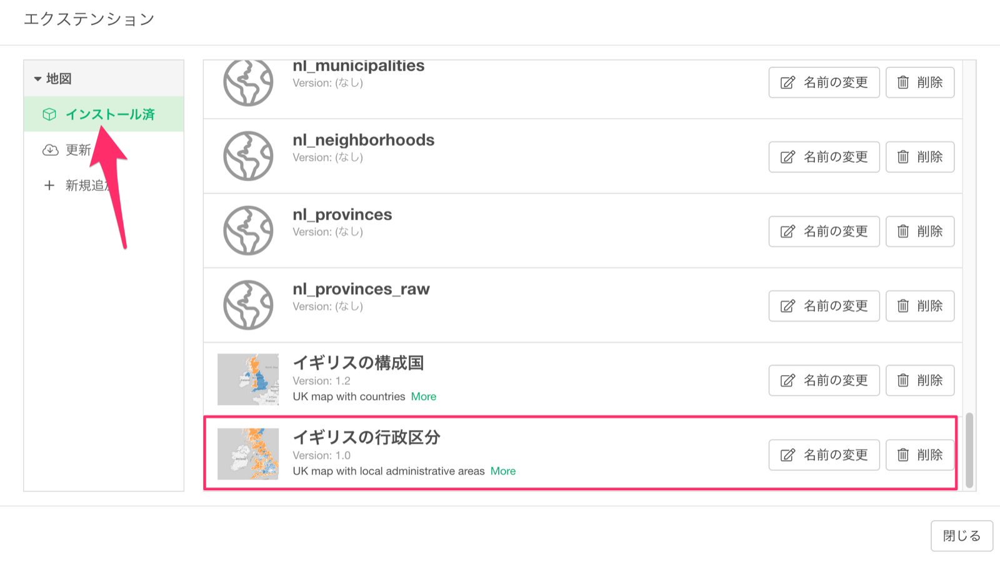

### インポートしたGeoJSONファイルを使って地理情報を可視化する

エクステンションダイアログを閉じると、エリアタイプにインポートした地図の情報が表示されるようになります。

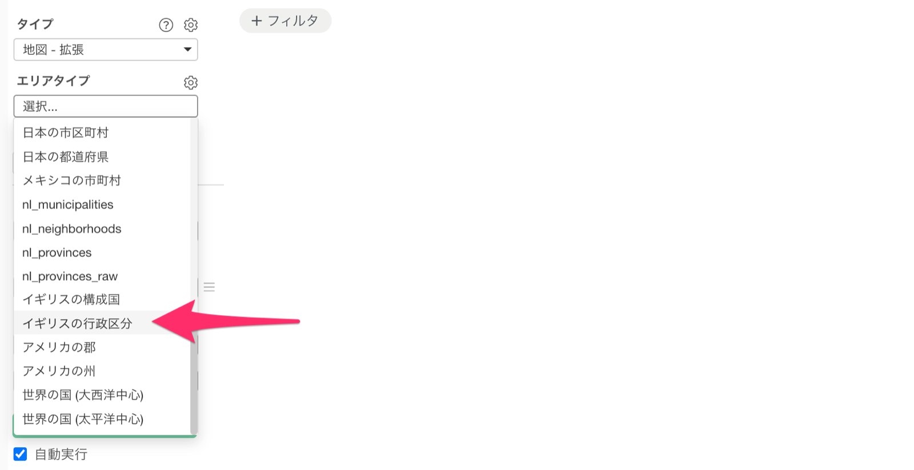

キープロパティでは、各GeoJSONで設定されている地理情報を可視化するためのキーの情報を指定します。

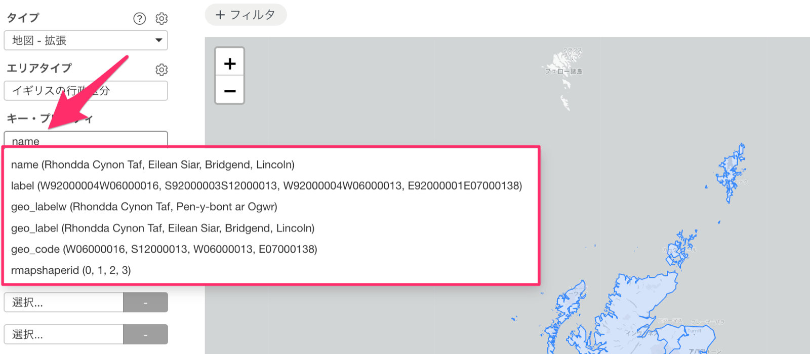

例えば、手元のデータに行政区分コード（今回のデータのキーでいうと、「geo_code」）があり、その情報をもとに地理的な情報を可視化したかったとします。

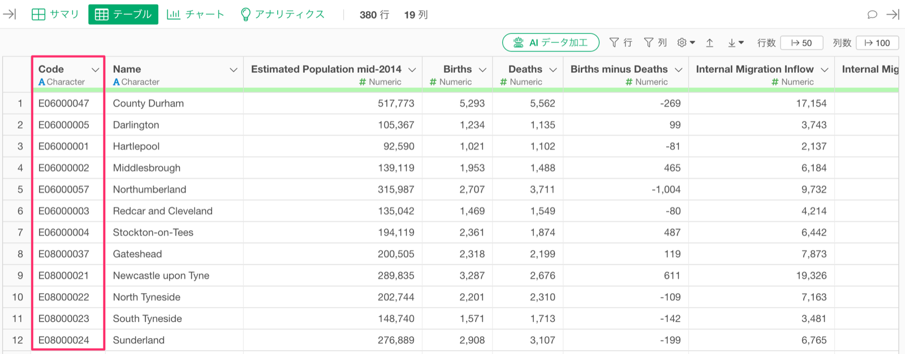

そのようなときには、キー・プロパティに「geo_code」を選択します。

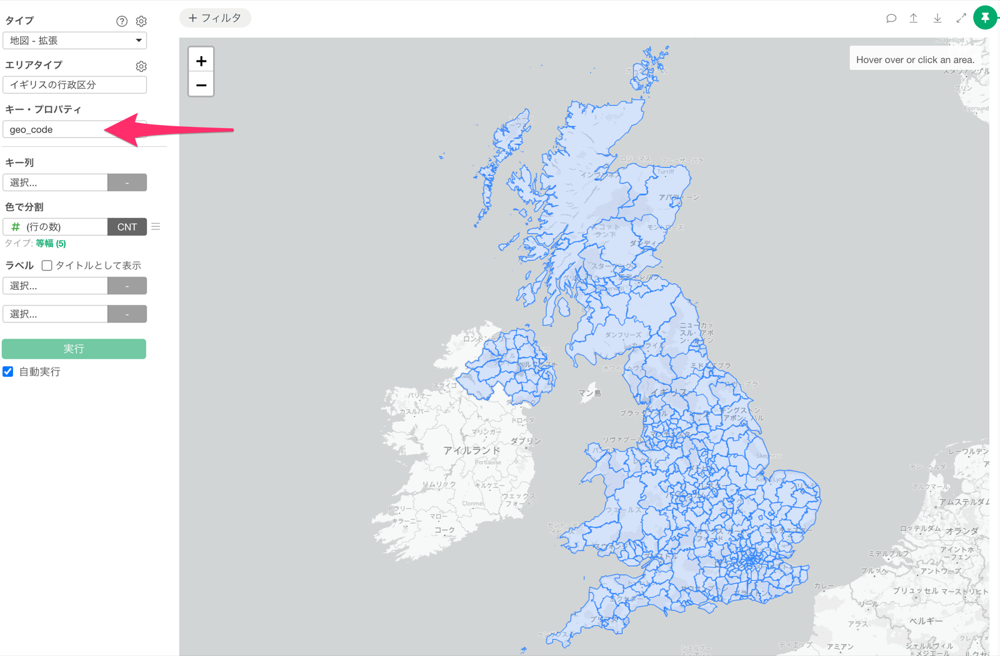

すると、GeoJSONの定義内容をもとに、地理的な境界が地図上に表示されます。

続いて、設定したキー・プロパティに対応する列をキー列に指定し、「色で分割」に任意の列を選択することで、選択したGeoJSONと、指定した列をもとにした、地理的な区分ごとの情報が描画されます。

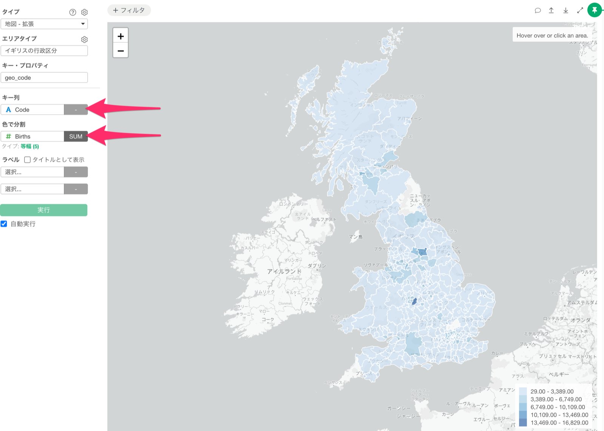

## AIを使ってGeoJSONファイルを作成する

Exploratoryでは、GeoJSONファイルをインポートすることで、デフォルトの地図では対応していない地理的区分でデータの可視化が可能です。

こちらのノートでは、外部のAIツールを使って、GeoJSONファイルを簡単に作成する方法を説明します。

### AIの活用

GeoJSONとは、地域の境界線や座標などの地理情報をJSON形式で表現したファイル形式です。

以前は、このGeoJSONファイルを独自に作成するためには、Rの専門的な知識が求められていました。多くの場合、Shapefileと呼ばれる地理データフォーマットをRに読み込み、属性データを整形し、GeoJSON形式に変換するという一連の処理が必要で、[複雑な手順](https://blog.exploratory.io/creating-GeoJSON-out-of-shapefile-in-r-40bc0005857d)をたどることが一般的でした。

しかし、生成AIの登場によって、こういった技術的な知識がなくても、自然言語で、AIに指示するだけでGeoJSONファイルを簡単に作成できるようになりました。

### GeoJSONの作成

今回は、Anthropic社が提供するAI ツールである「Claude Code」を例に、GeoJSONファイルを作成する方法を説明します。

[Claude Code](https://code.claude.com/docs/ja/overview)は、コードの記述やファイルの生成など、技術的な作業をAIが代わりに実行してくれるツールです。GeoJSONの作成では、データソースのダウンロードから変換・整形まで、一連の作業をまとめて処理してくれます。

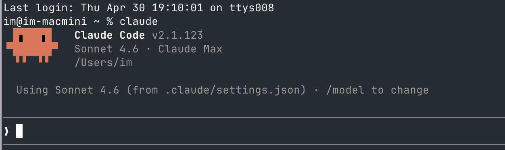

#### プロンプトの例

今回はドイツの郡（Landkreise）レベルのGeoJSONファイルを作成していきます。

例えば、次のようなシンプルなプロンプトで指示するだけで、GeoJSONファイルを作成できます。

``` text
ドイツの郡（Landkreise）のGeoJSONファイルを作成してください。
各エリアのプロパティとして、郡名（Name）と郡コード（Code）を含めてください。
座標系はWGS84（EPSG:4326）を使用してください。
```

プロンプトを送信すると、Claude Codeはインターネット上の地理データを参照し、GeoJSONファイルを生成します。


なお、ここで指定している `Name`（郡名）と `Code`（郡コード）は、GeoJSONファイルを使って、Exploratoryの中で地理データを可視化する際の「キー・プロパティ」と呼ばれる設定に関わります。

インポートしたGeoJSONファイルを使って地理データを可視化するときには、インポートしたGeoJSONで設定したプロパティを「キー・プロパティ」として選択します。

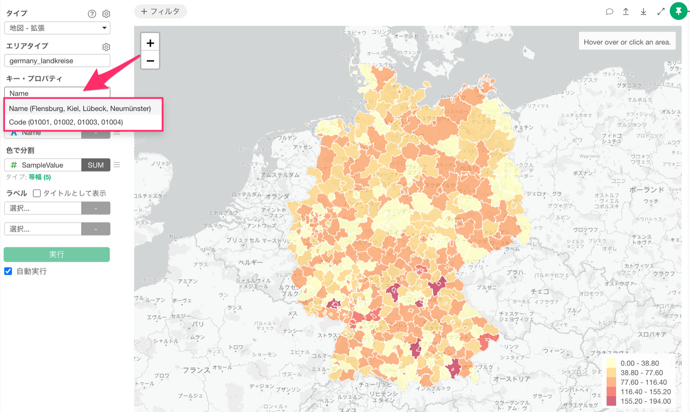

これはGeoJSONの各エリアを識別するための属性情報で、手元のデータフレームの特定の列と照合するために使われます。

例えば、データフレームに「郡コード名」の値を持つ列があれば、GeoJSONの `Name` プロパティをキー・プロパティに指定することで、郡ごとのデータが地図上に正しくマッピングされます。

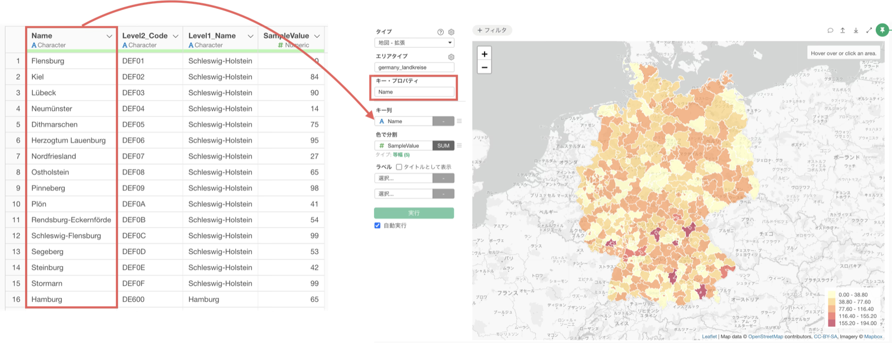

このように、プロンプトでプロパティ名を指定しておくことで、後のExploratoryでの設定がスムーズになります。

座標系（WGS84）については、GeoJSONの国際標準規格でWGS84が定められています。ただし、政府機関が公開している地理データの中には、国や地域固有の別の測地系で提供されているものもあります。

そのためプロンプトで明示的に指定しておくことで、座標系の違いによる地図のズレを防ぐことができます。

#### データのライセンスについて

地図データを扱う際には、データソースのライセンスに注意が必要です。地理情報データの中には、個人・学術利用は許可されているものの、商用利用を禁止しているものが多く存在します。

例えば、世界の行政区域データとして広く知られているGADM（Global Administrative Areas Database）は、非商用利用のみを対象としています。

そのため、ビジネスや商用目的でGeoJSONを利用する場合は、以下のようにプロンプトで商用利用可能なデータソースを明示的に指定することが重要です。

``` text
ドイツの郡（Landkreise）のGeoJSONファイルを作成してください。
各エリアのプロパティとして、郡名（Name）と郡コード（Code）を含めてください。
座標系はWGS84（EPSG:4326）を使用してください。
データソースには商用利用が可能なものを使用してください（OpenStreetMapのODbLライセンスや、パブリックドメインのデータなど）。
```

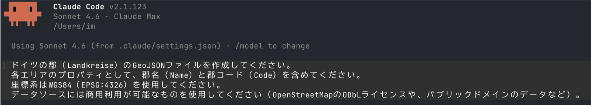

このように指定することで、AIは商用利用可能なデータソースを選んでGeoJSONを生成してくれます。

なお、代表的な商用利用可能なデータソースとしては、OpenStreetMap（ODbLライセンス、帰属表記が必要）やNatural Earth（パブリックドメイン）などがあります。

### 作成したGeoJSONファイルをExploratoryにインポートする

GeoJSONファイルが完成したら、Exploratoryにインポートしましょう。

まず、Exploratoryでデータフレームを開き、チャートビューで「地図 - 拡張」を選択します。


エリアタイプの横にあるギアアイコンをクリックすると、エクステンションダイアログが表示されます。

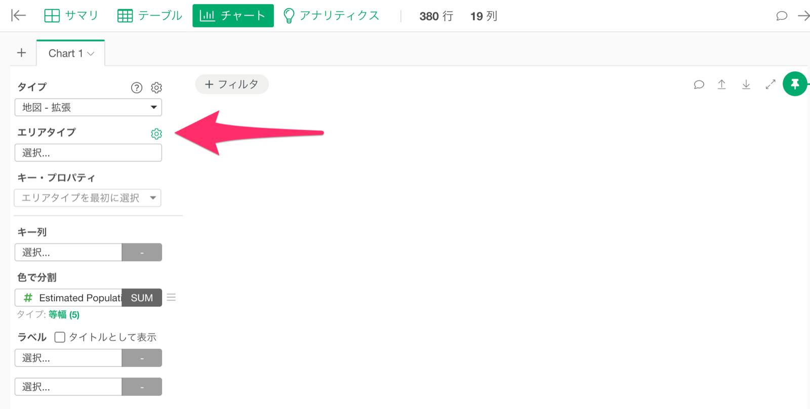

ダイアログで「新規追加」ボタンをクリックします。

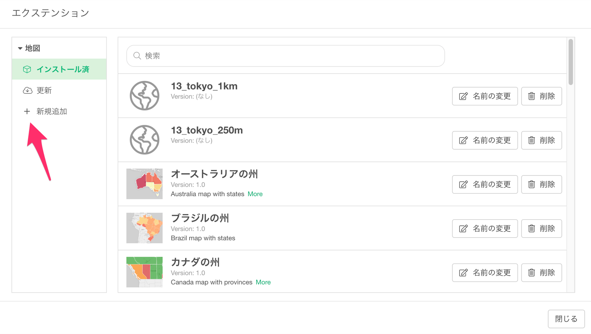

すると、GeoJSONのインポート画面が表示されます。

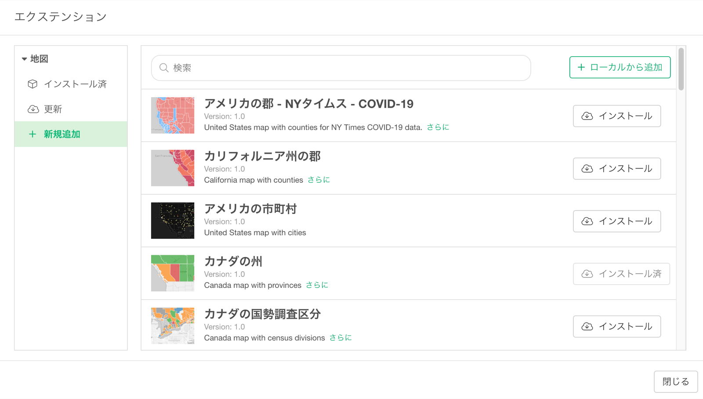

インポート画面からはExploratoryがホストしている地図と、ご自身で用意したGeoJSONファイルを直接インポートできます。


今回は、「ローカルから追加」ボタンをクリックして、作成したGeoJSONファイルをファイルピッカーから選択して追加します。

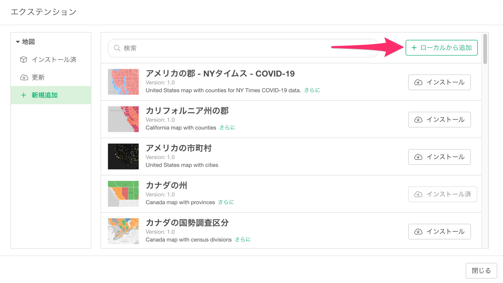

ファイルが追加されると、インストール済みの地図としてインポートした地図が表示されます。（インポートしたファイル名が地図の名前となります。）

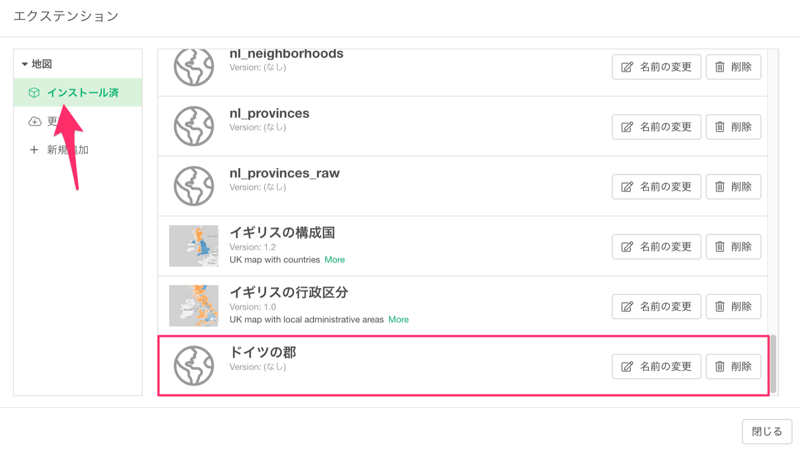

ファイルのインポートが完了したら、チャートのエリアタイプに追加した地図が表示されるようになります。

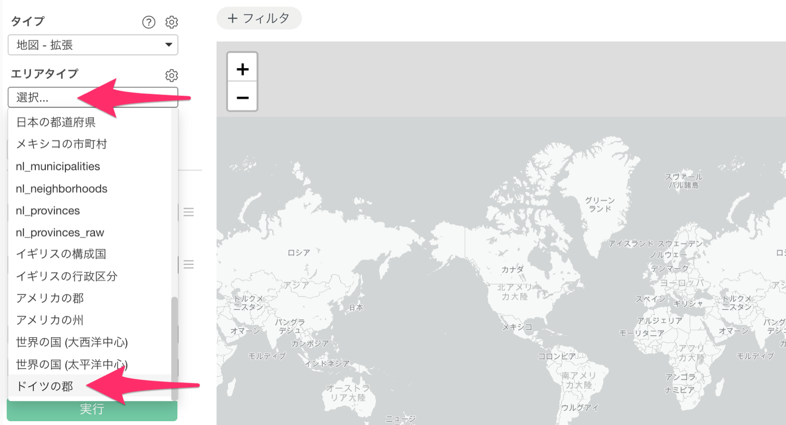

インポートした地図を選択のうえ、可視化に必要な列を選択することで、インポートしたGeoJSONファイルを使った可視化が可能です。

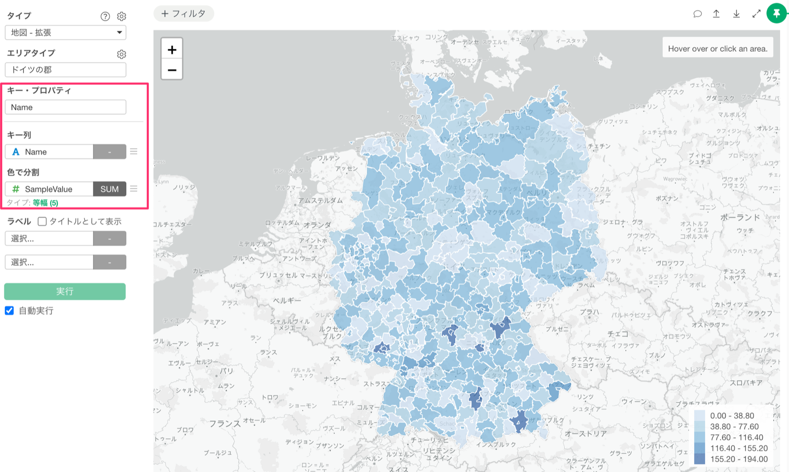
