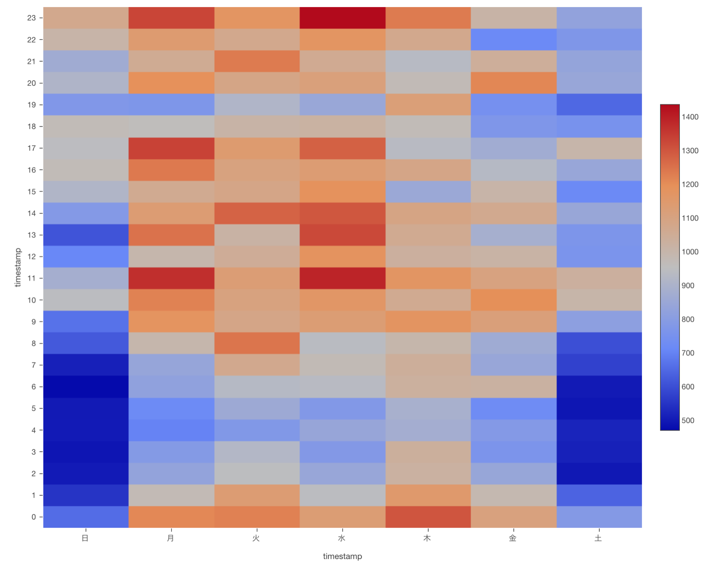
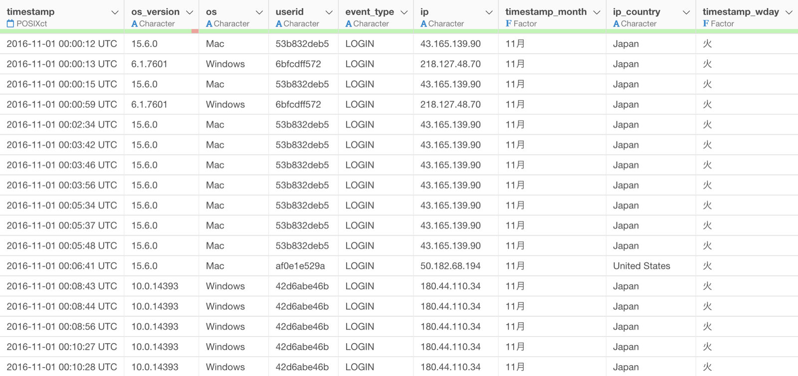
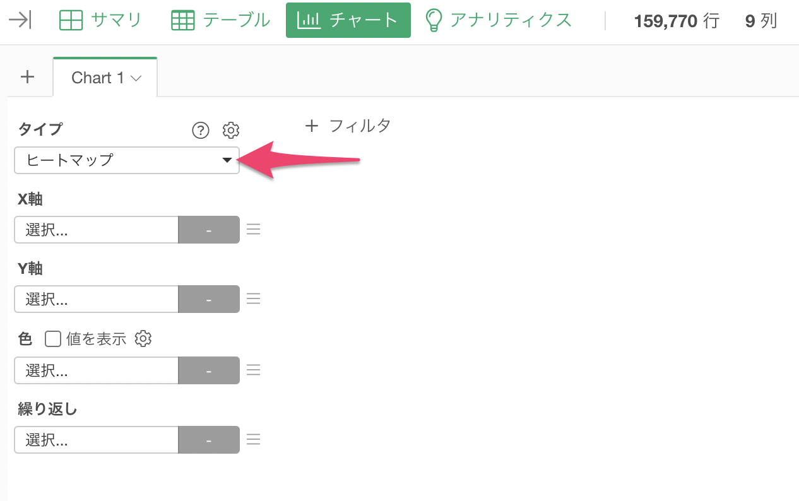
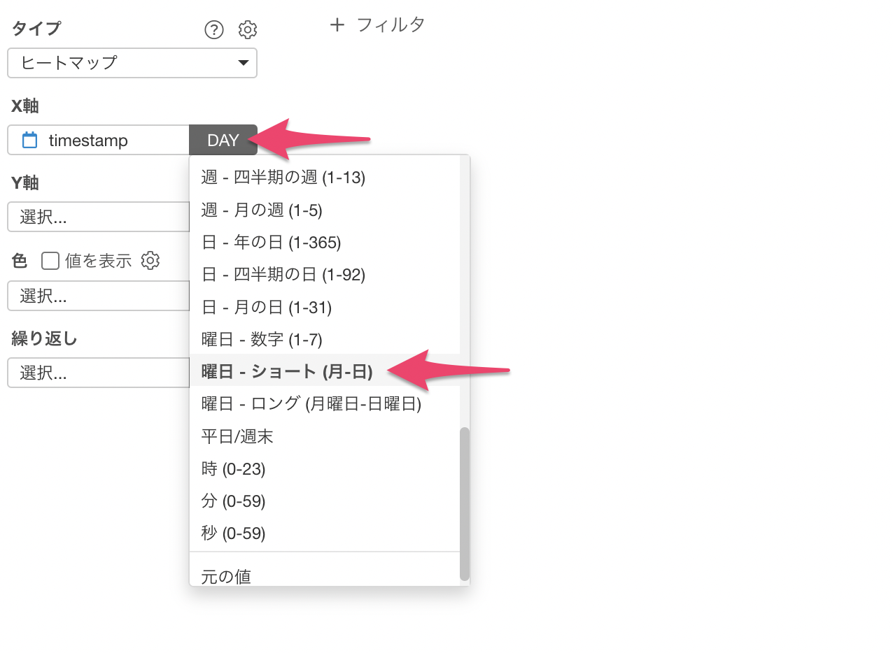
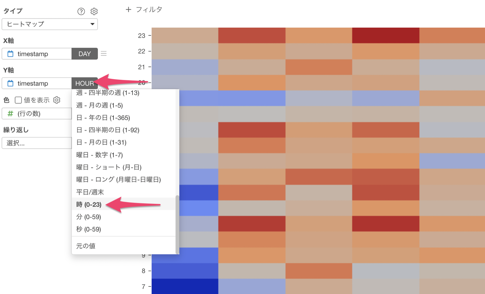
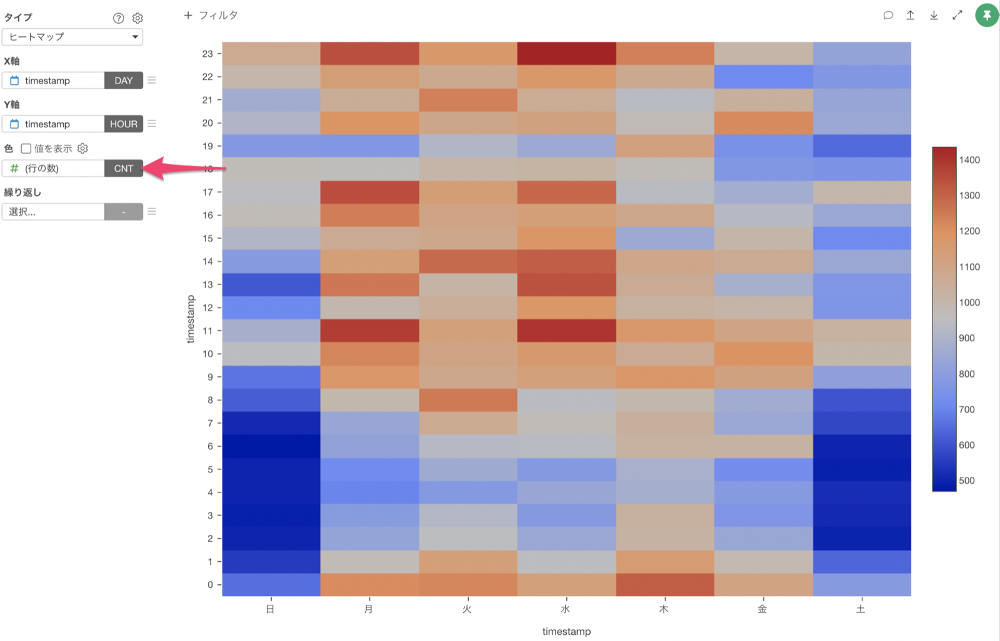
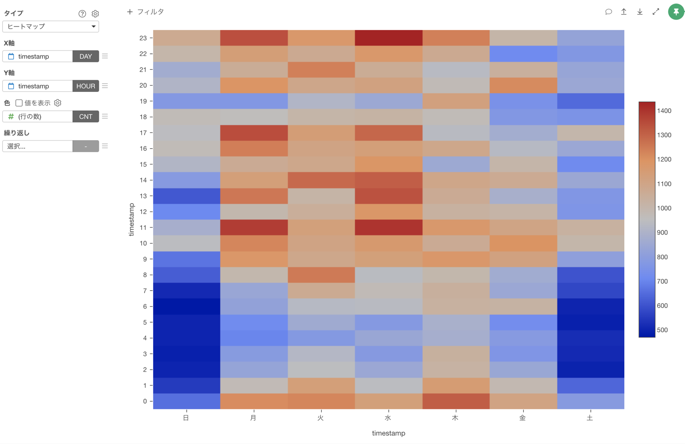
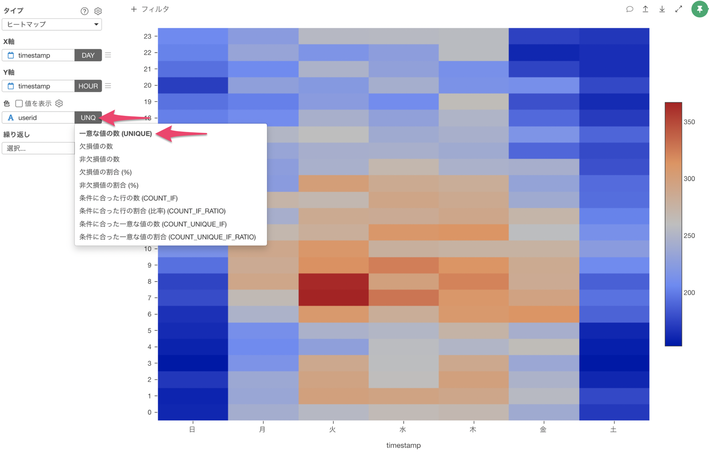
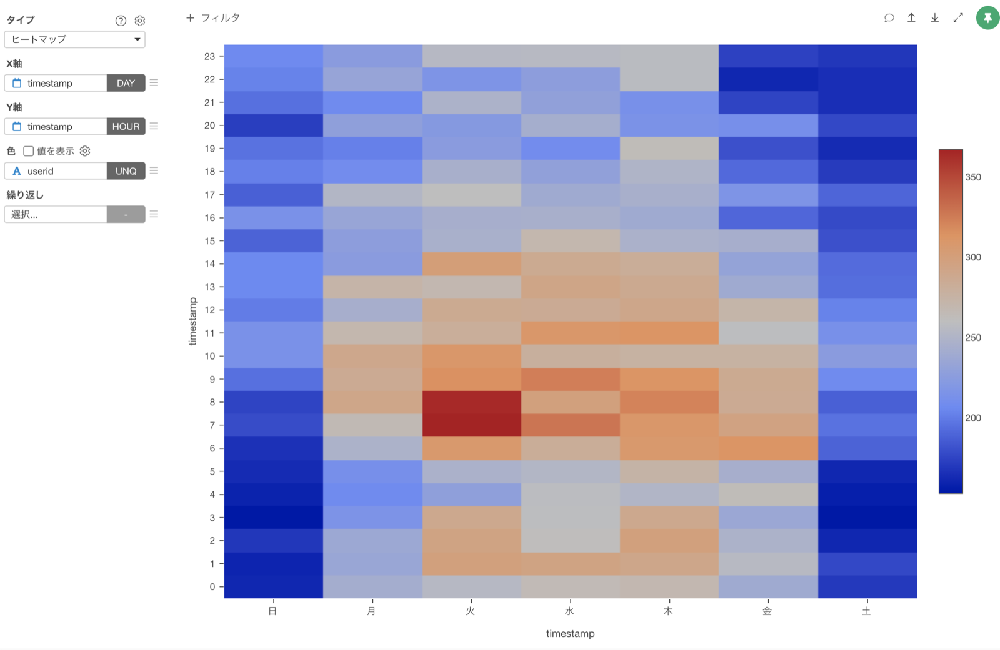

ヒートマップは、カテゴリ間の組み合わせを集計して、値の大きさを色で表現するチャートです。

今回はサンプルデータとして[アクティビティデータ](https://exploratory.io/data/GMq1Qom5tS/Activities-Data-xVH1jMx9cr)を使用していきます。

このデータはウェブサイトのアクセスデータで、1行が1アクセスで、列にはアクセス日時（timestamp）やOSなどの列があります。

今回は、何曜日の何時にアクセス数やユーザー数が多い傾向にあるのかヒートマップを使用して可視化していきます。

何曜日の何時にアクセス数やユーザー数が多いかの傾向を掴みたいということは、曜日と時間という２つのカテゴリの組み合わせを見たいということになります。このようなときに便利なのが、ヒートマップというチャートです。

実際にヒートマップを作成して、みていきましょう。

### アクセス数

新しくチャートを作り、「ヒートマップ」を選択します。

曜日ごとにデータを見ていきたいので、X軸に「timestamp」を選び、集計単位に抽出の「曜日 - ショート (月-日)」を選択します。

次に、1日の時間ごとにデータを見ていきたいので、Y軸も同様に、timestampを選び、集計単位に抽出の「時 (0-23)」を選択します。

今回は、アクセス数（行の数）の傾向を可視化したいのですが、既にデフォルトで「色」には「行の数」が選択されています。

そのため、曜日と時間毎のアクセス数を色を使用して可視化できました。

ここでは、色が赤で濃くなればなるほどアクセス数が多いことを意味します。逆に、青の色が濃くなればなるほどアクセス数が少ないということになります。

ヒートマップを見ると、土曜日と日曜日はアクセス数が極端に少ないため、平日に使用されていることがわかりました。また、使用時間は朝の9時から多くなっているようです。

### ユーザー数

次に、アクセス数ではなく、ユーザー数を可視化していきます。

ユーザー数を見ていきたいため、色で分割に「userid」を選び、集計関数は「一意な値の数 (UNIQUE)」を選択します。

曜日と時間毎のユーザー数を色を使用して可視化できました。

先ほどのアクセス数と同様に、土曜日と日曜日は使用しているユーザーがほとんどいないようです。 また、ユーザーは午前の時間帯に多く集まっているようです。特に火曜日の7時と8時はかなり多い結果となりました。
