ヒストグラムは、数値データの分布を、値の範囲ごとの行の数をバーにして可視化するチャートです。

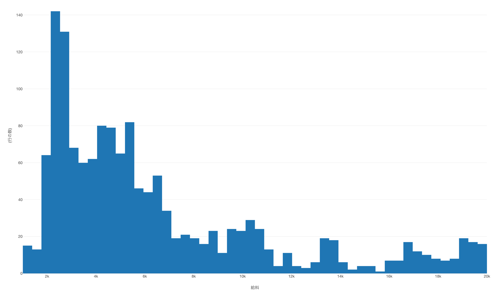

サンプルデータとして従業員データを使用していきます。 このデータは1行が1従業員で、列には給料や職種などの列があります。

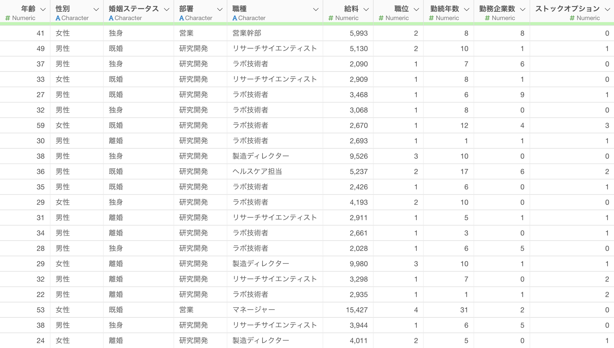

今回は、給料のデータの分布をヒストグラムを使って可視化していきます。

ちなみに、サマリビューからも給料の分布が可視化されていますが、ヒストグラムを作ることで、分布をより細かくみていくことができます。

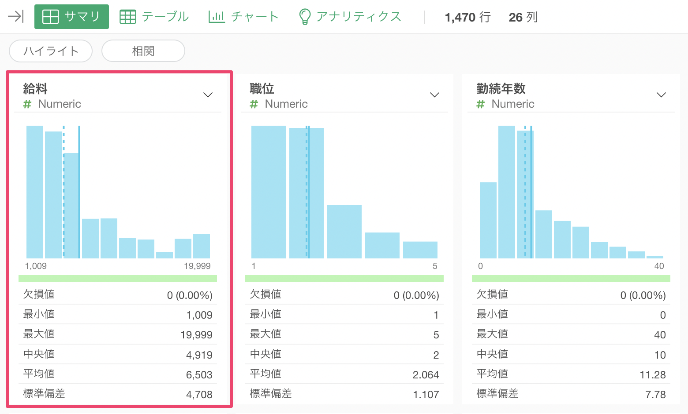

チャートビューからチャートを作成し、タイプに「ヒストグラム」を選び、X軸に「給料」を選択します。

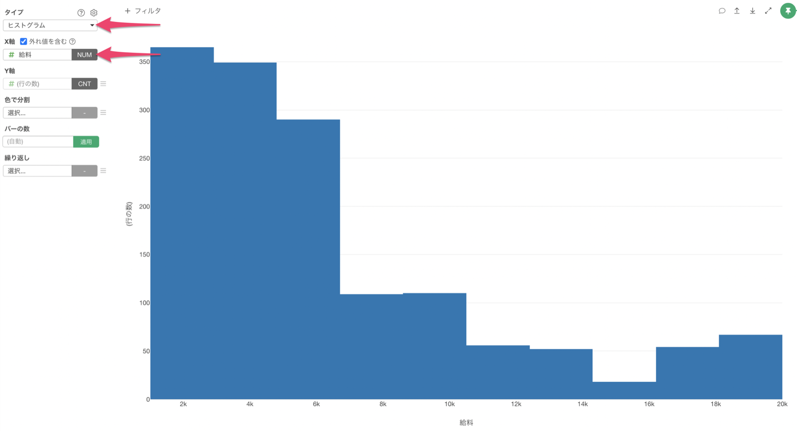

給料のヒストグラムが作成できました。

デフォルトのバーの数は10となっていて、給料を等幅で10等分したバーが可視化されています。Y軸の値はその範囲にある行の数となります。

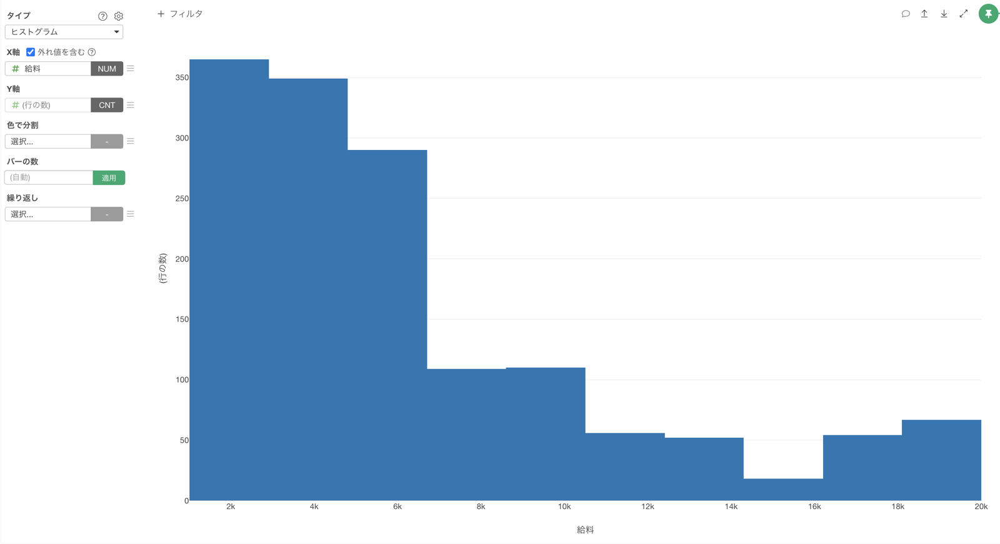

バーの数に「50」と指定すると給料を等幅で50等分したバーが可視化されます。

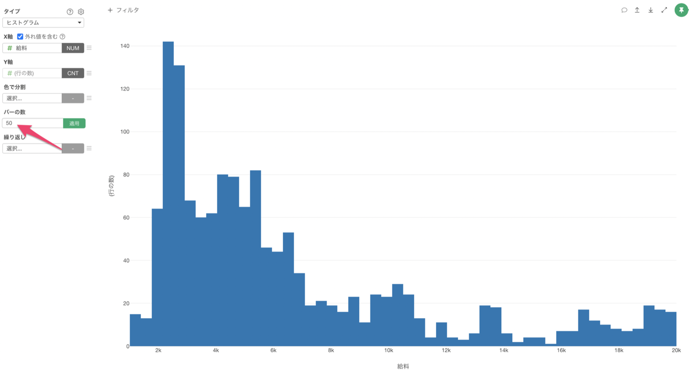

もしデータに外れ値がある場合は、外れ値を含むのチェックを外すことで外れ値を除くことができます。外れ値の閾値は1.5IQRを使用しています。

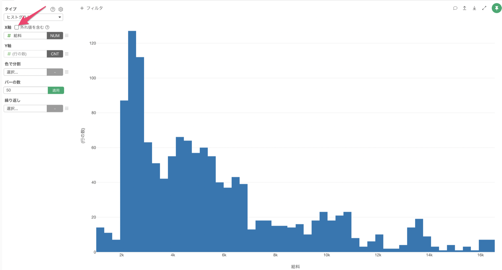

ヒストグラムを見ると、給料が2,000ドルから6,000ドルの間に多くの人が集まっているようです。また、給料が10,000ドル以上の人たちも一定数いるようで、16,000ドルから20,000ドルにも多少のデータが集まっています。

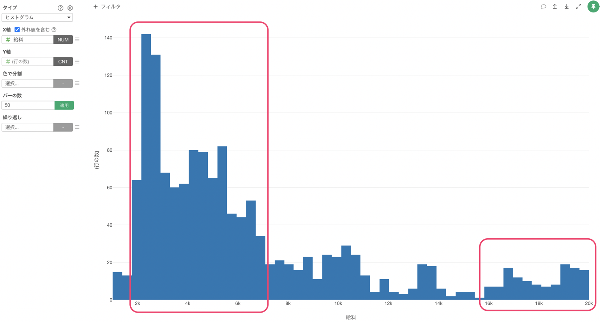

色で分割に「職種」を選択します。

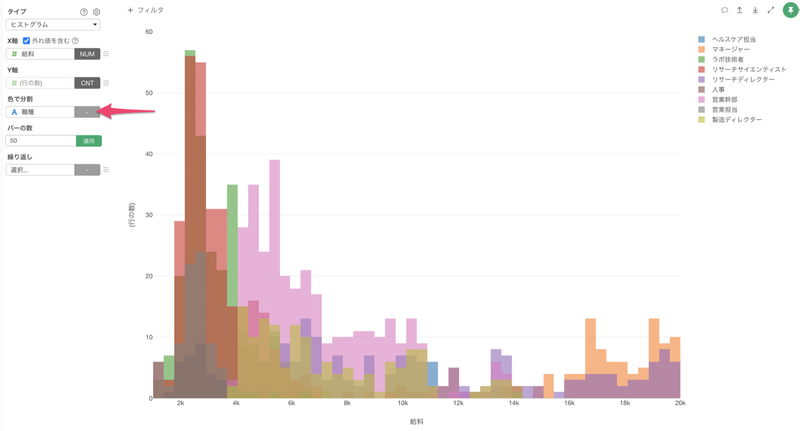

職種ごとに分けてヒストグラムで可視化できました。

職種ごとに見ると、給料が高い人たちはマネージャーやリサーチディレクターということがわかりました。

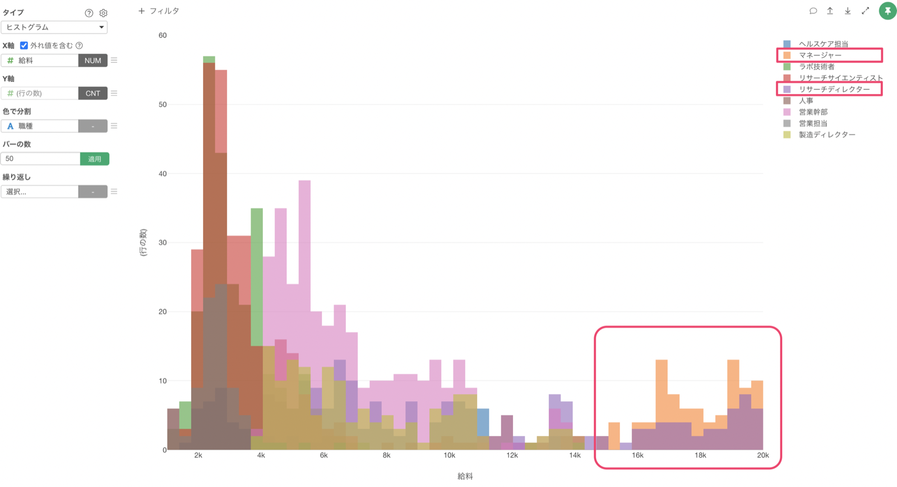

今回のようにヒストグラムを使うことで、数値データの分布を可視化でき、色や[繰り返し](https://exploratory.io/note/GMq1Qom5tS/YZc5vEy0xt)にカテゴリを割り当てることで、何がデータをバラつかせているのかを見ていくことができます。

## ヒストグラムのX軸のフォーマットを変更する

ヒストグラムのX軸のフォーマットを変更したいときには、チャートの設定メニューから変更が可能です。

例えば、利益率のように小数表記の列をX軸に選択していて、パーセント表記にしたい場合、チャートの設定のX軸のフォーマットのメニューから、パーセント表記に変更できます。

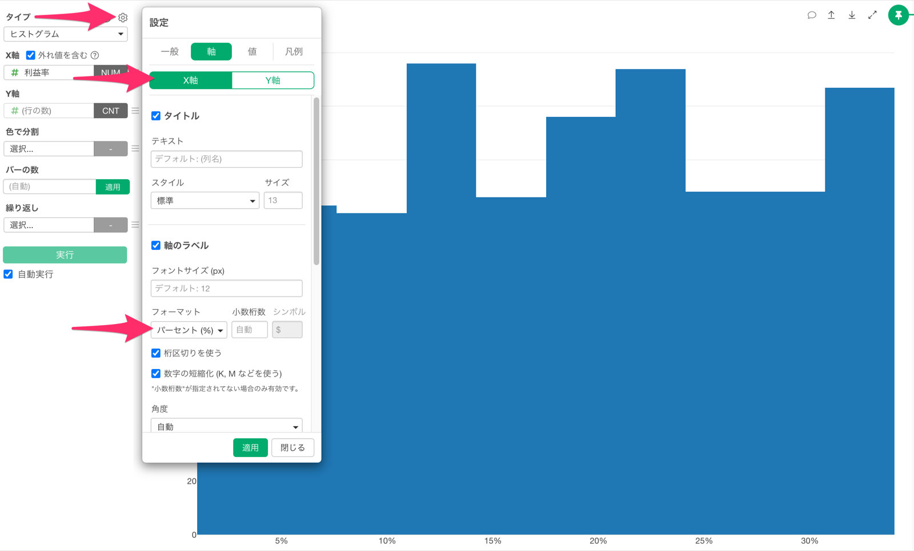

## ヒストグラムに関するよくある質問

**累積ヒストグラムやパレート図を作成したい**

累積ヒストグラムの作成方法につきましては、以下のリンクをご参考ください。

- 累積ヒストグラムの作り方 - [リンク](https://exploratory.io/note/exploratory/tBH8PvK0)

また、パレート図の作成方法につきましては、以下のリンクをご参考ください。

- パレート図を作成する方法 - [リンク](https://exploratory.io/note/BWz1Bar4JF/GRe2sRe9WX)
