ラインチャートは、時間の経過に伴う値の変化（方向）を線でつないで可視化するチャートです。時系列データのトレンドの変化を見たいときに向いています。

## ラインチャートの作り方

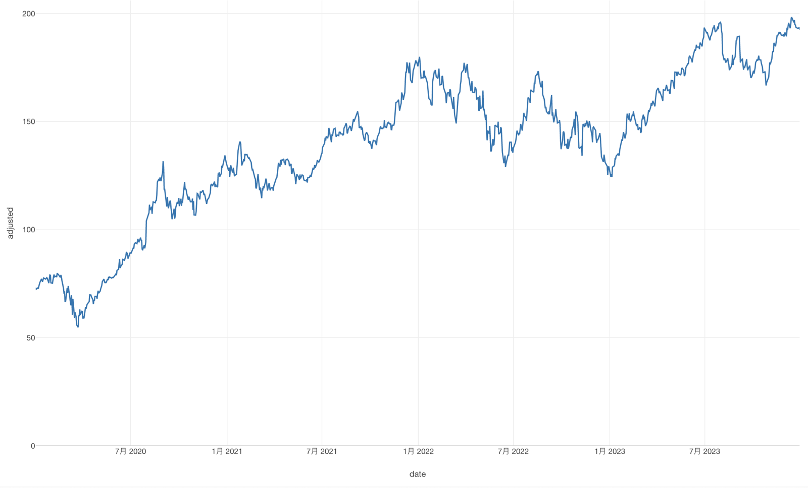

サンプルデータとして[Appleの株価データ](https://exploratory.io/data/GMq1Qom5tS/Apple-Stock-Prices-mwS9OLY5lM)を使用していきます。

このデータは1行が1日の株価を表しています。

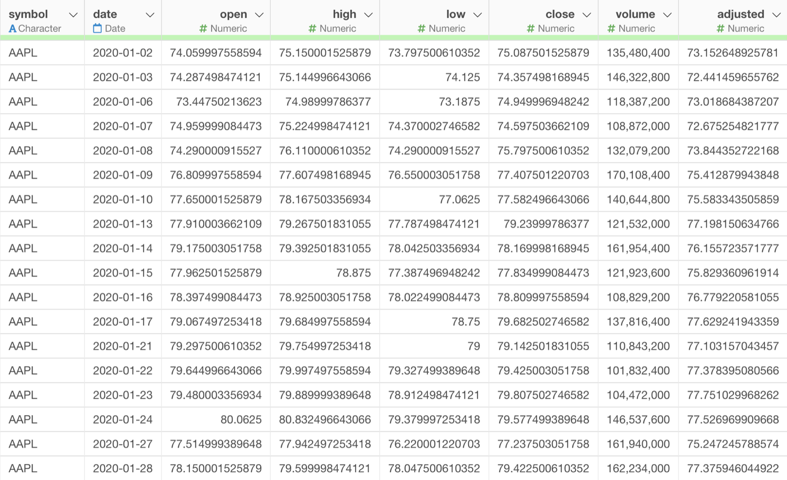

今回は、時間が経つに連れてAppleの株価がどのように推移しているかを見たいため、ラインチャートを選択します。

チャートを新規作成し、タイプに「ライン」を選択します。

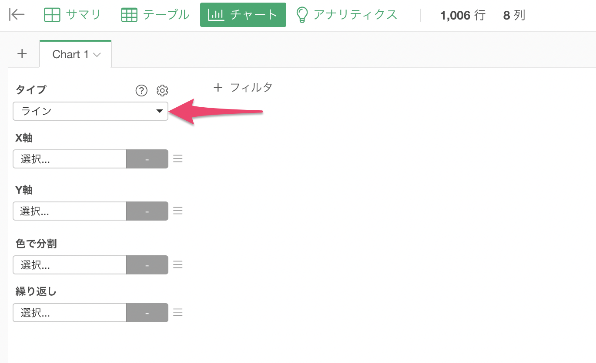

X軸に「date」を選択します。

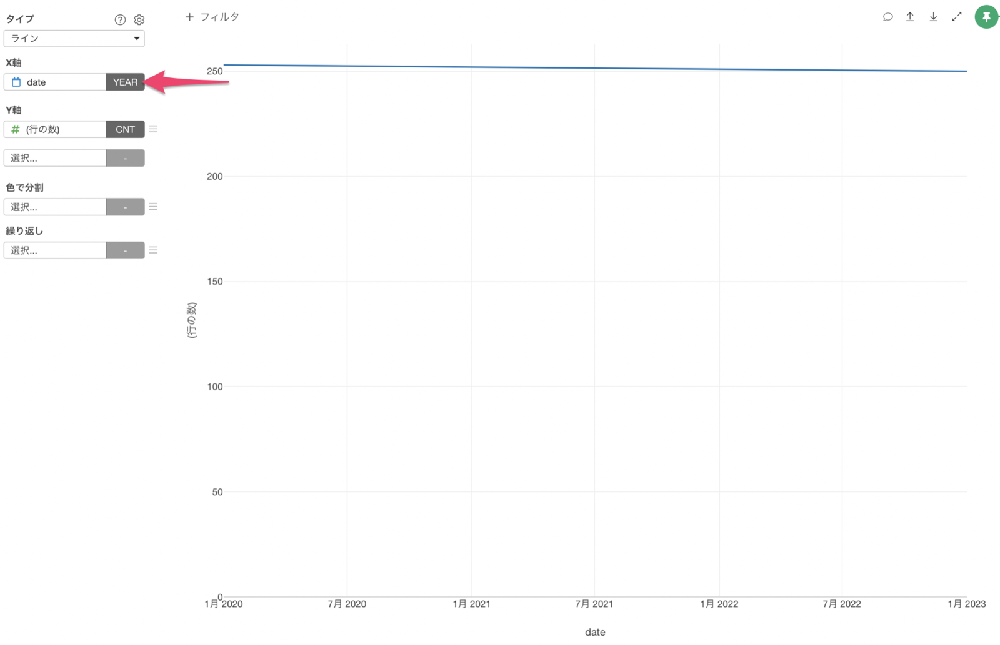

Y軸には調整済み株価である「adjusted」を選択し、集計関数に「平均値」を選びます。

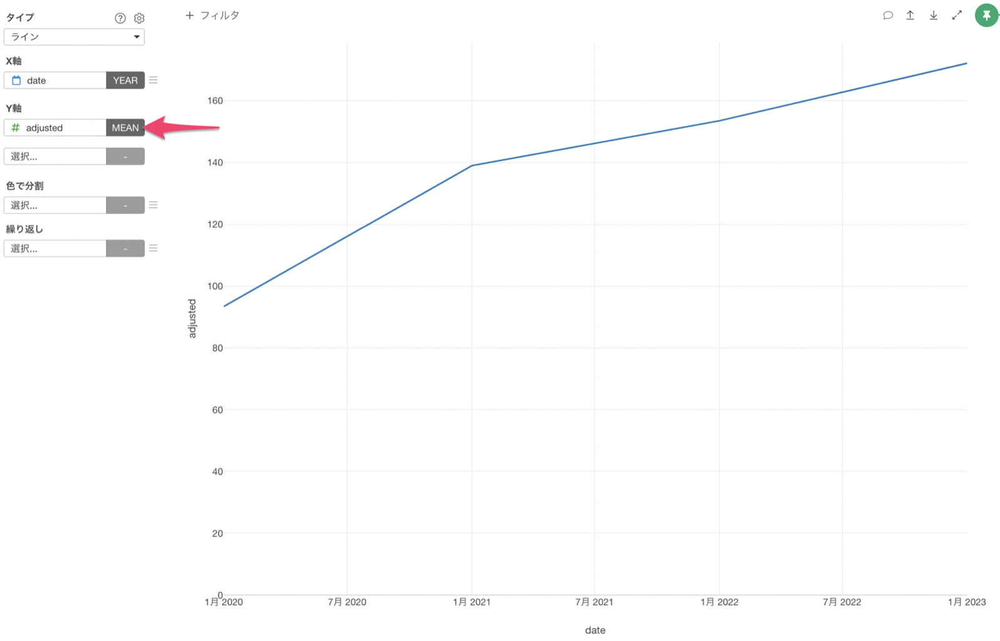

日付の集計単位が「丸め処理」の「年」になっているため、1年ごとの株価の平均値が可視化されています。

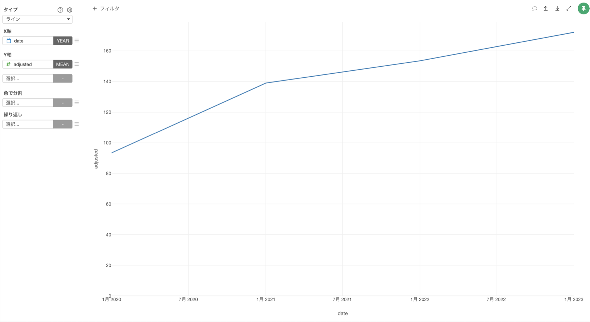

月単位で見たい時には、日付の集計単位を「丸め処理」の「月」に変更します。

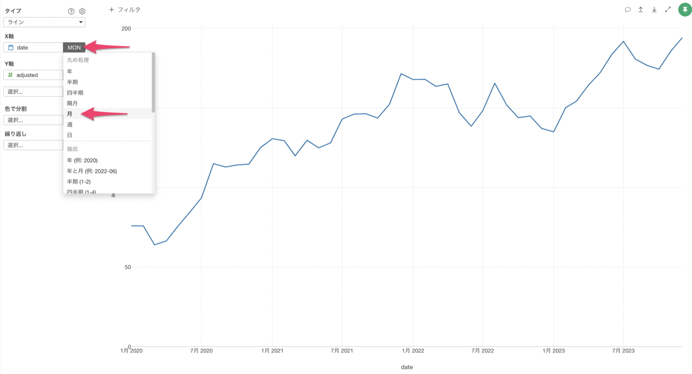

2020年は1月から3月にかけて下落し、4月に上昇へ転じています。

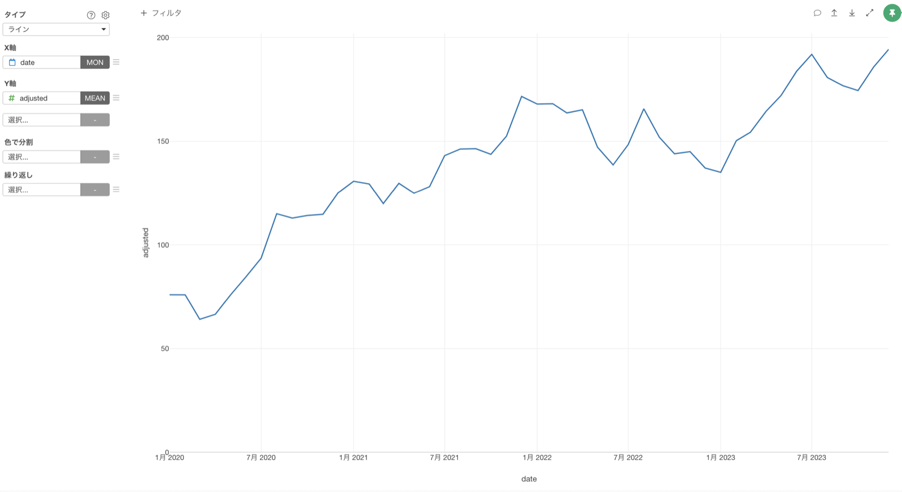

より細かい日単位で見たい時は、日付の集計単位を「丸め処理」の「日」に変更します。

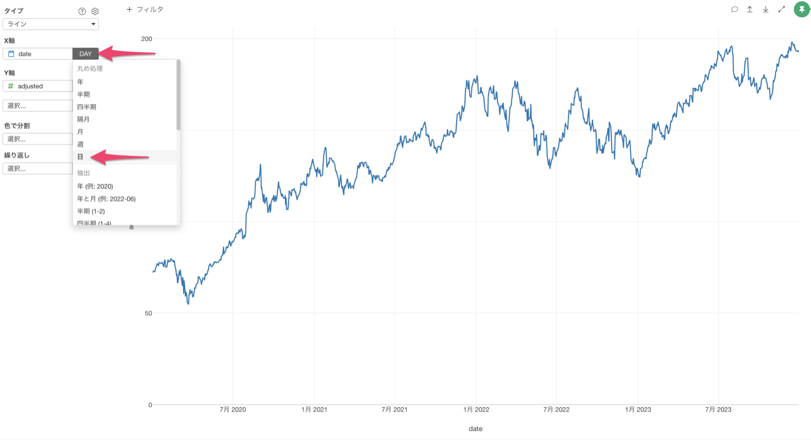

これにより1日ごとの株価の値動きを可視化できます。

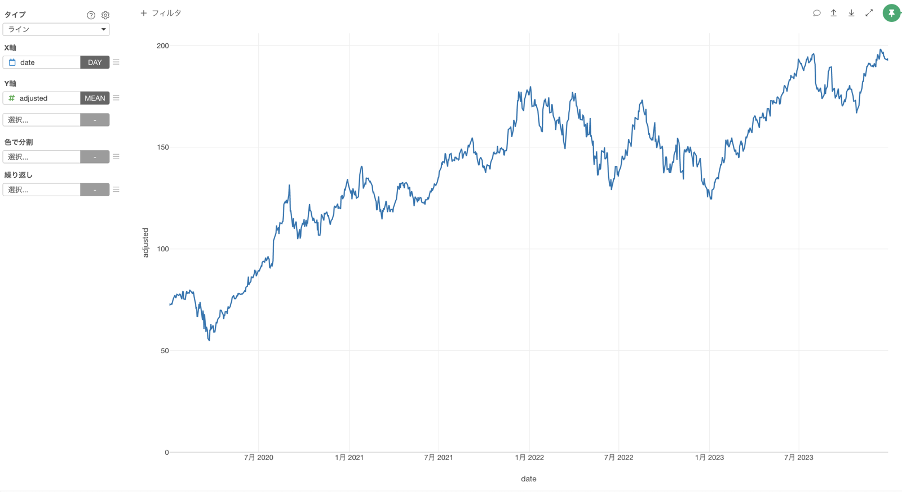

今回のように、時系列データのトレンドの変化をみたいときは、「方向」を可視化することが得意なラインチャートがおすすめです。

## 線の模様で分割する

ラインチャートを色で分割すると、凡例の区別を色だけに頼ることになり、白黒で印刷したときや、色の見分けがつきにくい方が見たときに、どの線がどの系列か分からなくなります。

Exploratory デスクトップのv16.4から、ラインチャートに線の模様で分割のオプションがサポートされ、1つのラインを複数のグループに分割したときに、実線・破線といった模様を自動で割り当てられるようになりました。

ここでは売上データを使って、月ごとの売上の線を顧客セグメントごとに模様で描き分ける方法を説明します。

### 利用データ

今回は1行が1件の注文を表し、列には注文日・顧客セグメント・売上といった注文の情報を持つ売上データを利用します。

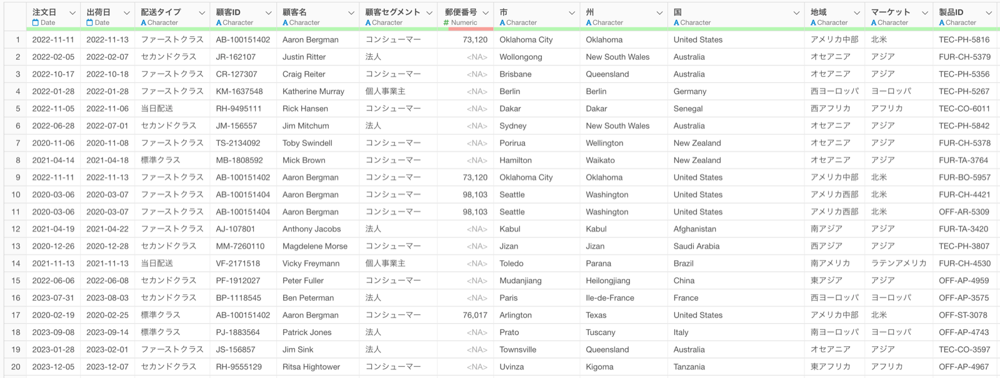

データは[こちら](https://exploratory.io/data/BWz1Bar4JF/MfK6hxi7)からダウンロードいただけます。

### 月ごとの売上のラインチャートを作る

チャートビューに移動し、チャートのタイプから「ライン」を選択し、X軸には「注文日」、Y軸には「売上」を選択します。

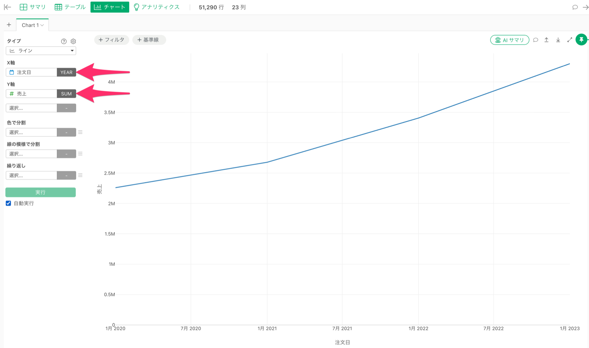

続いて、X軸の「注文日」の日付の単位のメニューを開き、「月」で丸め処理を選択します。

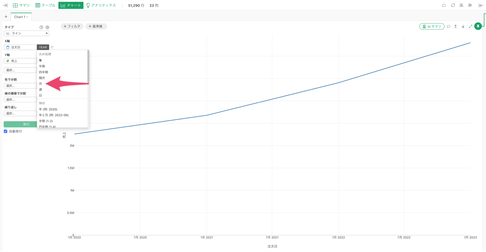

これで、月ごとの売上のラインチャートができました。

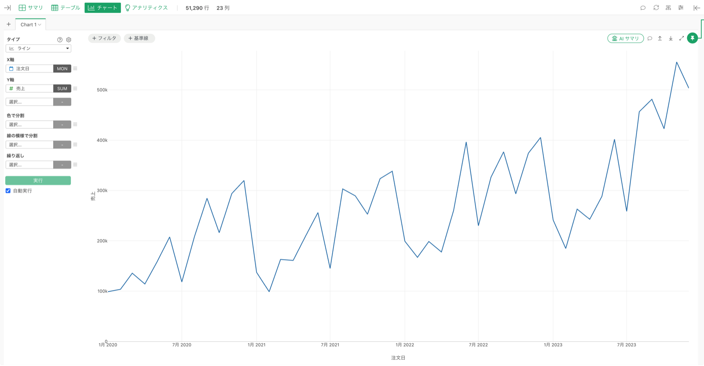

### 線の模様で分割に顧客セグメントを割り当てる

続いて線の模様で分割に「顧客セグメント」を選択します。

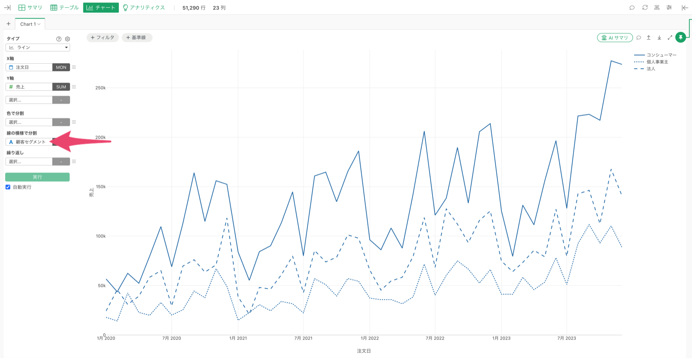

すると、同じ1色の線が3本になり、顧客セグメントの値ごとに実線・点線・破線で描き分けられます。

右上の凡例にも同じ模様が表示され、コンシューマーが実線、個人事業主が点線、法人が破線です。

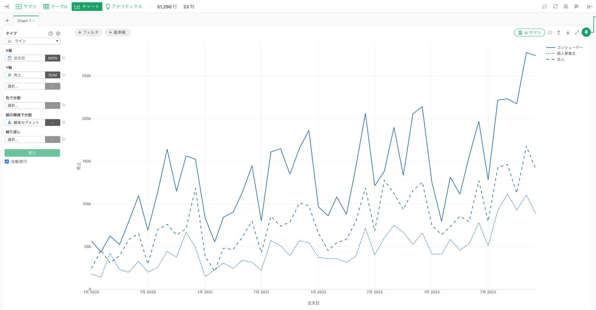

これで、色に頼らずに顧客セグメントごとの線を見分けられるようになりました。

### 線の模様、グループの設定で選べる模様を確かめる

線の模様で分割の三本線のメニューをクリックします。

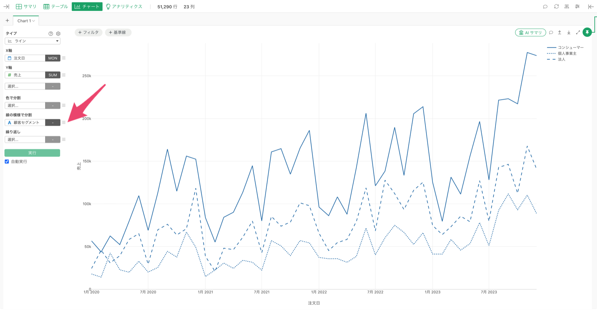

メニューから「線の模様、グループ」を選択します。

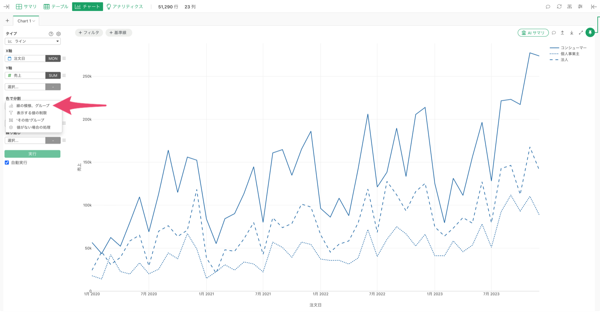

すると、「線の模様、グループの設定」のダイアログが開きます。

一番下の法人の行の、模様の列の見本をクリックすると、選べる模様が6つ表示されます。

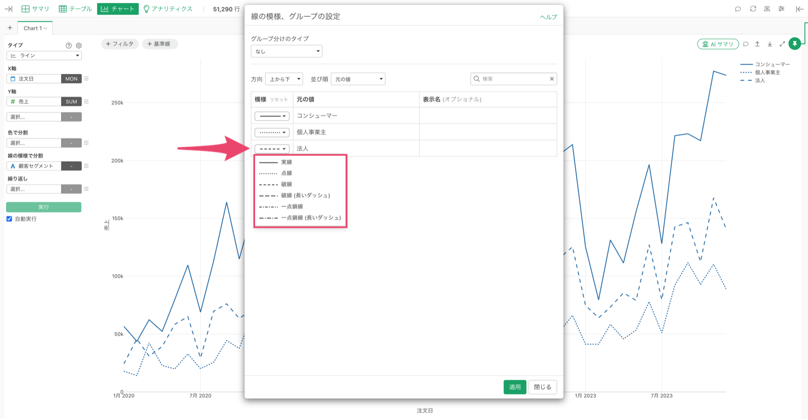

選べる模様は、実線、点線、破線、破線 (長いダッシュ)、一点鎖線、一点鎖線 (長いダッシュ)の6つで、値には、この順に自動で割り当てられます。今回のデータの値は3つなので、上から3つの実線、点線、破線が使われています。

なお、7つ目の値からは先頭の模様に戻って繰り返されるので、値が7つ以上ある列では、模様だけでは見分けられませんのでご注意ください。
