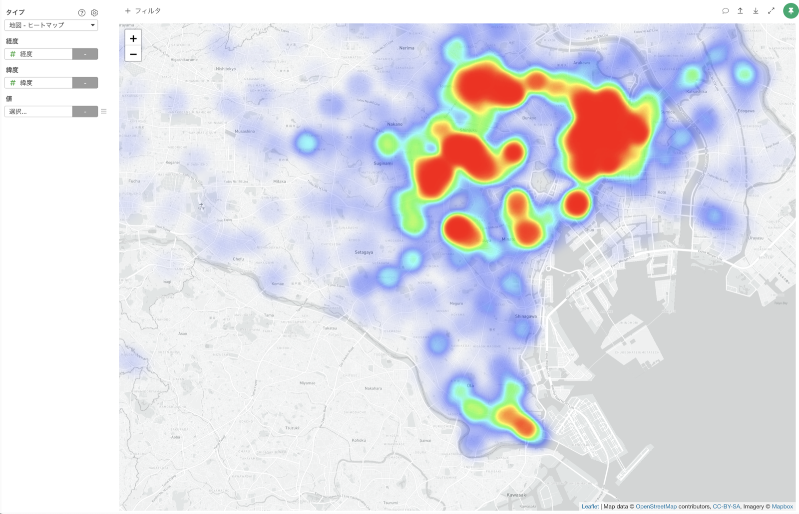
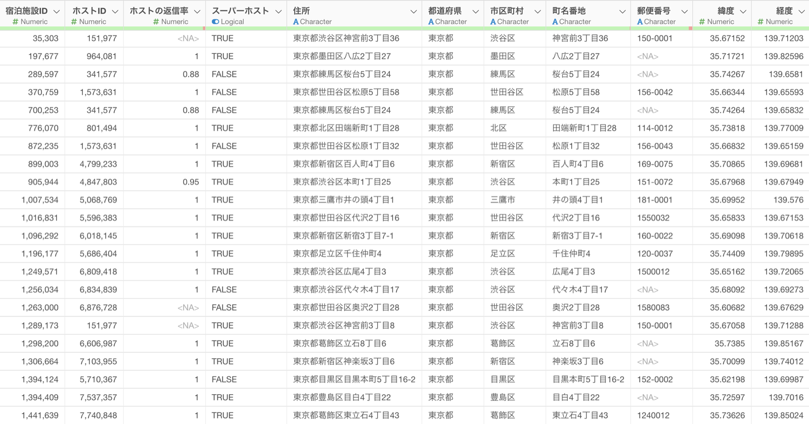
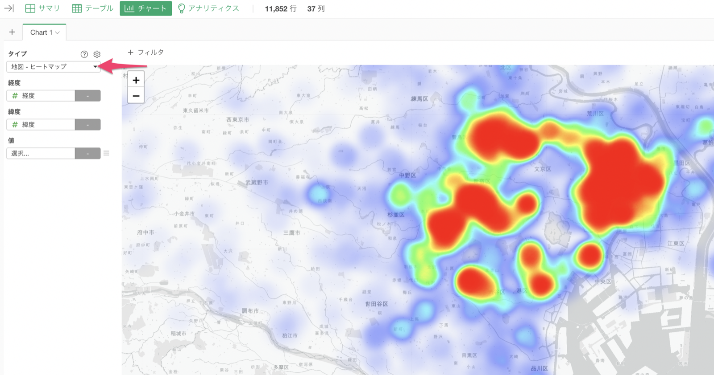
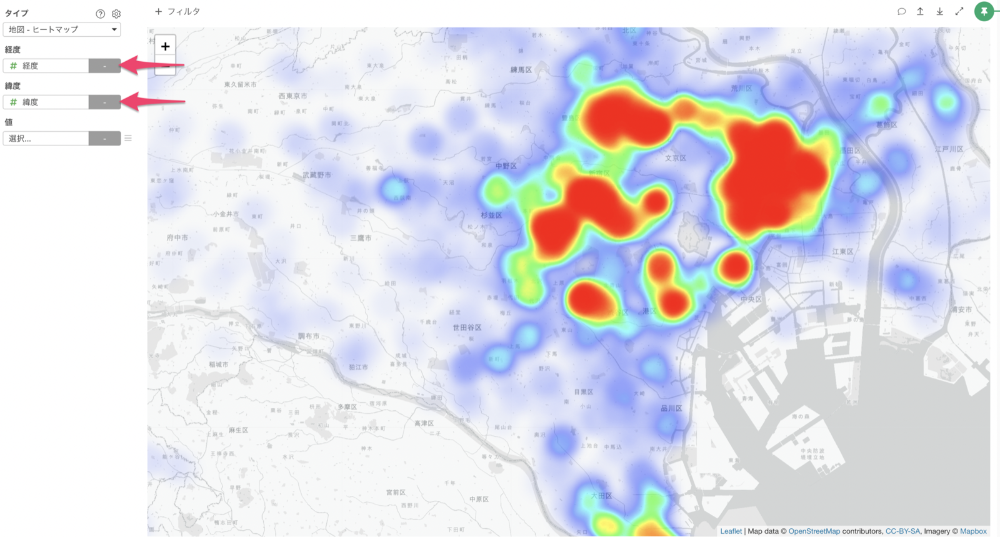
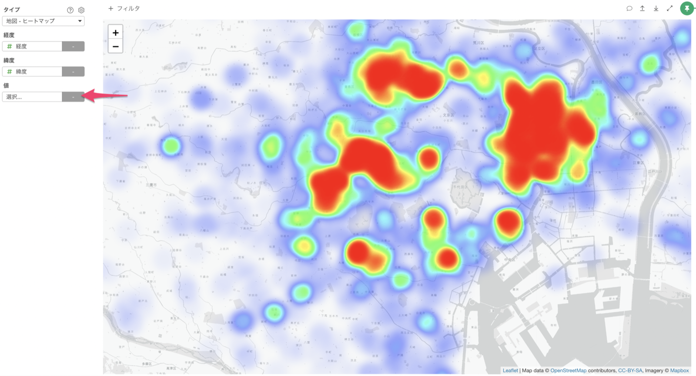
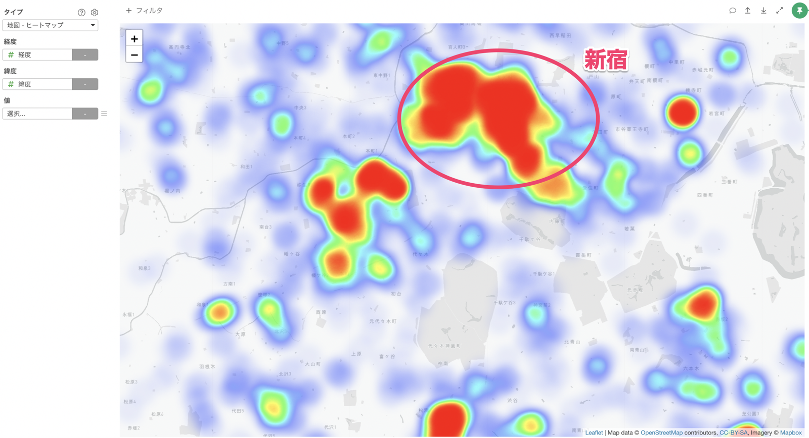
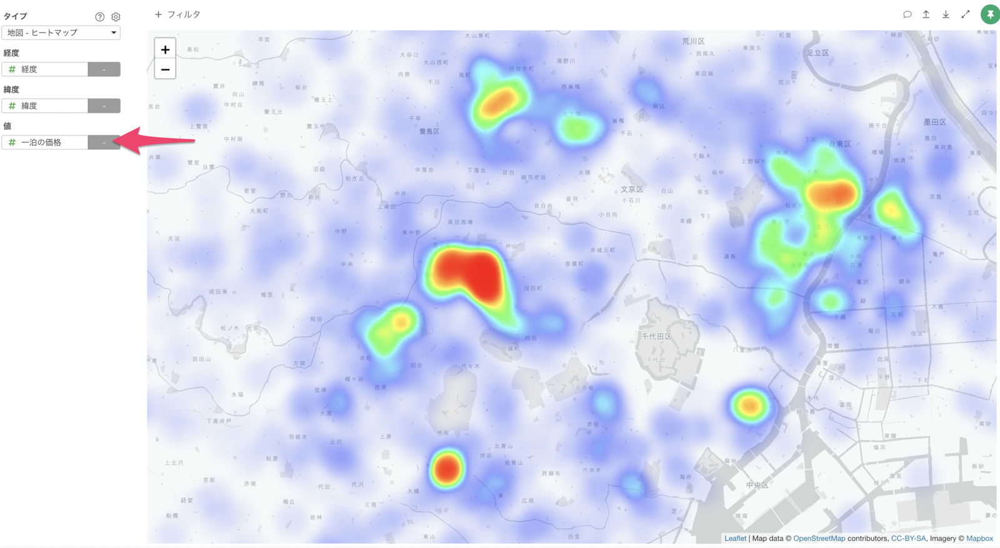
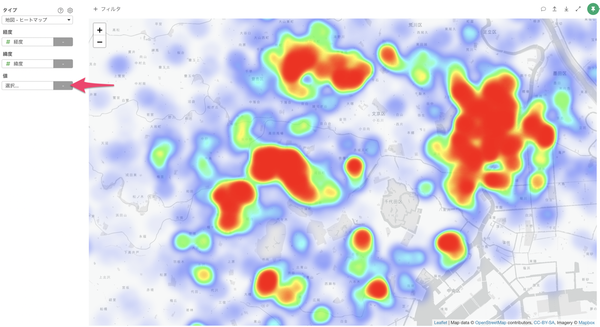
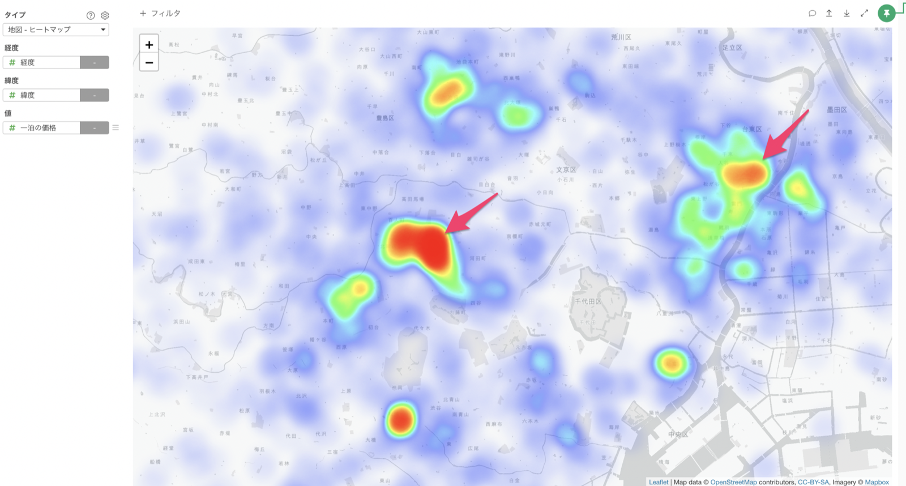

地図 - ヒートマップは、特定の地点に集まるデータの量を、色で可視化できるチャートです。

今回はサンプルデータとして「Airbnbの東京の宿泊施設データ」を使用していきます。

このデータは1行が1宿泊施設となっており、列には宿泊施設がある住所や緯度、経度、価格などの列があります。

今回は、地図上でどこに宿泊施設が集まっているのかを色をもとに表現したいため、「地図 - ヒートマップ」を使用して可視化していきます。

チャートビューに移り、タイプに「地図 - ヒートマップ」を選択します。

経度と緯度が両方とも未指定のときは、データの中に下記の名前の列があれば自動で選ばれます。既存のチャートからタイプを切り替えた場合は、両方の割り当てを確認してください。

- 経度の場合

  - 経度
  - longitude
  - long
  - lon

- 緯度の場合

  - 緯度
  - latitude
  - lat

値に何も選択しない場合、それぞれのデータポイントは同一の値になり、データが密集している地点は色が赤くなっていき、データが密集していない地点は色が薄い青で表現されるようになっています。

これにより、新宿のあたりの色が赤く塗りつぶされているために、多くの宿泊施設が密集していることがわかります。

値に「一泊の価格」の列を割り当ててみます。地点における色の濃さが変わりました。

値に一泊の価格を指定した場合

値に何も指定していない場合

値に価格の列を指定することにより、それぞれのデータポイントは価格の情報をデータとして持つことになります。例えA地点とB地点でデータ数の密集度が同じ程度だとしても、A地点の方が価格が高い宿泊施設が多い場合は、A地点が濃くなるようになっています。

