カスタム (R) は、チャート・ビューで使えるチャートタイプのひとつです。R のコードを書くことで、Exploratory が標準でサポートしていない任意のチャートを作れます。作ったチャートは、ダッシュボードやノートで再利用できます。

以前は、R のコードでカスタムチャートを作るには、ノートやダッシュボードのコードブロックに R スクリプトを直接書く必要がありました。同じチャートを複数のレポートで使うたびにコードをコピー＆ペーストする必要があり、通常のチャートのようにパブリッシュしたり、コメントを付けたりもできませんでした。バージョン15で、カスタム (R) がチャートタイプとして追加されました。

## できること

カスタム (R) チャートは、通常のチャートと同様に、次のように扱えます。

- チャート・ビューでの確認と管理
- コメントの挿入
- チャートとしてのパブリッシュ
- ダッシュボードやノートへの挿入と、複数レポートでの再利用

## 使い方

1. チャート・ビューのチャートタイプの一覧から「カスタム (R)」を選びます。R のコードを入力するエディターが表示されます。

   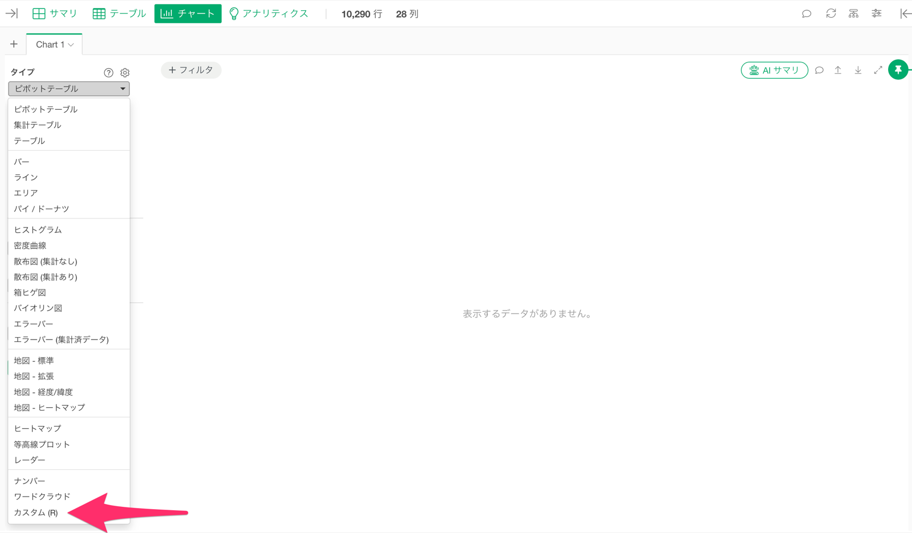

   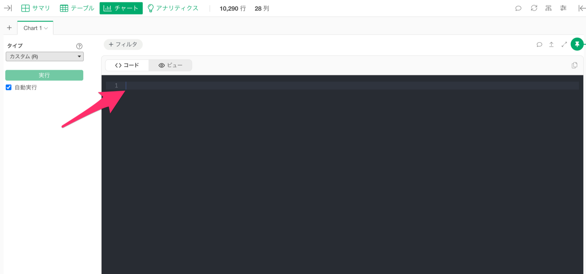

2. エディターに R のコードを書きます。データフレームを参照するときは、通常の R スクリプトと違って、`${DATA}` と書きます。現在開いているデータフレームが指定されます。

   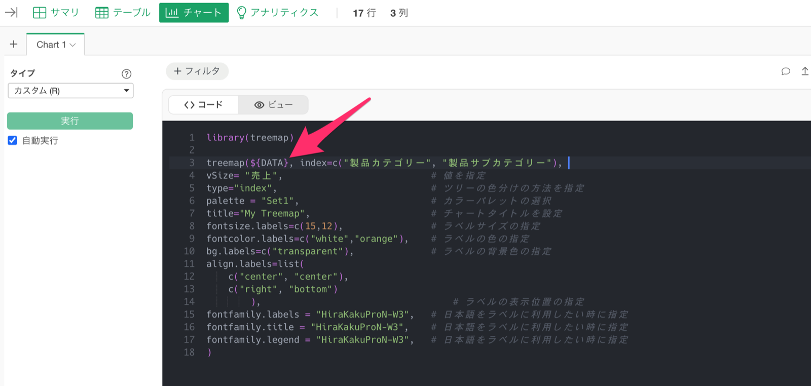

3. 「ビュー」ボタンをクリックすると、チャートが表示されます。

   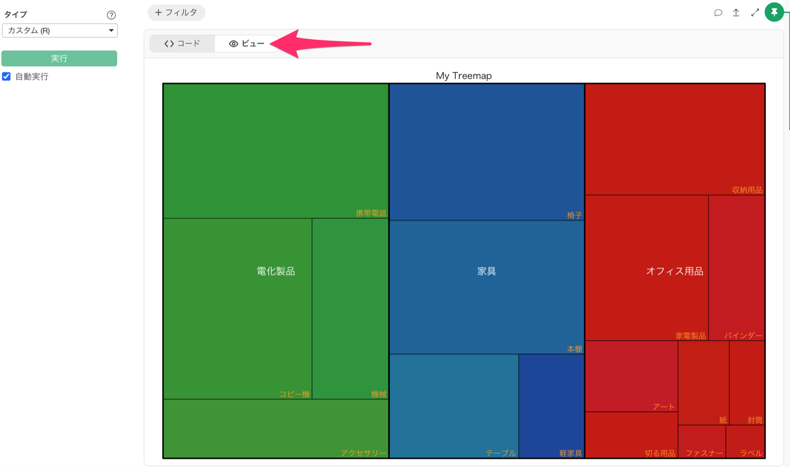

参照できるのは、現在開いているデータフレームだけです。コードの中で他のデータフレームを直接参照する書き方は使えません。

## R パッケージをインストールする

カスタム (R) チャートでは、任意の R パッケージを使えます。Exploratory にプリインストールされていないパッケージを使うときは、先にインストールします。

1. プロジェクトメニューから「Rパッケージの管理」を選びます。

   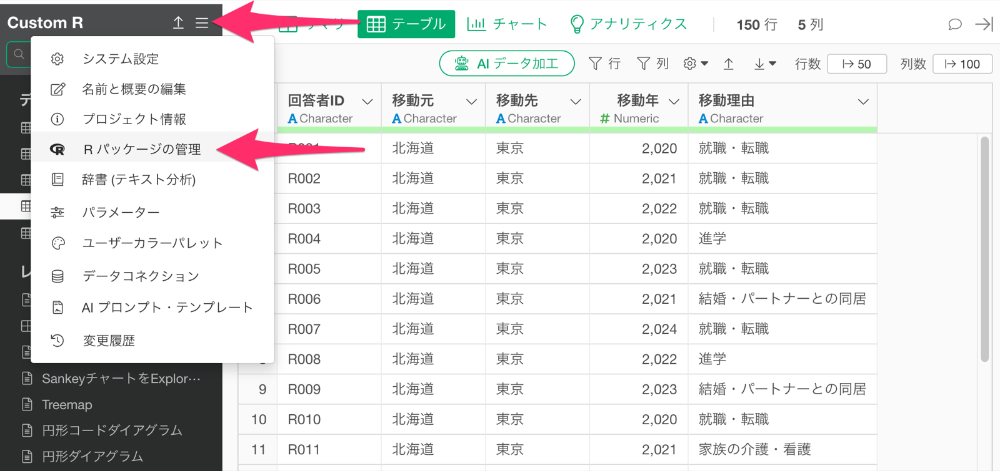

2. 表示されたダイアログにパッケージ名を入力して、インストールします。

   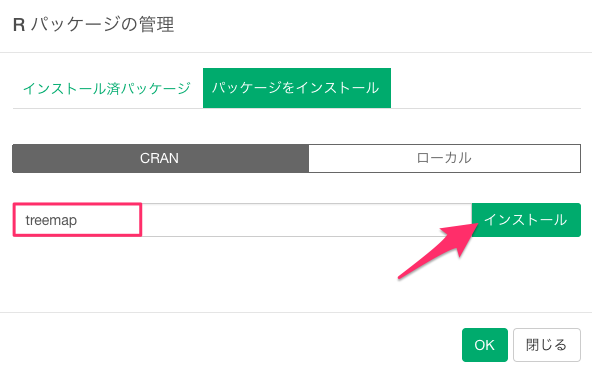

インストールが終わると、エディターでパッケージを読み込み、パッケージがサポートする関数を使えます。

## チャートの作成例

### ツリーマップ

`treemap` パッケージの `treemap` 関数を使うと、階層構造を持つデータを四角形の面積で表すツリーマップを作れます。親カテゴリを同系色でグループ化すると、全体に占める各カテゴリの割合をひと目で把握できます。製品カテゴリ別の売上構成、予算の内訳、Web サイトのトラフィックの内訳など、「大きい順に何がどれくらいを占めているか」を見たいときに向いています。

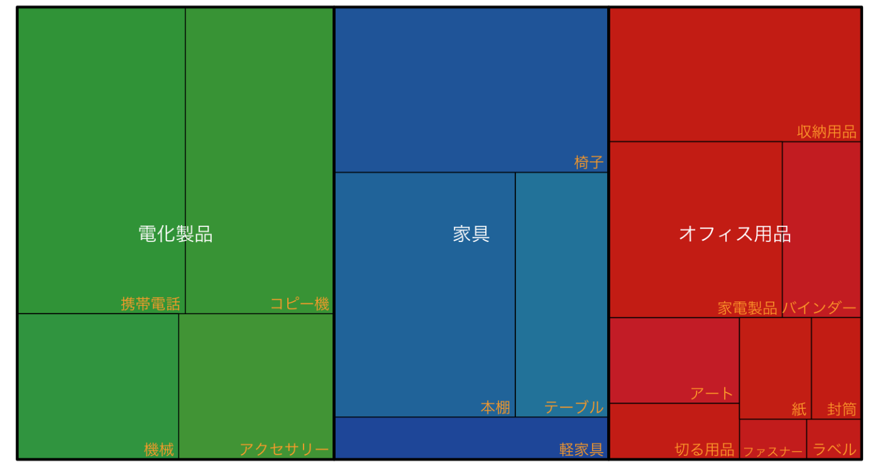

ツリーマップには、親カテゴリ・子カテゴリと、それぞれに対応する数値（売上など）を集計したデータフレームが必要です。

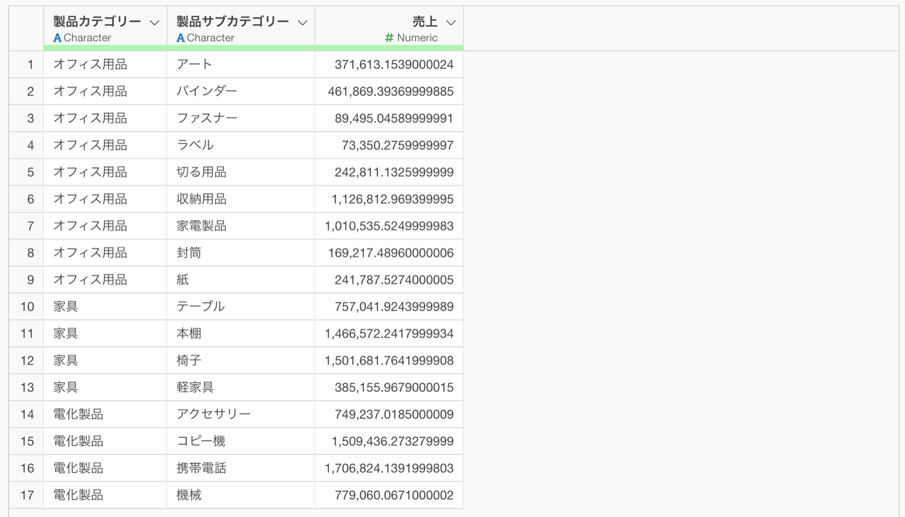

次のようなコードを書きます。

```text
library(treemap)

treemap(${DATA}, index=c("製品カテゴリー", "製品サブカテゴリー"), 
vSize= "売上",                           # 値を指定
type="index",                            # ツリーの色分けの方法を指定
palette = "Set1",                        # カラーパレットの選択
title="My Treemap",                      # チャートタイトルを設定
fontsize.labels=c(15,12),                # ラベルサイズの指定
fontcolor.labels=c("white","orange"),    # ラベルの色の指定
bg.labels=c("transparent"),              # ラベルの背景色の指定
align.labels=list(
    c("center", "center"), 
    c("right", "bottom")
        ),                               # ラベルの表示位置の指定
fontfamily.labels = "HiraKakuProN-W3",   # 日本語をラベルに利用したい時に指定
fontfamily.title = "HiraKakuProN-W3",    # 日本語をラベルに利用したい時に指定
fontfamily.legend = "HiraKakuProN-W3",   # 日本語をラベルに利用したい時に指定
)
```

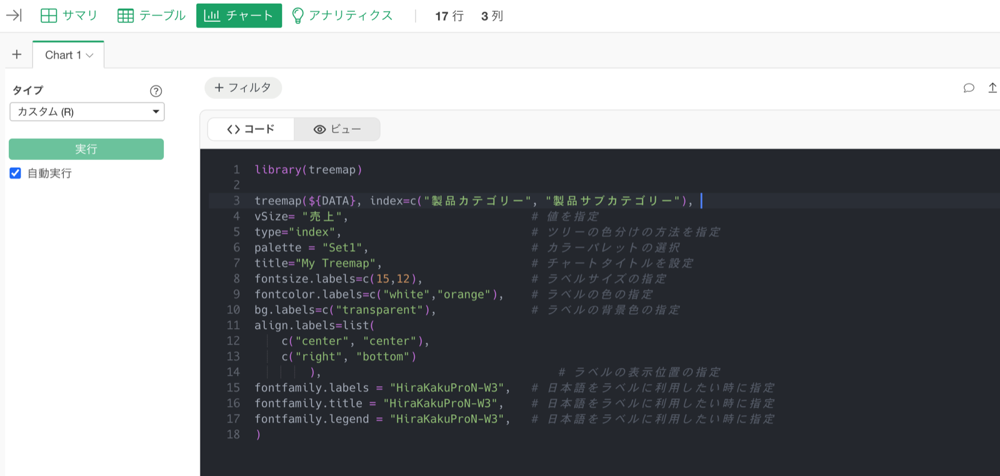

「ビュー」ボタンをクリックすると、ツリーマップが表示されます。

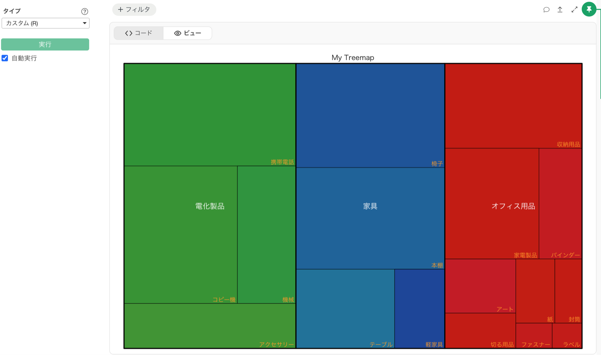

### 円形コードダイアグラム

円形コードダイアグラムは、複数のカテゴリ間の関係や流れを円形のレイアウトで表すチャートです。`circlize` パッケージの `chordDiagram` 関数で作れます。弧の太さが関連の強さを表し、すべてのカテゴリ間の関係を1つの図で把握できます。地域間の人口移動、取引先間の資金フロー、チーム間のコミュニケーション量など、「多数のカテゴリがお互いにどれくらい関係しているか」を見渡したいときに向いています。

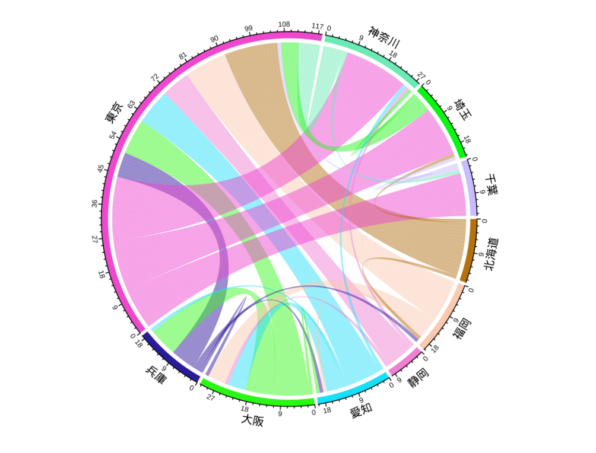

移動元と移動先の2列を含むデータが必要です。

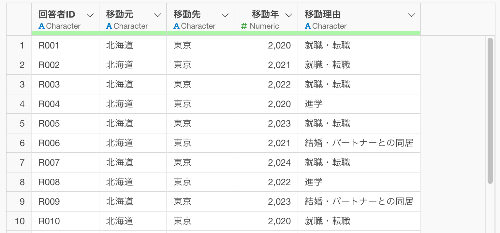

次のようなコードを書きます。

```text
library(showtext)
library(circlize)

showtext_auto() # これを実行するだけで日本語が通るようになります

chordDiagram(${DATA}[, c("移動元", "移動先")], transparency = 0.5)
# 方向の情報は持たないため、移動元と移動先の列は逆でも問題ありません。
```

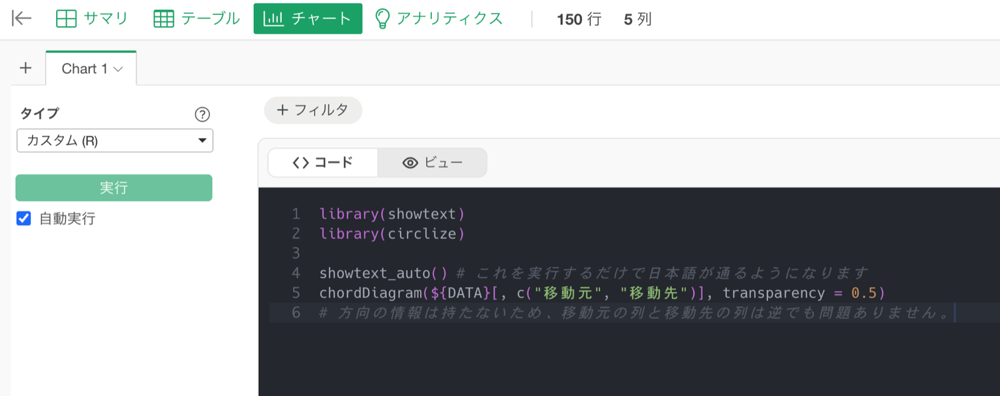

「ビュー」ボタンをクリックすると、円形コードダイアグラムが表示されます。

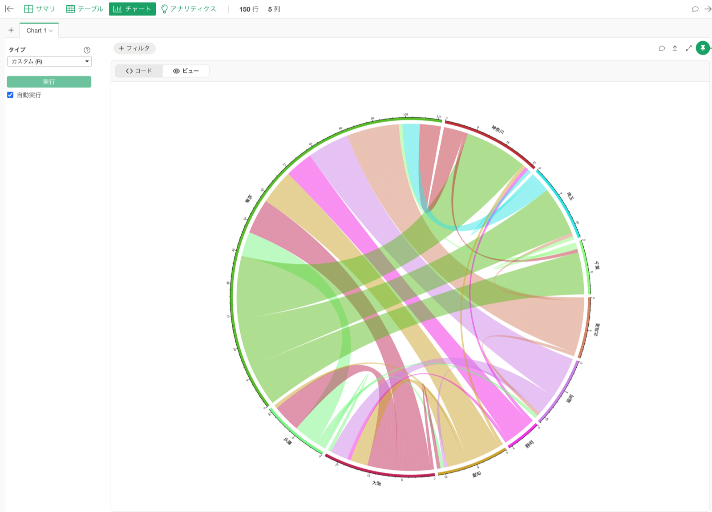

## エラーと自動修正

使おうとしている R パッケージがインストールされていないときは、インストールを促すダイアログが表示され、そこから R パッケージをインストールできます。

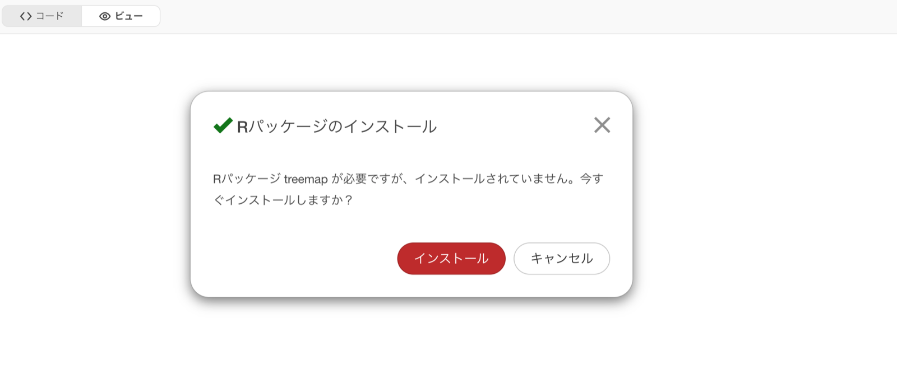

エラーが発生したときは、次のダイアログが表示されます。

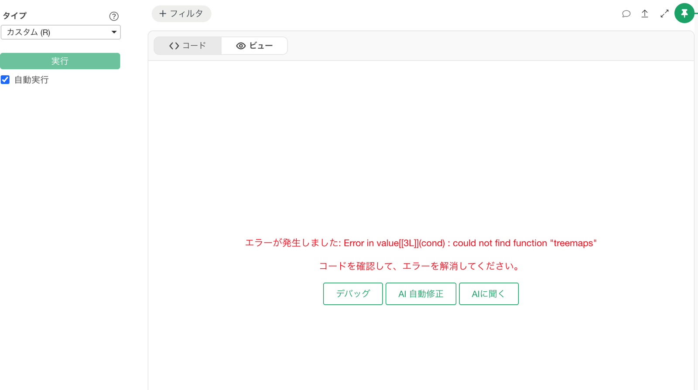

- AI 自動修正: 書いたコードの問題を、AI が自動で修正しようとします。
- AI に聞く: チャットウィンドウが開き、問題を解決するための回答を AI から得られます。
