散布図は、2つの数値データ（カテゴリデータも可能）が交わる位置に、データを点でプロットするチャートです。1行を1つの点にする「散布図 (集計なし)」と、グループごとに集計した値を点にする「散布図 (集計あり)」があります。ここでは「散布図 (集計なし)」を説明します。「散布図 (集計あり)」は [散布図 (集計あり)](/ja/viz/bubble) を参照してください。

## 散布図 (集計なし)の作り方

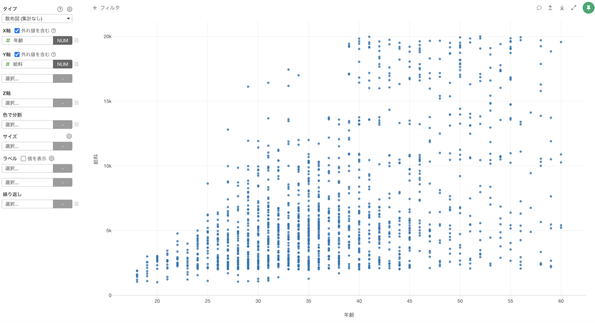

今回はサンプルデータとして[従業員データ](https://exploratory.io/data/kanaugust/HR-Employee-Attrition-Tog2pMA0AH)を使用していきます。

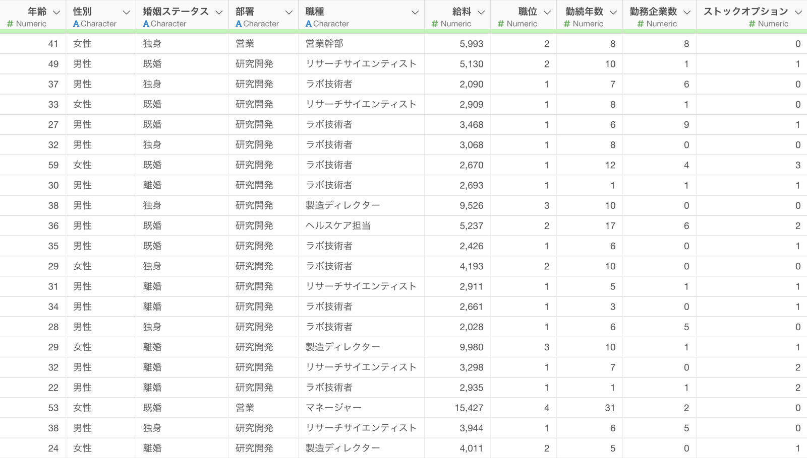

このデータは1行が1従業員で、列には年齢や勤続年数、給料などのデータがあります。

今回は「年齢」と「給料」の関係を散布図 (集計なし) を使って可視化したいです。

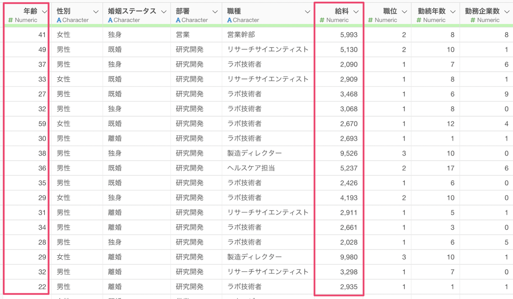

新しくチャートを作成し、チャートタイプに「散布図 (集計なし)」を選びます。

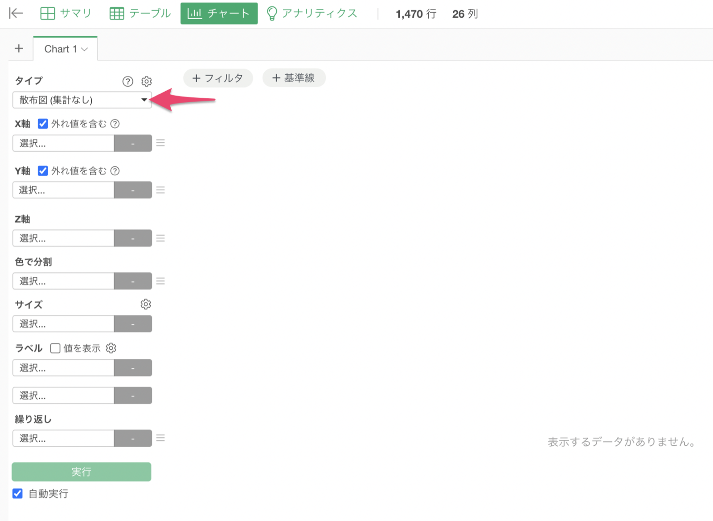

X軸には「年齢」を、Y軸には「給料」を選択します。

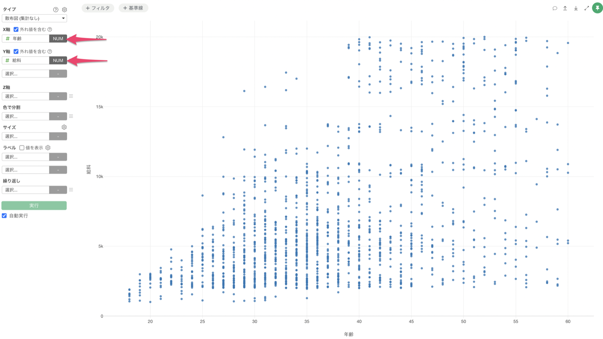

年齢と給料の関係性を表す散布図を作成できました。

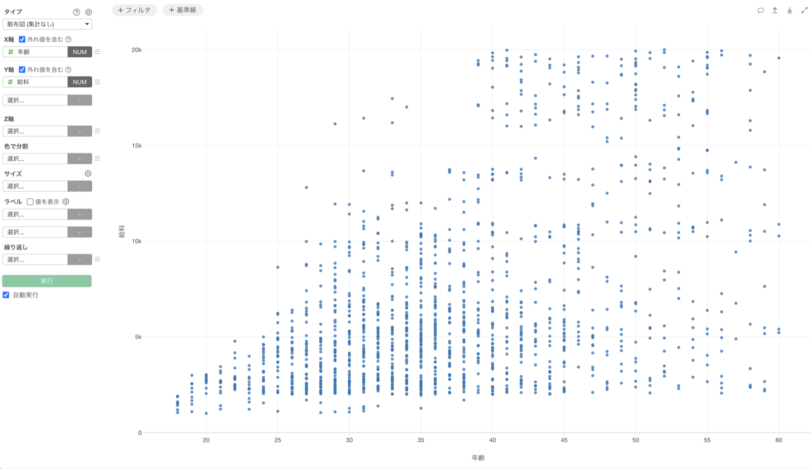

散布図は、X軸（年齢）とY軸（給料）の交わる位置にデータを点でプロットします。また、今回のデータは1行が1従業員のデータのため、一つの点が一人の従業員データということになります。

### トレンドライン（直線）を追加する

この散布図を見ると、年齢が上がるにつれて月収も上がっているように見えますが、実際にその関係があるかをトレンドラインの線形回帰の線を引いて確認してみます。

Y軸のメニューから「トレンドライン」を選択します。

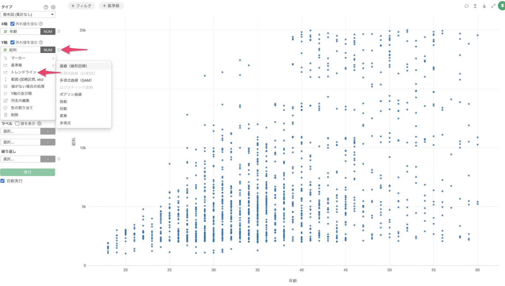

トレンドラインのサブメニューから「直線（線形回帰）」を選択します。

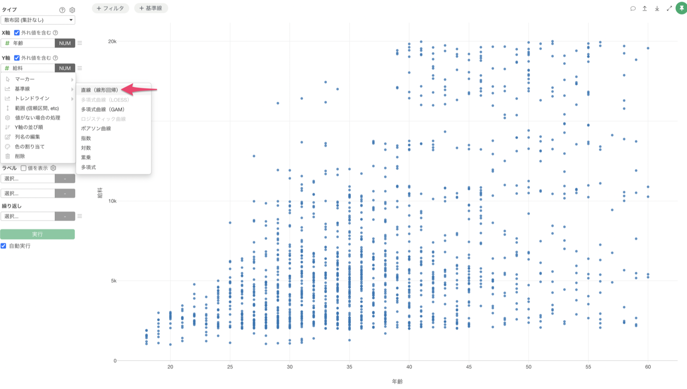

これにより、年齢と給料の関係を表す線形回帰のトレンドラインを引くことができました。

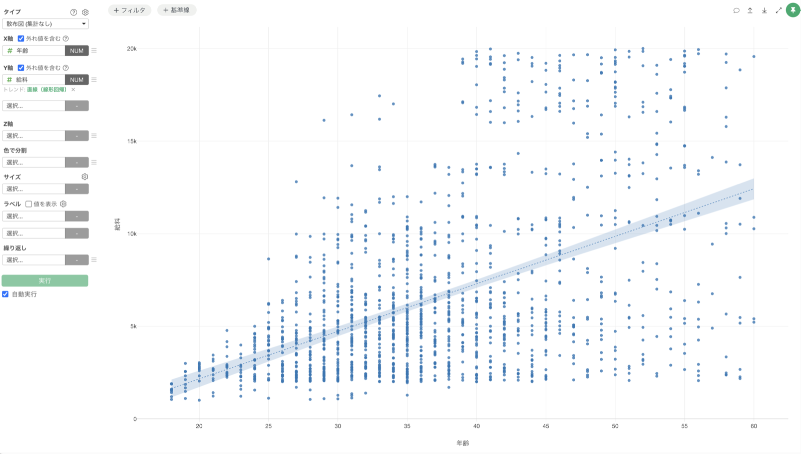

このトレンドラインをみても、年齢が上がるにつれて給料も上がっていることが確認できます。

その関係の強さを表す指標として「相関係数」がありますが、今回の相関係数は「0.497」と中程度の正の相関関係があることがわかります。

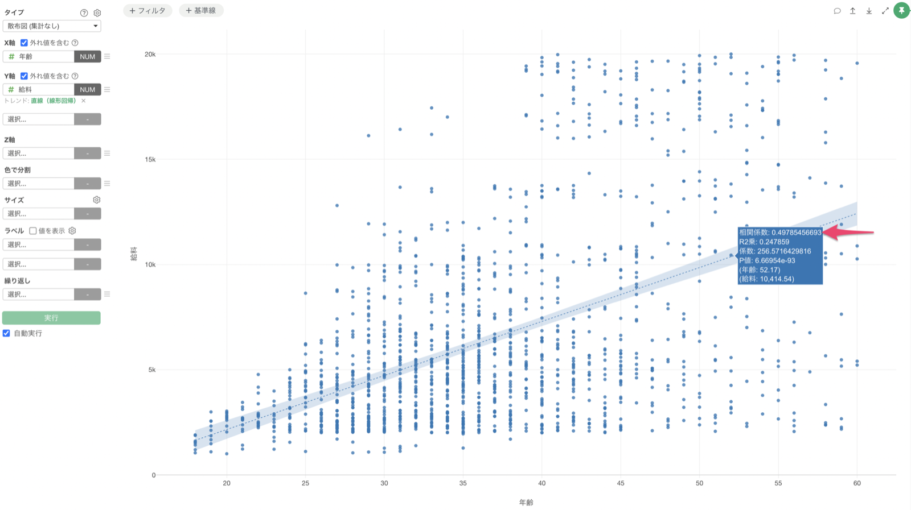

ちなみに、相関係数は-1から1の間の値をとり、変数間の相関関係の強さと方向を示します。

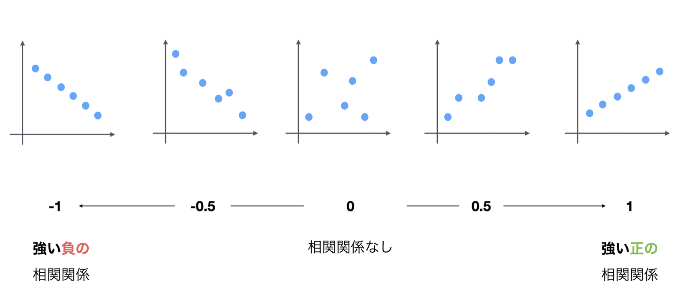

- 1に近いほど強い正の相関（一方が増加すると他方も増加）
- -1に近いほど強い負の相関（一方が増加すると他方は減少）
- 0に近いほど相関が弱い、または存在しない

係数やR2乗などのトレンドライン（線形回帰）の詳細について確認したい方は、[こちら](https://exploratory.io/note/exploratory/QjQ6kMm2)のノートをご覧ください。

### 散布図に関するよくある質問

**Q: 「ラベル」に列を選択して、「チャート上に表示」にチェックしたときに表示される値のフォントのサイズは変更できますか。**

散布図では、「ラベル」に列を選択して、「チャート上に表示」にチェックを付けると、ラベルに選択した列の値を散布図上に表示できます。

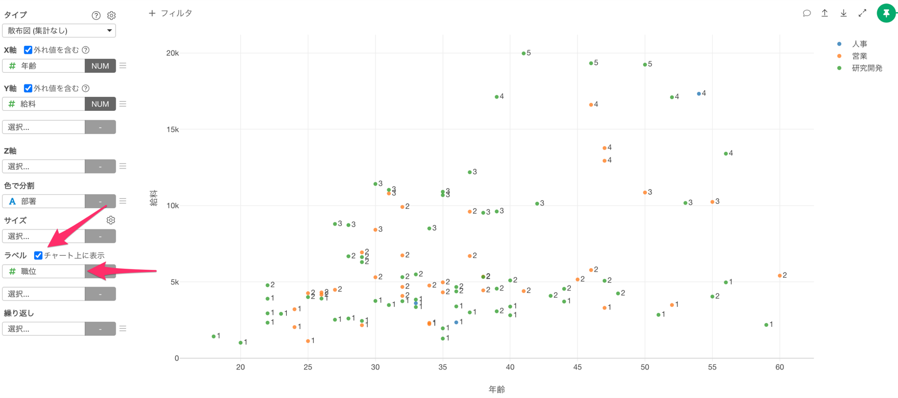

また散布図上で表示される、ラベルの値のフォントサイズを変更したい場合、「チャートの設定」を開き、「プロット領域」の「フォントサイズ」から変更が可能です。

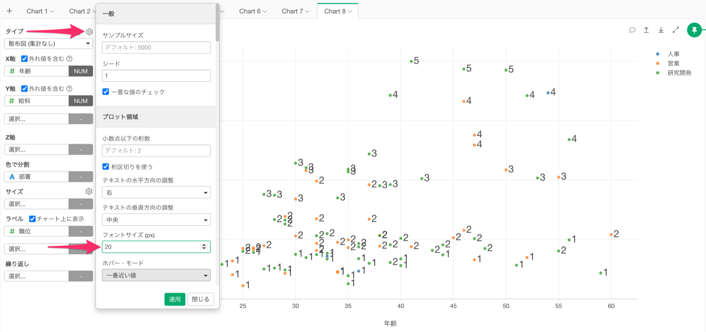

## 重なった点をずらして分布を確認する（ジッター）

アンケートデータで「サービスの使いやすさ」と「サービスの推奨度」のような2つの設問の関係を見たいとき、散布図はよく使われます。

ところが5段階評価のように取りうる値の種類が少ない設問だと、点が打たれる場所が格子状の限られた位置にしかありません。何百人分の回答があっても、同じ組み合わせを選んだ回答はすべて同じ座標にぴったり重なってしまい、画面上は1つの点にしか見えません。

結果として、どの回答の組み合わせに人が集中しているのかが、散布図からはまったく読み取れなくなります。

そこで「ジッター（ずらし）」 を使うと、重なっている点を元の位置の周りに少しだけずらして表示できます。

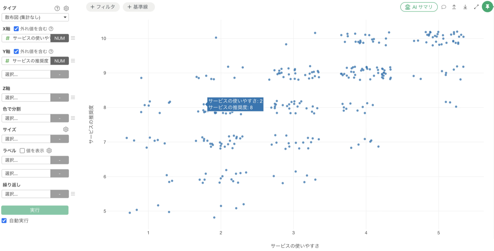

点の散らばり具合から、どの組み合わせに回答が多いのかがひと目で分かるようになります。ずらすのは表示上の位置だけで、元のデータの値や分析の結果は変わりません。

### 利用データ

今回は1行が1人のアンケート回答者を表す、電話会議ツールに関する顧客満足度調査のデータを利用します。

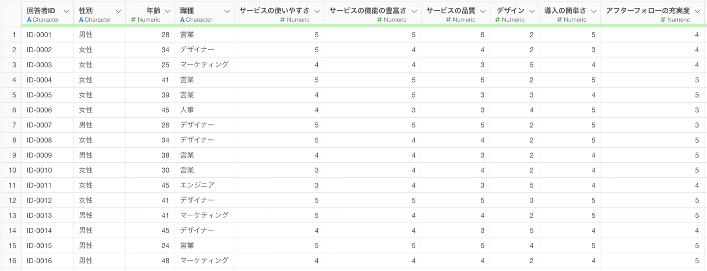

回答者ID・性別・年齢・職種といった回答者の属性と、「サービスの使いやすさ」「サービスの機能の豊富さ」「サービスの品質」「デザイン」「導入の簡単さ」などの評価の列を持っています。

右の方にスクロールすると、「サービスの推奨度」の列があります。こちらは0から10までの点数で答える設問です。さらに「推奨度の理由」のような自由記述の列も含まれています。

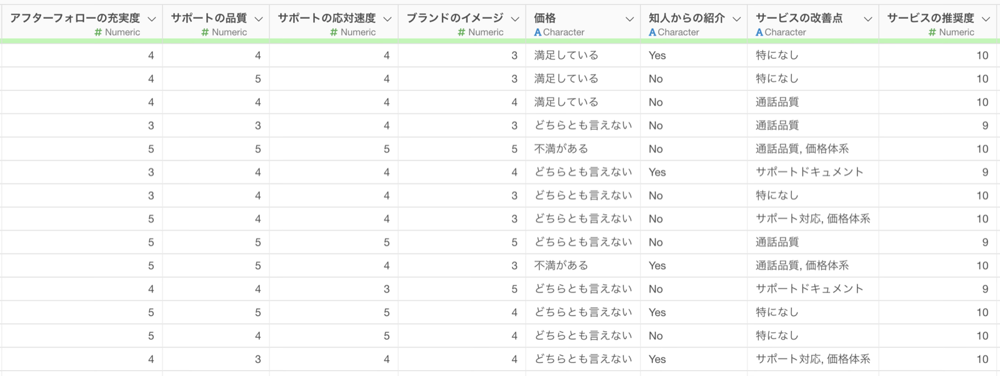

データは[こちら](https://exploratory.io/data/exploratory/sdh1Tly7)からダウンロードいただけます。

### 散布図で2つの設問の関係を見る

まず、「サービスの使いやすさ」が高い人ほど「サービスの推奨度」も高いのか、という2つの設問の関係を散布図で確認します。

チャートビューに移動し、チャートの タイプ に「散布図 (集計なし)」 を選択し、X軸には 「サービスの使いやすさ」 、Y軸には 「サービスの推奨度」 を選択します。

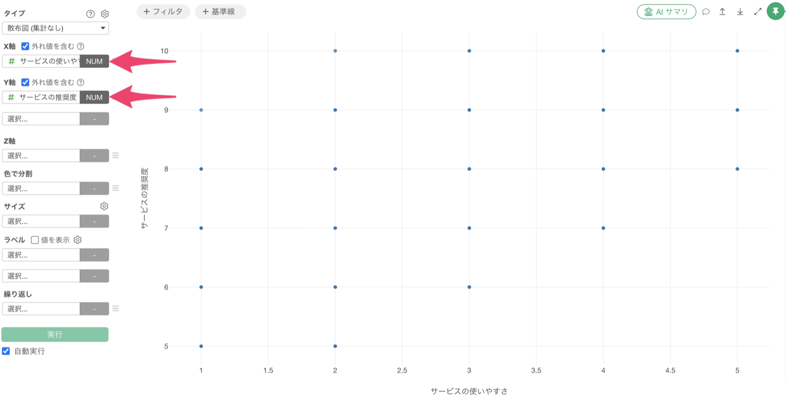

すると散布図が表示されますが、点は格子の交点にしか現れず、数えられるほどの数しかありません。

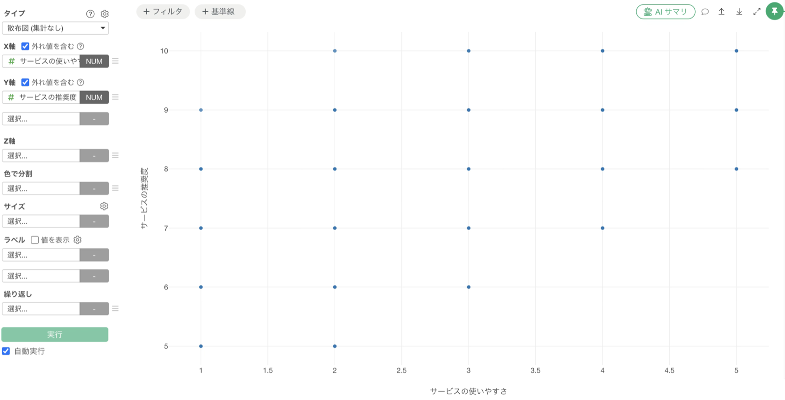

X軸は1から5、Y軸は5から10の範囲に値が収まっているため、数百人分の回答があっても、点が打たれる場所は限られた組み合わせの数しかありません。

同じ組み合わせを選んだ回答者はすべて同じ座標に重なってしまい、1つの点として表示されています。そのため、この状態ではどの組み合わせに回答が集中しているのかが分かりません。

### ジッター（ずらし）で点をずらす

ジッター（ずらし）で点をずらして、どの組み合わせに回答が集中しているかを確認します。

「Y軸」 に割り当てた列のメニューをクリックし、 「マーカー」 にマウスカーソルを合わせると、サブメニューが表示されるので、一番下の 「設定」 を選択します。

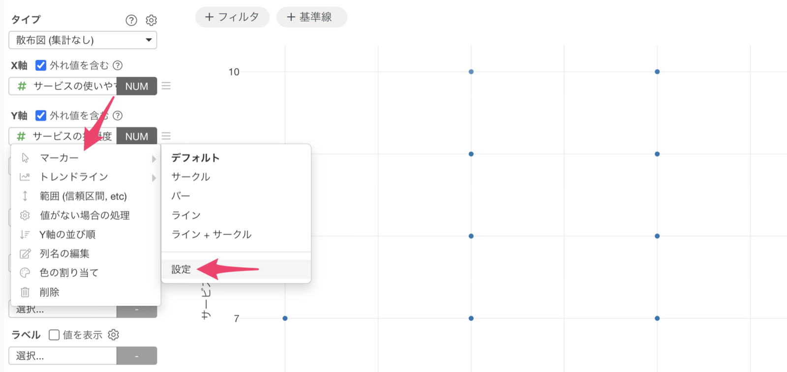

「マーカーの設定」 のダイアログの「マーカー」 では点の形（デフォルト、サークル、バーなど）を選べますが、その下の 「ジッター（ずらし）」 のセクションが、今回使う設定です。

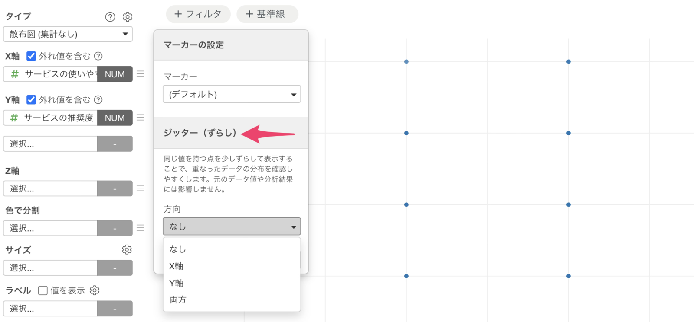

「方向」 のドロップダウンをクリックすると、選択肢が表示されます。

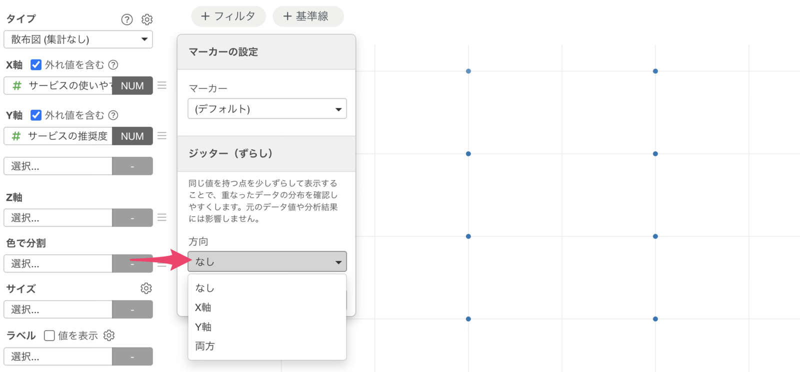

選択肢は以下の4つです。

- なし: ジッターを使いません。初期設定はこちらです。
- X軸: 点をX軸方向（横方向）にずらします。
- Y軸: 点をY軸方向（縦方向）にずらします。
- 両方: 点をX軸方向とY軸方向の両方にずらします。

#### X軸方向にずらして確認する

まず 「方向」 に 「X軸」 を選択し「適用」 ボタンをクリックします。

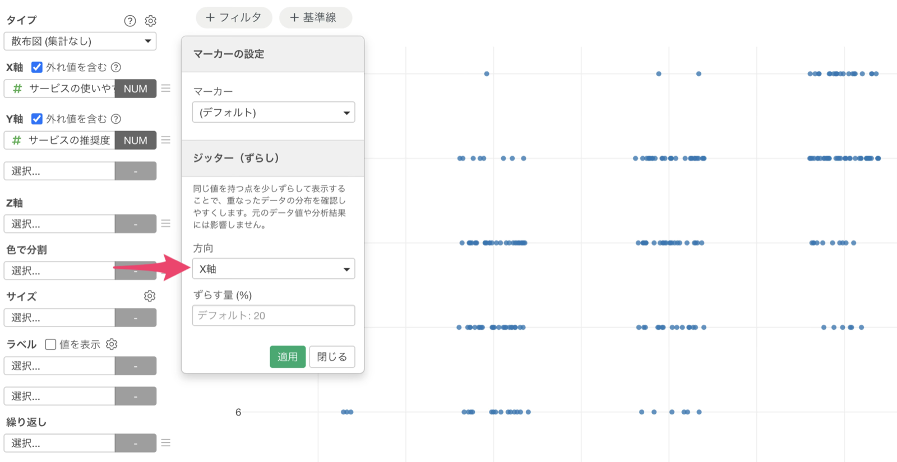

チャートを見ると、点が横方向に広がって表示されるようになりました。

同じ座標に重なっていた回答が横一列に散らばるので、どの組み合わせに回答が多いのかを、横方向の帯の長さと濃さから読み取れるようになります。

#### Y軸方向にずらして確認する

次に 「方向」 のドロップダウンから 「Y軸」 を選択します。

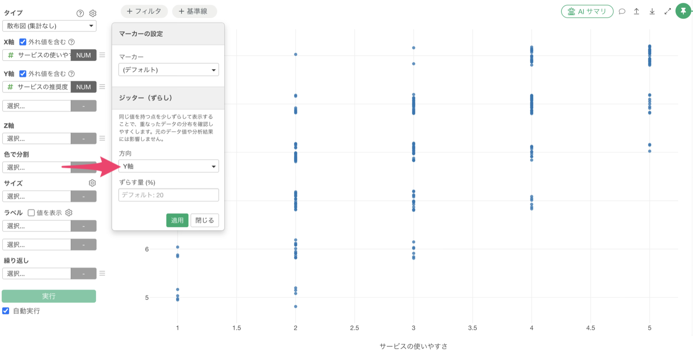

「適用」 ボタンをクリックすると、今度は点が縦方向に広がります。

X軸の値ごとに縦の帯ができるので、使いやすさの評価ごとに推奨度がどのあたりに集まっているのかを比べやすくなります。

#### 両方向にずらして確認する

最後に 「方向」 のドロップダウンから 「両方」 を選択して、 「適用」 ボタンをクリックします。

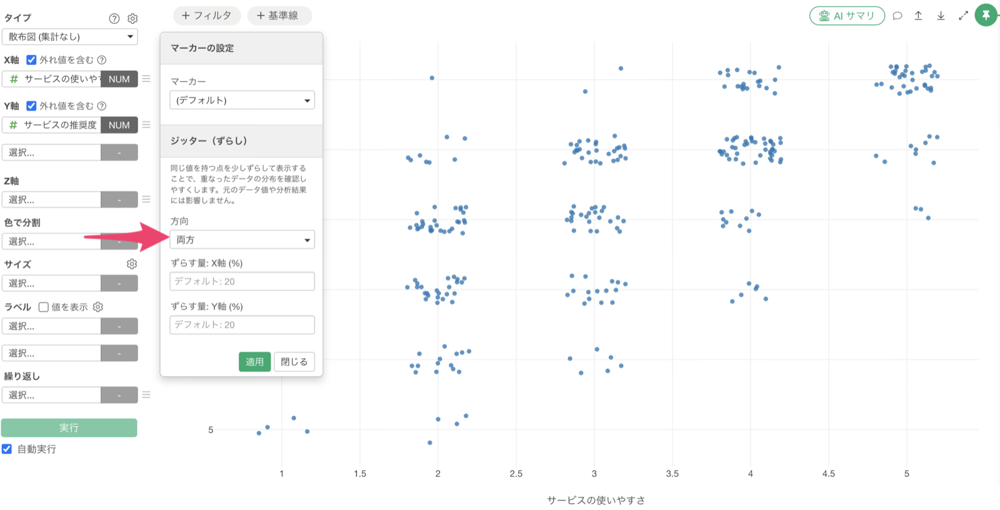

点が縦横の両方向に広がり、それぞれの格子点が点の集まり（かたまり）として表示されるようになりました。かたまりの大きさや濃さを見比べれば、どの回答の組み合わせに人が多いのかが分かります。

このチャートからは、サービスの使いやすさの評価が高い回答者ほど、サービスの推奨度も高くなるという関係を読み取ることができます。

#### ずらす量を調整する

点の広がりが大きすぎる、あるいは小さすぎると感じたときは、 「ずらす量 (%)」 に数値を入力して調整します。

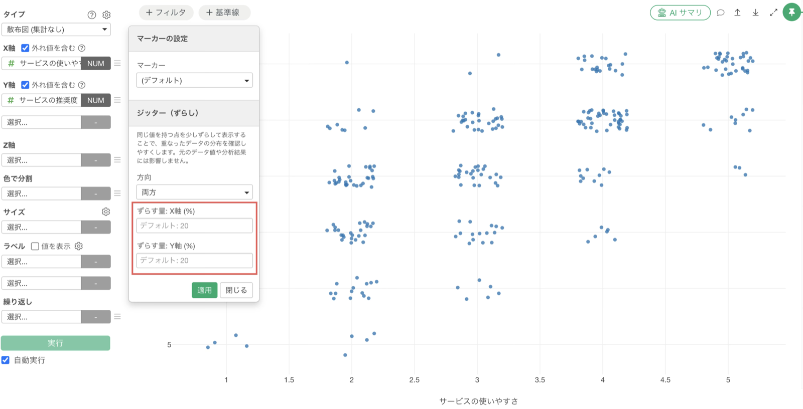

入力欄には 「デフォルト: 20」 と表示されており、何も入力しない場合はこの値が使われます。

値を大きくすると点は大きく散らばり、小さくすると元の位置の近くにまとまります。値を入力して 「適用」 ボタンをクリックすると、チャートに反映されます。

「両方」 を選んでいる場合は、 「ずらす量: X軸 (%)」 と 「ずらす量: Y軸 (%)」 にそれぞれ値を指定できます。

#### 元の値をツールチップで確認する

ジッターを使うと点の表示位置は動きますが、元のデータの値は変わりません。

点にマウスカーソルを合わせると、ツールチップに元の値がそのまま表示されます。

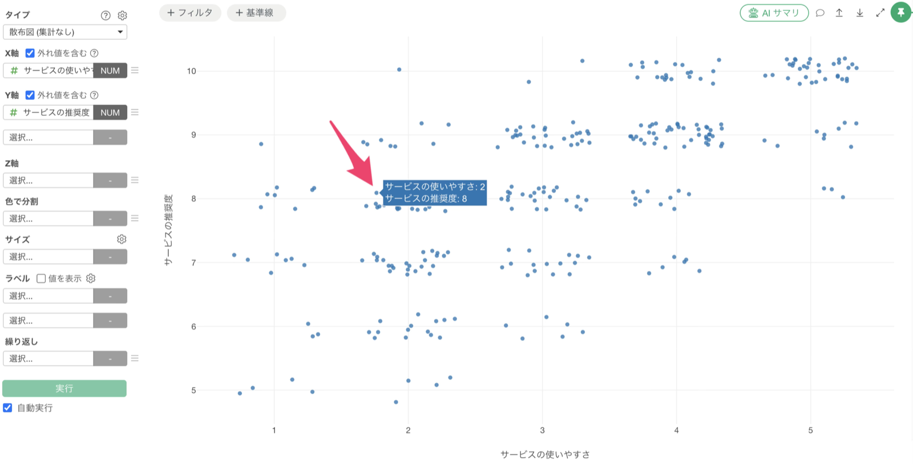

上の例では、点の表示位置は格子からずれているにもかかわらず、ツールチップには 「サービスの使いやすさ: 2」 「サービスの推奨度: 8」 と、元の回答の値が表示されています。

これで、点をずらして分布を読み取りながら、個々の回答の値も元のまま確認できることを確認できました。
