バイオリン図は、カテゴリごとに数値データの分布を可視化するチャートです。箱ヒゲ図と密度曲線を組み合わせた形で、分布の形まで読み取れます。

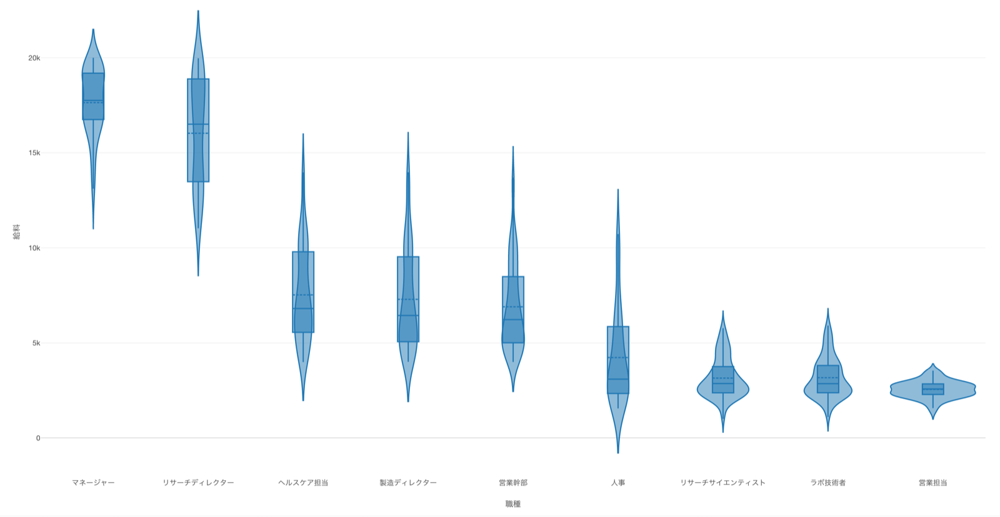

サンプルデータとして従業員データを使用していきます。 このデータは1行が1従業員で、列には給料や職種などの列があります。

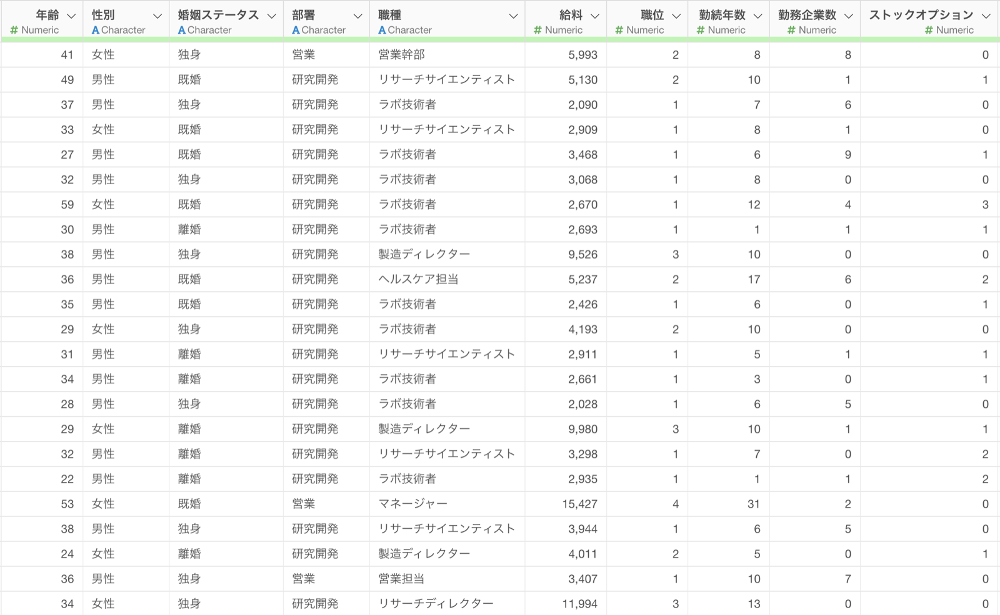

今回は、職種ごとの給料のデータの分布をバイオリン図を使って可視化していきます。

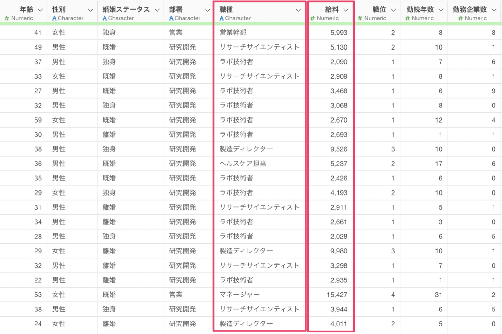

チャートビューからチャートを作成し、タイプに「バイオリン図」を選択します。

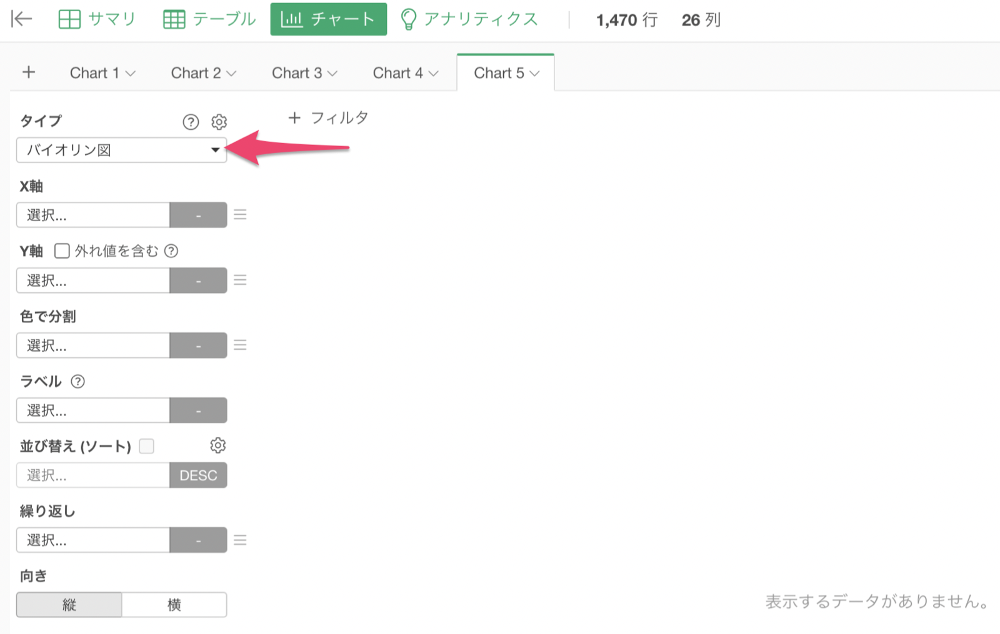

Y軸に「給料」を選択します。

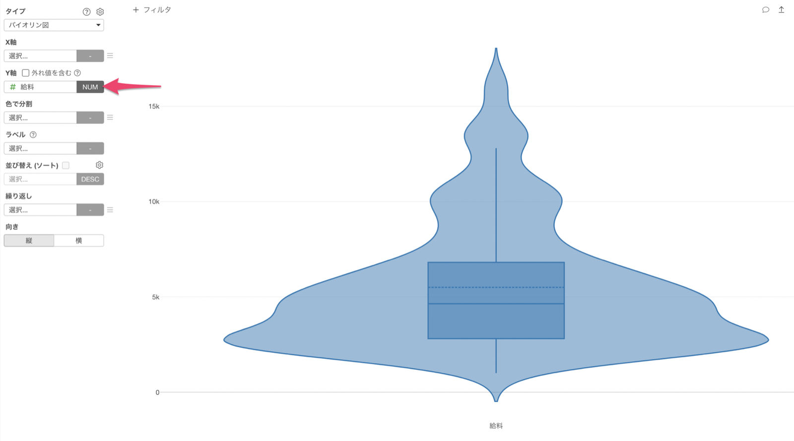

給料の分布をバイオリン図を使って可視化できました。

バイオリン図は[箱ヒゲ図](https://exploratory.io/note/GMq1Qom5tS/17-skB4kPv4JL)と[密度曲線](https://exploratory.io/note/GMq1Qom5tS/eck4bdS4Wl)を融合したチャートで、箱ヒゲ図と同じく数値データの分布を5つの代表値で表現するのに加え、平均値も可視化されます。そして、分布を密度曲線でも表しているチャートになります。

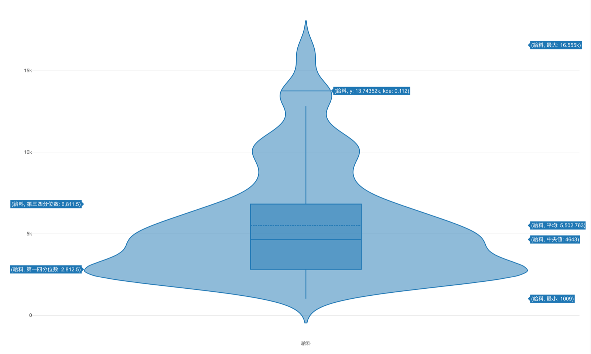

外れ値を含むにチェックをすると、外れ値を含んだ状態で可視化されます。外れ値の閾値は1.5IQRを使用しています。

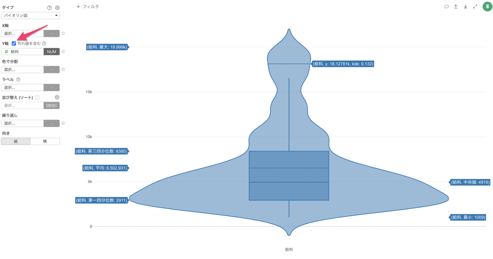

X軸に「職種」を割り当てて、職種ごとの給料の分布を比べていきます。

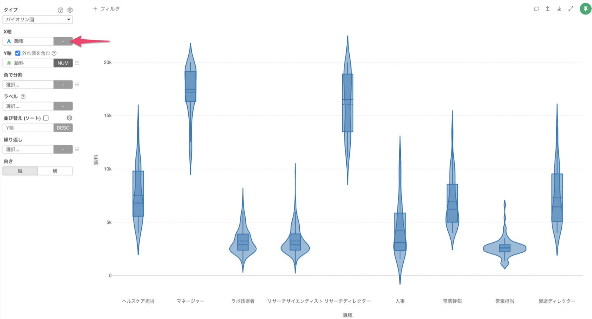

比べやすくするために、並び替え（ソート）のチェックボックスにチェックをつけます。

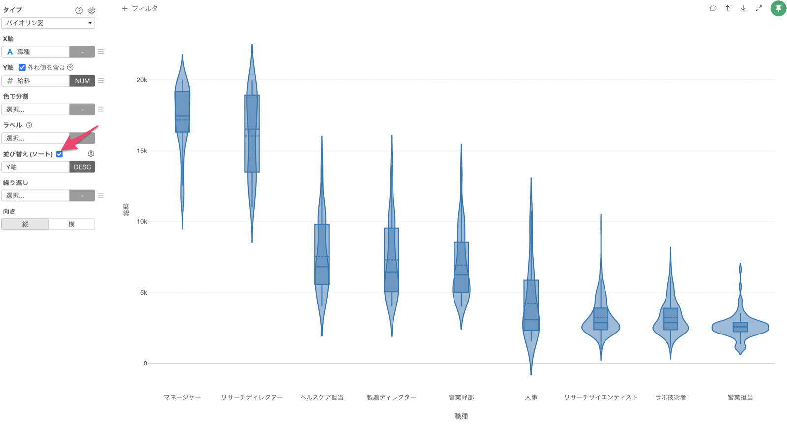

職種によって、給料の分布に違いがあるようで、３つのグループがあるように見えます。

給料が高い職種と、中間に位置する職種、そして給料が低い職種があることがわかります。

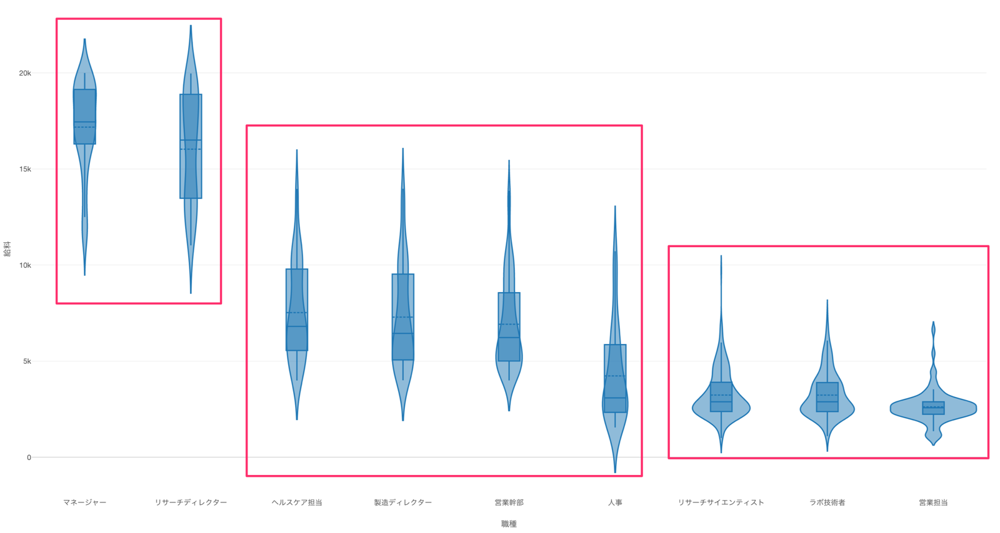

給料が低い職種の人たちのバイオリン図を見ると、確率密度の曲線から給料が2,000ドルから3,000ドルに多くの人が集まっていることがわかります。

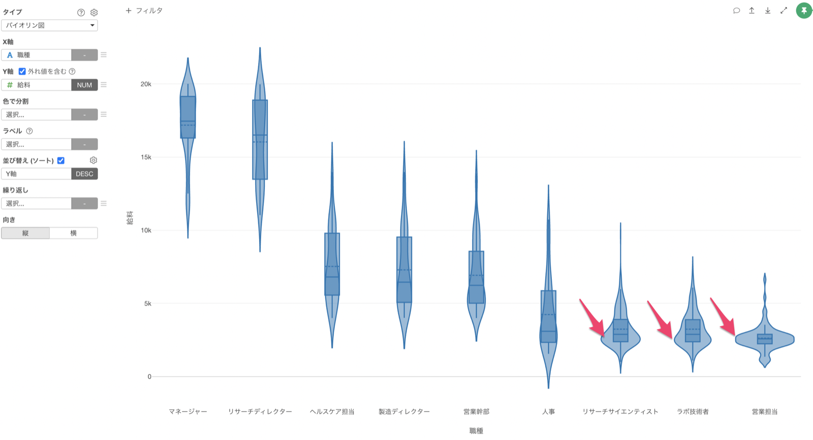

チャートの設定から「データをポイントで表示」を適用します。

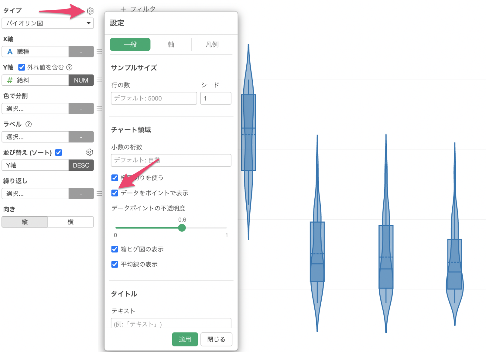

それぞれの職種ごとにY軸の給料に対応した値が点で表示されます。

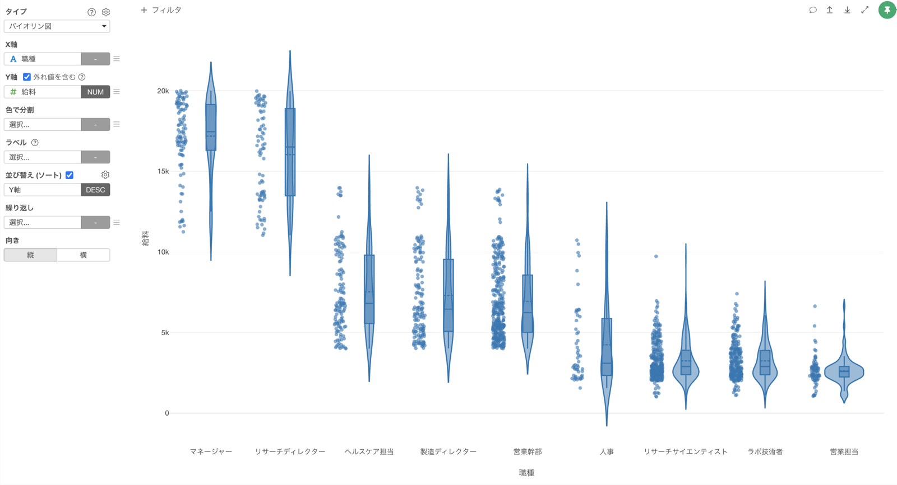

今回のように、バイオリン図を使うことで、カテゴリデータごとに数値データの分布を比べていくことができます。
