「マージ」は、複数のデータフレームの行を結合して、1つのデータフレームにまとめる機能です。毎月新しく作られるデータを既存のデータに追加するときなどに使います。ステップメニューの「結合 / マージ」から「マージ (行を追加する / Union)」を選び、行を結合したいデータフレームを指定します。

## 2つのデータフレームの行を結合する

例えば、毎月新しく別のファイルとして作られるデータを既存のデータに追加したいとします。

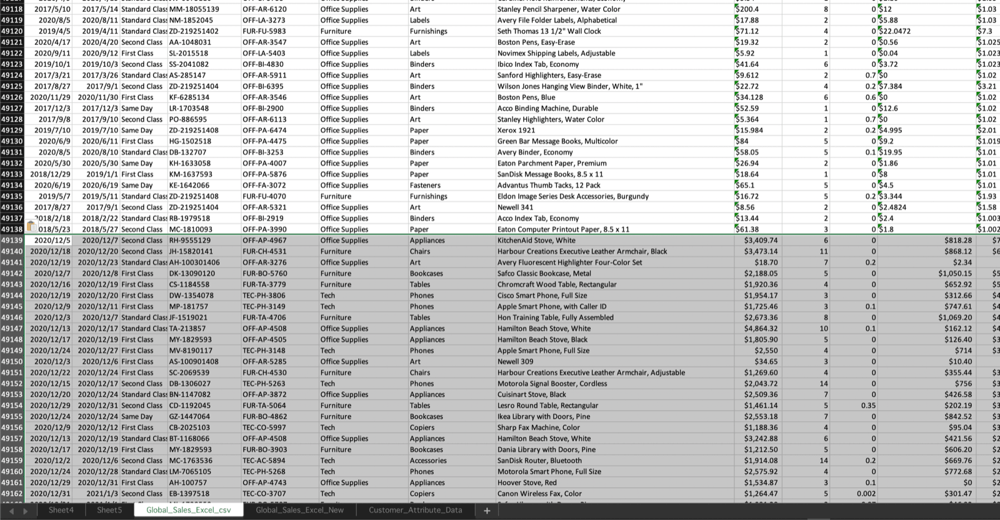

Exploratoryでは、マージのダイアログの中で、行を結合したいデータフレームを指定するだけになります。

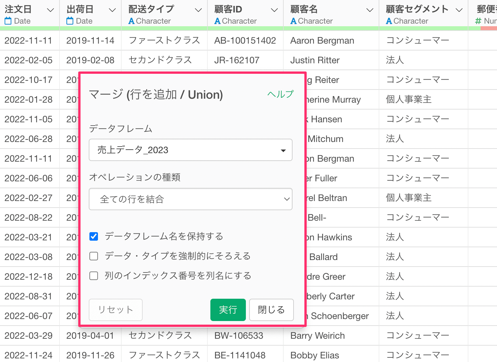

例えば、2つのデータフレームがあり、1つ目が2022年の売上のデータです。

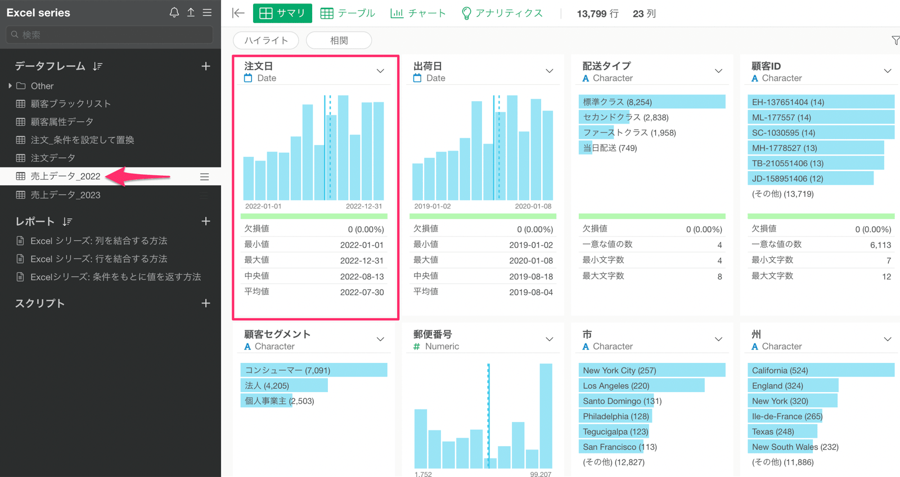

2つ目が2023年の売上データで、データの構造は同じで期間のみが違うデータとなっています。

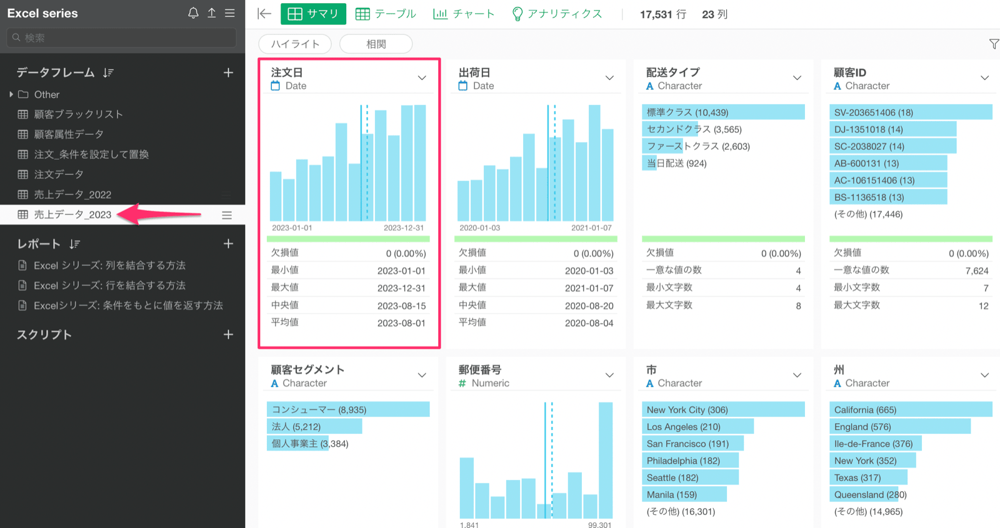

これらの２つのデータの行を結合して、「2022/1/1 - 2023/12/31」の2年間の売上データにしたいです。

そういったときに使えるのが「マージ」です。

ステップメニューの「結合 / マージ」から「マージ (行を追加する / Union)」を選択します。

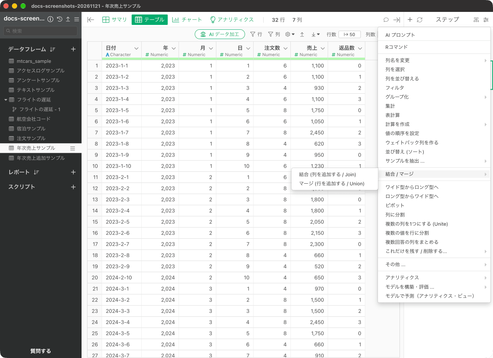

マージのダイアログが表示されます。

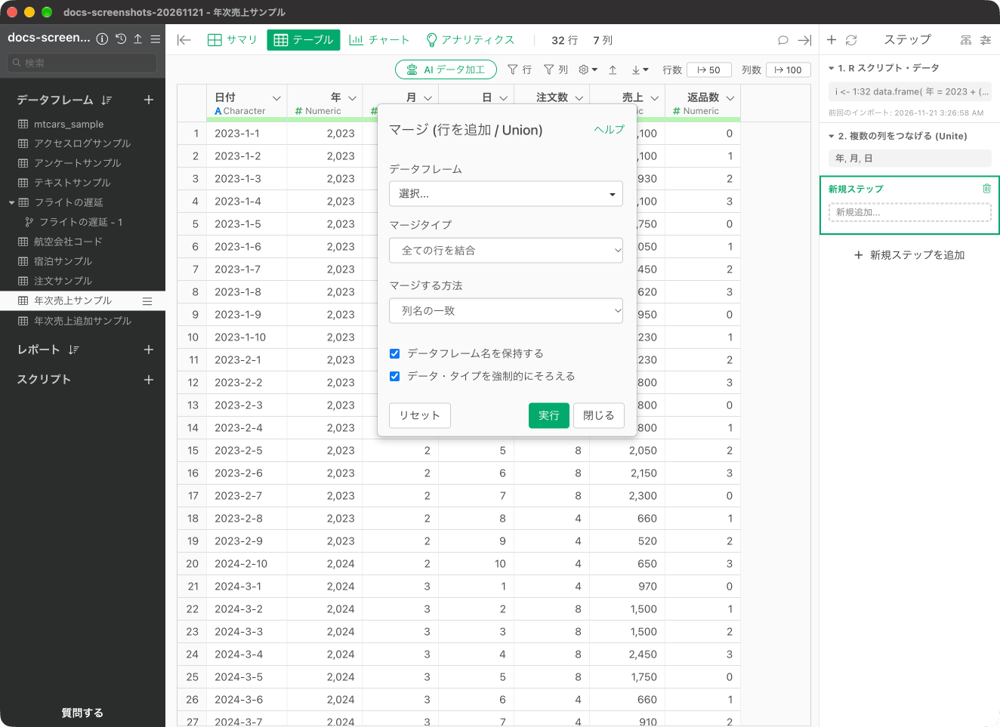

行を結合したいデータフレームを指定します。今回の場合は、「売上データ_2023」にチェックボックスをつけます。

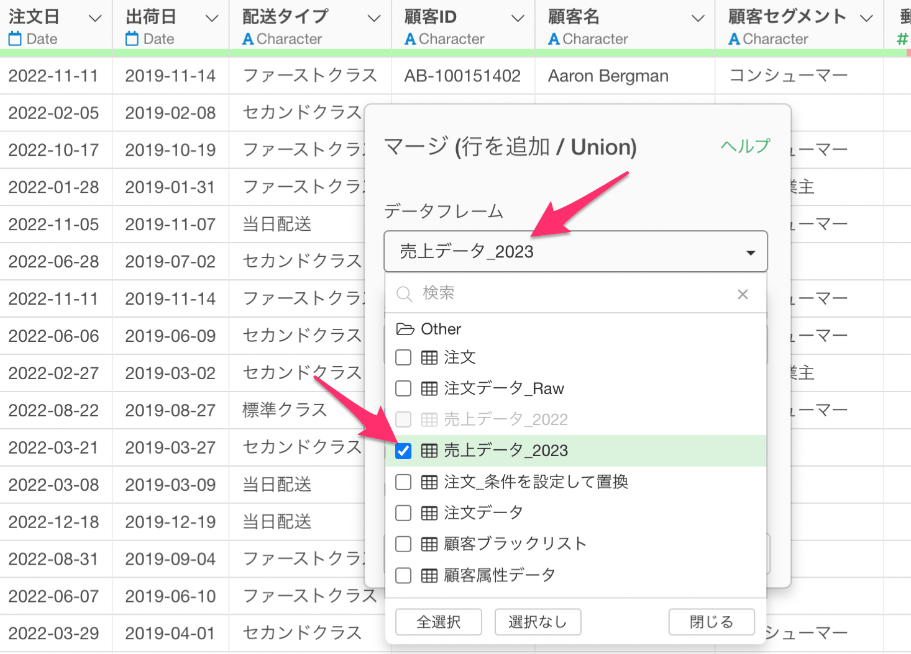

行を結合したいデータフレームを指定できたら、「実行」ボタンをクリックします。

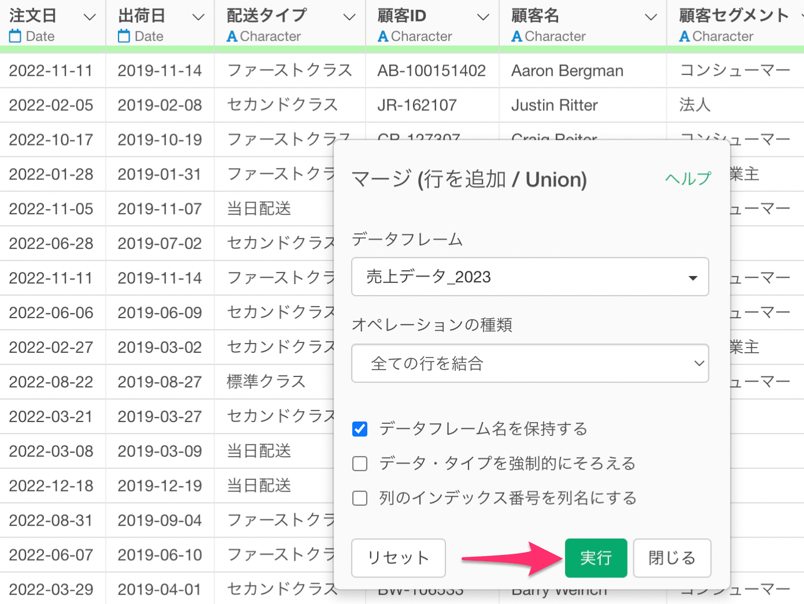

これによって、2022年、2023年の売上データを行結合して、2年間の売上データにできました。

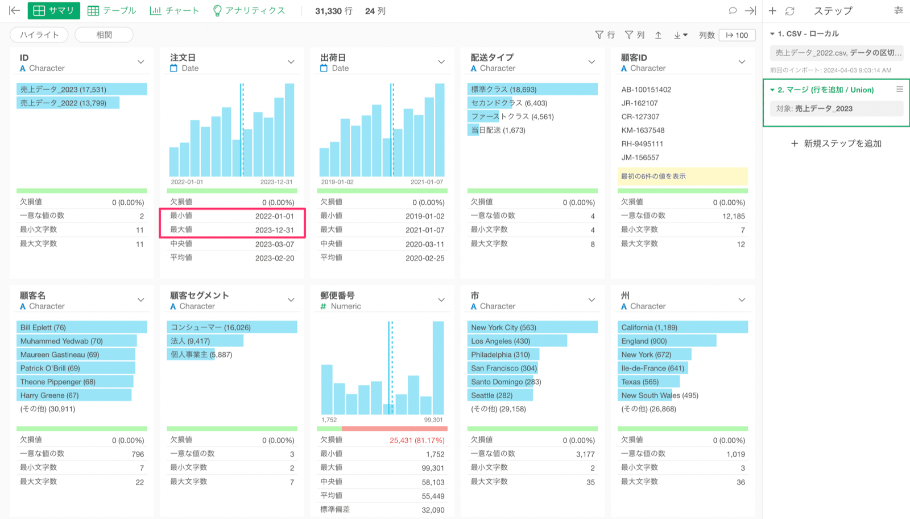

## マージのオプション

### データタイプの自動調整

異なるデータタイプの列をマージすると以下のようにエラーが発生します。

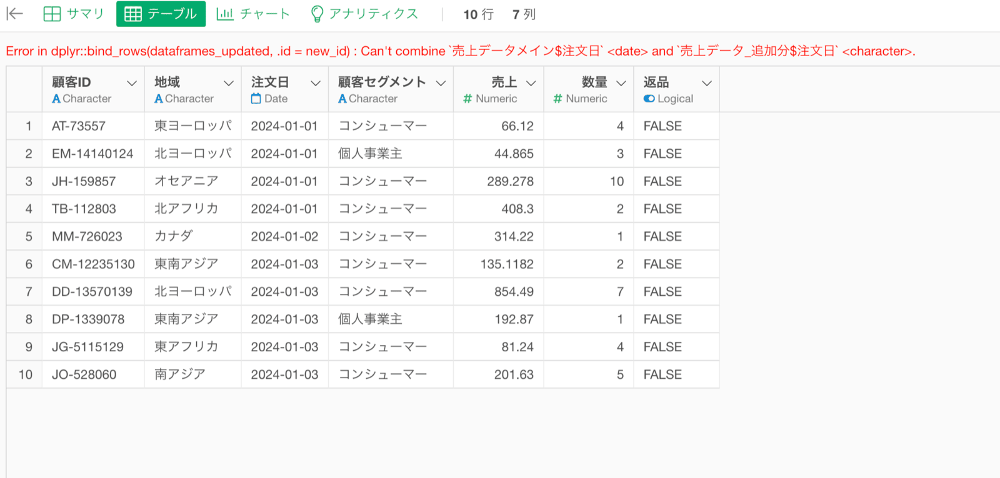

マージダイアログで「データ・タイプを強制的にそろえる」オプションにチェックを入れます。

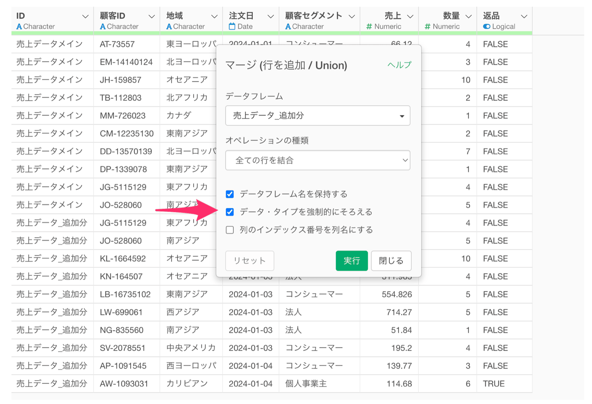

このオプションを選択すると、メインのデータフレームのデータタイプが優先され、マージするデータフレームのデータタイプが自動的に調整されます。

### 列の並び順を利用したマージ

列名が異なるデータフレームをマージすると、別々として認識されて列が分かれてしまいます。

しかし、列名は異なるが、2つのデータフレームで列の順番が同じだったとします。

マージダイアログの「マージする方法」で「列の並び順」を選びます。これにより、列名が異なっていても、同じ位置にある列同士を正しくマージできます。

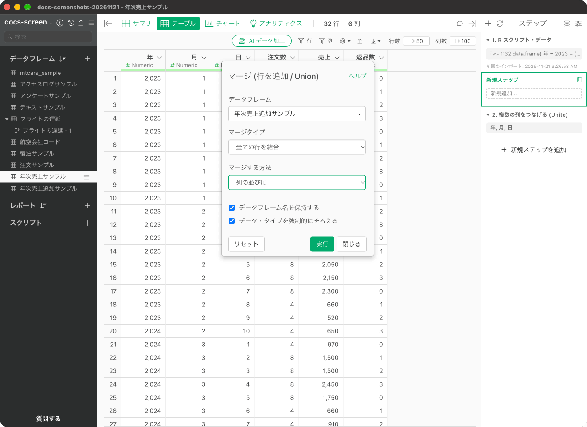

このオプションを選択すると、列名ではなく列の位置（インデックス）に基づいてマージが行われます。マージ後、必要に応じて列名を再設定してください。

### マージタイプの選択

マージの際には、「マージタイプ」から適切なものを選択します。「データフレーム名を保持する」と「データ・タイプを強制的にそろえる」は、ダイアログを開いた直後の状態ではどちらもオンです。

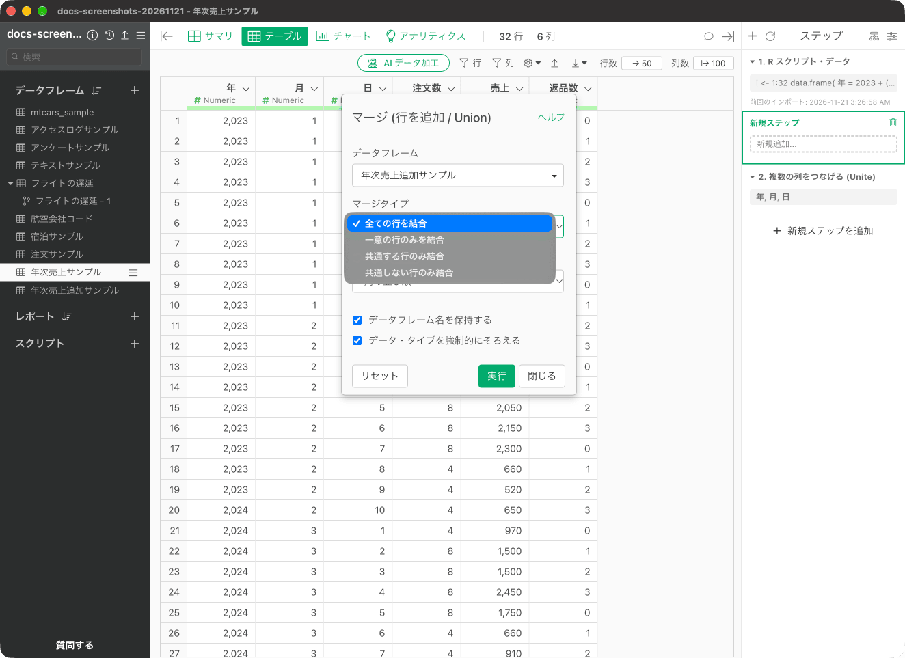

1.  全ての行を結合：デフォルトオプション。すべての行をそのままマージします。
2.  一意の行のみを結合：重複する行を除外してマージします。
3.  共通する行のみ結合：両方のデータフレームに存在する行のみをマージします。
4.  共通しない行のみ結合：メインのデータフレームにのみ存在する行をマージします。

これらのオプションを使用することで、重複データの処理や特定の条件に基づいたマージを行うことができます。
