複数の列を選んで「計算を作成 - 複数の列」の「条件を指定」を開くと、対象の列に複数の列を指定でき、同じ計算処理を一度に適用できます。1列ずつ処理する手間がなくなり、ステップも読みやすくなります。

Exploratoryでは簡単に、条件をもとに計算を作成できますが、複数の列に対して、同じ計算処理を一度に適用することも可能です。

複数の列を選んで条件を指定する際、「対象となる列」に複数の列を指定し、新しい値の中「.（ドット）」を利用することで、対象として選択した全ての列に同じ計算処理を適用できます。

今回は1行が1つの宿泊予約を表し、列には宿泊日、宿泊費用、サービス料、食事費用、キャンセル状況などの情報を持つデータを利用して、キャンセルの場合は、費用の80%が請求されるため、そちらをデータに反映していきます。

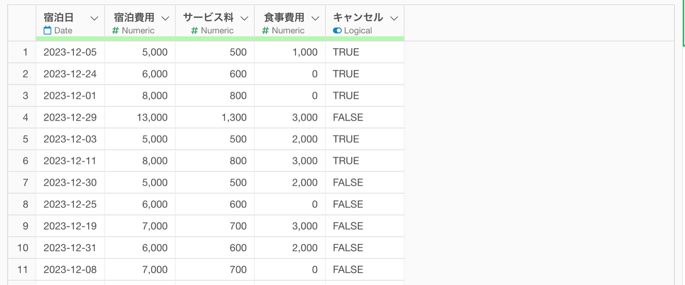

## 1列に条件付き計算を適用する

まず単一の列に対して条件付き計算を適用する方法を説明します。

「宿泊費用」の列のヘッダーメニューから「計算を作成」の「条件付き」を選択します。

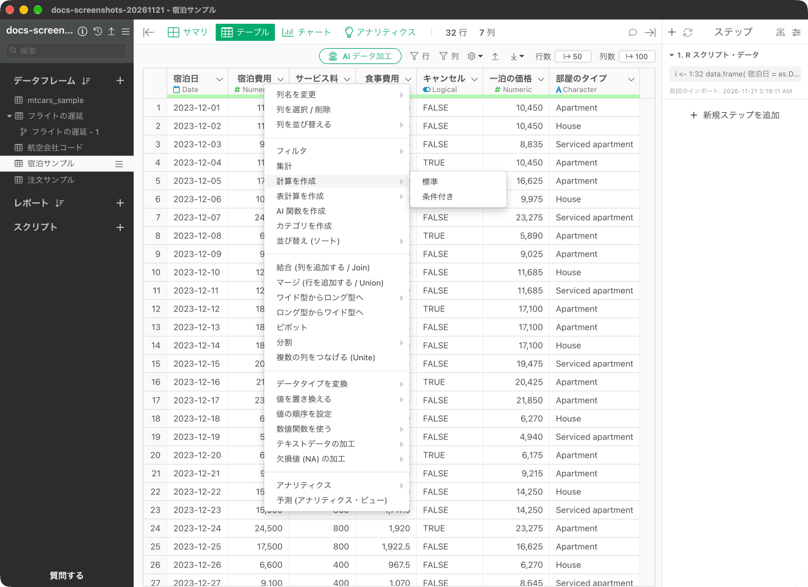

条件付き計算のダイアログが開いたら、「条件の追加」ボタンをクリックし、キャンセル列を選択してキャンセルがTRUEの場合の条件を設定します。

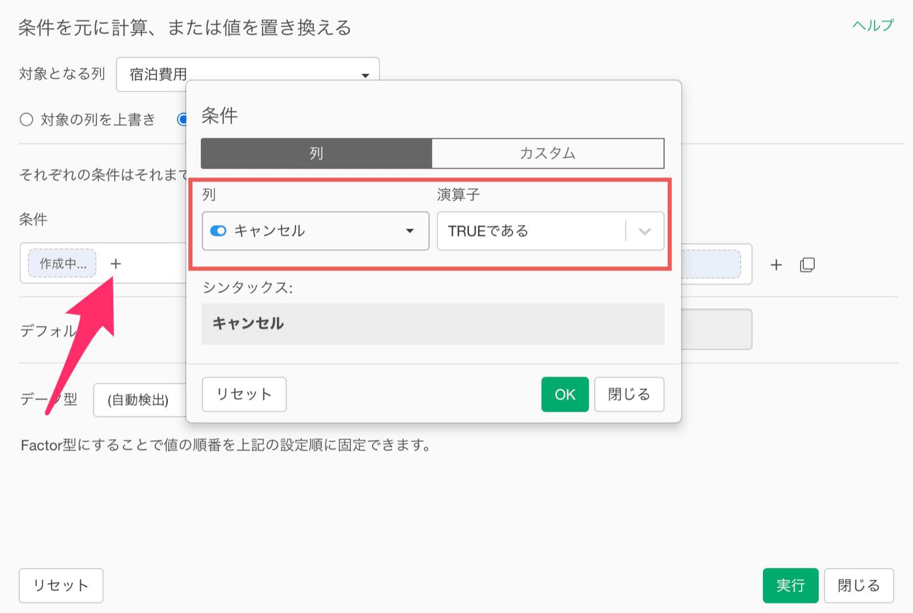

新しい値のタイプに「計算」を選択し、計算式として「宿泊費用 \* 0.8」を入力します。

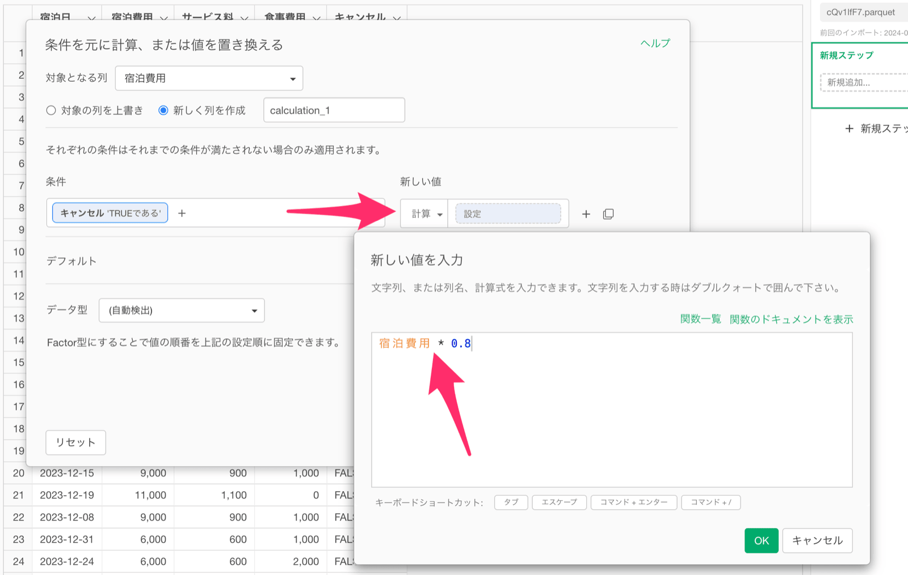

デフォルト値として宿泊費用列を選択します。

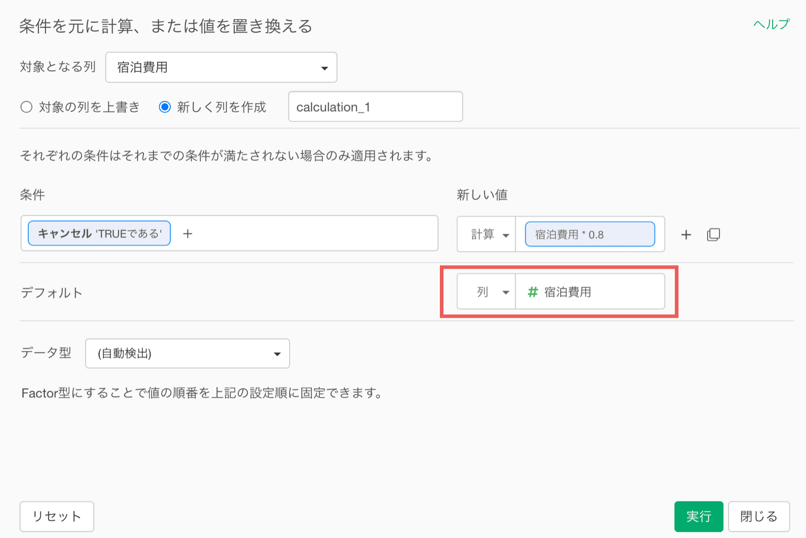

新しい列名を「宿泊費用_キャンセル考慮」として実行ボタンをクリックします。

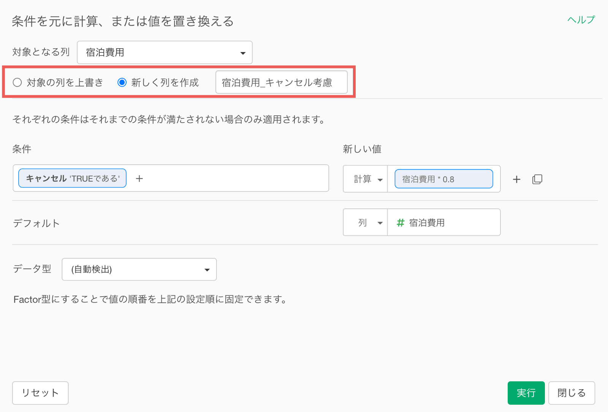

これでキャンセル時は80%の金額、非キャンセル時は通常金額が計算された新しい列が作成できました。

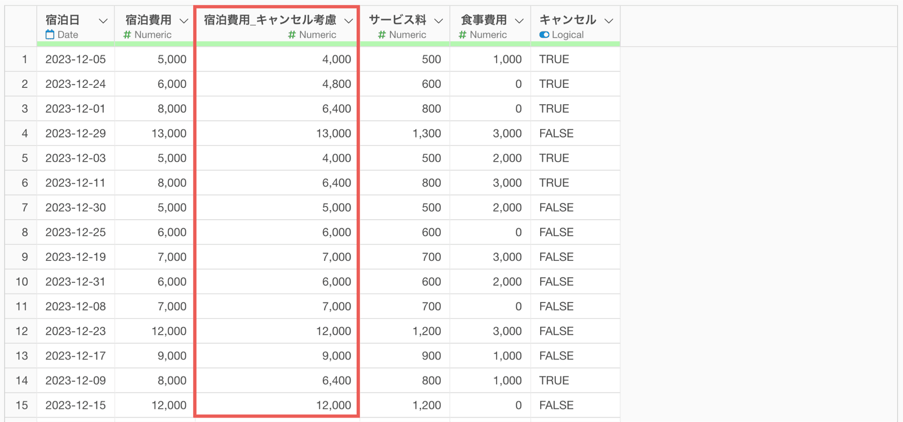

## 複数列に同じ計算を適用する

複数の列に対して同じ条件付き計算を一度に適用する方法を説明します。

宿泊費用、サービス料、食事費用の列をまとめて選び、「計算を作成 - 複数の列」の「条件を指定」を選びます。

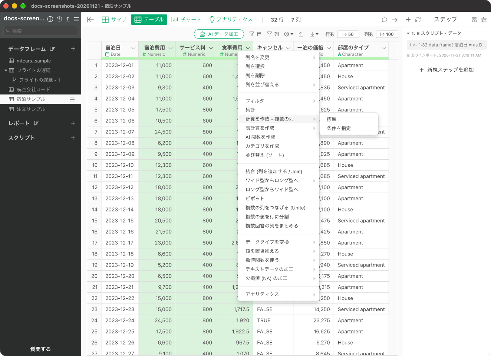

条件付き計算のダイアログが開いたら、対象となる列で複数の列が選択されていることが確認できます。（同じデータ型の列のみ列として選択が可能です）

「条件の追加」ボタンをクリックし、キャンセル列を選択してキャンセルがTRUEの場合の条件を設定します。

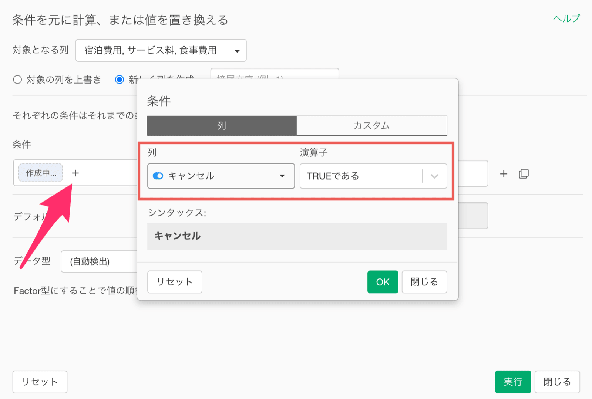

新しい値のタイプに「計算」を選択し、今回の計算式では列名の代わりにドット(.)を使用することで、選択した全ての列に対して同じ計算（. \* 0.8）を適用できます。

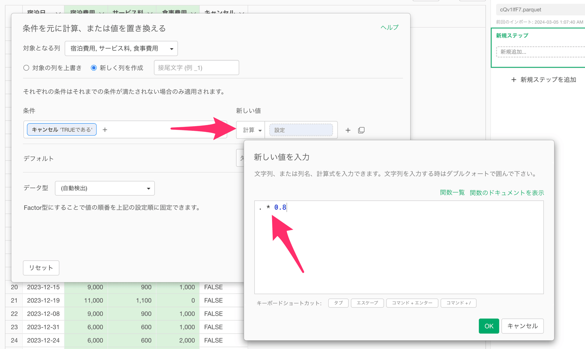

新しい値には計算式 `. * 0.8` を残します。デフォルトのタイプに「列」、値に「(選択された列)」を指定します。

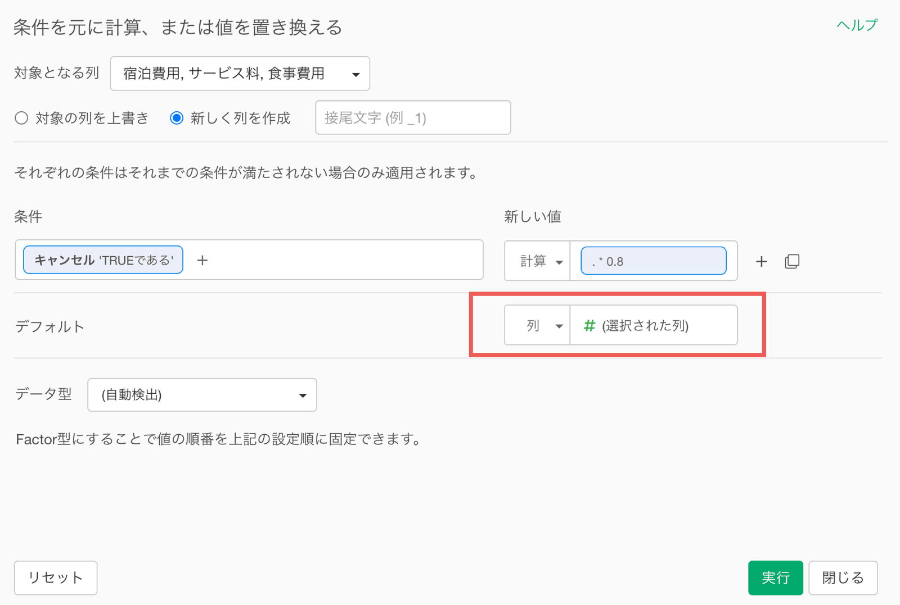

接尾語として「\_キャンセル考慮」を指定して実行ボタンをクリックします。

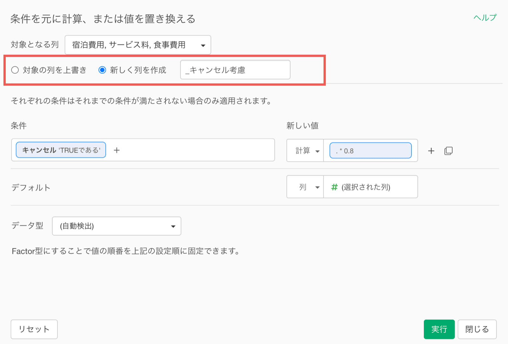

これで選択した全ての列に対して、キャンセル時は80%の金額、非キャンセル時は通常金額が計算された新しい列が作成できました。

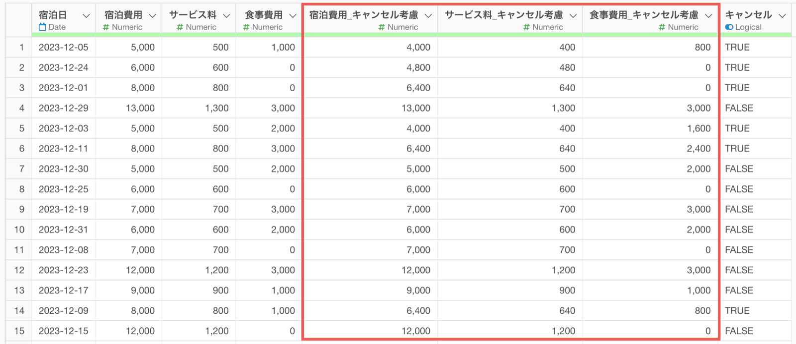
