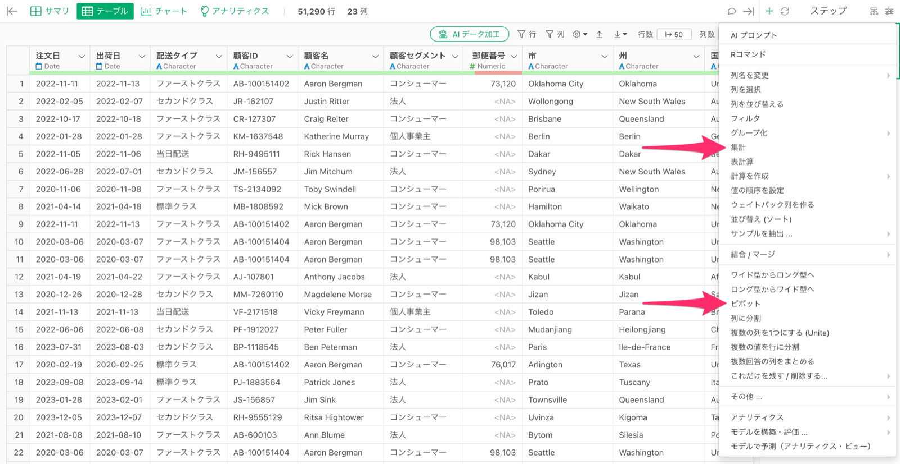
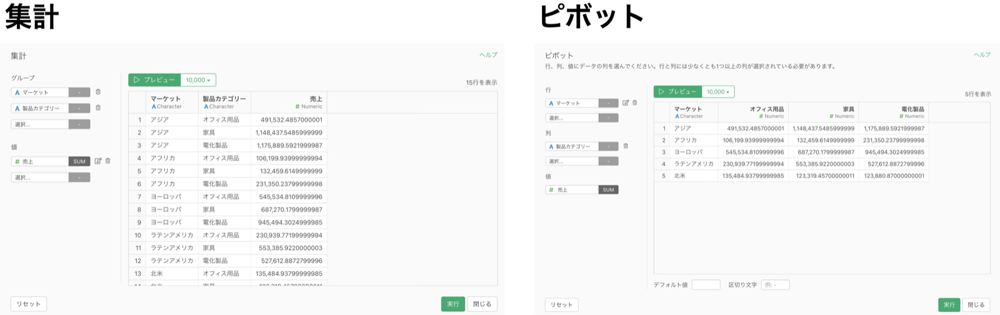
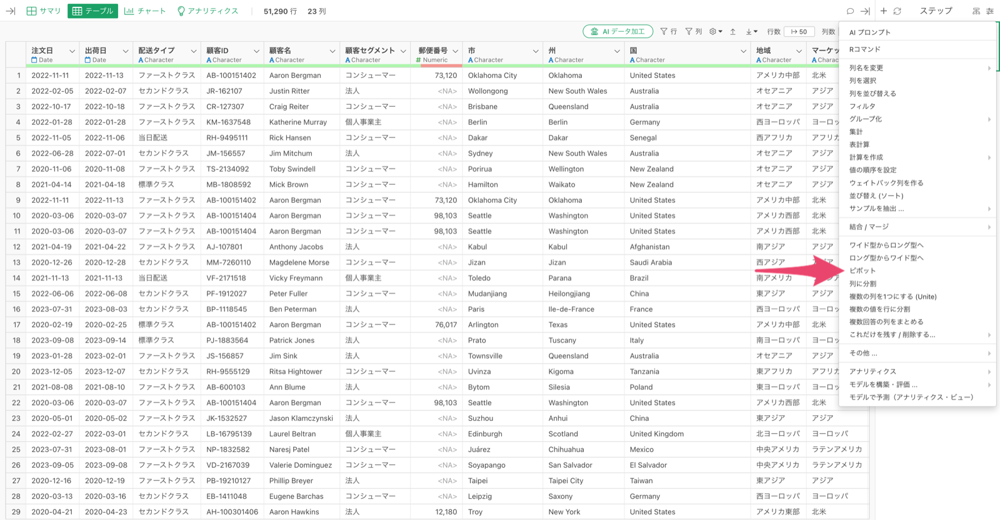
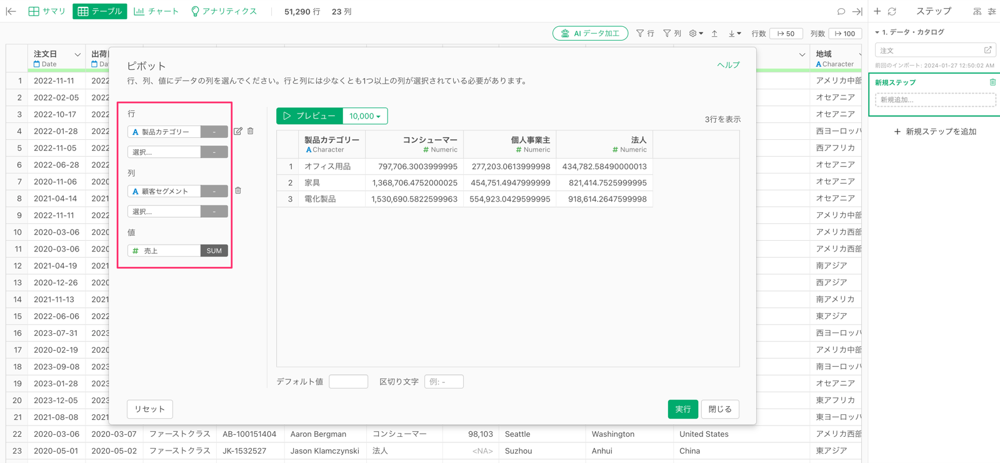
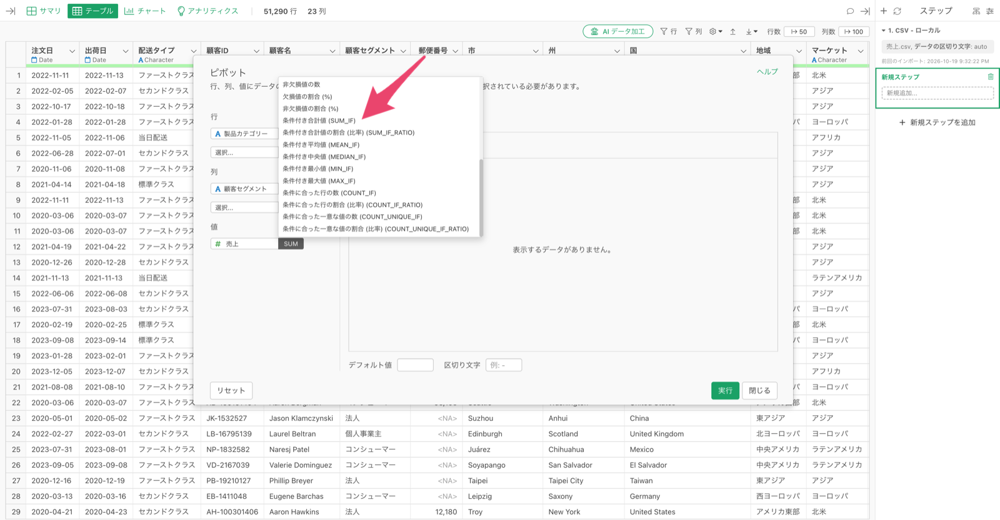
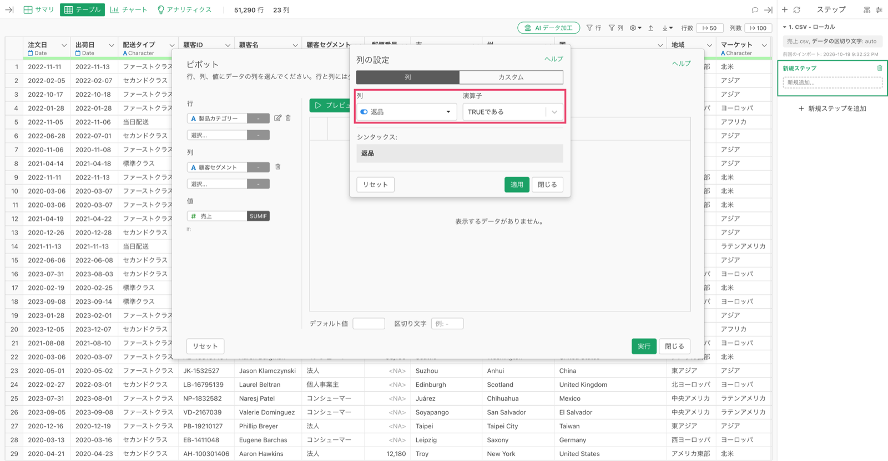
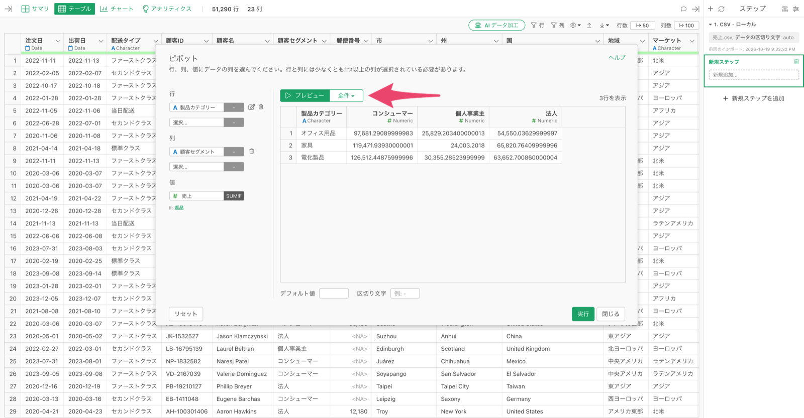
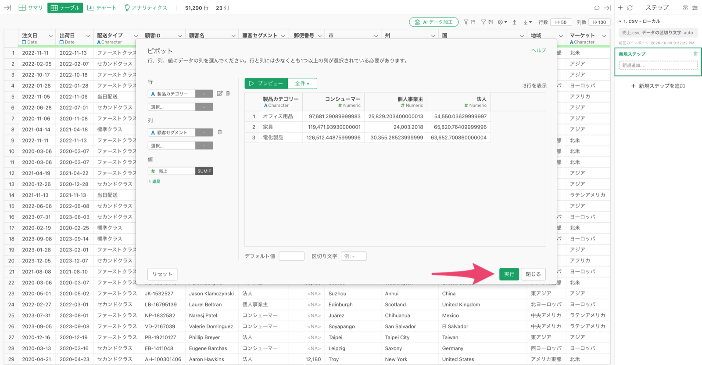
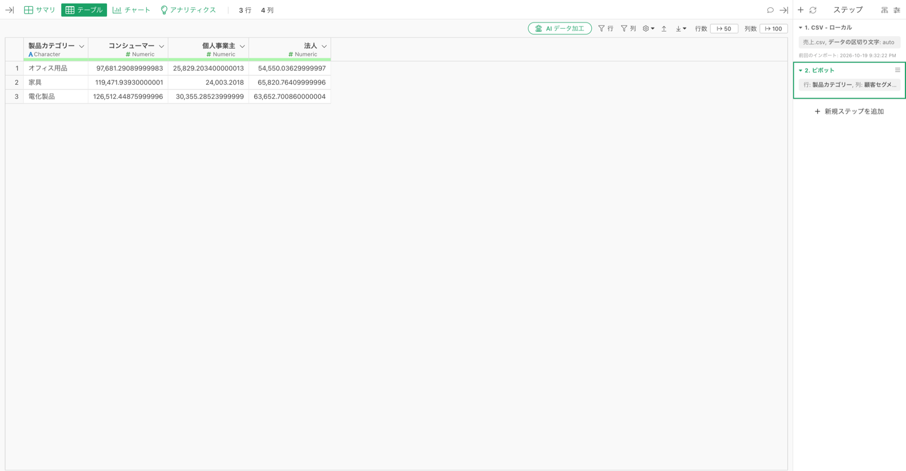
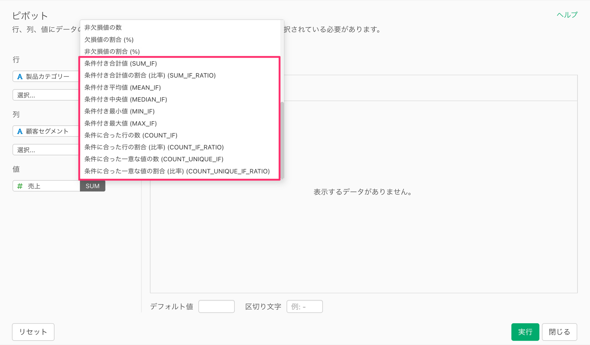

「ピボット」は、行と列に指定した列の組み合わせごとに値を集計して、列に指定した列の値を列見出しとして横に並べた、クロス集計表のデータを作るステップです。

## ピボットと条件付きの集計関数

たとえば、売上のデータがあったときに、製品カテゴリと顧客セグメントのクロス集計表を作りながら、「返品された分だけの売上」のように特定の条件に合致した指標を集計したいことがあります。

Exploratory のデータ加工には、「集計」とは別に「ピボット」というメニューがあります。

「集計」は、グループごとの集計結果を縦に並べた表を作り、「ピボット」は、行と列に指定した列の組み合わせごとに値を集計し、列に指定した列の値を列見出しとして横に並べた、クロス集計表を作ります。

ただ、ピボットのステップでは、これまで値の集計関数に合計や平均などしか選べず、条件に合う行だけを集計できませんでした。

そのため、フィルタのステップで返品の行だけをフィルタしてからピボットするか、「集計」のステップで条件付きの集計をしてから別のステップで横持ちの形に整形するなど、複数のステップを挟む必要がありました。

Exploratory v16.4 から、ピボットのステップの値の集計関数に、条件付きの関数（Excel の SUMIF と同じ考え方の関数）を選べるようになり、条件付きの集計と、横持ち（ワイド型）への展開を、1ステップで済ませられます。

## ピボットで返品された売上を合計する

テーブル・ビューで、ステップメニューの「新規ステップを追加」をクリックし、メニューから「ピボット」を選択します。

「ピボット」のダイアログが開きます。行に「製品カテゴリ」、列に「顧客セグメント」、値に「売上」を選択します。

続いて、値の「売上」の右にある SUM をクリックし、開いたメニューを下へスクロールして「条件付き合計値」を選択します。

すると、「列の設定」のダイアログが開きます。

列に「返品」を選択すると、演算子が自動で「TRUEである」になり、返品が TRUE の行だけが合計の対象になるので、「適用」をクリックします。

プレビューは、初期設定では 10,000 行のサンプルで計算されます。

全件の数字を確かめるため、「プレビュー」の隣のサンプルサイズ（10,000）を「全件」にしてから「プレビュー」をクリックすると、返品された売上だけを合計した表がプレビューに表示されます。

最後に「実行」をクリックします。

すると、ピボットのステップが追加され、製品カテゴリを行、顧客セグメントを列にしたデータフレームができます。

これで、フィルタや整形のステップを挟まずに、返品された売上だけのクロス集計表をピボット1ステップで作成できました。

## ピボットで使える条件付きの関数

値の集計関数のメニューには、「条件付き合計値」のほかにも条件付きの関数が並んでいます。

関数はメニューに表示される順に、次のとおりです。

- 条件付き合計値 (SUM_IF): 条件に合う行だけの値の合計
- 条件付き合計値の割合 (比率) (SUM_IF_RATIO): 条件に合う行の合計が、そのセルの合計に占める割合（0〜1）。例: 売上のうち返品された売上の割合。数値の列で使えます
- 条件付き平均値 (MEAN_IF)・条件付き中央値 (MEDIAN_IF)・条件付き最小値 (MIN_IF)・条件付き最大値 (MAX_IF): 条件に合う行だけの平均値・中央値・最小値・最大値
- 条件に合った行の数 (COUNT_IF): 条件に合う行の数（値の列の中身は使いません）
- 条件に合った行の割合 (比率) (COUNT_IF_RATIO): 条件に合う行の数が、そのセルの行数に占める割合（0〜1）。例: 注文のうち返品された件数の割合
- 条件に合った一意な値の数 (COUNT_UNIQUE_IF): 条件に合う行の、値の列の一意な値の数。例: 値を顧客名にすると、返品したことのある顧客の数
- 条件に合った一意な値の割合 (比率) (COUNT_UNIQUE_IF_RATIO): 上の数が、そのセルの一意な値の数に占める割合（0〜1）。例: 顧客のうち返品したことのある顧客の割合。文字列の列でも使えます

## こういうときに役立ちます

**一般ビジネス（売上）:**

製品カテゴリや顧客セグメントごとの、返品された売上だけの合計を、横持ちの表にまとめられます。この機能がなければ、フィルタと整形のステップを重ねることになります。

**アンケート調査:**

たとえば年代ごと・性別ごとに、総合満足度で「5」と答えた回答者の割合を、「条件に合った行の割合」で横持ちの表にまとめられます。

**IR（大学の教学データの分析）:**

たとえば学部ごと・学年ごとに、在籍状況が「休学」の学生の数をまとめたデータフレームを作れます。結果はステップとして残るので、学生数のデータとの結合などの後続の加工にそのまま続けられます。

**人事:**

たとえば部署ごと・職位ごとに、雇用形態が「契約社員」の従業員の数を横持ちの表にまとめられます。
