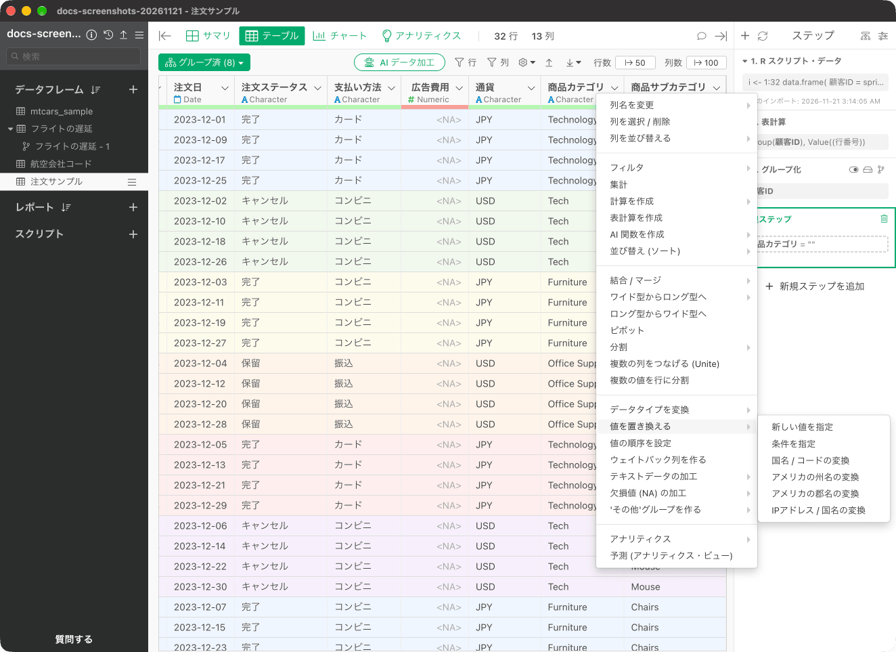
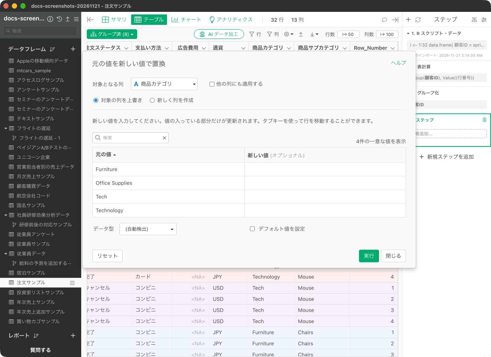
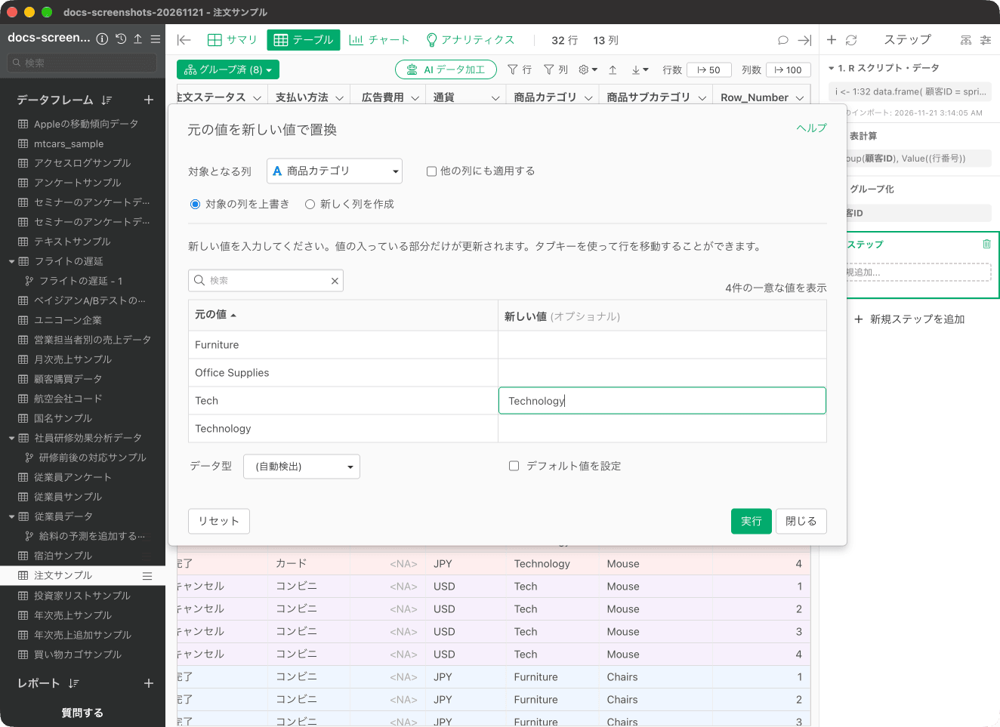
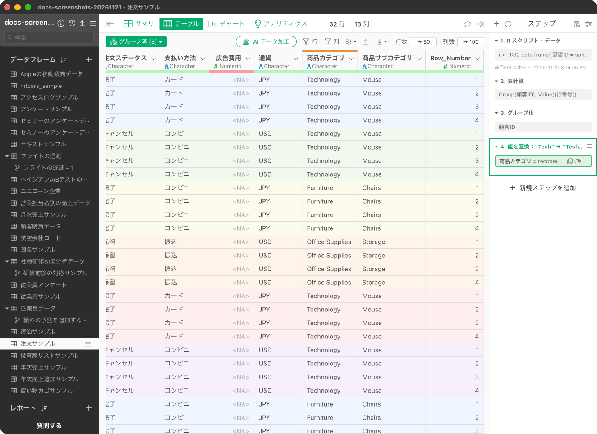
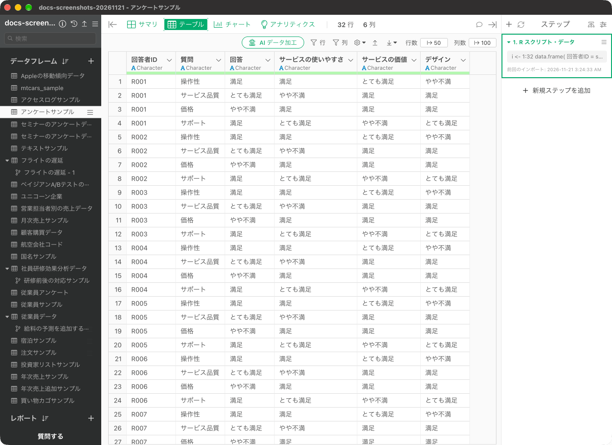
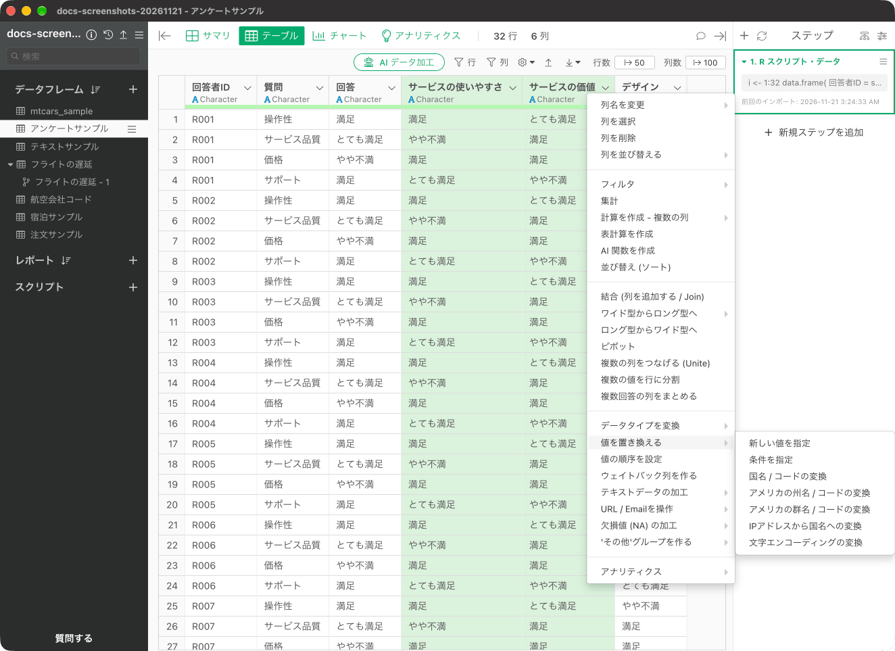
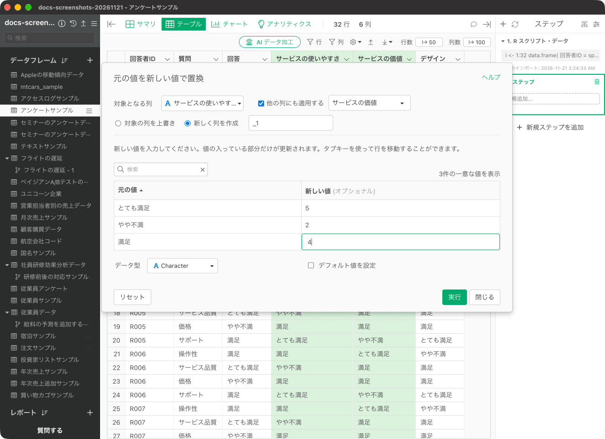
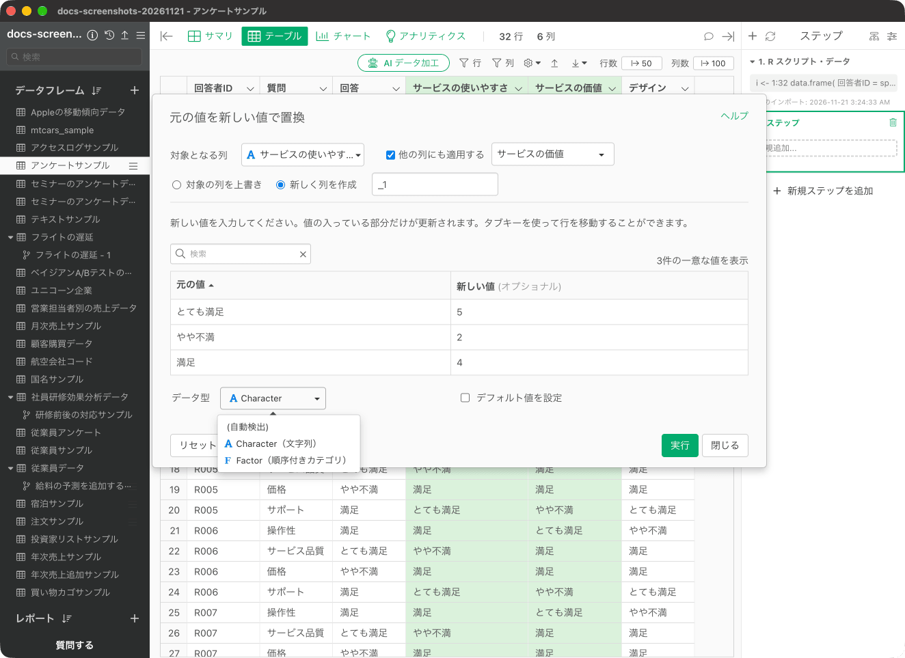
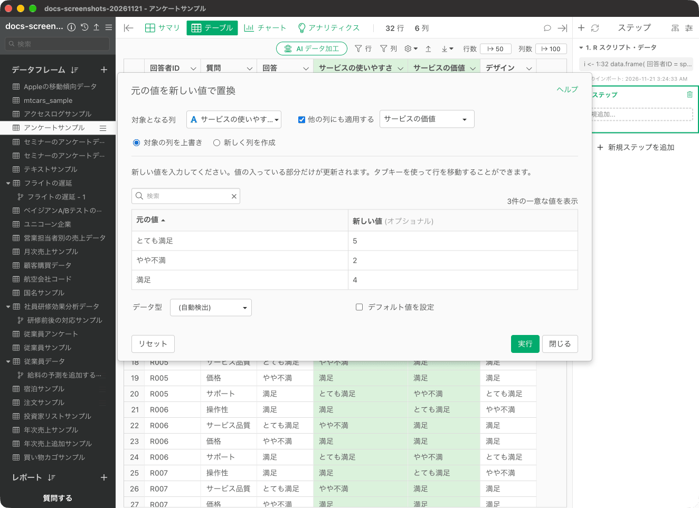
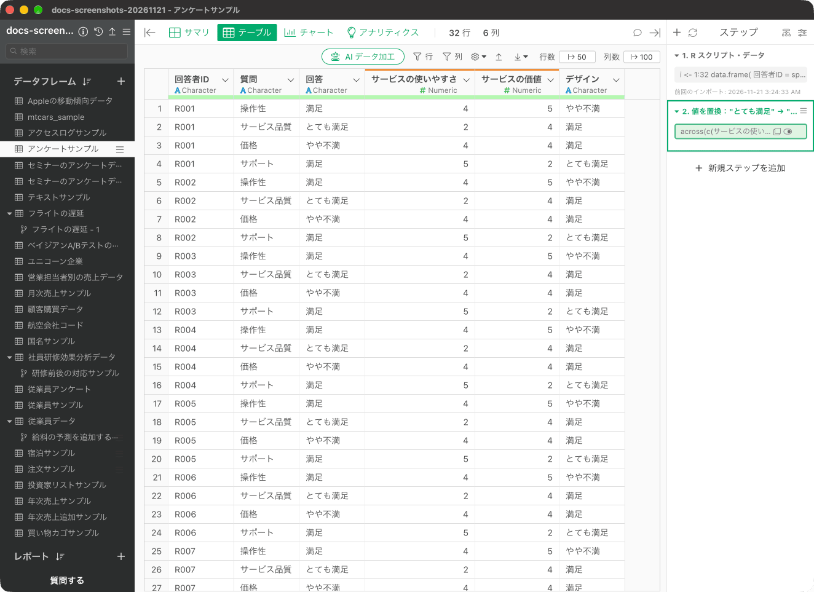

「元の値を新しい値で置換」は、列の中の値を別の値に置き換える機能です。表記が混在している値を統一するときなどに使います。列ヘッダメニューの「値を置き換える」から「新しい値を指定」を選びます。

## 表記の揺れを統一する

例えば、注文データの「商品カテゴリ」列には、「Furniture」「Office Supplies」「Tech」「Technology」の4種類の値があります。このうち「Tech」と「Technology」は同じ意味を表しているため、「Technology」に統一したいです。

「商品カテゴリ」列のヘッダメニューから「値を置き換える」の「新しい値を指定」を選択します。

「元の値を新しい値で置換」のダイアログが表示されます。「元の値」には、列にある4種類の値が並びます。初期状態では「対象の列を上書き」が選ばれ、データ型は「(自動検出)」です。

元の値「Tech」の「新しい値」に「Technology」を入力して実行します。

実行すると「値を置換」ステップが追加され、「商品カテゴリ」の「Tech」が「Technology」に置き換わります。

## 複数の列で値をいっぺんに置換する

例えば、次のアンケートデータでは、「サービスの使いやすさ」「サービスの価値」「デザイン」の列に「とても満足」「満足」「やや不満」といった回答が文字列で入っています。

しかし、回答ごとの平均値や相関を見るなど、分析を進めるには数値型にする必要があります。そこで、次のように数値へ置き換えます。この例では「サービスの使いやすさ」と「サービスの価値」の2列を対象にします。

- とても満足: 5
- 満足: 4
- やや不満: 2

複数の列で一気に値を置換したい場合は、Shiftキーを押しながら複数列選択し、列ヘッダメニューから「値を置き換える」の「新しい値を指定」を選択します。

「元の値を新しい値で置換」のダイアログが表示されます。「他の列にも適用する」にチェックが入り、選んだ2列が対象になっています。値ごとに、対応する数値を新しい値に入力します。初期状態では「新しく列を作成」が選ばれ、列名の接尾辞は「_1」です。

データ型は初期状態では「Character（文字列）」です。「データ型」を開くと「(自動検出)」「Character（文字列）」「Factor（順序付きカテゴリ）」から選べます。「(自動検出)」を選ぶと、新しい値に合わせてデータ型が変換されます。今回は新しい値が数値だけなので、数値型になります。

もとの列を上書きしたいため、「対象の列を上書き」を選んで実行します。

これにより、2つの列の回答が文字列から数値に置き換わり、列のデータ型も Numeric になりました。

