「ロング型からワイド型へ」は、キー列と値の列に縦に並んでいるデータを、キーごとに列を持つ横長のデータに変換する機能です。アンケートの質問ごとの列を作って、質問どうしの関係を分析したいときなどに使います。

## データの持ち方 - ワイド型とロング型

以下のデータがあったとします。日や月ごとに列が存在しています。

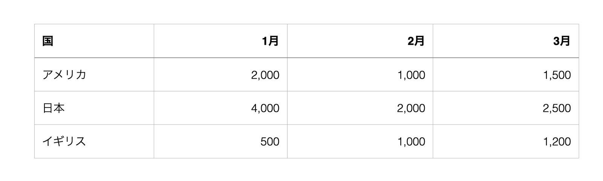

このようなデータの形式は、データが増えていくと、横方向に伸びる（列が増える）データとなっているため、「ワイド型」と呼ばれています。

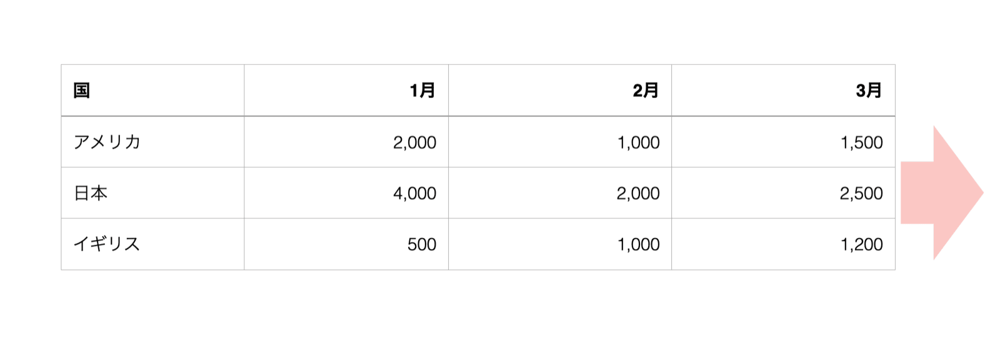

一方で、下記のように月ごと、国ごとに行が分かれているデータがあります。

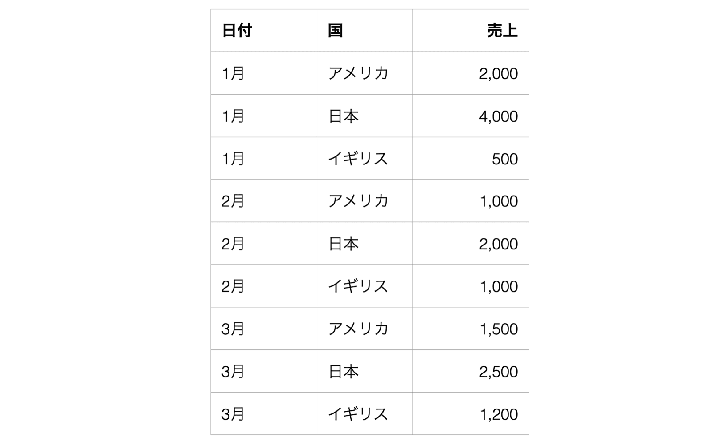

このようなデータの形式は、データが増えていくと、縦方向に伸びる（行が増える）データとなっているため、「ロング型」と呼ばれています。

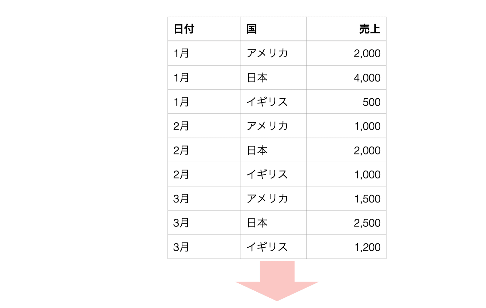

一般的に、アナリティクスを使った分析には、1行が観察対象（顧客、従業員、商品、など）となっているワイド型データが適しており、集計・可視化には、カテゴリと値がそれぞれの列にまとまっているロング型データが適しています。

データ分析をするときは、出したいアウトプットに応じたデータの持ち方に変換をしていく必要があります。

## ロング型のデータをワイド型に変換する

今回は「顧客満足度調査データ」を使用します。

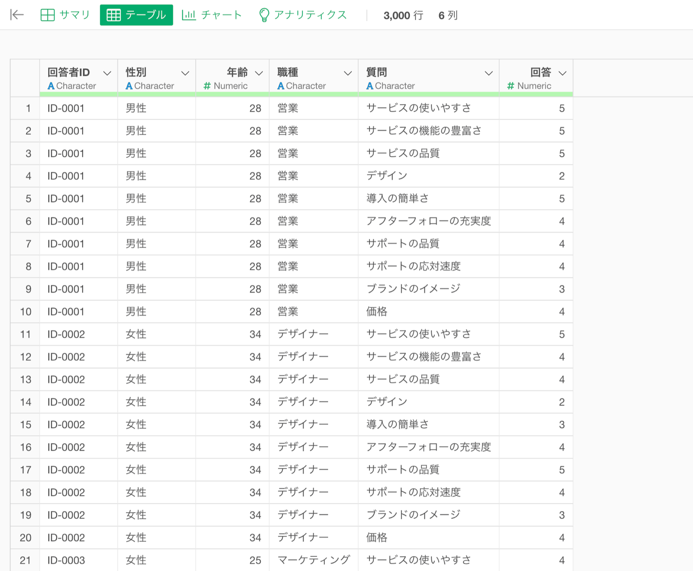

回答者、アンケートの質問ごとに行があるロング型のデータとなっています。

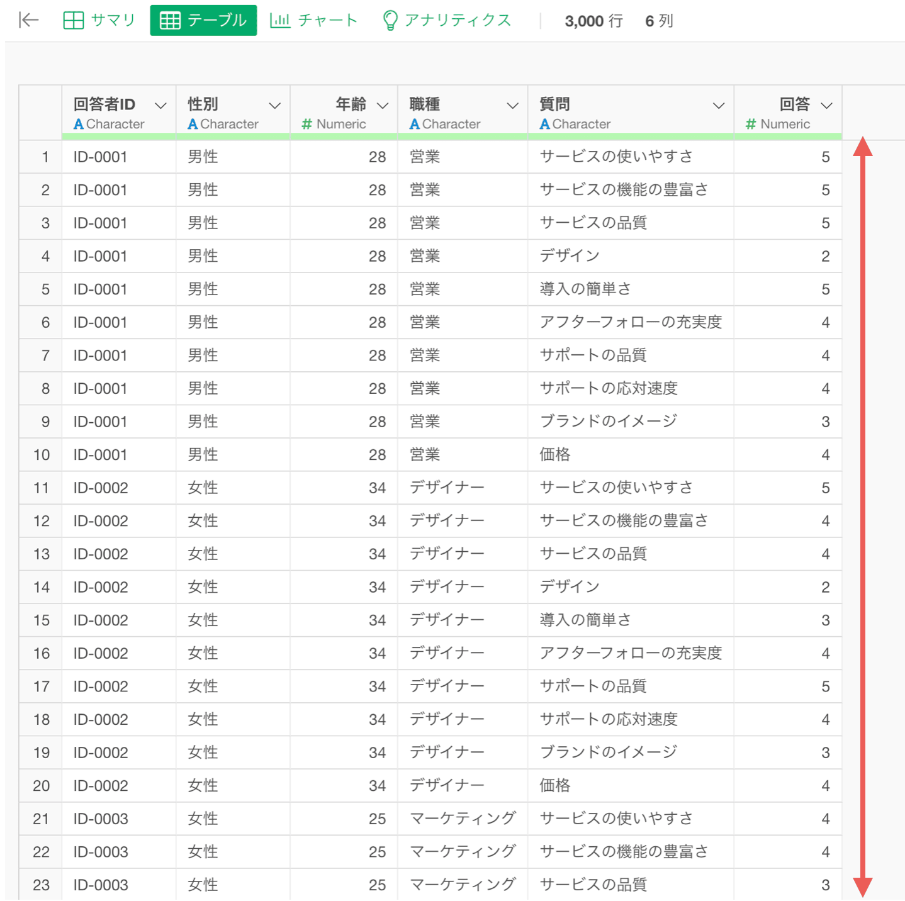

ロング型のデータでは、質問ごとの回答の平均値などの可視化はしやすいです。

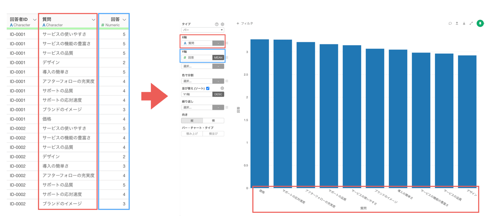

一方で、質問どうしの関係性を可視化したい時、分析したい時には質問ごとに列が分かれていなければいけません。

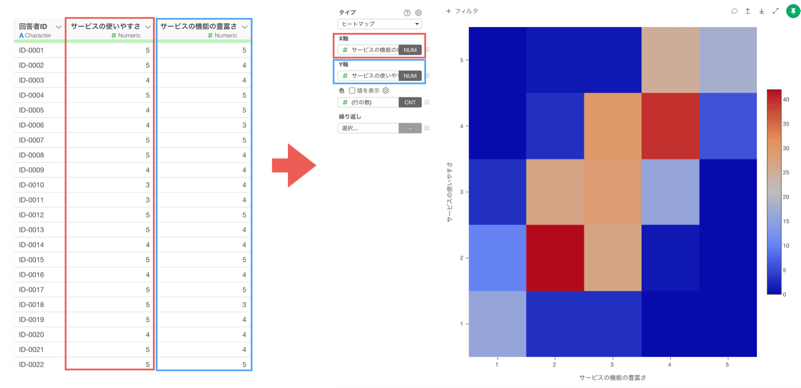

そのため、データをロング型からワイド型へ変換していきましょう。

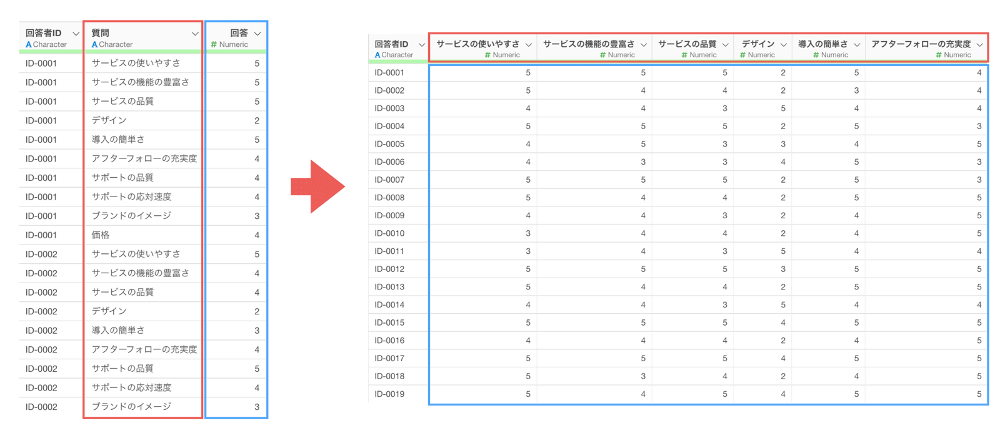

質問と回答の列をシフトキーを使って複数選び、「ロング型からワイド型へ」を選択します。

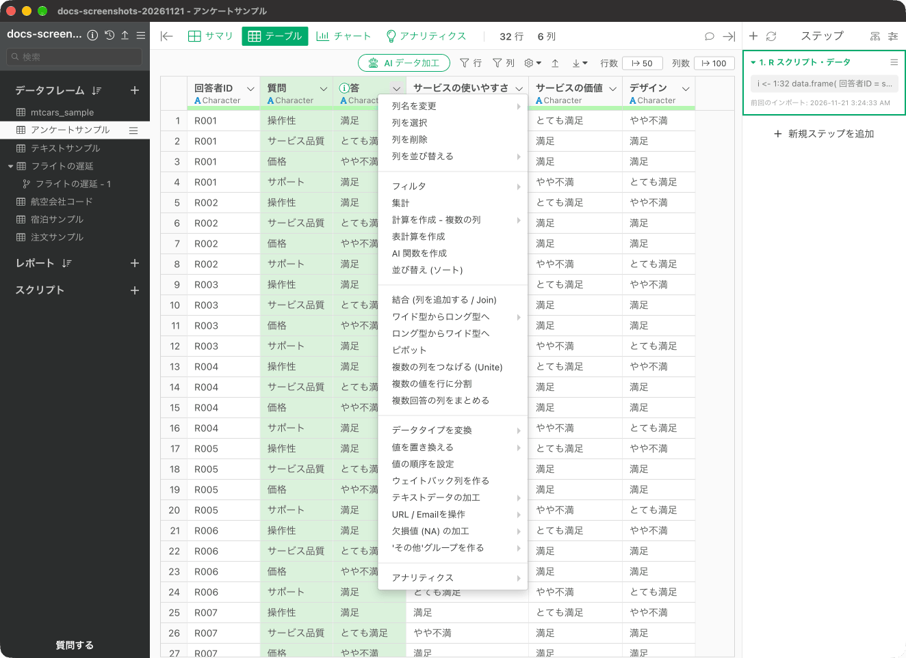

「ロング型からワイド型」へのダイアログが表示されます。

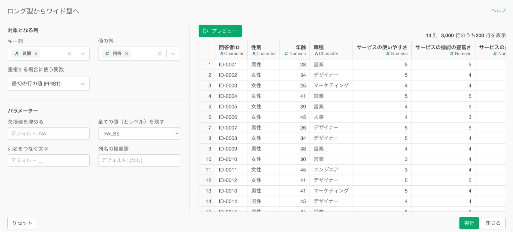

キー列には「質問」、値の列には「回答」が選択されていることがわかります。

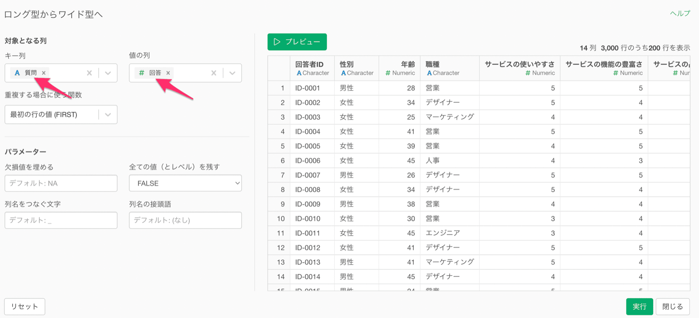

プレビューをした時に結果に問題がなければ、実行ボタンをクリックします。

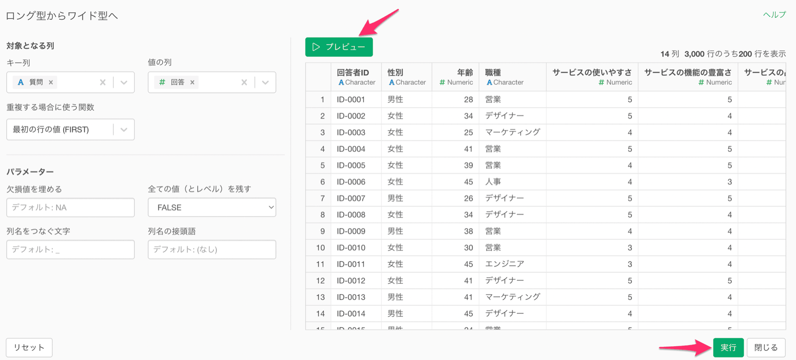

ロング型からワイド型へ変換でき、アンケートの質問ごとに列を持つことができました。

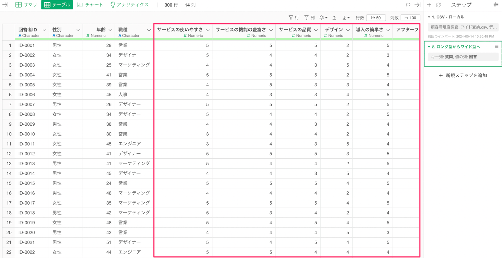

例えば、それぞれの質問の列の相関を一気に見たい場合は、アナリティクスビューにある「相関」が使えます。変数には、質問ごとにある列を選択します。

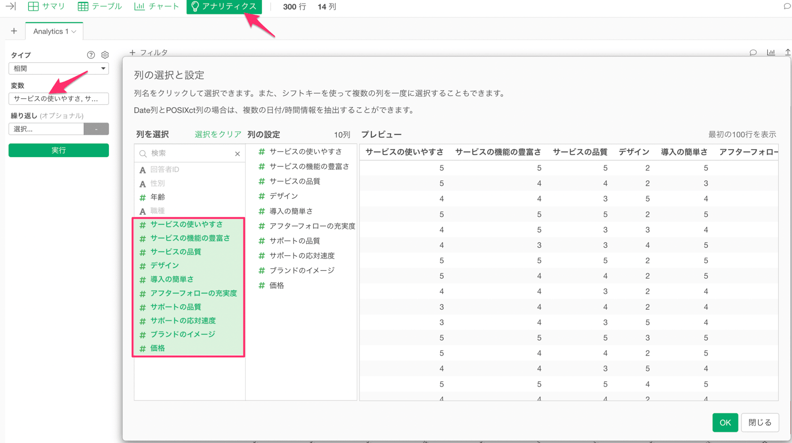

これによって、それぞれの質問どうしの相関係数を一気に確認できます。

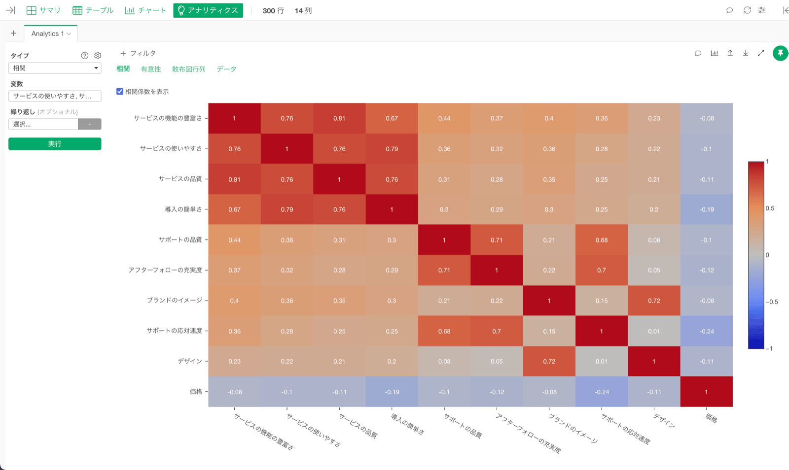
