「集計」は、データラングリングのステップとして、データ自体をグループごとに集計する機能です。1行が1注文のデータを、1行が1顧客のデータに集計する、といった使い方ができます。集計結果に対して、さらにデータの加工や計算を行えます。

## 顧客ごとに集計する

今回はデータラングリングとして、データ自体を集計していきましょう。

使用するデータは1行が1注文のデータで、列には「顧客ID」や「注文日」、「売上」などが存在しています。

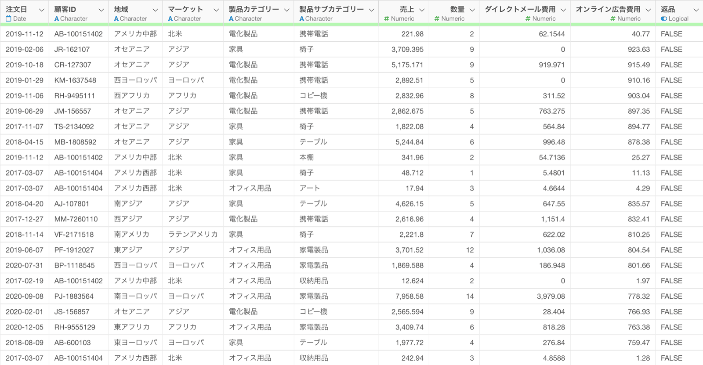

このデータを使って顧客ごとに「売上」、「注文回数」などを集計したデータを作りたいです。

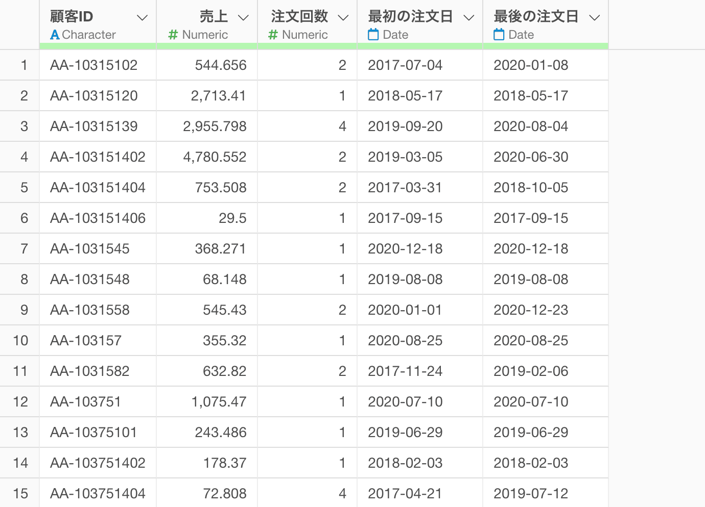

顧客IDの列ヘッダメニューから「集計」を選択します。

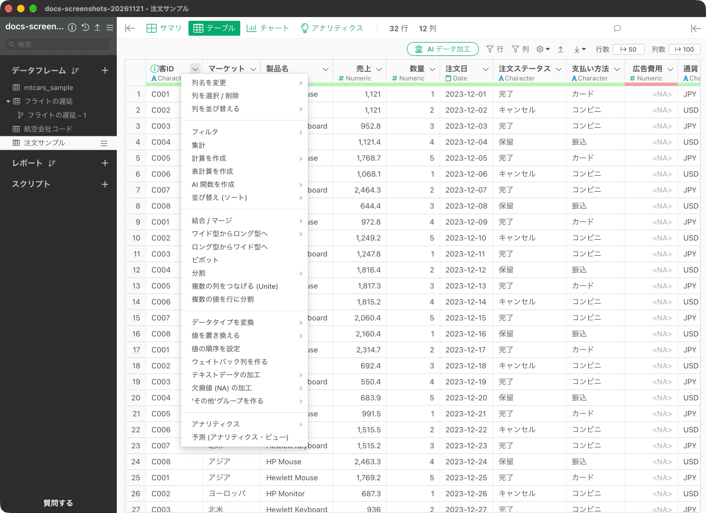

集計のダイアログが表示され、グループには「顧客ID」の列が割り当てられています。さらに、値には行の数がデフォルトで指定されているため、顧客IDごとの行数が求められています。

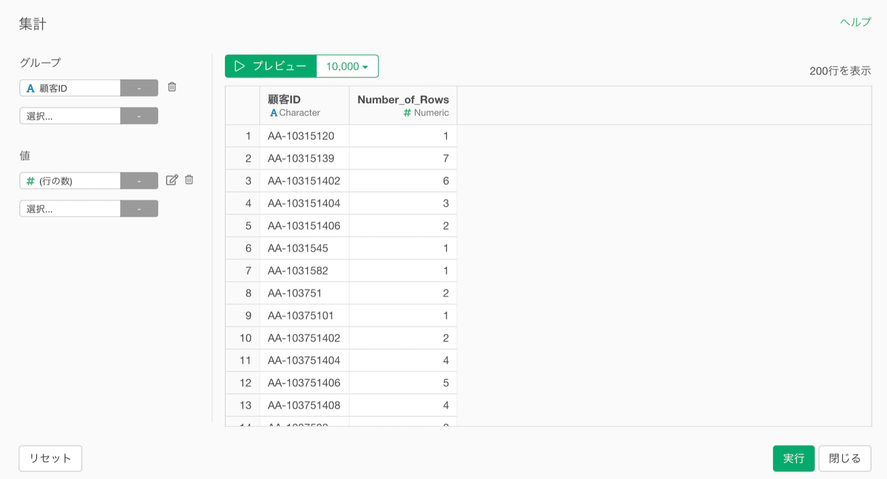

まず初めに、「売上の合計値」を求めていきたいです。

値には「売上」を選択し、集計関数には「合計値 (SUM)」を選択します。

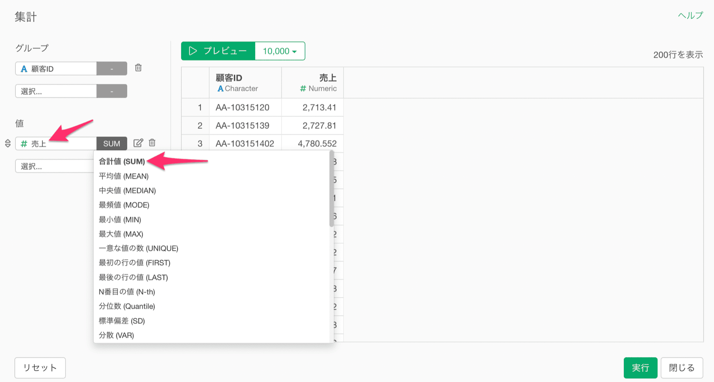

プレビューをクリックすることで、顧客ごとに売上の合計値を集計できていることが確認できます。

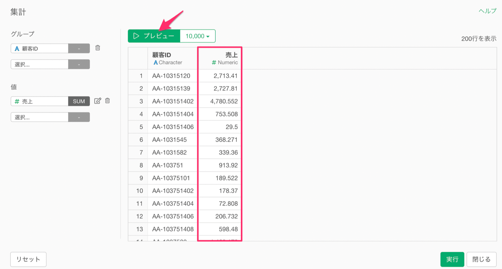

次は、注文した日数を求めていきましょう。

注文した日数を求めるために今回は、値に「注文日」を選択して、集計関数には「一意な値の数 (UNIQUE)」を選択します。

これによって、同じ日複数の製品による注文があって行が分かれていたとしても同日の注文として扱い、異なる日の注文が何件だったかを数えられるようになります。

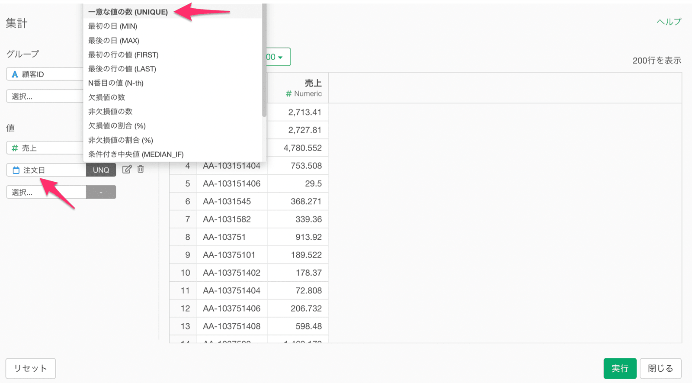

顧客ごとに「最初の注文日」と「最後の注文日」を求めていきたいです。

値に注文日の列を割り当て、集計関数には「最初の日 (MIN)」を選択します。これによって最初の注文日が求められます。

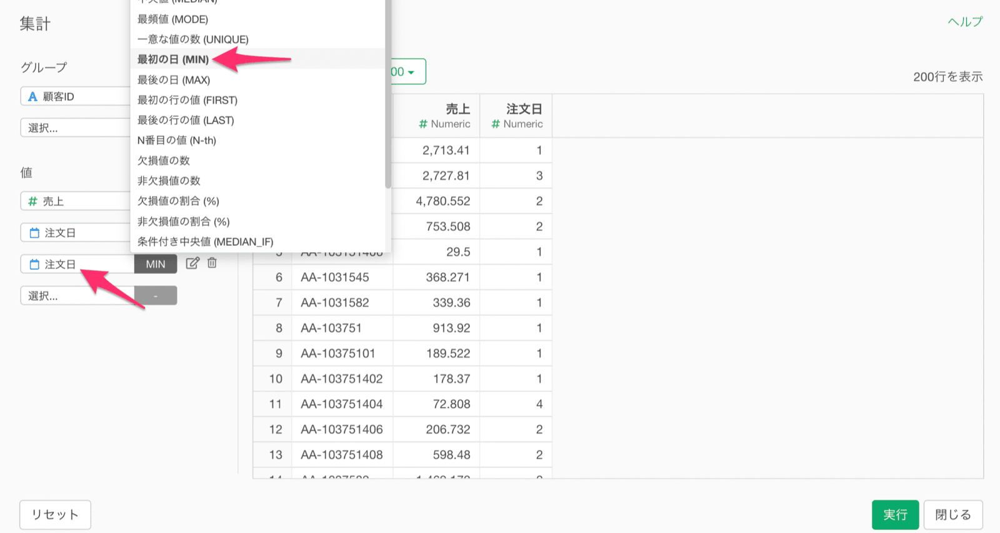

最後の注文日を求めたい場合も同様で、値に注文日の列を割り当て、集計関数には「最後の日 (MAX)」を選択します。

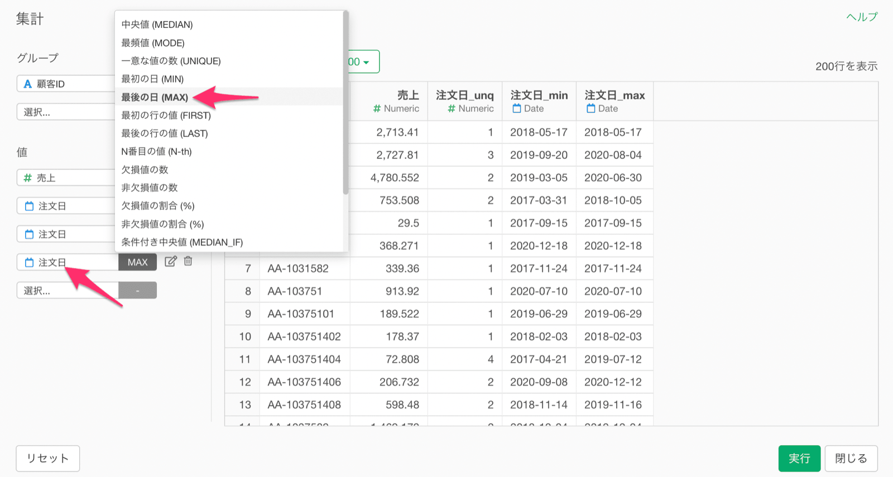

これで集計したい値を全て設定できました。プレビューを押すことで、顧客ごとに売上、注文回数、最初と最後の注文日が集計されていることがわかります。

一方で、「注文日_unq」や「注文日_min」のように列名がわかりづらくなっています。

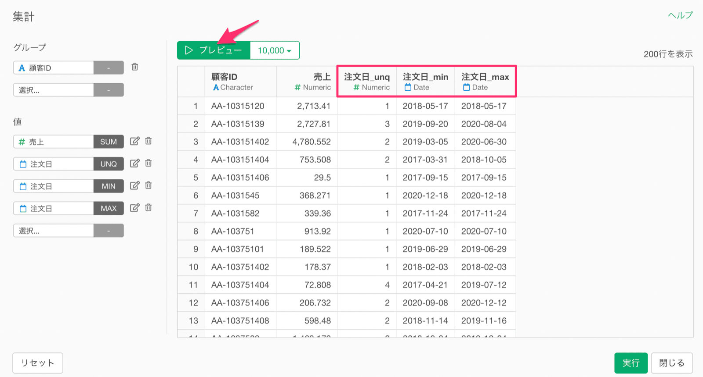

そういった時には、値の「編集」ボタンをクリックします。

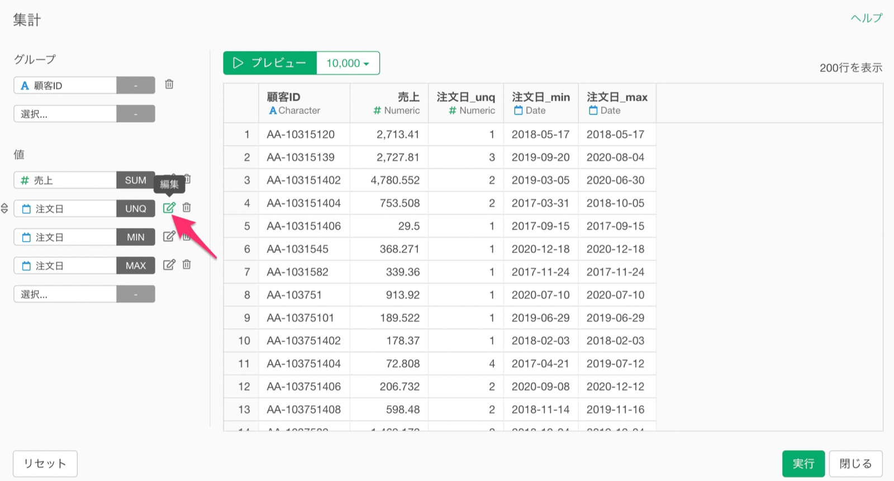

これによって新しい列名を集計のダイアログの中で変更していくことが可能です。

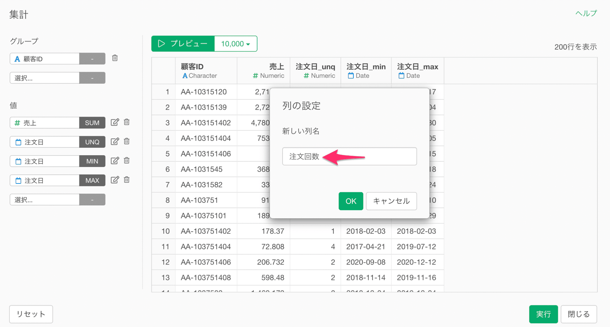

プレビューを押すことで、列名が変わっていることが確認できます。

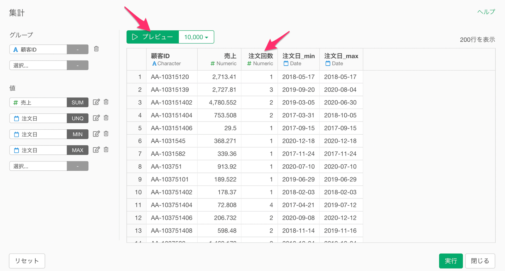

最終的には、列名を以下のように変更をしていきましょう。

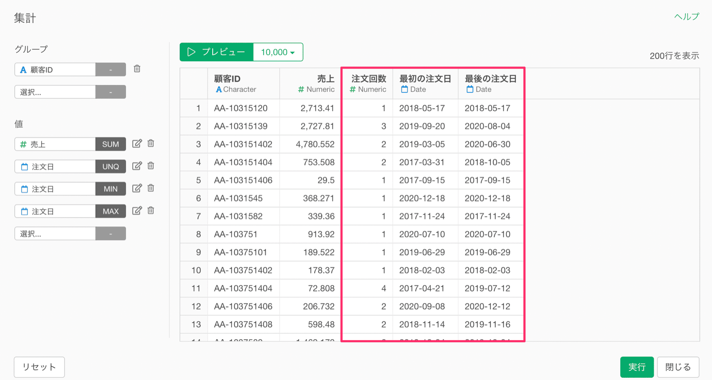

実行することで、1行が1注文のようなデータから、1行が1顧客のデータに集計できました。

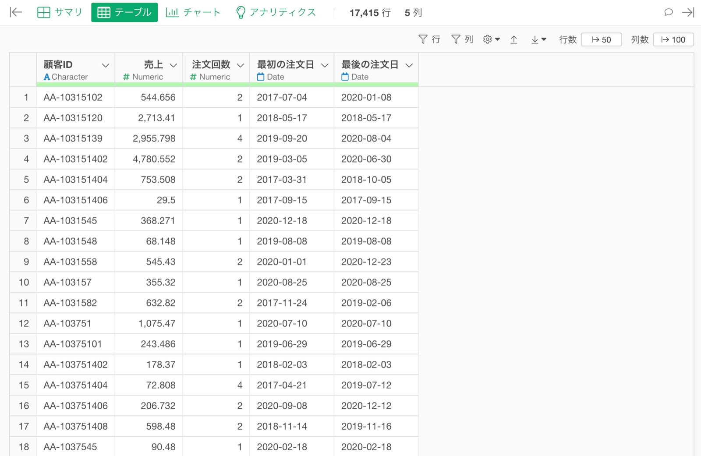

データとして集計をすることで、例えば注文回数の列の「i」のボタンをクリックすると、注文回数の分布やサマリ情報を確認できます。

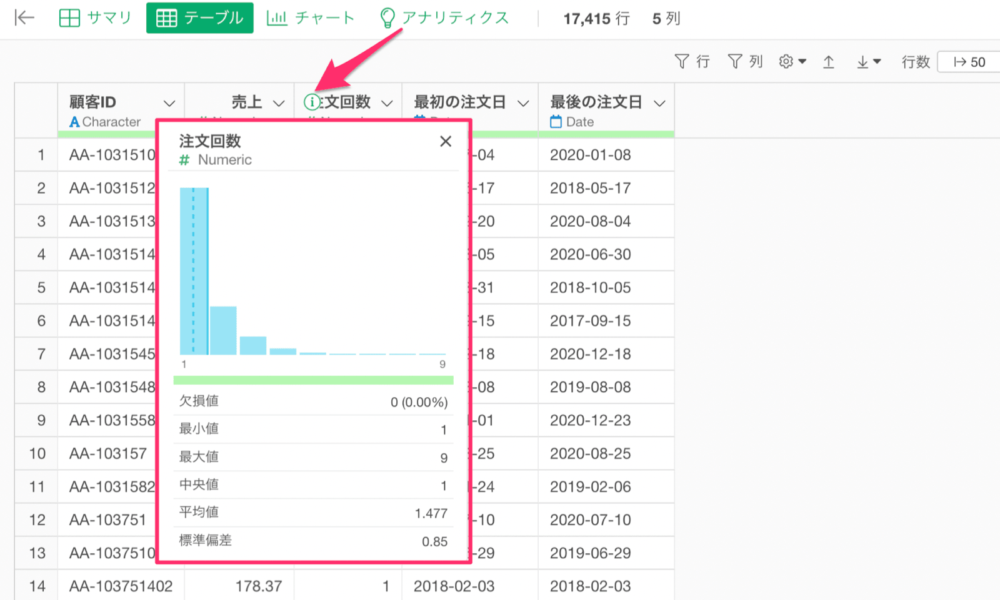

「最後の注文日」と「最初の注文日」の差を計算すると、顧客ごとの購買期間（日数）も求められます。

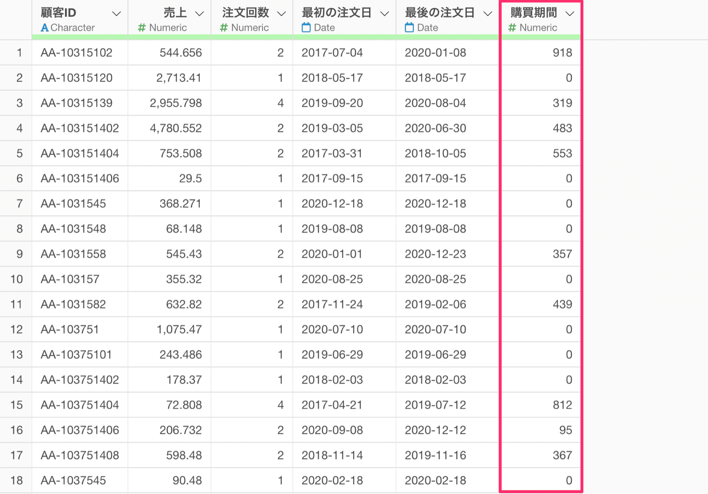

このように、データ自体を集計したことによって、その後にさらにデータラングリングをして新たな指標を作っていくこともできます。

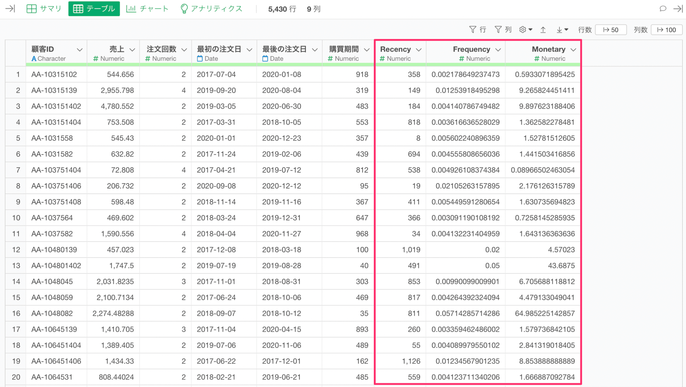
