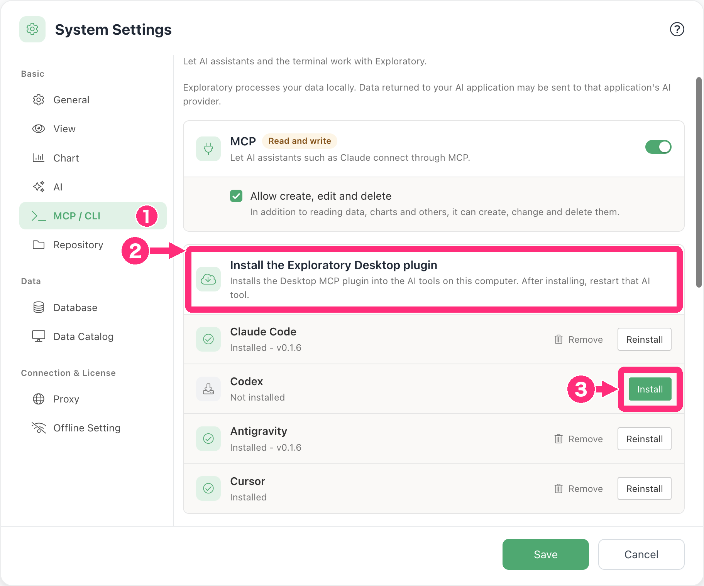
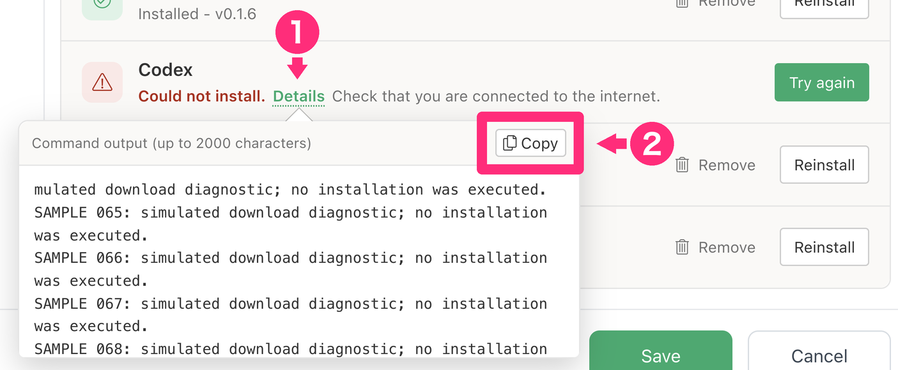

# Install the plugin

After you install it, an AI tool can use Exploratory Desktop. In Exploratory Desktop, System Settings installs the Desktop MCP plugin into the AI tools on this computer.
It takes about 5 minutes. You need Exploratory Desktop and the AI tool you want to install into (Claude Code, Codex, Antigravity or Cursor) on the same computer.

There is no separate procedure for each AI tool: Claude Code, Codex, Antigravity and Cursor all install from the same card.

<a id="steps"></a>

## Install

### Install from System Settings

In Exploratory Desktop, open System Settings.

1. In the menu on the left, choose MCP / CLI.
2. Check the "Install the Exploratory Desktop plugin" card.
3. Choose Install on the row of the AI tool you use.



The card says:

> Installs the Desktop MCP plugin into the AI tools on this computer. After installing, restart that AI tool.

The card lists Claude Code, Codex, Antigravity and Cursor. An AI tool that is not on this computer shows Not found on this computer. The command is added automatically when the app starts, so there is no step to register it.

Next, on the same screen, do this.

4. Turn on the MCP switch. It is off by default.
5. Only when you want the AI to create or change charts, notes and other content, check Allow create, edit and delete. Without it, the AI can only read.
6. Choose Save at the bottom of the screen.

If you do not save, the MCP switch and the Allow create, edit and delete setting do not take effect.

### Check it in the AI tool

1. When the install ends, restart that AI tool.
2. The first time an AI tool connects, Desktop asks whether to allow it. Allow only an app you started yourself.
3. In Exploratory Desktop, open the project you want to use.
4. In the AI tool, ask this.

   ```text
   List the data frames in my open Exploratory project.
   ```

   This works with the read-only setting too. To try creating something, turn on Allow create, edit and delete and save, then ask for a chart instead, such as a bar chart of a column of your own data.

5. Check the connection.
   - In Claude Code, open `/mcp` and check that exploratory-desktop is connected.
   - In Codex, run `codex mcp list` and check that exploratory-desktop is listed.

If a call says that MCP is turned off, go back to System Settings and check that you turned the MCP switch on and chose Save.

<a id="differences"></a>

## Differences between AI tools

The card works the same way, but what it installs differs a little.

| AI tool | What the card installs | What the card shows |
| --- | --- | --- |
| Claude Code | The Exploratory Desktop plugin (with its skills) | Installed - v and the plugin version; Reinstall and Remove take the place of Install |
| Codex | Same | Same |
| Antigravity | Same | Same |
| Cursor | Only adds exploratory-mcp to ~/.cursor/mcp.json. No skills are installed | Installed, without a version. The buttons are Reinstall and Remove |

Restart the AI tool after installing, whichever one it is.

The buttons on the card change with its state.

| State | What the card shows |
| --- | --- |
| Not installed | Not installed, and a green Install button |
| Installed | Installed, with Reinstall and Remove |

Choosing Remove opens a confirmation.

<a id="failure"></a>

## When the install fails

When an install fails, the second line of that AI tool's row shows "Could not install." in red. Details is right after it, then a sentence that gives the reason (for example "Check that you are connected to the internet."), and a Try again button at the right of the row. When updating an installed plugin fails, a Remove button also appears to its right.

Hold the mouse pointer over Details to see the output of the command that ran, in a pop-up. The output is the last 2000 characters. If it is long, you can scroll inside the pop-up vertically. The pop-up stays when you move the pointer into it. Click Details to keep it open. Copy at the top right copies the output.

The image is an example of how the error details look when updating an installed plugin failed. The command output in the pop-up is a sample and differs from real output.

1. Hold the mouse pointer over Details.
2. Choose Copy at the top right.



If the reason does not let you fix it, send the copied output to support. When it is fixed, choose Try again.

<a id="manual"></a>

## Install by hand

Use this when you do not use the card. The plugin is not in the official plugin directories. Add the repository exploratory-io/exploratory as a marketplace, then install the plugin exploratory. Run the commands in a terminal yourself, or ask an AI tool to run them.

**Claude Code**

```sh
claude plugin marketplace add exploratory-io/exploratory
claude plugin install exploratory@exploratory
```

You can also open /plugin in Claude Code, add the marketplace exploratory-io/exploratory and select exploratory.

In the Claude app, open Settings \> Plugins, choose Add marketplace \> From repository, enter exploratory-io/exploratory, then install exploratory. A plugin installed from the terminal also appears there as "Installed locally". The local MCP runs in Cowork (when it runs on this computer) and in the Code tab. It does not run in a regular chat.

**Codex**

```sh
codex plugin marketplace add exploratory-io/exploratory
codex plugin add exploratory@exploratory
```

**Antigravity**

```sh
git clone https://github.com/exploratory-io/exploratory
agy plugin install ./exploratory/plugins/exploratory-desktop
```

Needs Git. The plugin appears in the Antigravity app under Customizations \> Installed.

**Cursor**

Add the `exploratory-desktop` entry below to ~/.cursor/mcp.json. If `mcpServers` already exists in the file, add only the `exploratory-desktop` entry inside it and keep the other server settings. The example shows a complete new file. It adds the Desktop MCP without the skills, the same entry the card writes.

```json
{
  "mcpServers": {
    "exploratory-desktop": {
      "command": "exploratory-mcp"
    }
  }
}
```

To also use the skills, load the plugin folder with the Cursor CLI (the steps Exploratory's setup guide shows for Cursor).

```sh
git clone https://github.com/exploratory-io/exploratory
agent --plugin-dir ./exploratory/plugins/exploratory-desktop
```

<a id="update"></a>

## Update and remove

It depends on how you installed it.

- Installed with the card (Claude Code, Codex, Antigravity, Cursor): choose Reinstall on the card to install the latest plugin again (this is also how you update). To remove it, choose Remove on the same card. Cursor too: what you installed with the card is removed with Remove on the card.
- Installed by hand: use the commands in the table below to update and remove.

| AI tool | Update | Remove |
| --- | --- | --- |
| Claude Code | claude plugin marketplace update exploratory, then claude plugin update exploratory@exploratory, and restart Claude Code | claude plugin uninstall exploratory@exploratory |
| Codex | codex plugin marketplace upgrade exploratory, then codex plugin remove exploratory@exploratory and codex plugin add exploratory@exploratory | codex plugin remove exploratory@exploratory |
| Antigravity | Run git pull in the cloned folder, then agy plugin install again | Remove the plugin in Antigravity's plugin settings |
| Cursor (loaded with agent --plugin-dir) | Run git pull in the cloned folder and start agent --plugin-dir again | Stop using --plugin-dir |
| Cursor (you wrote ~/.cursor/mcp.json by hand) | Rewrite its contents | Remove exploratory-desktop from ~/.cursor/mcp.json |

The Desktop MCP stops when you quit Exploratory Desktop. Removing the plugin does not affect your Server MCP connection.

<a id="trouble"></a>

## If it does not work

[Troubleshooting](troubleshooting.md) lists the messages and what to do.
