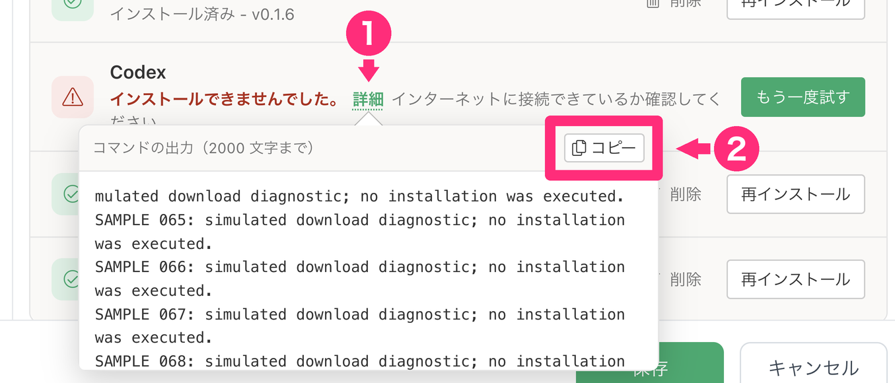

# プラグインのインストール

インストールすると、AI ツールから Exploratory Desktop を使えるようになります。Exploratory Desktop のシステム設定から、Desktop MCP のプラグインを、このコンピューターの AI ツールにインストールします。
所要時間は 5 分ほどです。同じコンピューターに、Exploratory Desktop と、プラグインを入れる AI ツール（Claude Code、Codex、Antigravity、Cursor のいずれか）を用意してください。

AI ツールごとに別の手順はありません。Claude Code、Codex、Antigravity、Cursor は、同じカードから入れられます。

<a id="steps"></a>

## インストールする

### システム設定でインストールする

Exploratory Desktop で、画面の左下にある自分の名前を選び、開いたメニューで「システム設定」を選びます（写真の ① と ②）。


1. 左のメニューで、「MCP / CLI」を選びます。
2. 「Exploratory Desktop プラグインのインストール」のカードを確かめます。
3. 使う AI ツールの行の「インストール」を選びます。


カードの説明は次のとおりです。

> Desktop MCP のプラグインを、このPC上の AI ツールにインストールします。インストールしたあとは、その AI ツールを起動し直してください。

カードには、Claude Code、Codex、Antigravity、Cursor が並びます。このコンピューターにない AI ツールには、「このパソコンに見つかりません」と表示されます。コマンドは、アプリの起動時に自動で入ります。コマンドを登録する操作は要りません。

続けて、同じ画面で、次の操作をします。

4. 「MCP」のスイッチをオンにします。初期状態ではオフです。
5. チャートやノートなどを AI に作成・変更させるときだけ、「作成、変更、削除を許可する」にチェックを入れます。チェックがないと、AI は読み取りだけができます。
6. 画面の下にある「保存」を選びます。

保存しないと、「MCP」のスイッチと「作成、変更、削除を許可する」の設定が反映されません。

### AI ツールで確かめる

1. インストールが終わったら、その AI ツールを起動し直します。
2. AI ツールが初めて接続すると、Desktop が許可するかどうかを聞きます。自分で起動したアプリだけ許可してください。
3. Exploratory Desktop で、使うプロジェクトを開きます。
4. AI ツールで、次のように頼みます。

   ```text
   開いている Exploratory のプロジェクトのデータフレームを一覧して
   ```

   これは、読み取りだけの設定でも動きます。作成も試すときは、「作成、変更、削除を許可する」をオンにして保存してから、自分のデータの列を使った棒グラフなど、チャートを作るように頼みます。

5. 接続を確かめます。
   - Claude Code では、`/mcp` を開いて、exploratory-desktop が接続されていることを確認します。
   - Codex では、`codex mcp list` を実行して、exploratory-desktop が並んでいることを確認します。

MCP がオフだと表示されたときは、システム設定に戻り、「MCP」のスイッチをオンにして「保存」を選んだかを確かめます。

<a id="differences"></a>

## AI ツールごとの違い

カードの操作は同じですが、入るものが少し違います。

| AI ツール | カードで入るもの | カードの表示 |
| --- | --- | --- |
| Claude Code | Exploratory Desktop のプラグイン（スキルを含む） | 「インストール済み - v」とプラグインのバージョン。「インストール」の代わりに「再インストール」と「削除」 |
| Codex | 同上 | 同上 |
| Antigravity | 同上 | 同上 |
| Cursor | ~/.cursor/mcp.json に exploratory-mcp を登録するだけです。スキルは入りません | 「インストール済み」だけで、バージョンは表示されません。ボタンは「再インストール」と「削除」 |

どの AI ツールも、インストールのあとに起動し直します。

カードのボタンは、状態によって変わります。

| 状態 | 表示とボタン |
| --- | --- |
| インストールしていない | 「未インストール」と、緑の「インストール」 |
| インストール済み | 「インストール済み」と、「再インストール」「削除」 |

「削除」を選ぶと、確認の画面が出ます。

<a id="failure"></a>

## インストールに失敗したとき

失敗すると、その AI ツールの行の 2 行目に、赤い文字で「インストールできませんでした。」と表示されます。すぐ右に「詳細」、その後ろに理由の文（例:「インターネットに接続できているか確認してください。」）、行の右に「もう一度試す」のボタンが出ます。インストール済みのプラグインの更新に失敗したときは、その右に「削除」のボタンも出ます。

「詳細」にマウスを載せると、実行したコマンドの出力が、吹き出しで表示されます。出力は、末尾の 2000 文字までです。長いときは、吹き出しの中を縦にスクロールできます。吹き出しの中にマウスを移しても消えません。「詳細」をクリックすると、開いたままになります。右上の「コピー」で、出力をコピーできます。

画像は、インストール済みのプラグインの更新に失敗したときの、エラーの詳細の表示例です。吹き出しに出ているコマンドの出力は、サンプルで、実際の出力とは異なります。

1. 「詳細」にマウスを載せます。
2. 右上の「コピー」を選びます。



理由の文を読んでも直せないときは、コピーした出力を添えて、サポートに問い合わせてください。直ったら、「もう一度試す」を選びます。

<a id="manual"></a>

## 手作業でインストールする

カードを使わないときの手順です。このプラグインは、公式のプラグイン一覧にはありません。リポジトリ exploratory-io/exploratory をマーケットプレイスとして足してから、プラグイン exploratory を入れます。コマンドは、ご自身でターミナルに打つか、AI ツールに頼んで実行してもらってください。

**Claude Code**

```sh
claude plugin marketplace add exploratory-io/exploratory
claude plugin install exploratory@exploratory
```

Claude Code で /plugin を開き、マーケットプレイス exploratory-io/exploratory を足して、exploratory を選んでも入れられます。

Claude アプリでは、設定 \> プラグインを開き、追加（Add marketplace）\> リポジトリから を選んで、exploratory-io/exploratory を入力し、exploratory を入れます。ターミナルで入れたプラグインも、そこに「ローカルにインストール済み」と表示されます。ローカルの MCP は、Cowork（このコンピューター上で動かしているとき）と Code タブで使えます。通常のチャットでは使えません。

**Codex**

```sh
codex plugin marketplace add exploratory-io/exploratory
codex plugin add exploratory@exploratory
```

**Antigravity**

```sh
git clone https://github.com/exploratory-io/exploratory
agy plugin install ./exploratory/plugins/exploratory-desktop
```

Git が必要です。プラグインは、Antigravity のアプリの Customizations \> Installed に表示されます。

**Cursor**

次の `exploratory-desktop` の項目を ~/.cursor/mcp.json に追加します。ファイルにすでに `mcpServers` がある場合は、その中に `exploratory-desktop` の項目だけを追加し、ほかのサーバーの設定は残します。以下は、新しいファイルを作る場合の全体の例です。スキルなしで Desktop の MCP が入ります。カードが書くのと同じ内容です。

```json
{
  "mcpServers": {
    "exploratory-desktop": {
      "command": "exploratory-mcp"
    }
  }
}
```

スキルも使うときは、Cursor の CLI でプラグインのフォルダを読み込みます（Exploratory のセットアップ案内が Cursor 向けに示す手順です）。

```sh
git clone https://github.com/exploratory-io/exploratory
agent --plugin-dir ./exploratory/plugins/exploratory-desktop
```

<a id="update"></a>

## 更新と削除

入れ方によって、操作が違います。

- カードで入れたもの（Claude Code、Codex、Antigravity、Cursor）: カードの「再インストール」で、最新のプラグインに入れ直します（更新も、この操作で行います）。外すときは、同じカードの「削除」を選びます。Cursor も、カードで入れたものは、カードの「削除」で外せます。
- 手作業で入れたもの: 次の表のコマンドで、更新と削除をします。

| AI ツール | 更新 | 削除 |
| --- | --- | --- |
| Claude Code | claude plugin marketplace update exploratory を実行し、続けて claude plugin update exploratory@exploratory を実行して、Claude Code を起動し直します | claude plugin uninstall exploratory@exploratory |
| Codex | codex plugin marketplace upgrade exploratory を実行し、続けて codex plugin remove exploratory@exploratory と codex plugin add exploratory@exploratory を実行します | codex plugin remove exploratory@exploratory |
| Antigravity | クローンしたフォルダで git pull を実行し、もう一度 agy plugin install を実行します | Antigravity のプラグインの設定で、プラグインを削除します |
| Cursor（agent --plugin-dir で読み込んだとき） | クローンしたフォルダで git pull を実行し、もう一度 agent --plugin-dir で起動します | --plugin-dir を使わないようにします |
| Cursor（~/.cursor/mcp.json を手で書いたとき） | 内容を書き直します | ~/.cursor/mcp.json から exploratory-desktop を消します |

Desktop の MCP は、Exploratory Desktop を終了すると止まります。プラグインを削除しても、Server の MCP の接続には影響しません。

<a id="trouble"></a>

## うまくいかないとき

[トラブルシューティング](troubleshooting_ja.md) を参照してください。
