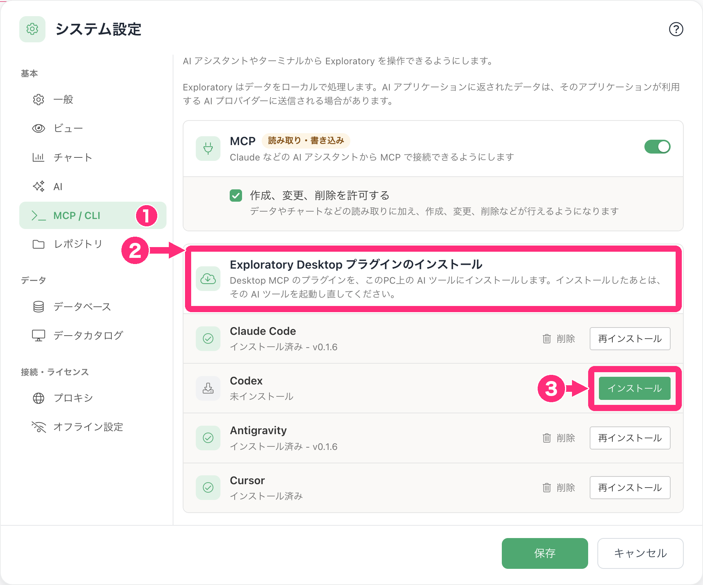

# プラグインのインストール

Exploratory Desktop のシステム設定から、Desktop MCP のプラグインを、このコンピューターの AI ツールにインストールします。AI ツールごとに別の手順はありません。Claude Code、Codex、Antigravity、Cursor は、同じカードから入れられます。

<a id="steps"></a>

## インストールする

### 1. システム設定を開く

Exploratory Desktop で、システム設定を開き、「MCP / CLI」を選びます。

### 2. MCP をオンにする

「MCP」のスイッチをオンにします。初期状態ではオフです。

### 3. 書き込みを許可する（AI にチャートやノートを作らせるとき）

チャートやノートなどを AI に作成・変更させるときだけ、「作成、変更、削除を許可する」にチェックを入れます。チェックがないと、AI は読み取りだけができます。

### 4. プラグインをインストールする

同じタブの「Exploratory Desktop プラグインのインストール」のカードで、使う AI ツールの「インストール」を選びます。カードの説明は次のとおりです。

> Desktop MCP のプラグインを、このPC上の AI ツールにインストールします。インストールしたあとは、その AI ツールを起動し直してください。

カードには、Claude Code、Codex、Antigravity、Cursor が並びます。このコンピューターにない AI ツールには、「このパソコンに見つかりません」と表示されます。コマンドは、アプリの起動時に自動で入ります。コマンドを登録する操作は要りません。



画像の 1 は手順 1 で選ぶ左のメニューの「MCP / CLI」、2 は手順 4 の「Exploratory Desktop プラグインのインストール」のカード、3 は Codex の行の「インストール」です。

### 5. 設定を保存する

システム設定の下にある「保存」を選びます。保存しないと、手順 2 と手順 3 の設定が反映されません。

### 6. AI ツールを起動し直す

インストールが終わったら、その AI ツールを起動し直します。

### 7. 接続を許可する

AI ツールが初めて接続すると、Desktop が許可するかどうかを聞きます。自分で起動したアプリだけ許可してください。

### 8. プロジェクトを開く

Exploratory Desktop で、使うプロジェクトを開きます。

### 9. AI に頼んで試す

AI ツールで、次のように頼みます。

```text
開いている Exploratory のプロジェクトで、売上データから月別の棒グラフを作って
```

### 10. 接続を確かめる

Claude Code では、/mcp を開いて、exploratory-desktop が接続されていることを確認します。Codex では、codex mcp list を実行して、exploratory-desktop が並んでいることを確認します。MCP がオフだと表示されたときは、手順 2 と手順 5 に戻り、スイッチをオンにして「保存」を選んだかを確かめます。

<a id="differences"></a>

## AI ツールごとの違い

カードの操作は同じですが、入るものが少し違います。

| AI ツール | カードで入るもの | カードの表示 |
| --- | --- | --- |
| Claude Code | Exploratory Desktop のプラグイン（スキルを含む） | 「インストール済み - v」とプラグインのバージョン。「インストール」の代わりに「再インストール」と「削除」 |
| Codex | 同上 | 同上 |
| Antigravity | 同上 | 同上 |
| Cursor | ~/.cursor/mcp.json に exploratory-mcp を登録するだけです。スキルは入りません | 「インストール済み」だけで、バージョンは表示されません。ボタンは「再インストール」と「削除」 |

どの AI ツールも、インストールのあとに起動し直します。

カードのボタンは、状態によって変わります。

| 状態 | 表示とボタン |
| --- | --- |
| インストールしていない | 「未インストール」と、緑の「インストール」 |
| インストール済み | 「インストール済み」と、「削除」「再インストール」 |

「削除」を選ぶと、確認の画面が出ます。

<a id="manual"></a>

## 手作業でインストールする

カードを使わないときの手順です。このプラグインは、公式のプラグイン一覧にはありません。リポジトリ exploratory-io/exploratory をマーケットプレイスとして足してから、プラグイン exploratory を入れます。コマンドは、ご自身でターミナルに打ってください。AI ツールに実行させるのは避けてください。権限の設定によっては止められます。

**Claude Code**

```sh
claude plugin marketplace add exploratory-io/exploratory
claude plugin install exploratory@exploratory
```

Claude Code で /plugin を開き、マーケットプレイス exploratory-io/exploratory を足して、exploratory を選んでも入れられます。

Claude アプリでは、設定 \> プラグインを開き、追加（Add marketplace）\> リポジトリから を選んで、exploratory-io/exploratory を入力し、exploratory を入れます。ターミナルで入れたプラグインも、そこに「ローカルにインストール済み」と表示されます。ローカルの MCP は、Cowork（このコンピューター上で動かしているとき）と Code タブで使えます。通常のチャットでは使えません。

**Codex**

```sh
codex plugin marketplace add exploratory-io/exploratory
codex plugin add exploratory@exploratory
```

**Antigravity**

```sh
git clone https://github.com/exploratory-io/exploratory
agy plugin install ./exploratory/plugins/exploratory-desktop
```

Git が必要です。プラグインは、Antigravity のアプリの Customizations \> Installed に表示されます。

**Cursor**

次の内容を ~/.cursor/mcp.json に追加します。スキルなしで Desktop の MCP が入ります。カードが書くのと同じ内容です。

```json
{
  "mcpServers": {
    "exploratory-desktop": {
      "command": "exploratory-mcp"
    }
  }
}
```

Cursor には、~/.claude から取り込んだ Claude Code のプラグインも表示されます。その場合は、先に Claude Code でプラグインを入れ、Cursor の設定で「Include Third-Party Plugins, Skills, and Other Configs」をオンにします。

<a id="update"></a>

## 更新と削除

入れ方によって、操作が違います。

- カードで入れたもの（Claude Code、Codex、Antigravity、Cursor）: カードの「再インストール」で、最新のプラグインに入れ直します（更新も、この操作で行います）。外すときは、同じカードの「削除」を選びます。Cursor も、カードで入れたものは、カードの「削除」で外せます。
- 手作業で入れたもの: 次の表のコマンドで、更新と削除をします。

| AI ツール | 更新 | 削除 |
| --- | --- | --- |
| Claude Code | claude plugin marketplace update exploratory を実行し、続けて claude plugin update exploratory@exploratory を実行して、Claude Code を起動し直します | claude plugin uninstall exploratory@exploratory |
| Codex | codex plugin marketplace upgrade exploratory を実行し、続けて codex plugin remove exploratory@exploratory と codex plugin add exploratory@exploratory を実行します | codex plugin remove exploratory@exploratory |
| Antigravity | クローンしたフォルダで git pull を実行し、もう一度 agy plugin install を実行します | Antigravity のプラグインの設定で、プラグインを削除します |
| Cursor（~/.cursor/mcp.json を手で書いたとき） | 内容を書き直します | ~/.cursor/mcp.json から exploratory-desktop を消します |
| Cursor（Claude Code から取り込んだプラグイン） | Claude Code でプラグインを更新します（Cursor は ~/.claude から取り込みます） | Claude Code でアンインストールします |

Desktop の MCP は、Exploratory Desktop を終了すると止まります。プラグインを削除しても、Server の MCP の接続には影響しません。

<a id="trouble"></a>

## うまくいかないとき

[トラブルシューティング](troubleshooting_ja.md) を参照してください。
