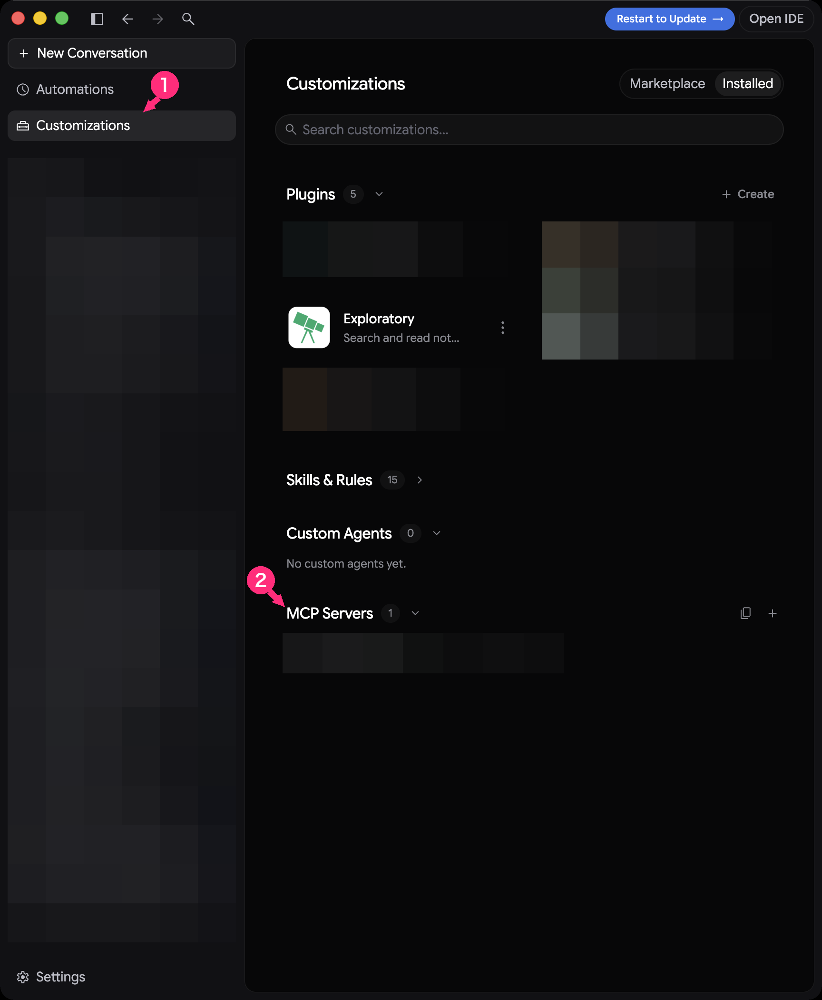
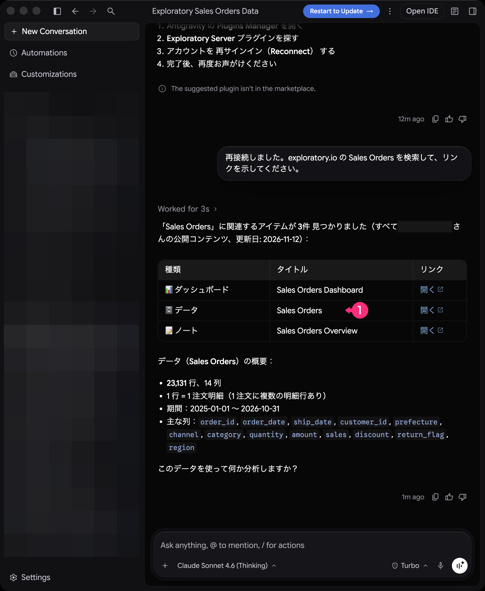
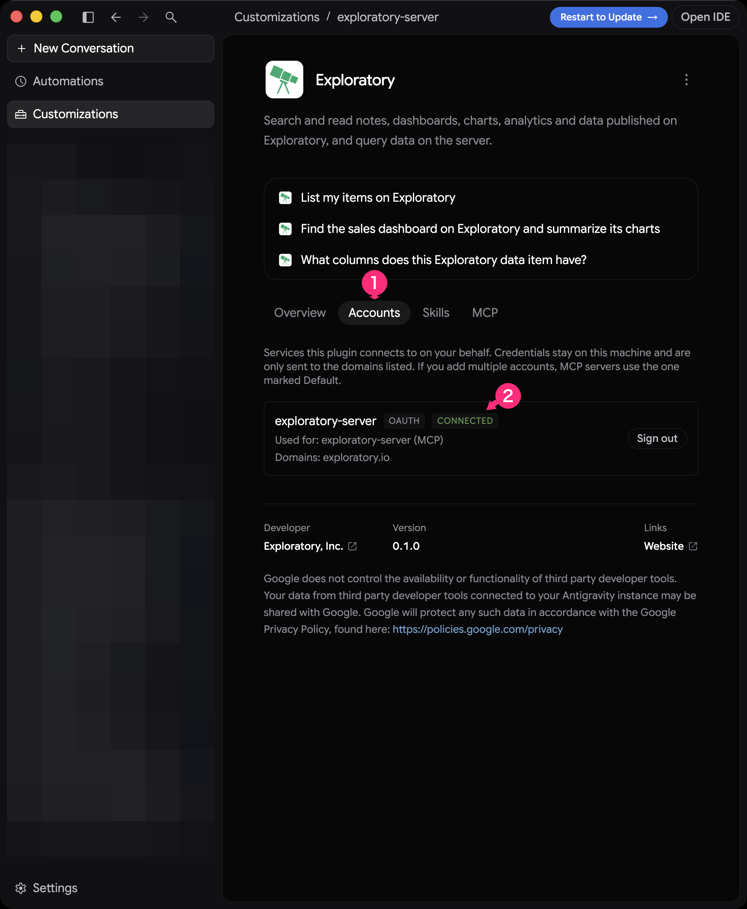
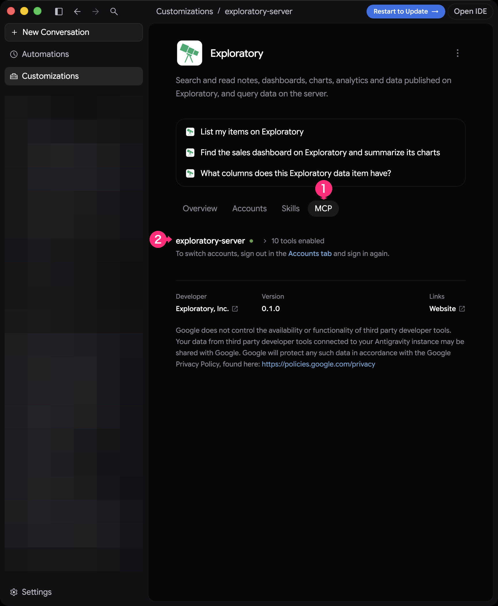

# Connect Antigravity

After you connect, an AI can read notes and data published on Exploratory. You register the Exploratory server in Antigravity and sign in through your browser.
It takes about 10 minutes. You need an Exploratory account and Antigravity.

<a id="need"></a>

## Requirements

- An Exploratory account
- Antigravity
- You do not need an API key or a client ID.

<a id="steps"></a>

## Steps

### Copy the config file path

1. In the Antigravity app, select Customizations in the sidebar.
2. In the MCP Servers header, select Copy Config File Path. The location of the config file (mcp_config.json) is copied.



Check that Installed is selected at the top of the screen.

### Register the server

A remote server takes its URL in "serverUrl".

1. Open mcp_config.json and add the following.

   **mcp_config.json**

   ```text
   {
     "mcpServers": {
       "exploratory-server": {
         "serverUrl": "https://exploratory.io/mcp"
       }
     }
   }
   ```

To use the agy command line, write the same content in ~/.gemini/config/mcp_config.json.

### Start the sign-in in the app

1. Under MCP Servers, select Authenticate next to exploratory-server.

### Approve the access in the browser

1. When your browser opens, sign in to Exploratory.
2. On Exploratory's consent page, approve the access.
3. Copy the authorization code shown in the browser.

### Paste the authorization code into the app

1. Paste the authorization code into the Enter authorization code field.
2. Select Submit.

The server reconnects automatically. A server you have signed in to shows a Sign out button.

### Start the sign-in in agy

To use agy, follow these steps.

1. Start agy.
2. Run `/plugin`.
3. Open the exploratory-server connection (the Desktop plugin exploratory is separate).
4. Choose Sign in.

### Approve the access in the browser for agy

1. Approve on Exploratory's consent page.
2. Copy the authorization code shown in the browser.

### Paste the authorization code into agy

1. Paste the authorization code you copied from the browser into agy.

### Try it

1. In a new chat, send this.

   ```text
   Find the "Sales Orders" data on Exploratory.
   ```

### Check the result

1. Check the Sales Orders data in the table of search results.



If the Sales Orders data appears with its URL, the connection works.

<a id="plugin"></a>

## Check the connection when you installed the plugin

If you installed the Exploratory plugin, open Exploratory under Plugins in Customizations to check the connection.

### Check the Accounts tab

1. Select the Accounts tab.
2. Check the CONNECTED label of exploratory-server.



When exploratory-server shows OAUTH and CONNECTED, it is connected.

### Check the MCP tab

1. Select the MCP tab.
2. Check the exploratory-server row.



The tab shows exploratory-server and the number of tools it provides (for example "10 tools enabled").

<a id="trouble"></a>

## Troubleshooting

| What you see | What to do |
| --- | --- |
| You are asked to sign in | Go through the sign-in steps above again. |
| You installed the Desktop plugin but the Server tools do not appear | The Desktop plugin exploratory is separate from Server. Register Server with the configuration above. |

- [Troubleshooting](../troubleshooting.md) - Fixes by symptom for the MCP Server as a whole.

<a id="remove"></a>

## Disconnect

In the app, select More actions (⋮) next to exploratory-server and choose Delete. To pause it only, choose Disable. You can also disconnect by deleting the exploratory-server entry you added to mcp_config.json.

Removing the registration does not revoke the access you approved. To revoke it, also remove the client under Connected AI Apps in your account settings on exploratory.io.
