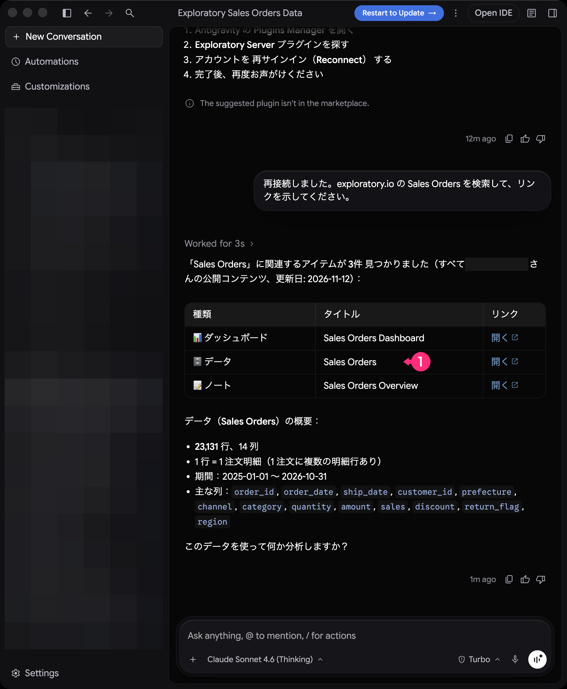
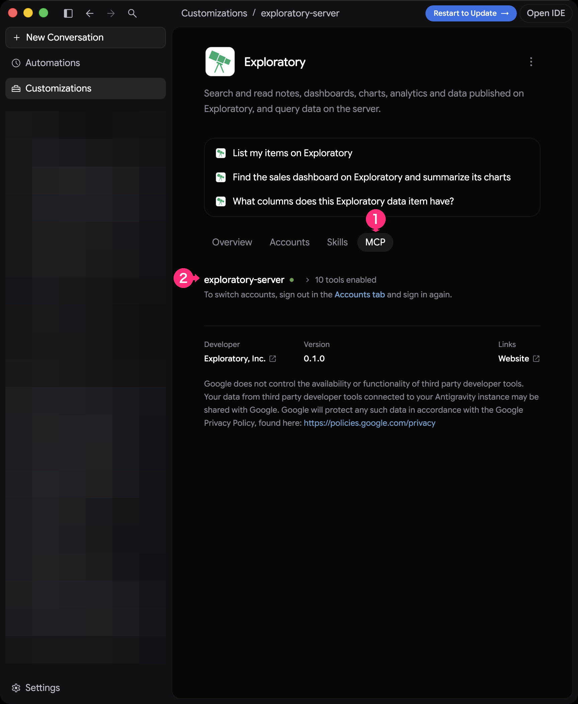

# Antigravity につなぐ

Antigravity に Exploratory のサーバーを登録し、ブラウザでサインインします。

<a id="need"></a>

## 必要なもの

- Exploratory のアカウント
- Antigravity
- API キーとクライアント ID は必要ありません。

<a id="steps"></a>

## 手順

### 1. 「Customizations」を選ぶ

Antigravity のアプリで、サイドバーの「Customizations」を選びます。

### 2. 「Installed」を選ぶ

「Installed」を選びます。

### 3. 設定ファイルの場所をコピーする

「MCP Servers」の見出しにある「Copy Config File Path」を選ぶと、設定ファイル（mcp_config.json）の場所をコピーできます。


画像の 1 は手順 1 の「Customizations」、2 は手順 3 の「MCP Servers」の見出しです。この画像は、英語の画面です。

### 4. サーバーを登録する

mcp_config.json を開き、次の内容を書き足します。リモートのサーバーは、「serverUrl」に URL を書きます。

**mcp_config.json**

```text
{
  "mcpServers": {
    "exploratory-server": {
      "serverUrl": "https://exploratory.io/mcp"
    }
  }
}
```

コマンドラインの agy で使うときは、~/.gemini/config/mcp_config.json に、同じ内容を書きます。

### 5. 「Authenticate」を選ぶ

「MCP Servers」で、exploratory-server の横にある「Authenticate」を選びます。

### 6. ブラウザでサインインする

ブラウザが開きます。Exploratory にサインインします。

### 7. アクセスを許可する

Exploratory の同意画面で、アクセスを許可します。

### 8. 認可コードをコピーする

ブラウザに表示された認可コードをコピーします。

### 9. 認可コードを貼り付ける

「Enter authorization code」の欄に、認可コードを貼り付けます。

### 10. 「Submit」を選ぶ

「Submit」を選びます。

サーバーは、自動でつなぎ直されます。サインインできたサーバーには、「Sign out」のボタンが表示されます。

agy で使うときは、次の順で行います。

| 順 | 操作 |
| --- | --- |
| 1 | agy を起動します。 |
| 2 | /plugin を実行します。 |
| 3 | exploratory-server の接続を開きます（Desktop プラグインの exploratory とは別です）。 |
| 4 | Sign in を選びます。 |
| 5 | Exploratory の同意画面で許可します。 |
| 6 | ブラウザに表示された認可コードを、agy に貼り付けます。 |

### 11. 試す

新しいチャットで、次のように送信します。

```text
Exploratory にある「Sales Orders」のデータを探して
```

Sales Orders のデータが URL つきで表示されれば、接続できています。



画像の 1 は、検索結果の表の「Sales Orders」のデータです。この画像は、英語の画面です。

<a id="plugin"></a>

## プラグインでインストールした場合の確かめ方

Exploratory のプラグインをインストールしたときは、「Customizations」の「Plugins」で「Exploratory」を開くと、接続の状態を確かめられます。「Accounts」のタブに、exploratory-server が「OAUTH」「CONNECTED」と表示されます。「MCP」のタブには、exploratory-server と、使えるツールの数（例: 「10 tools enabled」）が表示されます。


画像の 1 は「Accounts」のタブ、2 は「CONNECTED」の表示です。この画像は、英語の画面です。



画像の 1 は「MCP」のタブ、2 は exploratory-server の行です。この画像は、英語の画面です。

<a id="trouble"></a>

## トラブルシューティング

| 表示される内容 | 対処 |
| --- | --- |
| サインインを求められる | 上のサインインの手順を、もう一度行います。 |
| Desktop のプラグインをインストールしたが、Server のツールが表示されない | Desktop のプラグイン exploratory は、Server とは別です。上の設定で、Server を登録します。 |

- [トラブルシューティング](../troubleshooting_ja.md) - MCP Server 全体の、症状ごとの対処です。

<a id="remove"></a>

## 接続を解除する

アプリでは、exploratory-server の横の「More actions」（⋮）を選び、「Delete」を選びます。一時的に止めるだけなら、「Disable」を選びます。mcp_config.json に追加した exploratory-server の部分を削除しても、解除できます。

登録を解除しても、アクセスの許可は残ります。許可も取り消すには、exploratory.io のアカウント設定の「接続中のAIアプリ」から、クライアントを解除します。
