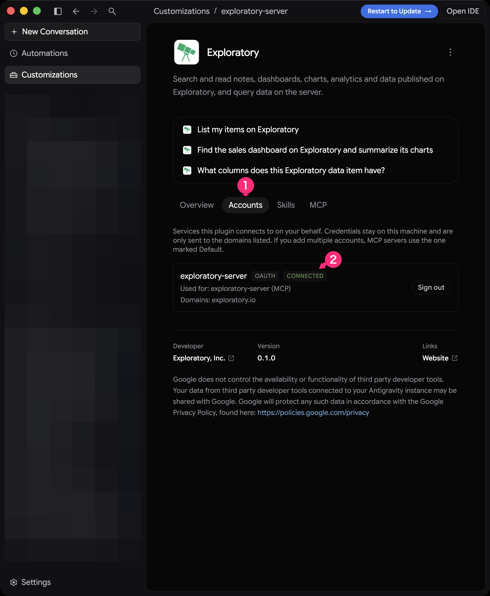

# Antigravity につなぐ

接続すると、AI から Exploratory に公開されたノートやデータを読めるようになります。Antigravity に Exploratory のサーバーを登録し、ブラウザでサインインします。
かかる時間は 10 分ほどです。Exploratory のアカウントと、Antigravity を用意してください。

<a id="need"></a>

## 必要なもの

- Exploratory のアカウント
- Antigravity
- API キーとクライアント ID は必要ありません。

<a id="steps"></a>

## 手順

### 設定ファイルの場所をコピーする

1. Antigravity のアプリで、サイドバーの「Customizations」を選びます。
2. 「MCP Servers」の見出しにある「Copy Config File Path」を選びます。設定ファイル（mcp_config.json）の場所がコピーされます。


画面の上の「Installed」が選ばれていることを確かめてください。

### サーバーを登録する

リモートのサーバーは、「serverUrl」に URL を書きます。

1. mcp_config.json を開きます。
2. 次の内容を書き足します。

   ```text
   {
     "mcpServers": {
       "exploratory-server": {
         "serverUrl": "https://exploratory.io/mcp"
       }
     }
   }
   ```

コマンドラインの agy で使うときは、~/.gemini/config/mcp_config.json に、同じ内容を書きます。

### アプリでサインインする

1. 「MCP Servers」で、exploratory-server の横にある「Authenticate」を選びます。
2. ブラウザが開いたら、Exploratory にサインインします。
3. Exploratory の同意画面で、アクセスを許可します。
4. ブラウザに表示された認可コードをコピーします。
5. Antigravity に戻り、「Enter authorization code」の欄に、認可コードを貼り付けます。
6. 「Submit」を選びます。

サーバーは、自動でつなぎ直されます。サインインできたサーバーには、「Sign out」のボタンが表示されます。

### agy でサインインする

コマンドラインの agy で使うときは、次の順で行います。

1. agy を起動します。
2. `/plugin` を実行します。
3. exploratory-server の接続を開きます（Desktop プラグインの exploratory とは別です）。
4. 「Sign in」を選びます。
5. ブラウザで、Exploratory の同意画面で許可します。
6. ブラウザに表示された認可コードをコピーします。
7. agy に戻り、認可コードを貼り付けます。

### 試す

1. 新しいチャットで、次のように送信します。

   ```text
   Exploratory にある「Sales Orders」のデータを探して
   ```

続けて、結果を確かめます。

1. 検索結果の表にある「Sales Orders」のデータを確かめます。


Sales Orders のデータが URL つきで表示されれば、接続できています。

<a id="plugin"></a>

## プラグインでインストールした場合の確かめ方

Exploratory のプラグインをインストールしたときは、「Customizations」の「Plugins」で「Exploratory」を開くと、接続の状態を確かめられます。

次の 2 つの画面で確かめられます。

1. 「Accounts」のタブを選びます。
2. exploratory-server の「CONNECTED」の表示を確かめます。



exploratory-server が「OAUTH」「CONNECTED」と表示されていれば、接続できています。

続けて、「MCP」のタブを確かめます。

1. 「MCP」のタブを選びます。
2. exploratory-server の行を確かめます。


exploratory-server と、使えるツールの数（例: 「10 tools enabled」）が表示されます。

<a id="trouble"></a>

## トラブルシューティング

| 表示される内容 | 対処 |
| --- | --- |
| サインインを求められる | 上のサインインの手順を、もう一度行います。 |
| Desktop のプラグインをインストールしたが、Server のツールが表示されない | Desktop のプラグイン exploratory は、Server とは別です。上の設定で、Server を登録します。 |

- [トラブルシューティング](../troubleshooting_ja.md) - MCP Server 全体の、症状ごとの対処です。

<a id="remove"></a>

## 接続を解除する

アプリでは、exploratory-server の横の「More actions」（⋮）を選び、「Delete」を選びます。一時的に止めるだけなら、「Disable」を選びます。mcp_config.json に追加した exploratory-server の部分を削除しても、解除できます。

登録を解除しても、アクセスの許可は残ります。許可も取り消すには、exploratory.io のアカウント設定の「接続中のAIアプリ」から、クライアントを解除します。
